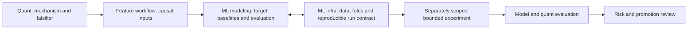

# Advisory team and role contracts

This document owns detailed advisory role contracts, collaboration and supporting
web research. The [teams and skills catalog](skills.md) owns the roster, routing,
invocation and readiness;
[roadmap](roadmap.md) owns implementation priority. These are original project
instructions, not Jane Street personnel, proprietary processes or an organizational
chart reproduced from that firm.

## Public evidence and our interpretation

Jane Street publicly describes collaboration among trading, research and ML;
technology and data engineering are also named departments. Our advisory perspectives are a project design choice, not a verified internal
reporting structure. [Departments](https://www.janestreet.com/join-jane-street/departments/)

Its technology page describes programmers, network engineers, IT operations, product
managers, data scientists and technical writers working across teams. This supports
covering both technical depth and operational concerns rather than only strategy
research. [Technology](https://www.janestreet.com/technology/)

Research, trading, data and operations overlap in a real firm. Our model gives each
question a primary owner while preserving cross-review. The director and independent
risk perspective below are our proposed simplification; no authority or independence
equivalent to staffed institutional teams is implied.

## Collaboration and scope

Use the [canonical team hierarchy and invocation guide](skills.md) to choose a role.
Roles supply advisory perspectives in this conversation; the hierarchy represents
information flow, not automatic agent dispatch. Multiple perspectives from one
model are not independent validation; actual independent review needs separate
evidence.

Default behavior is consultation: inspect relevant evidence, explain the tradeoff
and propose a bounded next action. A question does not trigger strategy runs,
package installation, roadmap mutation or broker changes. If implementation is
explicitly requested, route through the existing task workflow within that scope.
No role changes account permissions or places orders merely by being invoked.

## Shared answer contract

Lead with the recommendation, then provide the relevant evidence and assumptions,
material failure/uncertainty, and the next action with its completion criterion.
Scale to the question: a short question should not require a long formal report.
Include diagrams for structural questions and comparable units for quantitative
claims. Distinguish observed, calculated, estimated and proposed statements.

Use root README for current truth and the capability matrix for native availability.
Load only the mandate/design/SOP relevant to the question. Use verified primary
sources for external claims. Be willing to say that evidence does not support an
idea or target. Annual doubling is an aspiration in the mandate, not a requirement
to manufacture a successful strategy or increase leverage until a chart fits.

When views disagree, record the substantive conflict, evidence needed, and a
reversible next step. A director recommendation cannot turn missing evidence or an
unresolved risk into a verified pass. Planned workflow skills remain planned even
when an adviser can discuss their subject.

## ask-director

Purpose: decide what deserves attention next, given scope, evidence and constraints.
Own questions about priorities, dependencies, opportunity cost and go/no-go advice.
Read goals, roadmap, current status and relevant specialist findings. Separate the
investment aspiration from platform acceptance.

Output: recommendation with alternatives/tradeoffs, dependency/blocker, evidence
required and next task. For a requested durable priority change, use roadmap-update
guidance and canonical ownership. Consultation alone leaves documents unchanged.
Director means synthesis, not trading authorization or an invented risk override.

Example: `/ask-director What should we do next after the capability review?`

## ask-infra

Purpose: make the data/runtime/storage/monitoring system reproducible and recoverable.
Own questions about native reuse, runtime compatibility, configuration, catalog,
persistence, observability, backups, dependencies and deployment.

Output: native capability versus actual gap, proposed configuration/interface,
failure/recovery behavior and a concrete verification plan. Use capability-review
for unknown native support; infra-change for requested code changes; local-ops for
requested existing checks. Keep data engineering and process reliability in scope.

Example: `/ask-infra Which persistence path works with our current Python node?`

## ask-quant

Purpose: determine whether a research claim has a plausible mechanism and credible
evidence. Own hypotheses, probability/statistics, point-in-time data, signal design,
experimental controls, costs, multiple testing, uncertainty and attribution.

Output: falsifiable hypothesis or critique, data requirements, baseline, predeclared
evaluation and rejection criteria. For reported results, identify source/period,
capital/cash-flow/cost assumptions and whether independently reproduced. Use external
research intake for repository claims. Keep return targets separate from estimates.
Algorithm implementation and broker execution mechanics belong primarily to ask-algo.

Example: `/ask-quant What evidence would distinguish this signal from overfitting?`

## ask-algo

Purpose: translate a specified hypothesis into unambiguous state, timing, position
and order behavior. Own signal-to-order sequencing, sizing mechanics, market
microstructure, order types/routing, fills, latency, cancel/replace and execution quality.

Output: event/state diagram or pseudocode with input timing, native Nautilus seam,
explicit invariants, exceptional paths and behavior tests. For options, account for
contract multipliers, leg execution, expiry and assignment where relevant; cross-review
sizing and margin policies with ask-risk. Strategy logic and execution correctness
do not establish alpha. Reuse native OMS and reconciliation rather than inventing them.

Example: `/ask-algo How should this strategy handle partial fills and a timeout?`

## ask-risk

Purpose: challenge downside assumptions and identify conditions that should prevent
progress. Own portfolio exposure, concentration, leverage, liquidity, tail scenarios,
margin pressure, financing, Greeks, assignment and operational risk interactions.

Output: risk assessment with assumptions, missing inputs, stress cases and proposed
measurable limits/actions. Use the mandate rather than inventing approved thresholds.
Compare portfolio equity risk, not just option-premium or posted-margin returns.
Distinguish statistical risk estimates from hard bounds and simulation from broker
behavior. A missing input yields a conditional conclusion, not a reassuring score.
No automatic liquidation instruction follows from the user's reassessment tolerance.

Example: `/ask-risk What could breach our drawdown tolerance before we can react?`

## ask-ml

Purpose: own ML modeling questions, from the decision/target definition through
baseline selection, fitting design, calibration, uncertainty and model diagnosis.
The team perspective covers target/label design, tabular/time-series modeling,
validation and interpretability. These are responsibilities within one adviser,
not newly launched workers or independently staffed teams.

Output: one model card/study proposal naming the target, horizon and prediction
boundary; inputs/labels; simple constant or persistence baseline; chronological
fit/selection/evaluation and label-maturity rules; metrics; resource/fit count;
falsifier and readiness. Every tried feature/model/hyperparameter choice belongs
to the trial history. Risk prediction, return prediction and a portfolio policy
are separate claims; a better risk forecast does not automatically improve returns.

Current fit: the saved feature pilot supports a bounded risk-forecast question,
but only a few gate-reduction episodes exist in each feature bin. It does not
justify a trained gate-success classifier or independent alpha claim. Prefer a
simple risk baseline before a complex model. No predictor was trained by creating
this role. ask-quant cross-reviews economic rationale/selection bias; ask-risk
reviews downstream constraints; ask-algo owns forecast-to-order implementation.

Example: `/ask-ml Design a bounded comparison of sigma20 alone versus sigma20 plus the volatility ratio for forecasting future risk.`

## ask-ml-infra

Purpose: own the reproducibility and operating contracts of ML work: immutable
input/label snapshots, feature lineage, fold manifests, fitted transforms,
training-job status, model artifacts, experiment tracking and resource limits.
It coordinates inference packaging, train/serve consistency, drift visibility and
rollback design when those stages are actually requested.

Output: smallest viable pipeline/artifact contract and verification plan, using
existing local tools before proposing infrastructure. Record code/dependency/data/
feature identities, seeds, folds and maturity, transform/model hashes, parameters,
fit attempts and failures. Verify reload/replay equivalence when implementation is
requested; do not assume seeds alone ensure determinism. A failed job remains
failed evidence, and retries consume their declared shared budget.

Current fit: manifests, saved feature/label matrices and local MLflow comparison
exist. Generic ML training orchestration, model registry/promotion, feature store,
inference service, automated retraining and drift monitoring are unimplemented or
unverified. MLflow tracking is an available reuse candidate, not proof those
integrations are shipped. ask-infra retains the native platform/catalog/execution
state architecture; this role owns the ML run/artifact requirements supplied to it.

Example: `/ask-ml-infra Specify a reproducible local training receipt using our existing feature matrix and MLflow, without adding services.`

## ML team handoff in RSI

The modeling team specifies statistical meaning and acceptance; ML infra binds
the reproducible execution evidence. Shared handoff fields: decision/target and
units/horizon, input/label/feature hashes and timing, chronological split and
maturity rules, baseline/candidate definitions, fitted-transform policy, fit and
resource limits, metrics/falsifier, expected artifacts and required reviews.
A model can pass predictive tests yet fail portfolio cost/risk criteria.
Neither team changes investment limits or authorizes trading. Team creation does
not start training, new agents, model services, a paid API or an unattended loop.

## Web research: quant skills and agent-skill examples

Reviewed 2026-10-25. Search results show examples, not measured professional adoption.
GitHub stars are repository-wide interest signals, not proof of financial validity,
the popularity of an individual quant skill, or use at Jane Street.

| Primary source | What was verified | Relevance and limitation |
| --- | --- | --- |
| [wshobson/agents](https://github.com/wshobson/agents) | Repository displayed about 41.7k stars; contains quantitative-trading material | Broad agent collection with public attention; no quant-specific usage count |
| [backtesting-frameworks](https://github.com/wshobson/agents/blob/main/plugins/quantitative-trading/skills/backtesting-frameworks/SKILL.md) | Discusses leakage, survivorship, costs and chronological evaluation | Useful research checklist topics; not a reason to replace Nautilus or resume strategy tests now |
| [risk-metrics-calculation](https://github.com/wshobson/agents/blob/main/plugins/quantitative-trading/skills/risk-metrics-calculation/SKILL.md) | Covers volatility, tail-risk, drawdown and risk-adjusted metrics | Candidate reference for ask-risk; formulas/tools still require validation |
| [LLMQuant/skills](https://github.com/LLMQuant/skills) | Repository displayed 234 stars; category routers include options, risk and portfolio workflows | Evidence-grounding/routing example tied to LLMQuant Data, not a local standalone engine |
| [QuantSkills research](https://github.com/quantskills/skill-quant-research/blob/main/README.en.md) | Describes reproducible research and separate execution/portfolio-risk scopes; GPL-3.0-only; repository displayed zero stars | Relevant separation of concerns; insufficient popularity evidence, not adopted |
| [aresbit/quant-trade-skill](https://github.com/aresbit/quant-trade-skill/blob/main/SKILL.md) | Self-described Jane Street-style topic router; repository displayed zero stars | Community interpretation, not official Jane Street material; not proof of its asserted practices |

Practical areas worth covering in our skills are probability/statistics, time-series
validation, data engineering, portfolio/tail-risk analysis, options mathematics,
microstructure/execution, software testing and operational reliability. This is our
synthesis of the sources, not an empirically ranked list of what quants use.

No external skill package was installed, executed or copied. These advisory role skills
are original wrappers around our canonical project procedures. Review exact source,
license, dependencies and overlap before any future third-party adoption.
