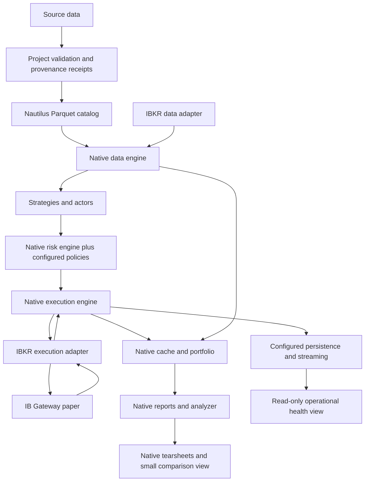

# Local platform architecture

This document owns module responsibilities, state authority and target structure.
Root [README](../README.md) owns shipped capability status;
[matrix](capabilities.md) owns upstream assessment; [roadmap](roadmap.md) owns sequence.
This target replaces the earlier custom-catalog/PostgreSQL-first architecture.

## Target flow



This is a responsibility map, not an exhaustive message sequence. Native message
bus/lifecycle link these modules. Project policy checks use the native trading path;
operators must not bypass the risk engine to submit broker orders. No execution
client or new persistence path has been configured in our observer.

## Reuse and extension responsibilities

| Module | Native responsibility | Project work where evidence shows a gap |
| --- | --- | --- |
| Catalog and ingestion | Typed market data, Parquet storage/query | Source rights, frozen input hashes, normalization identity, quality/calendar policies |
| Node configuration/lifecycle | Kernel, engines, actors/strategies, start/stop | Explicit mode/account/feed binding, config/dependency identity, process supervision |
| Runs/results | Native run/config IDs, results/statistics | Small artifact index and comparison eligibility checks; preserve native IDs |
| Execution | Orders, fills, positions, routing/reconciliation | Fault validation and procedures; no duplicate OMS |
| Risk and portfolio | Native validation, rate/notional limits, trading states, balances/PnL | Mandate-specific drawdown, leverage, concentration, feed and margin-buffer policies |
| Persistence | Current-node backing, streaming and component-state hooks | Select backend after restore proof; assess capture coverage before extending audit gaps |
| Analytics | Analyzer, reports, benchmark comparisons and tearsheets | Account/cash-flow/cost definitions and small cross-run selection view |
| Operator view | Native status/logging inputs | Read-only health/freshness/uncertainty and incident evidence |

The saved-result reporting slice now uses native precomputed-statistics HTML and
local MLflow in an isolated environment. MLflow-owned SQLite/artifacts track
historical experiments; they do not own broker/execution state. See the
[performance SOP](operations/performance.md) for the implemented path and
[decision 0003](decisions/0003-local-performance-browser.md) for its rationale.

The explicitly requested [leverage research model](../research/leverage-model.md)
uses a separate offline cash/share ledger with independent Decimal reconciliation.
It feeds the comparison renderer and a separate MLflow experiment. It does not
configure native margin execution or establish broker behavior.

## State authority and durability

Broker observations establish externally accepted orders, fills and account state.
Native engine/cache/portfolio maintain local working state. Reconciliation explains
discrepancies before resuming; a stale view cannot establish broker truth.

Catalog data represents normalized historical observations. Frozen source bytes
and provenance receipts identify what generated them; catalog files alone do not
establish immutability or provider licensing.

Our Python TradingNode kernel wires Redis or no backing for cache/message bus.
PostgreSQL classes elsewhere are not a drop-in configured backend on this path.
Streaming writes Feather files, separately from the historical Parquet catalog.
Component load/save, cache restoration, stream replay and durable event-store
capture differ in coverage and failure semantics.

Rust event-store documentation does not establish a configured journal in our
legacy node. Assess capture, durability, retention, failure signals and restore
before choosing journal implementation. PostgreSQL and DuckDB remain deferred
options; neither is the project-wide authority by decision at this stage.

## Required receipts and policies

- Data receipts identify source bytes, provider/instrument, coverage, timestamp
  convention/calendar, adjustments, transformation version and quality outcome.
- Run receipts preserve native IDs plus mode, inputs, effective configuration,
  code revision/dirty-file hashes, dependencies, status and artifact references.
- Audit extensions preserve native identities/correlation, distinguish intent from
  observed acknowledgment, and document gaps/ordering. Define extensions only after
  understanding native capture coverage.
- Comparisons flag differing dates, capital, cost/cash-flow policy, leverage and
  evidence quality; return on posted margin is not portfolio return.

These are later implementation requirements. The matrix distinguishes source
presence, imports and behavior proof. Existing historical evidence stays intact.

## Modes, controls and deployment

Project modes distinguish offline replay/simulation, paper observation, paper
execution and eventual live operation. Bind account/feed policy explicitly.
Native startup reconciliation defaults on; this does not verify connectivity or
establish that all continuous polling is configured.

Native HALTED/REDUCING controls are candidates to configure and verify. Pause new
submissions, cancel orders and close positions have separate effects. Stopping a
process is not cancellation. Query/reconcile unknown external outcomes before
retrying. Operational failure policies must be tested.

Use one concurrent node per process; parallel comparison workers use separate
processes. Keep current Python/Cython interfaces until a separate compatibility
decision justifies migration; Rust/PyO3 examples do not automatically apply.

## Repository structure

```text
README.md                     current capabilities and entrypoints
AGENTS.md                     instructions and conditional pointers
.agents/skills/               repeatable project workflows
docs/                         matrix, architecture, roadmap, SOPs and decisions
paper_trading/                existing IB observation implementation
research/                     preserved fixture and methodology
scripts/                      entrypoints, local checks, offline audit
tests/                        offline project behavior checks
reports/                      dated historical evidence
vendor/nautilus_trader/        ignored pinned upstream source
```

Add modules with their first concrete use. Keep native interfaces visible and
introduce adapters where behavior varies, such as fake versus IB communication.
No speculative database/migration package is needed for the native baseline.
