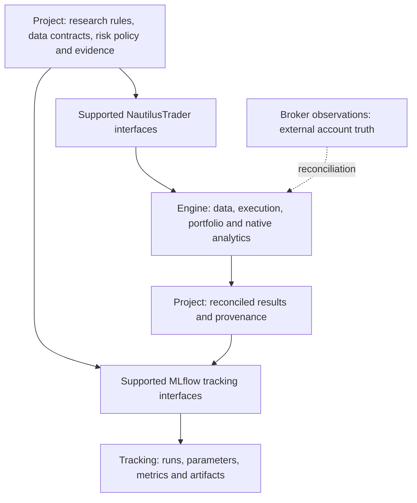
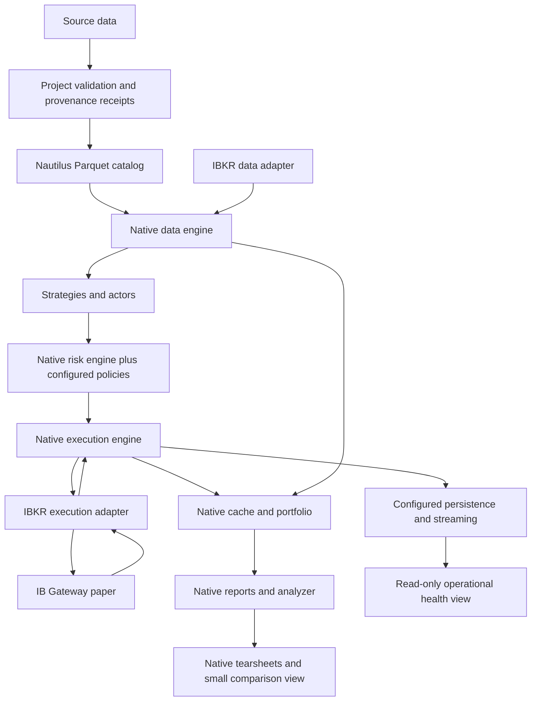
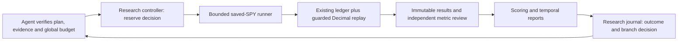
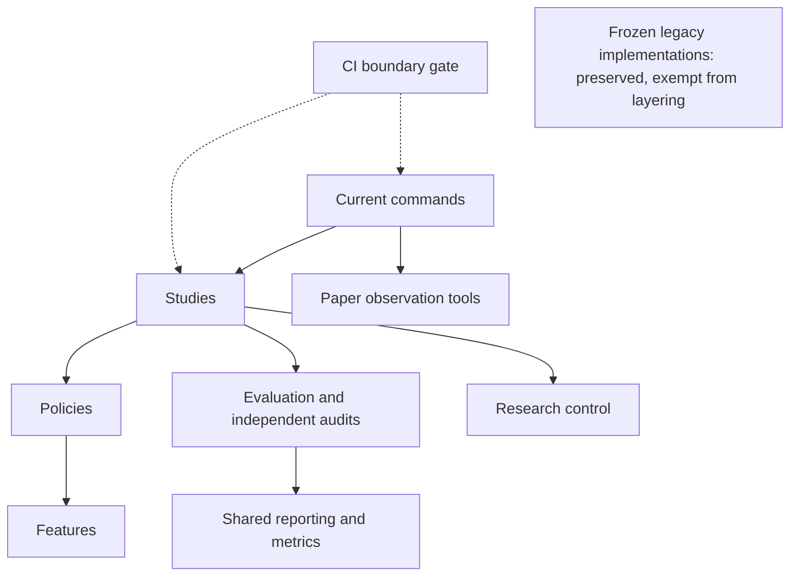

# Local platform architecture

This document owns module responsibilities, state authority and target structure.
Root [README](../README.md) owns shipped capability status;
[matrix](capabilities.md) owns upstream assessment; [roadmap](roadmap.md) owns sequence.
This target replaces the earlier custom-catalog/PostgreSQL-first architecture.

## Project and dependency boundaries

This section owns the division of responsibility between this repository,
NautilusTrader and MLflow, and the decision to configure, extend, upgrade or patch
upstream. It applies the existing [native-first decision](decisions/0002-native-capabilities-first.md)
and [reporting decision](decisions/0003-local-performance-browser.md); it does not
change their priorities or establish new implementation readiness.



These are ownership boundaries, not evidence that the live execution path is
configured. The [capability matrix](capabilities.md) records what is available,
configured and behavior-verified; root README owns current project status.

| Concern | What we build and own | What the dependency provides |
| --- | --- | --- |
| Strategy and research | Economic hypotheses, causal features, strategy rules, labels, trial budgets, chronological evaluation, costs and interpretation | NautilusTrader strategy/actor interfaces and simulation facilities; it does not select a profitable strategy for us |
| Data | Provider rights, frozen source snapshots, instrument/calendar/adjustment policy, quality gates and transformation provenance | NautilusTrader typed market data and native catalog/provider interfaces; source presence alone does not qualify our dataset |
| Trading runtime | Node configuration, adapters at project seams, account/mode policy, recovery tests and operational supervision | NautilusTrader engines, native order/execution routing, cache, portfolio and reconciliation facilities; configured support varies by adapter/runtime |
| Risk | Portfolio loss/leverage/concentration budgets, risk-gate logic and failure actions with explicit validation | NautilusTrader native order validation, limits and trading controls; these do not guarantee a drawdown ceiling |
| Financial results | Metric definitions, cash/dividend/financing assumptions, independent reconciliation and comparison eligibility | NautilusTrader analyzer/reports/tearsheets where compatible; MLflow records the values we supply rather than auditing their financial correctness |
| Experiment tracking | Importers, stable source/run fingerprints, tags, metric naming/units and links to preserved receipts | MLflow experiments/runs, parameter and metric logging, artifact storage APIs and browser comparison |
| Storage and operations | Select/configure storage, retain original evidence, test backups/restore, operate local services and protect credentials | Native persistence interfaces and MLflow-managed tracking stores; neither an interface nor a successful import proves recovery |
| CI and maintenance | Test our policies, adapters/importers, reports and integration against pinned versions; preserve failures | Upstream CI tests upstream code; their passing checks do not validate our application |

The offline research ledger is a declared, independently reconciled fixture. It
is not a second live order-management system or proof of native margin behavior.
We prefer native runtime/reporting capabilities before building replacements and
keep custom calculations when required by a documented financial contract.

State authority and durability are defined [below](#state-authority-and-durability).

### Configure, extend, upgrade or patch

Use the lowest-cost supported path that satisfies a concrete requirement:

| Choice | When to choose it | Required evidence before adoption |
| --- | --- | --- |
| Configure | The pinned release already supplies the required behavior | Effective configuration, an offline behavior check, failure/restore checks where relevant and a recorded readiness limit |
| Extend in this project | Project-specific strategy, policy, transform, report or importer fits a supported public interface | A small explicit interface/adapter, tests for timing/accounting/failure behavior and preserved upstream IDs; prefer public APIs over private internals |
| Upgrade a dependency | A supported newer release fixes the issue or exposes the needed capability | Release/API compatibility review, isolated environment, deliberate direct/lock updates, project regression/integration checks and rollback plan |
| Modify upstream source | A minimal reproduction shows a defect or missing core capability that configuration, supported extension and an acceptable upgrade cannot resolve | Separate fork/branch, pinned upstream base plus patch commit, regression test and license/attribution review; contribute upstream when appropriate |

Examples: implement a new strategy using NautilusTrader's strategy interface;
implement a new research score and log it through MLflow's tracking client; review
an upgrade if a needed supported API is absent; patch the engine or tracking server
only for a demonstrated defect that belongs there. Avoid replacing an entire
engine, tracker or database to solve a narrow missing integration.

A source patch is a maintained dependency: build/package it reproducibly, record
its provenance in run receipts, run the applicable upstream tests plus our
integration tests, and track an upstream issue/PR or an explicit local rationale.
Record the owner, removal/upgrade condition and rollback version. Ordinary checks
stay offline; broker validation requires its separately authorized SOP.

Installed files in `.venv` or `site-packages` are outputs, not an editable source
of truth. Keep project code here and upstream changes in a separately pinned
source fork/package. A reinstall must reproduce the same implementation. A
monkey-patch or private-API workaround needs the same explicit exception record,
regression tests and exit condition as an upstream patch.

### Version and artifact ownership

The direct requirements and frozen locks own installed versions; avoid copying
version numbers into competing policy lists. Keep the core engine and MLflow in
their existing separate environments, as documented in [local operations](operations/local.md)
and the [performance SOP](operations/performance.md). Updating one does not
implicitly authorize changing the other.

Track application code, configuration templates, setup/import scripts, dependency
locks and redacted audit receipts in Git. Generated environments, account secrets,
MLflow's local SQLite/server state and generated local artifacts stay outside Git
under the existing storage/ignore policies. A public repository is not permission
to publish credentials or datasets with unverified redistribution rights.

## Algorithm decision hierarchy

[GRS-1.0](research-standard.md#minimal-pipeline) owns the minimal position-proposal
and risk/sizing stages, one-change cycles, evidence and disposition rules.
This architecture owns module wiring and state boundaries. Optional market,
target or strategy-selection stages require their own qualified interfaces and
bounded evidence; a folder or diagram does not make a router operational.

## Target flow



This is a responsibility map, not an exhaustive message sequence. Native message
bus/lifecycle link these modules. Project policy checks use the native trading path;
operators must not bypass the risk engine to submit broker orders. No execution
client or new persistence path has been configured in our observer.

## Reuse and extension responsibilities

| Module | Native responsibility | Project work where evidence shows a gap |
| --- | --- | --- |
| Catalog and ingestion | Typed market data, Parquet storage/query | Source rights, frozen input hashes, normalization identity, quality/calendar policies |
| Node configuration/lifecycle | Kernel, engines, actors/strategies, start/stop | Explicit mode/account/feed binding, config/dependency identity, process supervision |
| Runs/results | Native run/config IDs, results/statistics | Small artifact index and comparison eligibility checks; preserve native IDs |
| Execution | Orders, fills, positions, routing/reconciliation | Fault validation and procedures; no duplicate OMS |
| Risk and portfolio | Native validation, rate/notional limits, trading states, balances/PnL | Mandate-specific drawdown, leverage, concentration, feed and margin-buffer policies |
| Persistence | Current-node backing, streaming and component-state hooks | Select backend after restore proof; assess capture coverage before extending audit gaps |
| Analytics | Analyzer, reports, benchmark comparisons and tearsheets | Account/cash-flow/cost definitions and small cross-run selection view |
| Operator view | Native status/logging inputs | Read-only health/freshness/uncertainty and incident evidence |

The saved-result reporting slice now uses native precomputed-statistics HTML and
local MLflow in an isolated environment. MLflow-owned SQLite/artifacts track
historical experiments; they do not own broker/execution state. See the
[performance SOP](operations/performance.md) for the implemented path and
[decision 0003](decisions/0003-local-performance-browser.md) for its rationale.

The explicitly requested [leverage research model](../research/leverage-model.md)
uses a separate offline cash/share ledger with independent Decimal reconciliation.
It feeds the comparison renderer and a separate MLflow experiment. It does not
configure native margin execution or establish broker behavior.

The [strategy catalogue suite](../research/strategy-suite.md) now extends the
offline research path with causal signal adapters, optional sizing overlays and
separate worker processes. An inventory of 100 candidates is distinct from the
22 simulated adaptations. The renderer shows unmet data/execution prerequisites;
it does not fabricate results for unsupported candidates.

The [research development procedure](research-development.md) and [cataloged project skills](skills.md#available-research-workflows)
provide the instruction layer for scoped research. They use existing artifacts/tools; they do not implement an
autonomous optimizer, scheduler, new datastore or broker promotion path.

## State authority and durability

Broker observations establish externally accepted orders, fills and account state.
Native engine/cache/portfolio maintain local working state. Reconciliation explains
discrepancies before resuming; a stale view cannot establish broker truth.

Frozen inputs, run manifests and audit receipts establish historical project
evidence provenance. Corrections produce new linked versions rather than replacing
the original evidence.

MLflow owns its tracking metadata and imported artifact copies. A FINISHED run
means the tracking/import operation finished; it does not establish profitable,
reproducible, approved or broker-ready trading behavior. MLflow is not our live
execution journal or a substitute for backing up original evidence.

Catalog data represents normalized historical observations. Frozen source bytes
and provenance receipts identify what generated them; catalog files alone do not
establish immutability or provider licensing.

Our Python TradingNode kernel wires Redis or no backing for cache/message bus.
PostgreSQL classes elsewhere are not a drop-in configured backend on this path.
Streaming writes Feather files, separately from the historical Parquet catalog.
Component load/save, cache restoration, stream replay and durable event-store
capture differ in coverage and failure semantics.

Rust event-store documentation does not establish a configured journal in our
legacy node. Assess capture, durability, retention, failure signals and restore
before choosing journal implementation. PostgreSQL and DuckDB remain deferred
options; neither is the project-wide authority by decision at this stage.

## Required receipts and policies

- Data receipts identify source bytes, provider/instrument, coverage, timestamp
  convention/calendar, adjustments, transformation version and quality outcome.
- Run receipts preserve native IDs plus mode, inputs, effective configuration,
  code revision/dirty-file hashes, dependencies, status and artifact references.
- Audit extensions preserve native identities/correlation, distinguish intent from
  observed acknowledgment, and document gaps/ordering. Define extensions only after
  understanding native capture coverage.
- Comparisons flag differing dates, capital, cost/cash-flow policy, leverage and
  evidence quality; return on posted margin is not portfolio return.

These are later implementation requirements. The matrix distinguishes source
presence, imports and behavior proof. Existing historical evidence stays intact.

## Modes, controls and deployment

Project modes distinguish offline replay/simulation, paper observation, paper
execution and eventual live operation. Bind account/feed policy explicitly.
Native startup reconciliation defaults on; this does not verify connectivity or
establish that all continuous polling is configured.

Native HALTED/REDUCING controls are candidates to configure and verify. Pause new
submissions, cancel orders and close positions have separate effects. Stopping a
process is not cancellation. Query/reconcile unknown external outcomes before
retrying. Operational failure policies must be tested.

Use one concurrent node per process; parallel comparison workers use separate
processes. Keep current Python/Cython interfaces until a separate compatibility
decision justifies migration; Rust/PyO3 examples do not automatically apply.

## Repository structure

The scoped offline research controller is separate from native execution state:



`research/control/research_controller.py` owns hash-chained decision events, idempotent
operations, logical/resource reservations and branch state. Its journal is local
research history, not broker truth or proof of native node recovery.
`research/studies/spy/bounded_study.py` owns strict saved-SPY plans, per-plan case limits,
finite/coverage guards, output hashes and verified cache reuse. The coordinator
currently enforces the aggregate financial ceiling and deadline outside that runner.
`research/control/scoring.py` owns score consistency and ordering; [scoring](research-scoring.md)
owns meanings. `reporting/temporal.py` owns descriptive path calculations.
The research ledger remains the existing Python simulator; neither this slice nor
its tests establish Nautilus execution parity or new instrument support.

```text
README.md                     current capabilities and entrypoints
AGENTS.md                     instructions and conditional pointers
.agents/skills/               repeatable project workflows
docs/                         matrix, architecture, roadmap, SOPs and decisions
paper_trading/                broker observation and offline fixtures
research/                     research rules, data checks, plans and bounded control
reporting/                    shared metrics, saved-result adapters and renderers
scripts/                      entrypoints, local checks, offline audit
tests/                        offline project behavior checks
reports/                      dated historical evidence
vendor/nautilus_trader/        ignored pinned upstream source
```

Add modules with their first concrete use. Keep native interfaces visible and
introduce adapters where behavior varies, such as fake versus IB communication.
No speculative database/migration package is needed for the native baseline.


### Research package layout and frozen compatibility

The proposed grouping is now implemented for the published research code:

```text
research/
├── features/          causal feature transforms
├── policies/          signals, allocation overlays and risk-gate rules
├── evaluation/        financing ledger, reconciliation and input/temporal audits
├── control/           catalogue access, scoring and research journal/controller
├── studies/spy/       bounded runner, engine fixture, reports and historical adapters
├── plans/             preserved study definitions; new gate plans use current/
├── compatibility.json immutable old-file hashes and canonical module mapping
└── *.py               frozen legacy implementations, retained for reproduction
scripts/current/       current command entrypoints
scripts/*.py           preserved legacy commands and unaffected operational tools
tests/current/         behavioral suite for current implementations
tests/test_*.py        preserved legacy coverage plus migration checks
```

New development imports the concrete implementations in these packages, rather
than forwarding to flat modules. The machine-readable
[compatibility manifest](../research/compatibility.json) owns the exact old-to-new
mapping and baseline hashes. The legacy copies are intentional immutable source
inputs, not second development owners. Never synchronize current edits back into
them. Existing commands/imports therefore retain their original behavior and byte
identity. Original test files remain unchanged; their migrated counterparts test
the current graph. `tests/test_package_compatibility.py` checks frozen bytes,
imports, source identity separation, CLI discovery and synthetic output parity.

`make strategy-suite` and `make leverage-comparison` select current commands.
For a new bounded plan use `scripts/current/bounded_study.py`; old
`scripts/bounded_study.py` and flat imports remain the historical route. Current
runners hash their new source paths; a legacy plan is rejected there rather than
silently acquiring a different implementation. Existing hash/data failures in
old plans remain failures. This migration never renews financial budgets.

Historical gate adapters in the current namespace require separately prepared
`research/plans/current/` plans, use `.local/current-risk-gate/` state and
`reports/current-risk-gate/` outputs. Those plans are not generated or executed
by this infrastructure change. Synthetic ETF probes likewise isolate state under
`.local/current-etf-readiness/`. Historical comparisons still read their original
report references. No historical report, plan or journal is renamed or rewritten.

Shared metrics, saved-result adapters and renderers remain in `reporting/`, broker
observation in `paper_trading/`. Ignored `data/` and `.local/` retain their roles.
`research/README.md` remains the frozen SPY methodology. The primary checkout's
unpublished later research is outside this published-main migration; move it only
with its own source-identity review. No NautilusTrader or MLflow source changes,
dependency upgrades or new financial results are part of this change.

[Content/report conventions](README.md#content-structure) own document structure;
[foundation adoption](tasks/2026-10-27-project-foundation-adoption.md) records this
slice and remaining gaps without changing M1–M5 priority or runtime readiness.

### Enforced Python dependency boundaries

The executable layer policy lives in [`scripts/check_boundaries.py`](../scripts/check_boundaries.py).
`make boundaries-check` runs it without importing application code; `make check`
and the existing PR/push CI workflow include that gate. The
[implementation review](tasks/2026-10-27-dependency-boundaries.md) records acceptance
and the structural score; these are infrastructure findings, not strategy results.



Reusable research/reporting/broker packages cannot import commands or tests.
Features remain independent of higher layers; policies can use features, evaluation
can use policies/features/reporting, and control remains separate from execution.
Studies compose those pieces. Reporting and broker observation stay independent of
research orchestration. The code policy owns the exact allowlist; all current
project Python modules in these roots are checked, including future modules.
Unknown flat research modules fail instead of inheriting a permissive exemption.
Static dependency cycles also fail.

[`research/evaluation/saved_review.py`](../research/evaluation/saved_review.py)
owns the four unchanged independent saved-ledger review functions. Current callers
import that library. Its metrics remain separate from the primary ledger and
reporting calculations so extraction does not collapse independent checking.
The current reviewer CLI records its own and the helper's hashes. Current study
code lists and derived-review provenance reference the helper's new path.

The compatibility manifest retains exactly the original protected-file hash map;
its owner mapping additionally points the frozen reviewer to the new library and
current command. Frozen legacy research/scripts/tests keep their original imports
and bytes; current implementations cannot import them. Shared reporting and broker
modules may be both hash-protected and current: they are checked for layering,
not misclassified as obsolete just because their bytes are preserved.

The checker resolves ordinary, relative, member, function-local and type-checking
imports, recognizable literal dynamic imports and aliases. Nonliteral dynamic
imports and recognized opaque Python loaders fail the checked contract. Tests
exercise rejected imports/cycles, frozen tampering and the actual Make target's
nonzero exit. This is static architecture enforcement, not a security sandbox,
complete runtime dependency graph, third-party side-effect audit or validation of
subprocess command targets. Arbitrary reflection and monkey-patching are outside
its guarantee. Tests may deliberately use both graphs for compatibility checks.
