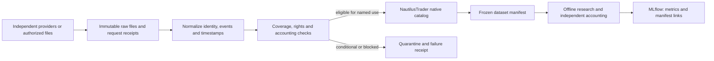

# Local historical data library

This document owns local dataset contracts, the implemented bounded price pilot,
the current-member stock archive and the remaining acquisition plan.
Provider/collector claims and source pins belong in the dated
[independent-data screening](tasks/2026-10-25-independent-data-review.md).
[Architecture](architecture.md) owns runtime boundaries; [roadmap](roadmap.md)
owns portfolio priority; [research development](research-development.md) owns
experiment eligibility. General ingestion and universe qualification remain planned.

The [Alpaca Basic pilot](tasks/2026-10-25-alpaca-us-stock-pilot.md) now has 164
structurally checked raw daily bars for four instruments, native catalog
write/read and duplicate-import proof. Synthetic restore is verified separately.
The isolated pilot catalog is a conditional price-data cache: corporate actions,
full source-use qualification and financial comparison eligibility remain blocked.
The normal eligibility flow below applies to promoted research datasets; storage
of this conditional pilot is not a promotion or financial-use approval.

The [current SPY equity-holdings archive](tasks/2026-10-25-sp500-stock-library.md)
processed 503 standard equity symbols from the issuer workbook dated 2026-10-22:
459 have full 2016–2025 session coverage, 41 partial coverage and three no bars.
The native catalog contains 1,212,539 bars across 500 instruments. Raw, normalized,
coverage and manifest artifacts remain local. This is a survivor-selected current
holdings proxy; corporate actions and financial eligibility remain unqualified.

The separately requested [sector-ETF acquisition](tasks/2026-10-28-sector-etf-acquisition.md)
now retains27654raw daily bars across ten fixed sector ETFs plus SPY,2016–2025,
with native catalog round-trip and read-only duplicate verification. The API also
returned436cash dividends and5splits. Action completeness is blocked:160missing
payment dates and two SPY dividend omissions against the saved issuer reference.
This is a conditional local dataset, not financial comparison eligibility or a
change to broad-market acquisition priority.

Objective: make reusable historical **US stock** research inputs available without
QuantConnect, under the free/local mandate. User narrowed the initial acquisition
scope on 2026-10-25. Begin with daily US-listed common stocks; SPY is retained only
as a comparison benchmark. ETF expansion, forex, futures, options and intraday
collection are deferred. Prior multi-asset evidence and its blocked goal remain
preserved; this priority change does not resume that experiment.

Alpaca Basic is the first source candidate, with documented history since 2016;
Twelve Data remains a secondary coverage/cross-check candidate. Both require
source-use and account-entitlement qualification. No paid subscriptions or
billing-enabled trials. Dataset possession, quality, research eligibility and
permission to publish are separate states.

## Planned flow and ownership



Reuse existing collectors for transport and NautilusTrader for typed market data,
catalog write/query and replay. We own source permission evidence, identity/event
normalization, audit rules, immutable manifests and eligibility. MLflow records
dataset/run identities and metrics; it is not the price database. Do not introduce
a database server, replacement Parquet catalog or engine migration for this plan.
The pilot verifies native catalog behavior for this narrow bar/instrument slice;
general M1 configuration, failure/recovery and ingestion acceptance remain open.

## Proposed local layout

Use the already ignored `data/` root; these are design paths, not folders created
by this task. Large datasets and provider responses do not enter the public repo.

```text
data/
├── raw/<provider>/<acquisition-id>/       # original responses/files, never edited
├── normalized/<dataset-version>/         # provider-neutral bars/events/identities
├── catalog/<dataset-version>/            # native Nautilus catalog layout within
├── manifests/<dataset-version>.json      # hashes, scope, source and eligibility
├── quality/<dataset-version>/            # coverage, disagreements and audit reports
└── quarantine/<acquisition-id>/          # rejected/partial inputs, preserved
```

Git tracks schemas, adapters, redacted receipts and tiny redistributable synthetic
fixtures. Credentials remain in local excluded configuration. Public run artifacts
must not embed provider data, account IDs or signed request URLs. Retention,
backup and permitted redistribution are recorded per dataset rather than inferred
from a free subscription or open-source collector license.

## Dataset contracts

| Record | Required content and rule |
| --- | --- |
| Source agreement | Provider, plan, reviewed date and evidence link/hash; distinguish automated acquisition, local storage, personal/internal use, derived outputs and redistribution. Unknown material permission blocks acquisition/use for that scope |
| Acquisition | Collector revision/environment, requested symbols/dates/feed/adjustment, redacted endpoint/parameters, UTC retrieval time, HTTP/content type, response bytes/hash, pagination/row counts, errors and quota consumption. Never log keys in URLs/headers |
| Instrument identity | Stable internal ID plus provider ID, asset type, exchange/venue, currency, timezone/calendar, listing/inception/delisting and effective-dated ticker mapping. Ticker alone is not identity |
| Equity/ETF bars | Raw unadjusted OHLCV, session label, bar start/end, known-at convention, feed and units. Adjusted prices/TRI are separate derived data with an explicit action policy; never count dividends twice |
| Corporate actions | Split ratio, cash distribution and currency, ex/record/payment dates where needed, effective/known-at timestamps, issuer/provider references and unresolved disagreements. Raw-source history is retained |
| Deferred FX contract | Base/quote currencies, source venue, bid/ask/mid identity, UTC conversion and session cutoff. Bid bars do not become midpoint bars; missing volume remains unknown. Financing/swaps require separate inputs or a disclosed research assumption |
| Deferred futures contract | Individual contract IDs, expiry/last trade/first notice when applicable, multiplier, tick, currency, venue/calendar, raw settlement versus trade prices. Continuous series require a separate versioned roll/adjustment recipe and cannot directly serve as executable contract prices |
| Universe membership | Effective and known-at intervals, security-type/liquidity policy and delisted coverage. A present-day ticker list is a discovery list, not a historical investable universe |
| Audit and manifest | Files and SHA-256, source/code versions, observed/expected sessions, missing/extra/duplicate rows, action joins, calendar, price semantics, outlier/disagreement review, rights state and named research use. Never label an entire provider universally eligible |

Publication timestamps must be genuine or explicitly unknown. Retrieval time in
2026 does not establish what was knowable in 2008. Revised fundamentals/macro data
need historical vintages before predictive use. Do not forward-fill pre-inception,
post-delisting, missing sessions or missing contract prices to manufacture coverage.

## Qualification and failure rules

1. Preserve source bytes before normalization. Verify stable identifiers and source
   feed/adjustment choices. Unauthorized access, challenges and exhausted quotas
   stop the request; no identity rotation or alternative scraper as a bypass.
2. Compare expected sessions with observations using the relevant venue/calendar.
   Reject nonfinite/invalid OHLC, conflicting duplicates and malformed timestamps.
   Preserve partial windows and explicit gap reports; do not mark them complete.
3. Reconcile actions and benchmark overlaps from a separately identified source
   where available. Two wrappers over one provider are not independent evidence.
   Disagreements are flagged and investigated rather than averaged away.
4. Qualify for a named use: descriptive charts, signal research, or financially
   reconciled simulation. Price-only availability can support a diagnostic while
   blocking total-return/accounting claims. Missing delisted coverage blocks broad
   survivor-free stock-selection claims, not necessarily a declared fixed-ETF study.
5. Freeze accepted files, transform versions and receipts before experiments.
   New data/revisions create a new dataset version. Runs bind exact manifests;
   failed imports cannot alter a prior eligible catalog.
6. Test duplicate import, interrupted download, quota error, corrupted file,
   catalog round-trip and restore into a separate directory. Rerunning an identical
   import must preserve identity/values without silently duplicating observations.

The [500-stock readiness review and bounded repair plan](tasks/2026-10-25-stock-backtest-readiness.md)
prioritizes qualification, causal timing and accounting before scaling financial
comparisons. It does not change the original acquisition or research budgets.

## Phases and completion evidence

These phases support M1 and later research; they do not replace the infrastructure
roadmap or declare any strategy ready.

| Phase | Proposed scope | Completion evidence / stop condition |
| --- | --- | --- |
| D0 Source and catalog baseline | Provider registry, manifest schema, permission states; native catalog proof with synthetic data | **Partial:** pilot instrument/bar round-trip, identical import and separate synthetic restore verified; general schema, interrupted writes and broader restore coverage remain open |
| D1 US stock source qualification | AAPL, MSFT, JPM and SPY benchmark, small daily samples first; Alpaca first, Twelve Data optional | **Partial:** authenticated SIP raw samples acquired for both months and structurally validated. Actions, full source-use scope and broader identity audit remain unqualified. These deliberately selected survivors are integration fixtures, not unbiased stock-selection evidence |
| D2 Daily stock library | User expanded scope to the issuer's current SPY equity holdings: 503 standard share-class tickers as of 2026-10-22, with available 2016–2025 raw daily prices | **Conditional archive implemented:** [acquisition receipt](tasks/2026-10-25-sp500-stock-library.md): 459 full-window, 41 partial, three unavailable; zero structurally invalid or internally gapped series. This current-member pool is a SPY proxy and survivor-selected, not point-in-time S&P membership; instrument/action qualification remains separate |
| D3 Historical-universe qualification | Active/inactive discovery plus historical listings, delistings and ticker changes | Inspect delisted/security-change examples and known-at membership. API inactive status alone does not prove a complete historical universe. If incomplete, label the library survivor-selected and block broad unbiased selection claims |

Forex, exchange futures, options, intraday acquisition and expanded ETF pools are
**deferred**, not missing prerequisites for D1–D3. Their source findings remain in
the dated screening. Broader instrument contract rows above are future reference
only; implementing them is outside the initial US-stock library.

Discovery lists guide acquisition rather than select profitable assets. Avoid
downloading every tick when daily research only needs daily bars. Native daily
data is preferred to tick aggregation unless bid/ask or intraday questions require
it. Estimate storage from observed bytes per row, row counts and retained versions
during the pilot; no unmeasured hardware/cost forecast is assumed here.

## First bounded qualification pilot

**Price-data slice executed:** see the [pilot receipt](tasks/2026-10-25-alpaca-us-stock-pilot.md).
The original bounds below remain the scope, not authorization for another run or
full-history backfill. Zero purchases, trials requiring billing, broker calls,
market orders or strategy simulations. The user created the free account and
saved credentials locally; no secret is stored in tracked files.

- **Offline work:** schema/validator and native catalog proof on tiny synthetic
  equity, action and US-session timestamp fixtures. Test partial/duplicate/invalid imports
  and disposable restore using existing dependencies first.
- **Equity probe:** at most 20 HTTP attempts total across Alpaca/Twelve Data,
  including pagination and failed calls; one worker, at most 100 MB received,
  ten-minute request deadline. Never exceed provider quotas. No automatic retry
  of a failed entitlement/permission check. Stop at the first achieved answer.
- **Fixed questions:** do AAPL/MSFT/JPM and the SPY benchmark have raw daily
  coverage in 2016-01 and 2025-12? What split/dividend fields and historical
  instrument mappings are available at no cost? Request these small samples first;
  do not backfill until coverage and rights are established. Retain observed gaps
  and all errors. Pre-2016 backfill is deferred unless a separate free source is
  qualified; a shorter dataset cannot stand in for our earlier experiment.
- **Decision:** choose the US-stock primary source based on actual
  coverage, action fidelity, reproducibility and permitted local use. Deliver an
  eligible/conditional/blocked receipt per named scope, collector compatibility
  findings, observed size/request estimates and the next acquisition bound.

Passing a source pilot authorizes no financial experiment by itself. Preserve the
blocked historical experiment unchanged; if only a shorter common period is
available, propose a new comparison with fresh matched controls and a new budget.

## Run and inspect the implemented price pilot

The module supports `check-access`, `synthetic` and `download`. `check-access`
only checks local keys, not server entitlement. Default credentials come from
`APCA_API_KEY_ID` / `APCA_API_SECRET_KEY`, optionally loaded from owner-only ignored
`.env.alpaca`; the parser does not execute shell expressions. Use paper keys and
the fixed data-only endpoint. Do not put keys in command arguments or chat.

```sh
.venv/bin/python -m research.alpaca_pilot check-access
.venv/bin/python -m research.alpaca_pilot synthetic --root .local/alpaca-pilot --id NEW-PROOF-ID
```

The completed dataset is `alpaca-us-stock-pilot-v1`. Its raw responses are under
`data/raw/alpaca/alpaca-us-stock-pilot-v1/`, normalized rows under
`data/normalized/alpaca-us-stock-pilot-v1.json`, native catalog under
`data/catalog/alpaca-us-stock-pilot-v1/`, and receipt under
`data/manifests/alpaca-us-stock-pilot-v1.json`. These are ignored local artifacts.
Read bars using `ParquetDataCatalog` from the installed version; session labels
and original source timestamps remain in normalized rows. The month gap is
intentional and must not be filled or mistaken for continuous ten-year coverage.

An identical `catalog_import` verifies existing data without writing; a changed
input rejects rather than updating it. The download command requires a new
exclusive dataset ID and does not retry or resume partial HTTP acquisition.
Failed raw responses/receipts and staging directories remain available for diagnosis.
Creating a new ID must not be used to evade an exhausted request budget.


## Bounded acquisition procedure

This section owns repeatable acquisition mechanics; the phased plan above owns
source qualification and scope. The catalog's `trade-data-acquisition` skill routes
here. An acquisition request permits its stated historical-data work, not broker
operations or a financial trial.

1. Identify the intended use, source/universe snapshot date, identity policy,
   dates/warm-up, fields, feed and raw/adjusted semantics. Check existing manifests
   for reusable inputs. Record source access/use evidence and unresolved rights;
   free access is not redistribution permission.
2. Inspect the actual collector interface. `research.alpaca_pilot` implements its
   fixed four-symbol/two-month pilot; `research.us_stock_library` implements the
   fixed current-SPY-holdings/2016–2025 archive. Neither is a general downloader. The separate `research.sector_etf_acquisition`
   collector accepts only its frozen eleven-ETF/2016–2025 plan and data-only routes;
   see its acquisition receipt and limits before reuse.
   Read the corresponding task receipt and source before invoking it. Requirements
   outside that support go through infrastructure change and offline checks first.
3. Freeze aggregate HTTP/byte/time/concurrency bounds, pagination/stop policy,
   prior attempts, exclusive dataset ID, disk needs and local output paths before
   acquisition. Keep credentials outside tracked files; use data-only endpoints.
   Read-only downloads can still consume quotas. A fresh ID does not reset a budget.
4. Preserve raw bytes, redacted requests, source/code identity, normalized outputs
   and failure receipts. Stage catalog writes separately; verify native values,
   timestamps and instrument identities before publishing a conditional path.
   Classify missing/partial/invalid/gapped histories; never fill them implicitly.
5. Return coverage, exclusions, actual resource use, hashes, verification scope and
   limitations. Stop on the declared failure/budget condition, retaining staging
   and negative evidence. Audit saved inputs separately against a named study;
   ingestion success does not establish actions, point-in-time membership or
   financial eligibility. No broker session or backtest is implied.

The [500-stock receipt](tasks/2026-10-25-sp500-stock-library.md) demonstrates this
procedure for its fixed scope. Generic resumable ingestion, scheduled refresh,
action qualification and historical-universe reconstruction remain unimplemented
unless a later receipt establishes them.

## Sector issuer-qualified derivative:2026-10-28

The [issuer reconciliation](tasks/2026-10-28-sector-issuer-qualification.md) now
provides a separate442cash/1in-kind/5split derivative with complete payment dates
and preserved provider disagreements. Original API snapshots and their failed
qualification remain unchanged. Scope is private restated development analysis;
17new synthetic accounting checks passed; the subsequent eight-case project-ledger
comparison independently audited historical accounts and metrics. Native/broker
parity is not inferred. The [completed study](tasks/2026-10-28-sector-comparison-issuer-v2.md)
retains qualified capture and the failed strict joint drawdown screen.
