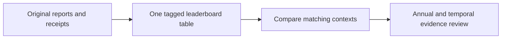

# Research leaderboard

| Algorithm / variant | Calmar (headline) | Evidence status | CAGR | Max DD | Longest underwater sessions / days | Sharpe | Tags | Context | Period | Outcome | Evidence | Lesson |
| --- | --- | --- | --- | --- | --- | --- | --- | --- | --- | --- | --- | --- |
| T11 + risk gate · 25bp · six-ETF study | 2.494124 | Truncated summary; audit incomplete | 92.0276% | 36.8978% | Missing in fresh capture | 1.640011 | ETF · target selection · traffic gate · 25bp | U1-25bp | 2020–2025 | Matched incumbent reference | [Study](tasks/2026-10-30-t11-universe-comparison.md) · [Receipt](tasks/evidence/2026-10-30-t11-universe-comparison.json) | Monthly selector trails T11; no adoption, missing robustness cases preserved. |
| T11 with traffic-light cap | 2.49 | Original aggregate; new export compatible | 92.03% | 36.90% | 199 /292 | 1.64 | leveraged ETF · tactical · funded · risk gate · export verified | B | 2020–2025 | Development result | [Study](tasks/2026-10-26-qc504-t11-gate.md) · [Receipt](tasks/evidence/2026-10-26-qc504-t11-gate.json) · [Export validation](tasks/2026-10-29-t11-export-validation.md) | Gate lowers depth but sacrifices growth and recovery time. |
| Ungated T11 | 2.33 | Original aggregate; new export compatible | 119.67% | 51.26% | 146 /214 | 1.69 | leveraged ETF · tactical · funded · export verified | B | 2020–2025 | Development result | [Study](tasks/2026-10-26-qc504-t11-gate.md) · [Receipt](tasks/evidence/2026-10-26-qc504-t11-gate.json) · [Export validation](tasks/2026-10-29-t11-export-validation.md) | Gate lowers depth but sacrifices growth and recovery time. |
| Four-sleeve ensemble | 1.54 | Aggregate development summary | 93.88% | 61.04% | 157 /230 | 1.60 | leveraged ETF · tactical · funded | B | 2020–2025 | Development result | [Study](tasks/2026-10-26-qc504-t11-gate.md) · [Receipt](tasks/evidence/2026-10-26-qc504-t11-gate.json) | Gate lowers depth but sacrifices growth and recovery time. |
| Volatility-adjusted sector top-three + gate · 5bp | 1.033047 | Captured; Fraction replay audited | 12.8871% | 12.47483% | 300 / 436 | 1.0029 | sector ETFs · market conditions · 5bp · control | E3-C2-5bp | 2017-02–2025 | Matched control | [Study](tasks/2026-10-30-calmar-epoch3.md) · [Receipt](tasks/evidence/2026-10-30-calmar-epoch3-c2.json) | Breadth proxy evaluated under unchanged selection/accounting; see fixed guards and lesson. |
| Volatility-adjusted sector top-three + gate · 5bp | 1.033047 | Captured; Fraction replay audited | 12.8871% | 12.47483% | 300 / 436 | 1.0029 | sector ETFs · target selection · 5bp · control | E3-C1-5bp | 2017-02–2025 | Matched control | [Study](tasks/2026-10-30-calmar-epoch3.md) · [Receipt](tasks/evidence/2026-10-30-calmar-epoch3-c1.json) | Correlation reduction alone worsens growth, drawdown and recovery. |
| Gated volatility-adjusted sector momentum · gate-v1 · 5bp | 1.033047 | Audited project-ledger development | 12.8871% | 12.47483% | 300 / 436 | 1.0029 | sector ETFs · 5bp · risk gate · challenger | S3-5bp | 2017-02–2025 | Calmar up; joint screen rejected | [Study](tasks/2026-10-28-sector-gate-v1.md) · [Receipt](tasks/evidence/2026-10-28-sector-gate-v1.json) · [Lesson](tasks/2026-10-28-sector-gate-experience-report.md) | Drawdown falls about17.2pp; lower CAGR and longer recovery reject joint target. |
| Volatility-adjusted sector top-three + gate · 10bp | 1.003744 | Captured; Fraction replay audited | 12.5665% | 12.51959% | 300 / 436 | 0.9809 | sector ETFs · market conditions · 10bp · control | E3-C2-10bp | 2017-02–2025 | Matched control | [Study](tasks/2026-10-30-calmar-epoch3.md) · [Receipt](tasks/evidence/2026-10-30-calmar-epoch3-c2.json) | Breadth proxy evaluated under unchanged selection/accounting; see fixed guards and lesson. |
| Volatility-adjusted sector top-three + gate · 10bp | 1.003744 | Captured; Fraction replay audited | 12.5665% | 12.51959% | 300 / 436 | 0.9809 | sector ETFs · target selection · 10bp · control | E3-C1-10bp | 2017-02–2025 | Matched control | [Study](tasks/2026-10-30-calmar-epoch3.md) · [Receipt](tasks/evidence/2026-10-30-calmar-epoch3-c1.json) | Correlation reduction alone worsens growth, drawdown and recovery. |
| Gated volatility-adjusted sector momentum · gate-v1 · 10bp | 1.003744 | Audited project-ledger development | 12.5665% | 12.51959% | 300 / 436 | 0.9809 | sector ETFs · 10bp · risk gate · challenger | S3-10bp | 2017-02–2025 | Calmar up; joint screen rejected | [Study](tasks/2026-10-28-sector-gate-v1.md) · [Receipt](tasks/evidence/2026-10-28-sector-gate-v1.json) · [Lesson](tasks/2026-10-28-sector-gate-experience-report.md) | Drawdown falls about17.2pp; lower CAGR and longer recovery reject joint target. |
| Original momentum | 1.00 | Aggregate development summary | 29.62% | 29.66% | 585 /847 | 1.05 | stocks · momentum · original sectors · replicated control | C | 2020–2025 | Historical treatment | [Study](tasks/2026-10-26-stock-risk-ablation.md) · [Receipt](tasks/evidence/2026-10-26-stock-risk-ablation.json) | Original sector treatment has unknown classifications; see D repair. |
| Stock momentum | 0.999 | Aggregate development summary | 29.62% | 29.66% | 585 / 847 | 1.049 | stocks/ETF · selection · base | A | 2020–2025 | Development result | [Study](tasks/2026-10-26-selection-completion.md) · [Receipt](tasks/evidence/2026-10-26-selection-completion.json) | Stock momentum beats its controls; longer underwater than SPY. |
| Original stock momentum | 0.9986 | Aggregate development summary | 29.62% | 29.66% | 585 /847 | 1.0491 | stocks · momentum · repaired sectors · replicated control | D | 2020–2025 | Development result | [Study](tasks/2026-10-26-sector-matched.md) · [Receipt](tasks/evidence/2026-10-26-sector-matched.json) | Sector control improves vs matched target; trails original growth. |
| NVDA/AMD hold | 0.98 | Aggregate development summary | 64.66% | 65.70% | 407 / 592 | 1.27 | NVDA/AMD · pairs/hold · fixed pair · benchmark | H | 2016–2025 | Development result | [Study](tasks/2026-10-26-stock-pairs-spy-comparison.md) · [Receipt](tasks/evidence/2026-10-26-stock-pairs-spy-comparison.json) | Pairs fails; pair-hold has hindsight selection and deep losses. |
| Sector cap | 0.9622 | Aggregate development summary | 24.52% | 25.48% | 583 /843 | 1.0521 | stocks · momentum · repaired sectors · sector cap | D | 2020–2025 | Development result | [Study](tasks/2026-10-26-sector-matched.md) · [Receipt](tasks/evidence/2026-10-26-sector-matched.json) | Sector control improves vs matched target; trails original growth. |
| Momentum + sector limit | 0.92 | Aggregate development summary | 21.07% | 22.87% | 573 /828 | 0.98 | stocks · momentum · original sectors · sector cap | C | 2020–2025 | Historical treatment | [Study](tasks/2026-10-26-stock-risk-ablation.md) · [Receipt](tasks/evidence/2026-10-26-stock-risk-ablation.json) | Original sector treatment has unknown classifications; see D repair. |
| Target-matched control | 0.8980 | Aggregate development summary | 24.27% | 27.03% | 584 /846 | 1.0378 | stocks · momentum · repaired sectors · control | D | 2020–2025 | Development result | [Study](tasks/2026-10-26-sector-matched.md) · [Receipt](tasks/evidence/2026-10-26-sector-matched.json) | Sector control improves vs matched target; trails original growth. |
| Stock momentum · 50 bp + delay | 0.863 | Aggregate development summary | 26.25% | 30.43% | 603 / 875 | 0.957 | stocks · selection · cost/delay stress | A2 | 2020–2025 | Development result | [Study](tasks/2026-10-26-selection-completion.md) · [Receipt](tasks/evidence/2026-10-26-selection-completion.json) | Stock stress drawdown exceeds30%; viewed-history stress. |
| Momentum + gate | 0.74 | Aggregate development summary | 19.65% | 26.67% | 606 /878 | 0.86 | stocks · momentum · original sectors · risk gate | C | 2020–2025 | Historical treatment | [Study](tasks/2026-10-26-stock-risk-ablation.md) · [Receipt](tasks/evidence/2026-10-26-stock-risk-ablation.json) | Original sector treatment has unknown classifications; see D repair. |
| Equal-weight sectors + gate · 5bp | 0.703734 | Captured; Fraction replay audited | 9.9458% | 14.13289% | 489 / 709 | 0.8797 | sector ETFs · target selection · 5bp · control | E3-C1-5bp | 2017-02–2025 | Matched control | [Study](tasks/2026-10-30-calmar-epoch3.md) · [Receipt](tasks/evidence/2026-10-30-calmar-epoch3-c1.json) | Correlation reduction alone worsens growth, drawdown and recovery. |
| Equal-weight sectors + gate · 10bp | 0.695110 | Captured; Fraction replay audited | 9.8705% | 14.19988% | 489 / 709 | 0.8737 | sector ETFs · target selection · 10bp · control | E3-C1-10bp | 2017-02–2025 | Matched control | [Study](tasks/2026-10-30-calmar-epoch3.md) · [Receipt](tasks/evidence/2026-10-30-calmar-epoch3-c1.json) | Correlation reduction alone worsens growth, drawdown and recovery. |
| Momentum + both | 0.69 | Aggregate development summary | 14.35% | 20.68% | 586 /848 | 0.80 | stocks · momentum · original sectors · gate+sector cap | C | 2020–2025 | Historical treatment | [Study](tasks/2026-10-26-stock-risk-ablation.md) · [Receipt](tasks/evidence/2026-10-26-stock-risk-ablation.json) | Original sector treatment has unknown classifications; see D repair. |
| Correlation-aware sector top-three + gate · 5bp | 0.581100 | Captured; Fraction replay audited | 9.5850% | 16.49460% | 402 / 585 | 0.8023 | sector ETFs · target selection · 5bp · challenger | E3-C1-5bp | 2017-02–2025 | Rejected fixed target | [Study](tasks/2026-10-30-calmar-epoch3.md) · [Receipt](tasks/evidence/2026-10-30-calmar-epoch3-c1.json) | Correlation reduction alone worsens growth, drawdown and recovery. |
| Correlation-aware sector top-three + gate · 10bp | 0.543798 | Captured; Fraction replay audited | 9.1271% | 16.78394% | 403 / 586 | 0.7686 | sector ETFs · target selection · 10bp · challenger | E3-C1-10bp | 2017-02–2025 | Rejected fixed target | [Study](tasks/2026-10-30-calmar-epoch3.md) · [Receipt](tasks/evidence/2026-10-30-calmar-epoch3-c1.json) | Correlation reduction alone worsens growth, drawdown and recovery. |
| No buy-topups · immediate risk cuts | 0.495563 | Audited cases; driver export recovered | 8.6231% | 17.4006% | 513 / 746 | 0.7703 | SPY · execution · 5bp · control | C06-5bp | 2005–2025 | Small Calmar/growth tradeoff | [Study](tasks/2026-10-28-execution-c06.md) · [Receipt](tasks/evidence/2026-10-28-execution-c06.json) | Fewer orders save costs but miss material Calmar/growth guards; export failure preserved and recovered read-only. |
| Original SPY gate | 0.495 | Aggregate development summary | 9.596% | 19.383% | 593 / 862 | 0.843 | sector ETF/SPY · daily · base · risk gate | E | 2017–2025 | Development result | [Study](tasks/2026-10-25-sector-momentum-comparison.md) · [Receipt](tasks/evidence/2026-10-25-sector-momentum-comparison.json) | Growth, drawdown and recovery favor different policies. |
| Ungated volatility-adjusted sector top-three · 5bp | 0.492530 | Captured; Fraction replay audited | 14.6128% | 29.66890% | 170 / 248 | 0.8632 | sector ETFs · market conditions · 5bp · control | E3-C2-5bp | 2017-02–2025 | Matched control | [Study](tasks/2026-10-30-calmar-epoch3.md) · [Receipt](tasks/evidence/2026-10-30-calmar-epoch3-c2.json) | Breadth proxy evaluated under unchanged selection/accounting; see fixed guards and lesson. |
| Volatility-adjusted sector momentum · issuer-v2 · 5bp | 0.492530 | Audited project-ledger development | 14.6128% | 29.66890% | 170 / 248 | 0.8632 | sector ETFs · 5bp · challenger · volatility rank | S2-5bp | 2017-02–2025 | Pass5bp; joint target rejected | [Study](tasks/2026-10-28-sector-comparison-issuer-v2.md) · [Receipt](tasks/evidence/2026-10-28-sector-comparison-issuer-v2.json) · [Report](tasks/2026-10-28-sector-selection-experience-report.md) | Calmar/growth/recovery improve; 0.00362pp deeper DD at10bp prevents joint pass. |
| Ungated volatility-adjusted sector momentum · gate-v1 · 5bp | 0.492530 | Audited project-ledger development | 14.6128% | 29.66890% | 170 / 248 | 0.8632 | sector ETFs · 5bp · volatility rank · reference | S3-5bp | 2017-02–2025 | Fresh matched control | [Study](tasks/2026-10-28-sector-gate-v1.md) · [Receipt](tasks/evidence/2026-10-28-sector-gate-v1.json) · [Lesson](tasks/2026-10-28-sector-gate-experience-report.md) | Exact parent accounting replay; reference preserved. |
| Discrete EMA/volatility gate | 0.491514 | Locally audited development | 8.7343% | 17.7701% | 513 / 746 | 0.7689 | SPY · sizing · 5bp · control | C01-5bp | 2005–2025 | Audited control | Study (`../.local/rsi-calmar-20261028/docs/tasks/2026-10-28-calmar-rsi-epoch.md`; private/local artifact, not published) · Receipt (`../.local/rsi-calmar-20261028/docs/tasks/evidence/2026-10-28-calmar-rsi-epoch.json`; private/local artifact, not published) | Fixed smooth cap is dominated by the discrete gate at both costs; no promotion. |
| Discrete gate · C02 replay | 0.491514 | Locally audited; captured lifecycle | 8.7343% | 17.7701% | 513 / 746 | 0.7689 | SPY · sizing · 5bp · control | C02-5bp | 2005–2025 | Audited control | Study (`../.local/rsi-calmar-20261028/docs/tasks/2026-10-28-ceiling-capture-study.md`; private/local artifact, not published) · Receipt (`../.local/rsi-calmar-20261028/docs/tasks/evidence/2026-10-28-ceiling-capture-study.json`; private/local artifact, not published) | Small drawdown benefit does not offset lower growth; Calmar falls at both costs. |
| Discrete gate · C03 replay | 0.491514 | Locally audited development | 8.7343% | 17.7701% | 513 / 746 | 0.7689 | SPY · position proposal · 5bp · control | C03-5bp | 2005–2025 | Audited control | [Study](tasks/2026-10-28-proposal-c03.md) · [Receipt](tasks/evidence/2026-10-28-proposal-c03.json) | Faster EMA proposal loses growth, depth and recovery; SMA control also trails incumbent. |
| Discrete gate · C04 replay | 0.491514 | Locally audited; captured lifecycle | 8.7343% | 17.7701% | 513 / 746 | 0.7689 | SPY · position proposal · 5bp · control | C04-5bp | 2005–2025 | Audited control | [Study](tasks/2026-10-28-no-veto-c04.md) · [Receipt](tasks/evidence/2026-10-28-no-veto-c04.json) | Union adds exposure but loses Calmar and all incumbent guardrails; gate-only trades growth for deeper and longer losses. |
| Discrete gate · C05 replay | 0.491514 | Locally audited; shared epoch capture | 8.7343% | 17.7701% | 513 / 746 | 0.7689 | SPY · feature representation · 5bp · control | C05-5bp | 2005–2025 | Audited control | [Study](tasks/2026-10-28-total-return-c05.md) · [Receipt](tasks/evidence/2026-10-28-total-return-c05.json) | Dividend-consistent features add exposure but fail performance guards; partial transform dominates full; incumbent retained. |
| Discrete gate · C06 replay | 0.491514 | Audited cases; driver export recovered | 8.7343% | 17.7701% | 513 / 746 | 0.7689 | SPY · execution · 5bp · control | C06-5bp | 2005–2025 | Audited control | [Study](tasks/2026-10-28-execution-c06.md) · [Receipt](tasks/evidence/2026-10-28-execution-c06.json) | Fewer orders save costs but miss material Calmar/growth guards; export failure preserved and recovered read-only. |
| Monthly buy-topups · immediate risk cuts | 0.491462 | Audited cases; driver export recovered | 8.7220% | 17.7470% | 513 / 746 | 0.7688 | SPY · execution · 5bp · challenger | C06-5bp | 2005–2025 | Rejected fixed target | [Study](tasks/2026-10-28-execution-c06.md) · [Receipt](tasks/evidence/2026-10-28-execution-c06.json) | Fewer orders save costs but miss material Calmar/growth guards; export failure preserved and recovered read-only. |
| No buy-topups · immediate risk cuts | 0.485900 | Audited cases; driver export recovered | 8.5521% | 17.6005% | 514 / 749 | 0.7647 | SPY · execution · 10bp · control | C06-10bp | 2005–2025 | Small Calmar/growth tradeoff | [Study](tasks/2026-10-28-execution-c06.md) · [Receipt](tasks/evidence/2026-10-28-execution-c06.json) | Fewer orders save costs but miss material Calmar/growth guards; export failure preserved and recovered read-only. |
| Smooth sizing under discrete ceiling | 0.483702 | Locally audited; captured lifecycle | 8.5803% | 17.7388% | 513 / 746 | 0.7643 | SPY · sizing · 5bp · challenger · negative result | C02-5bp | 2005–2025 | Rejected fixed target | Study (`../.local/rsi-calmar-20261028/docs/tasks/2026-10-28-ceiling-capture-study.md`; private/local artifact, not published) · Receipt (`../.local/rsi-calmar-20261028/docs/tasks/evidence/2026-10-28-ceiling-capture-study.json`; private/local artifact, not published) | Small drawdown benefit does not offset lower growth; Calmar falls at both costs. |
| Volatility-adjusted sector momentum · issuer-v2 · 10bp | 0.482229 | Audited project-ledger development | 14.3099% | 29.67450% | 170 / 248 | 0.8481 | sector ETFs · 10bp · challenger · volatility rank | S2-10bp | 2017-02–2025 | Rejected joint drawdown guard | [Study](tasks/2026-10-28-sector-comparison-issuer-v2.md) · [Receipt](tasks/evidence/2026-10-28-sector-comparison-issuer-v2.json) · [Report](tasks/2026-10-28-sector-selection-experience-report.md) | Calmar/growth/recovery improve; 0.00362pp deeper DD at10bp prevents joint pass. |
| Ungated volatility-adjusted sector momentum · gate-v1 · 10bp | 0.482229 | Audited project-ledger development | 14.3099% | 29.67450% | 170 / 248 | 0.8481 | sector ETFs · 10bp · volatility rank · reference | S3-10bp | 2017-02–2025 | Fresh matched control | [Study](tasks/2026-10-28-sector-gate-v1.md) · [Receipt](tasks/evidence/2026-10-28-sector-gate-v1.json) · [Lesson](tasks/2026-10-28-sector-gate-experience-report.md) | Exact parent accounting replay; reference preserved. |
| Ungated volatility-adjusted sector top-three · 10bp | 0.482229 | Captured; Fraction replay audited | 14.3099% | 29.67450% | 170 / 248 | 0.8481 | sector ETFs · market conditions · 10bp · control | E3-C2-10bp | 2017-02–2025 | Matched control | [Study](tasks/2026-10-30-calmar-epoch3.md) · [Receipt](tasks/evidence/2026-10-30-calmar-epoch3-c2.json) | Breadth proxy evaluated under unchanged selection/accounting; see fixed guards and lesson. |
| Monthly buy-topups · immediate risk cuts | 0.481810 | Audited cases; driver export recovered | 8.6492% | 17.9515% | 514 / 749 | 0.7631 | SPY · execution · 10bp · challenger | C06-10bp | 2005–2025 | Rejected fixed target | [Study](tasks/2026-10-28-execution-c06.md) · [Receipt](tasks/evidence/2026-10-28-execution-c06.json) | Fewer orders save costs but miss material Calmar/growth guards; export failure preserved and recovered read-only. |
| Discrete EMA/volatility gate | 0.481692 | Locally audited development | 8.6590% | 17.9762% | 514 / 749 | 0.7630 | SPY · sizing · 10bp · control | C01-10bp | 2005–2025 | Audited control | Study (`../.local/rsi-calmar-20261028/docs/tasks/2026-10-28-calmar-rsi-epoch.md`; private/local artifact, not published) · Receipt (`../.local/rsi-calmar-20261028/docs/tasks/evidence/2026-10-28-calmar-rsi-epoch.json`; private/local artifact, not published) | Fixed smooth cap is dominated by the discrete gate at both costs; no promotion. |
| Discrete gate · C02 replay | 0.481692 | Locally audited; captured lifecycle | 8.6590% | 17.9762% | 514 / 749 | 0.7630 | SPY · sizing · 10bp · control | C02-10bp | 2005–2025 | Audited control | Study (`../.local/rsi-calmar-20261028/docs/tasks/2026-10-28-ceiling-capture-study.md`; private/local artifact, not published) · Receipt (`../.local/rsi-calmar-20261028/docs/tasks/evidence/2026-10-28-ceiling-capture-study.json`; private/local artifact, not published) | Small drawdown benefit does not offset lower growth; Calmar falls at both costs. |
| Discrete gate · C03 replay | 0.481692 | Locally audited development | 8.6590% | 17.9762% | 514 / 749 | 0.7630 | SPY · position proposal · 10bp · control | C03-10bp | 2005–2025 | Audited control | [Study](tasks/2026-10-28-proposal-c03.md) · [Receipt](tasks/evidence/2026-10-28-proposal-c03.json) | Faster EMA proposal loses growth, depth and recovery; SMA control also trails incumbent. |
| Discrete gate · C04 replay | 0.481692 | Locally audited; captured lifecycle | 8.6590% | 17.9762% | 514 / 749 | 0.7630 | SPY · position proposal · 10bp · control | C04-10bp | 2005–2025 | Audited control | [Study](tasks/2026-10-28-no-veto-c04.md) · [Receipt](tasks/evidence/2026-10-28-no-veto-c04.json) | Union adds exposure but loses Calmar and all incumbent guardrails; gate-only trades growth for deeper and longer losses. |
| Discrete gate · C05 replay | 0.481692 | Locally audited; shared epoch capture | 8.6590% | 17.9762% | 514 / 749 | 0.7630 | SPY · feature representation · 10bp · control | C05-10bp | 2005–2025 | Audited control | [Study](tasks/2026-10-28-total-return-c05.md) · [Receipt](tasks/evidence/2026-10-28-total-return-c05.json) | Dividend-consistent features add exposure but fail performance guards; partial transform dominates full; incumbent retained. |
| Discrete gate · C06 replay | 0.481692 | Audited cases; driver export recovered | 8.6590% | 17.9762% | 514 / 749 | 0.7630 | SPY · execution · 10bp · control | C06-10bp | 2005–2025 | Audited control | [Study](tasks/2026-10-28-execution-c06.md) · [Receipt](tasks/evidence/2026-10-28-execution-c06.json) | Fewer orders save costs but miss material Calmar/growth guards; export failure preserved and recovered read-only. |
| Half discrete-gate control | 0.479785 | Locally audited; captured lifecycle | 4.4002% | 9.1712% | 513 / 746 | 0.7597 | SPY · sizing · 5bp · control | C02-5bp | 2005–2025 | Audited control | Study (`../.local/rsi-calmar-20261028/docs/tasks/2026-10-28-ceiling-capture-study.md`; private/local artifact, not published) · Receipt (`../.local/rsi-calmar-20261028/docs/tasks/evidence/2026-10-28-ceiling-capture-study.json`; private/local artifact, not published) | Small drawdown benefit does not offset lower growth; Calmar falls at both costs. |
| Smooth sizing under discrete ceiling | 0.473450 | Locally audited; captured lifecycle | 8.4957% | 17.9443% | 513 / 746 | 0.7576 | SPY · sizing · 10bp · challenger · negative result | C02-10bp | 2005–2025 | Rejected fixed target | Study (`../.local/rsi-calmar-20261028/docs/tasks/2026-10-28-ceiling-capture-study.md`; private/local artifact, not published) · Receipt (`../.local/rsi-calmar-20261028/docs/tasks/evidence/2026-10-28-ceiling-capture-study.json`; private/local artifact, not published) | Small drawdown benefit does not offset lower growth; Calmar falls at both costs. |
| Half discrete-gate control | 0.467913 | Locally audited; captured lifecycle | 4.3494% | 9.2953% | 513 / 746 | 0.7514 | SPY · sizing · 10bp · control | C02-10bp | 2005–2025 | Audited control | Study (`../.local/rsi-calmar-20261028/docs/tasks/2026-10-28-ceiling-capture-study.md`; private/local artifact, not published) · Receipt (`../.local/rsi-calmar-20261028/docs/tasks/evidence/2026-10-28-ceiling-capture-study.json`; private/local artifact, not published) | Small drawdown benefit does not offset lower growth; Calmar falls at both costs. |
| Sector-breadth gate + vol-adjusted top-three · 5bp | 0.467210 | Captured; Fraction replay audited | 7.8778% | 16.86145% | 527 / 768 | 0.7180 | sector ETFs · market conditions · 5bp · challenger | E3-C2-5bp | 2017-02–2025 | Rejected fixed target | [Study](tasks/2026-10-30-calmar-epoch3.md) · [Receipt](tasks/evidence/2026-10-30-calmar-epoch3-c2.json) | Breadth proxy evaluated under unchanged selection/accounting; see fixed guards and lesson. |
| Total-return trend eligibility + raw gate | 0.465775 | Locally audited; shared epoch capture | 8.6007% | 18.4654% | 531 / 769 | 0.7537 | SPY · feature representation · 5bp · control | C05-5bp | 2005–2025 | Partial control | [Study](tasks/2026-10-28-total-return-c05.md) · [Receipt](tasks/evidence/2026-10-28-total-return-c05.json) | Dividend-consistent features add exposure but fail performance guards; partial transform dominates full; incumbent retained. |
| SPY holding (90% initial target) | 0.46 | Aggregate development summary | 13.62% | 29.79% | 488 /708 | 0.79 | stocks · momentum · original sectors · benchmark | C | 2020–2025 | Historical treatment | [Study](tasks/2026-10-26-stock-risk-ablation.md) · [Receipt](tasks/evidence/2026-10-26-stock-risk-ablation.json) | Original sector treatment has unknown classifications; see D repair. |
| Sector momentum | 0.459 | Aggregate development summary | 13.630% | 29.682% | 195 / 287 | 0.798 | sector ETF/SPY · daily · base | E | 2017–2025 | Development result | [Study](tasks/2026-10-25-sector-momentum-comparison.md) · [Receipt](tasks/evidence/2026-10-25-sector-momentum-comparison.json) | Growth, drawdown and recovery favor different policies. |
| Total-return trend eligibility + raw gate | 0.457755 | Locally audited; shared epoch capture | 8.5297% | 18.6337% | 531 / 769 | 0.7482 | SPY · feature representation · 10bp · control | C05-10bp | 2005–2025 | Partial control | [Study](tasks/2026-10-28-total-return-c05.md) · [Receipt](tasks/evidence/2026-10-28-total-return-c05.json) | Dividend-consistent features add exposure but fail performance guards; partial transform dominates full; incumbent retained. |
| SPY holding | 0.457 | Aggregate development summary | 13.62% | 29.79% | 488 / 708 | 0.785 | stocks/ETF · selection · base · benchmark | A | 2020–2025 | Development result | [Study](tasks/2026-10-26-selection-completion.md) · [Receipt](tasks/evidence/2026-10-26-selection-completion.json) | Stock momentum beats its controls; longer underwater than SPY. |
| Gate-only SPY control | 0.444106 | Locally audited; captured lifecycle | 9.6930% | 21.8259% | 567 / 822 | 0.7961 | SPY · position proposal · 5bp · control | C04-5bp | 2005–2025 | Tradeoff control | [Study](tasks/2026-10-28-no-veto-c04.md) · [Receipt](tasks/evidence/2026-10-28-no-veto-c04.json) | Union adds exposure but loses Calmar and all incumbent guardrails; gate-only trades growth for deeper and longer losses. |
| SPY hold | 0.442 | Aggregate development summary | 14.82% | 33.53% | 488 / 708 | 0.864 | stocks/SPY · CAPM · no explicit costs · benchmark | F1 | 2016–2025 | Development result | [Study](tasks/2026-10-26-capm-cost-stop-ablation.md) · [Receipt](tasks/evidence/2026-10-26-capm-cost-stop-ablation.json) | CAPM fails against matched SPY even without explicit costs. |
| SPY hold | 0.442 | Aggregate development summary | 14.82% | 33.53% | 488 / 708 | 0.864 | stocks/SPY · CAPM · commissions · benchmark | F2 | 2016–2025 | Development result | [Study](tasks/2026-10-26-capm-cost-stop-ablation.md) · [Receipt](tasks/evidence/2026-10-26-capm-cost-stop-ablation.json) | Stock stop lowers growth and prolongs recovery. |
| SPY hold | 0.441 | Aggregate development summary | 14.82% | 33.57% | 488 / 708 | 0.863 | stocks/SPY · CAPM · 25bp stress · benchmark | F3 | 2016–2025 | Development result | [Study](tasks/2026-10-26-capm-cost-stop-ablation.md) · [Receipt](tasks/evidence/2026-10-26-capm-cost-stop-ablation.json) | Stop/re-entry and cost interaction is severe. |
| SPY hold | 0.44 | Aggregate development summary | 14.65% | 33.16% | 488 / 708 | 0.86 | SPY · intraday · breakout · benchmark | G | 2016–2025 | Development result | [Study](tasks/2026-10-26-dual-thrust-spy-comparison.md) · [Receipt](tasks/evidence/2026-10-26-dual-thrust-spy-comparison.json) | Breakout improvement screen fails versus SPY. |
| SPY hold | 0.44 | Aggregate development summary | 13.64% | 31.26% | 488 / 708 | 0.86 | NVDA/AMD · pairs/hold · fixed pair · benchmark | H | 2016–2025 | Development result | [Study](tasks/2026-10-26-stock-pairs-spy-comparison.md) · [Receipt](tasks/evidence/2026-10-26-stock-pairs-spy-comparison.json) | Pairs fails; pair-hold has hindsight selection and deep losses. |
| Total-return features · full transform | 0.439857 | Locally audited; shared epoch capture | 8.5478% | 19.4331% | 556 / 805 | 0.7404 | SPY · feature representation · 5bp · challenger | C05-5bp | 2005–2025 | Rejected fixed target | [Study](tasks/2026-10-28-total-return-c05.md) · [Receipt](tasks/evidence/2026-10-28-total-return-c05.json) | Dividend-consistent features add exposure but fail performance guards; partial transform dominates full; incumbent retained. |
| Gate-only SPY control | 0.438939 | Locally audited; captured lifecycle | 9.6309% | 21.9414% | 571 / 828 | 0.7916 | SPY · position proposal · 10bp · control | C04-10bp | 2005–2025 | Tradeoff control | [Study](tasks/2026-10-28-no-veto-c04.md) · [Receipt](tasks/evidence/2026-10-28-no-veto-c04.json) | Union adds exposure but loses Calmar and all incumbent guardrails; gate-only trades growth for deeper and longer losses. |
| SPY hold | 0.437 | Aggregate development summary | 13.950% | 31.942% | 488 / 708 | 0.846 | sector ETF/SPY · daily · base · benchmark | E | 2017–2025 | Development result | [Study](tasks/2026-10-25-sector-momentum-comparison.md) · [Receipt](tasks/evidence/2026-10-25-sector-momentum-comparison.json) | Growth, drawdown and recovery favor different policies. |
| SPY buy and hold · issuer-v2 · 5bp | 0.434733 | Audited project-ledger development | 13.8848% | 31.93866% | 489 / 709 | 0.8517 | sector ETFs · 5bp · benchmark · entry only | S2-5bp | 2017-02–2025 | Benchmark | [Study](tasks/2026-10-28-sector-comparison-issuer-v2.md) · [Receipt](tasks/evidence/2026-10-28-sector-comparison-issuer-v2.json) · [Report](tasks/2026-10-28-sector-selection-experience-report.md) | Calmar/growth/recovery improve; 0.00362pp deeper DD at10bp prevents joint pass. |
| SPY hold · gate-v1 · 5bp | 0.434733 | Audited project-ledger development | 13.8848% | 31.93866% | 489 / 709 | 0.8517 | sector ETFs · 5bp · buy and hold · benchmark | S3-5bp | 2017-02–2025 | Fresh matched control | [Study](tasks/2026-10-28-sector-gate-v1.md) · [Receipt](tasks/evidence/2026-10-28-sector-gate-v1.json) · [Lesson](tasks/2026-10-28-sector-gate-experience-report.md) | Exact parent accounting replay; reference preserved. |
| SPY buy and hold · issuer-v2 · 10bp | 0.434540 | Audited project-ledger development | 13.8829% | 31.94848% | 489 / 709 | 0.8514 | sector ETFs · 10bp · benchmark · entry only | S2-10bp | 2017-02–2025 | Benchmark | [Study](tasks/2026-10-28-sector-comparison-issuer-v2.md) · [Receipt](tasks/evidence/2026-10-28-sector-comparison-issuer-v2.json) · [Report](tasks/2026-10-28-sector-selection-experience-report.md) | Calmar/growth/recovery improve; 0.00362pp deeper DD at10bp prevents joint pass. |
| SPY hold · gate-v1 · 10bp | 0.434540 | Audited project-ledger development | 13.8829% | 31.94848% | 489 / 709 | 0.8514 | sector ETFs · 10bp · buy and hold · benchmark | S3-10bp | 2017-02–2025 | Fresh matched control | [Study](tasks/2026-10-28-sector-gate-v1.md) · [Receipt](tasks/evidence/2026-10-28-sector-gate-v1.json) · [Lesson](tasks/2026-10-28-sector-gate-experience-report.md) | Exact parent accounting replay; reference preserved. |
| Total-return features · full transform | 0.433653 | Locally audited; shared epoch capture | 8.4802% | 19.5553% | 557 / 806 | 0.7352 | SPY · feature representation · 10bp · challenger | C05-10bp | 2005–2025 | Rejected fixed target | [Study](tasks/2026-10-28-total-return-c05.md) · [Receipt](tasks/evidence/2026-10-28-total-return-c05.json) | Dividend-consistent features add exposure but fail performance guards; partial transform dominates full; incumbent retained. |
| Sector-breadth gate + vol-adjusted top-three · 10bp | 0.433162 | Captured; Fraction replay audited | 7.4921% | 17.29629% | 567 / 829 | 0.6867 | sector ETFs · market conditions · 10bp · challenger | E3-C2-10bp | 2017-02–2025 | Rejected fixed target | [Study](tasks/2026-10-30-calmar-epoch3.md) · [Receipt](tasks/evidence/2026-10-30-calmar-epoch3-c2.json) | Breadth proxy evaluated under unchanged selection/accounting; see fixed guards and lesson. |
| Continuous20% volatility cap | 0.433097 | Locally audited development | 8.2580% | 19.0673% | 550 / 797 | 0.7162 | SPY · sizing · 5bp · challenger · negative result | C01-5bp | 2005–2025 | Rejected fixed target | Study (`../.local/rsi-calmar-20261028/docs/tasks/2026-10-28-calmar-rsi-epoch.md`; private/local artifact, not published) · Receipt (`../.local/rsi-calmar-20261028/docs/tasks/evidence/2026-10-28-calmar-rsi-epoch.json`; private/local artifact, not published) | Fixed smooth cap is dominated by the discrete gate at both costs; no promotion. |
| Continuous20% volatility cap | 0.427690 | Locally audited development | 8.1714% | 19.1060% | 550 / 797 | 0.7095 | SPY · sizing · 10bp · challenger · negative result | C01-10bp | 2005–2025 | Rejected fixed target | Study (`../.local/rsi-calmar-20261028/docs/tasks/2026-10-28-calmar-rsi-epoch.md`; private/local artifact, not published) · Receipt (`../.local/rsi-calmar-20261028/docs/tasks/evidence/2026-10-28-calmar-rsi-epoch.json`; private/local artifact, not published) | Fixed smooth cap is dominated by the discrete gate at both costs; no promotion. |
| SMA200 price proposal + fixed gate | 0.422677 | Locally audited development | 7.7077% | 18.2354% | 545 / 790 | 0.7529 | SPY · position proposal · 5bp · control | C03-5bp | 2005–2025 | Simpler control | [Study](tasks/2026-10-28-proposal-c03.md) · [Receipt](tasks/evidence/2026-10-28-proposal-c03.json) | Faster EMA proposal loses growth, depth and recovery; SMA control also trails incumbent. |
| Raw sector momentum · issuer-v2 · 5bp | 0.417307 | Audited project-ledger development | 12.3823% | 29.67197% | 301 / 439 | 0.7313 | sector ETFs · 5bp · control · raw rank | S2-5bp | 2017-02–2025 | Scientific incumbent retained | [Study](tasks/2026-10-28-sector-comparison-issuer-v2.md) · [Receipt](tasks/evidence/2026-10-28-sector-comparison-issuer-v2.json) · [Report](tasks/2026-10-28-sector-selection-experience-report.md) | Calmar/growth/recovery improve; 0.00362pp deeper DD at10bp prevents joint pass. |
| Raw sector momentum · issuer-v2 · 10bp | 0.408050 | Audited project-ledger development | 12.1072% | 29.67088% | 307 / 448 | 0.7178 | sector ETFs · 10bp · control · raw rank | S2-10bp | 2017-02–2025 | Scientific incumbent retained | [Study](tasks/2026-10-28-sector-comparison-issuer-v2.md) · [Receipt](tasks/evidence/2026-10-28-sector-comparison-issuer-v2.json) · [Report](tasks/2026-10-28-sector-selection-experience-report.md) | Calmar/growth/recovery improve; 0.00362pp deeper DD at10bp prevents joint pass. |
| No-veto union eligibility + fixed gate | 0.396796 | Locally audited; captured lifecycle | 8.5623% | 21.5786% | 542 / 788 | 0.7491 | SPY · position proposal · 5bp · challenger | C04-5bp | 2005–2025 | Rejected fixed target | [Study](tasks/2026-10-28-no-veto-c04.md) · [Receipt](tasks/evidence/2026-10-28-no-veto-c04.json) | Union adds exposure but loses Calmar and all incumbent guardrails; gate-only trades growth for deeper and longer losses. |
| SMA200 price proposal + fixed gate | 0.393921 | Locally audited development | 7.3982% | 18.7809% | 546 / 794 | 0.7256 | SPY · position proposal · 10bp · control | C03-10bp | 2005–2025 | Simpler control | [Study](tasks/2026-10-28-proposal-c03.md) · [Receipt](tasks/evidence/2026-10-28-proposal-c03.json) | Faster EMA proposal loses growth, depth and recovery; SMA control also trails incumbent. |
| No-veto union eligibility + fixed gate | 0.382449 | Locally audited; captured lifecycle | 8.4325% | 22.0485% | 546 / 794 | 0.7391 | SPY · position proposal · 10bp · challenger | C04-10bp | 2005–2025 | Rejected fixed target | [Study](tasks/2026-10-28-no-veto-c04.md) · [Receipt](tasks/evidence/2026-10-28-no-veto-c04.json) | Union adds exposure but loses Calmar and all incumbent guardrails; gate-only trades growth for deeper and longer losses. |
| EMA200 price proposal + fixed gate | 0.374911 | Locally audited development | 6.9278% | 18.4785% | 624 / 904 | 0.6801 | SPY · position proposal · 5bp · challenger | C03-5bp | 2005–2025 | Rejected fixed target | [Study](tasks/2026-10-28-proposal-c03.md) · [Receipt](tasks/evidence/2026-10-28-proposal-c03.json) | Faster EMA proposal loses growth, depth and recovery; SMA control also trails incumbent. |
| GATE-RS1 selector + gate · 25bp · six-ETF study | 0.349702 | Partial audit capture | 13.4626% | 38.4974% | 533 / 774 | 0.613313 | ETF · target selection · traffic gate · 25bp | U1-25bp | 2020–2025 | Rejected selector | [Study](tasks/2026-10-30-t11-universe-comparison.md) · [Receipt](tasks/evidence/2026-10-30-t11-universe-comparison.json) | Monthly selector trails T11; no adoption, missing robustness cases preserved. |
| Equal-weight stock universe | 0.343 | Aggregate development summary | 6.47% | 18.86% | 552 / 805 | 0.664 | stocks/ETF · selection · base · control | A | 2020–2025 | Development result | [Study](tasks/2026-10-26-selection-completion.md) · [Receipt](tasks/evidence/2026-10-26-selection-completion.json) | Stock momentum beats its controls; longer underwater than SPY. |
| Equal-weight stocks · 50 bp + delay | 0.342 | Aggregate development summary | 6.19% | 18.12% | 553 / 806 | 0.650 | stocks · selection · cost/delay stress · control | A2 | 2020–2025 | Development result | [Study](tasks/2026-10-26-selection-completion.md) · [Receipt](tasks/evidence/2026-10-26-selection-completion.json) | Stock stress drawdown exceeds30%; viewed-history stress. |
| EMA200 price proposal + fixed gate | 0.339093 | Locally audited development | 6.5657% | 19.3625% | 669 / 971 | 0.6484 | SPY · position proposal · 10bp · challenger | C03-10bp | 2005–2025 | Rejected fixed target | [Study](tasks/2026-10-28-proposal-c03.md) · [Receipt](tasks/evidence/2026-10-28-proposal-c03.json) | Faster EMA proposal loses growth, depth and recovery; SMA control also trails incumbent. |
| Equal sectors | 0.320 | Aggregate development summary | 11.569% | 36.164% | 313 / 456 | 0.730 | sector ETF/SPY · daily · base · control | E | 2017–2025 | Development result | [Study](tasks/2026-10-25-sector-momentum-comparison.md) · [Receipt](tasks/evidence/2026-10-25-sector-momentum-comparison.json) | Growth, drawdown and recovery favor different policies. |
| Equal-weight sectors · issuer-v2 · 5bp | 0.319509 | Audited project-ledger development | 11.5603% | 36.18137% | 314 / 457 | 0.7325 | sector ETFs · 5bp · control · equal weight | S2-5bp | 2017-02–2025 | Allocation control | [Study](tasks/2026-10-28-sector-comparison-issuer-v2.md) · [Receipt](tasks/evidence/2026-10-28-sector-comparison-issuer-v2.json) · [Report](tasks/2026-10-28-sector-selection-experience-report.md) | Calmar/growth/recovery improve; 0.00362pp deeper DD at10bp prevents joint pass. |
| Equal-weight sectors · issuer-v2 · 10bp | 0.318978 | Audited project-ledger development | 11.5395% | 36.17656% | 315 / 460 | 0.7314 | sector ETFs · 10bp · control · equal weight | S2-10bp | 2017-02–2025 | Allocation control | [Study](tasks/2026-10-28-sector-comparison-issuer-v2.md) · [Receipt](tasks/evidence/2026-10-28-sector-comparison-issuer-v2.json) · [Report](tasks/2026-10-28-sector-selection-experience-report.md) | Calmar/growth/recovery improve; 0.00362pp deeper DD at10bp prevents joint pass. |
| Equal-weight low-vol universe | 0.316 | Aggregate development summary | 5.96% | 18.87% | 573 / 835 | 0.615 | stocks/ETF · selection · base · control | A | 2020–2025 | Development result | [Study](tasks/2026-10-26-selection-completion.md) · [Receipt](tasks/evidence/2026-10-26-selection-completion.json) | Stock momentum beats its controls; longer underwater than SPY. |
| Fixed equal-family + gate · 25bp · six-ETF study | 0.311926 | Native summary/audit; ledger unverified | 15.9950% | 51.2783% | 547 / 795 | 0.572532 | ETF · target selection · traffic gate · 25bp | U1-25bp | 2020–2025 | Matched simpler control | [Study](tasks/2026-10-30-t11-universe-comparison.md) · [Receipt](tasks/evidence/2026-10-30-t11-universe-comparison.json) | Monthly selector trails T11; no adoption, missing robustness cases preserved. |
| GATE-RS1 selector + gate · 50bp · six-ETF study | 0.310094 | Native summary/audit; ledger unverified | 12.1505% | 39.1833% | 533 / 774 | 0.568762 | ETF · target selection · traffic gate · 50bp | U1-50bp | 2020–2025 | Rejected selector | [Study](tasks/2026-10-30-t11-universe-comparison.md) · [Receipt](tasks/evidence/2026-10-30-t11-universe-comparison.json) | Monthly selector trails T11; no adoption, missing robustness cases preserved. |
| Half-EMA control | 0.265287 | Locally audited development | 4.0911% | 15.4214% | 531 / 769 | 0.6319 | SPY · sizing · 5bp · control | C01-5bp | 2005–2025 | Audited control | Study (`../.local/rsi-calmar-20261028/docs/tasks/2026-10-28-calmar-rsi-epoch.md`; private/local artifact, not published) · Receipt (`../.local/rsi-calmar-20261028/docs/tasks/evidence/2026-10-28-calmar-rsi-epoch.json`; private/local artifact, not published) | Fixed smooth cap is dominated by the discrete gate at both costs; no promotion. |
| Half-EMA control | 0.261679 | Locally audited development | 4.0429% | 15.4498% | 531 / 769 | 0.6249 | SPY · sizing · 10bp · control | C01-10bp | 2005–2025 | Audited control | Study (`../.local/rsi-calmar-20261028/docs/tasks/2026-10-28-calmar-rsi-epoch.md`; private/local artifact, not published) · Receipt (`../.local/rsi-calmar-20261028/docs/tasks/evidence/2026-10-28-calmar-rsi-epoch.json`; private/local artifact, not published) | Fixed smooth cap is dominated by the discrete gate at both costs; no promotion. |
| CAPM without stop | 0.258 | Aggregate development summary | 10.87% | 42.10% | 716 / 1043 | 0.583 | stocks/SPY · CAPM · no explicit costs · negative baseline | F1 | 2016–2025 | Negative baseline | [Study](tasks/2026-10-26-capm-cost-stop-ablation.md) · [Receipt](tasks/evidence/2026-10-26-capm-cost-stop-ablation.json) | CAPM fails against matched SPY even without explicit costs. |
| CAPM without stop | 0.253 | Aggregate development summary | 10.66% | 42.13% | 716 / 1043 | 0.575 | stocks/SPY · CAPM · commissions · negative baseline | F2 | 2016–2025 | Negative baseline | [Study](tasks/2026-10-26-capm-cost-stop-ablation.md) · [Receipt](tasks/evidence/2026-10-26-capm-cost-stop-ablation.json) | Stock stop lowers growth and prolongs recovery. |
| ETF momentum | 0.239 | Aggregate development summary | 6.25% | 26.12% | 606 / 882 | 0.510 | stocks/ETF · selection · base | A | 2020–2025 | Development result | [Study](tasks/2026-10-26-selection-completion.md) · [Receipt](tasks/evidence/2026-10-26-selection-completion.json) | Stock momentum beats its controls; longer underwater than SPY. |
| Equal-weight ETFs (5) | 0.227 | Aggregate development summary | 6.00% | 26.45% | 494 / 720 | 0.525 | stocks/ETF · selection · base · control | A | 2020–2025 | Development result | [Study](tasks/2026-10-26-selection-completion.md) · [Receipt](tasks/evidence/2026-10-26-selection-completion.json) | Stock momentum beats its controls; longer underwater than SPY. |
| CAPM +1% stop | 0.212 | Aggregate development summary | 7.74% | 36.54% | 730 / 1063 | 0.484 | stocks/SPY · CAPM · no explicit costs · negative baseline | F1 | 2016–2025 | Negative baseline | [Study](tasks/2026-10-26-capm-cost-stop-ablation.md) · [Receipt](tasks/evidence/2026-10-26-capm-cost-stop-ablation.json) | CAPM fails against matched SPY even without explicit costs. |
| CAPM +1% stop | 0.162 | Aggregate development summary | 6.03% | 37.17% | 945 / 1378 | 0.400 | stocks/SPY · CAPM · commissions · negative baseline | F2 | 2016–2025 | Negative baseline | [Study](tasks/2026-10-26-capm-cost-stop-ablation.md) · [Receipt](tasks/evidence/2026-10-26-capm-cost-stop-ablation.json) | Stock stop lowers growth and prolongs recovery. |
| CAPM without stop | 0.145 | Aggregate development summary | 6.18% | 42.76% | 1121 / 1630 | 0.384 | stocks/SPY · CAPM · 25bp stress · negative baseline | F3 | 2016–2025 | Negative baseline | [Study](tasks/2026-10-26-capm-cost-stop-ablation.md) · [Receipt](tasks/evidence/2026-10-26-capm-cost-stop-ablation.json) | Stop/re-entry and cost interaction is severe. |
| Low-volatility stocks | 0.077 | Aggregate development summary | 2.31% | 29.86% | 593 / 862 | 0.233 | stocks/ETF · selection · base | A | 2020–2025 | Development result | [Study](tasks/2026-10-26-selection-completion.md) · [Receipt](tasks/evidence/2026-10-26-selection-completion.json) | Stock momentum beats its controls; longer underwater than SPY. |
| CAPM +1% stop | -0.511 | Aggregate development summary | -51.08% | 99.92% | 2514 / 3653 | -3.470 | stocks/SPY · CAPM · 25bp stress · negative baseline | F3 | 2016–2025 | Negative baseline | [Study](tasks/2026-10-26-capm-cost-stop-ablation.md) · [Receipt](tasks/evidence/2026-10-26-capm-cost-stop-ablation.json) | Stop/re-entry and cost interaction is severe. |
| Causal NVDA/AMD pairs | −0.09 | Aggregate development summary | −2.18% | 25.62% | 2,341 / 3,401 | −0.41 | NVDA/AMD · pairs/hold · fixed pair · negative baseline | H | 2016–2025 | Negative baseline | [Study](tasks/2026-10-26-stock-pairs-spy-comparison.md) · [Receipt](tasks/evidence/2026-10-26-stock-pairs-spy-comparison.json) | Pairs fails; pair-hold has hindsight selection and deep losses. |
| Causal Dual Thrust | −0.11 | Aggregate development summary | −3.80% | 34.06% | 2,493 / 3,620 | −1.03 | SPY · intraday · breakout · negative baseline | G | 2016–2025 | Negative baseline | [Study](tasks/2026-10-26-dual-thrust-spy-comparison.md) · [Receipt](tasks/evidence/2026-10-26-dual-thrust-spy-comparison.json) | Breakout improvement screen fails versus SPY. |
| SPY intraday long | −0.22 | Aggregate development summary | −19.80% | 88.99% | 2,513 / 3,649 | −1.70 | SPY · intraday · breakout | G | 2016–2025 | Development result | [Study](tasks/2026-10-26-dual-thrust-spy-comparison.md) · [Receipt](tasks/evidence/2026-10-26-dual-thrust-spy-comparison.json) | Breakout improvement screen fails versus SPY. |
| G-Score | — | Blocked | — | — | — | — | stocks · fundamentals · blocked | GS | Not evaluated | Blocked: input semantics | [Study](tasks/2026-10-26-gscore-spy-comparison.md) · [Receipt](tasks/evidence/2026-10-26-gscore-spy-comparison.json) | Failed input probe; legacy ratios do not establish causal data. |
| Market conditions prototype | — | Synthetic only | — | — | — | — | synthetic · stage development · unranked | W1 | Synthetic fixtures | Engineering-only; unwired | Study (`../.local/stage-wave1-20261027/review/docs/tasks/2026-10-27-wave1-market-conditions.md`; private/local artifact, not published) · Receipt (`../.local/stage-wave1-20261027/review/docs/tasks/evidence/2026-10-27-wave1-market-conditions.json`; private/local artifact, not published) | Combined score can soften bearish breadth; no economic validation. |
| Target selection prototype | — | Synthetic only | — | — | — | — | synthetic · stage development · unranked | W1 | Synthetic fixtures | Engineering-only; unwired | Study (`../.local/stage-wave1-20261027/review/docs/tasks/2026-10-27-wave1-target-selection.md`; private/local artifact, not published) · Receipt (`../.local/stage-wave1-20261027/review/docs/tasks/evidence/2026-10-27-wave1-target-selection.json`; private/local artifact, not published) | Ranking differences do not establish financial superiority. |
| Risk/sizing prototype | — | Synthetic only | — | — | — | — | synthetic · stage development · unranked | W1 | Synthetic fixtures | Engineering-only; unwired | Study (`../.local/stage-wave1-20261027/review/docs/tasks/2026-10-27-wave1-risk-sizing.md`; private/local artifact, not published) · Receipt (`../.local/stage-wave1-20261027/review/docs/tasks/evidence/2026-10-27-wave1-risk-sizing.json`; private/local artifact, not published) | Immediate cuts pass; gradual re-entry may miss rebounds. |

## How to read this leaderboard

This is the canonical current leaderboard: **one table**, with tags for asset
class, strategy type, overlay, benchmark/control role and test context. It contains
83 saved financial comparison rows plus four unranked closed outcomes,87rows total,
including repeated controls; these are not87unique strategies. Updated2026-10-28;
C01throughC06add36local financial attempts and issuer-v2adds8to the earlier snapshot.

Financial rows are sorted by **reported Calmar descending for browsing**, followed
by unranked outcomes. Source precision is retained. **Compare performance within the same context code**; this
cross-context display order is not a universal scientific ranking. Dates, costs,
capital, leverage, execution and eligible universes differ. No blended score or
metric recalculation is introduced. The context descriptions below identify
those differences. Equal capital or dates alone do not equalize risk.

Tags identify what each row represents. `risk gate` and `sector cap` are policy
overlays; `control` and `benchmark` are comparison roles; `negative baseline`
means the specific study failed its improvement screen. `replicated control`
identifies repeated original policies in later matched tests. These tags are
navigation aids, not readiness or promotion decisions.

Drawdown is positive loss depth. CAGR is annualized; Sharpe assumptions and
underwater definitions remain study-specific. Reported durations count observed
sessions/calendar days under their source contract; local recovery-inclusive
metrics differ. An unrecovered ending is censored. Annual-reset drawdown cannot
replace continuous full-period drawdown.

Ungated T11 has the highest CAGR among these curated rows (119.67%,51.26%DD).
Gated T11 leads Calmar in its matched test (2.49), with lower growth and longer
underwater time. Stock momentum leads its base selection cohort (29.62%CAGR,
29.66%DD), but stressed drawdown reaches30.43%. The sector treatment improves
against its target-matched control while trailing the original policy’s growth.
No operationally approved winner, independent alpha or reliable annual doubling
has been established by these development records. The approximate30% reference
is a reassessment preference, not a guaranteed loss cap.

Original reports/receipts own measurements and lessons; this document owns the
current selection and presentation of rows. MLflow/browser views are drill-downs.
Every completed research cycle reconciles this same table through research
management and history review, including failed, blocked, abandoned, inconclusive
and engineering-only outcomes. Tags, outcome, evidence/receipt and a short lesson
are required; unavailable metrics are `—`, never zero. Upsert exact cycle/case/context
identities and retain prior evidence. Unchanged results require a verified closure
note, not another row; inaccessible evidence leaves reconciliation explicitly pending. Scientific acceptance
remains with [GRS](research-standard.md), score meanings with
[scoring](research-scoring.md), priorities with [roadmap](roadmap.md).

## Contexts and lessons

### A. Stock and ETF selection — base costs

2020–2025; USD10,000 whole shares; native IB fees +25bp slippage; staged MOO,90% nominal targets;6% debit ACT/360, no credit interest. Monthly selection versus entry-only SPY; realized exposure and universe differ. Latest completed selection study replaces the earlier coverage-limited comparison for this view.

[Result and lesson](tasks/2026-10-26-selection-completion.md) · [Evidence receipt](tasks/evidence/2026-10-26-selection-completion.json)

Stock momentum has the highest displayed Calmar in this cohort, but its longest underwater stretch exceeds SPY. Fixed selected universes and viewed history limit generalization. Annual and temporal detail: [selection browser](http://127.0.0.1:8765/selection-completion-v1/index.html).

### A2. Stock selection — cost and delay stress

Same2020–2025 fixture as A, but50bp slippage and one additional observed-session decision delay. These rows form their own paired stress context.

[Result and lesson](tasks/2026-10-26-selection-completion.md) · [Evidence receipt](tasks/evidence/2026-10-26-selection-completion.json)

Stock momentum crosses30% drawdown under this stress. The stress was selected after observing its earlier result; this is disclosed development evidence.

### B. T11 and ensemble — funded, matched gate test

2020–2025; USD10,000; native IB margin/default fees +25bp slippage;90% base target; staged MOO;6% debit ACT/360; no credit interest. Embedded leveraged/inverse/volatility ETFs mean nominal allocation does not describe underlying economic leverage.

[Result and lesson](tasks/2026-10-26-qc504-t11-gate.md) · [Evidence receipt](tasks/evidence/2026-10-26-qc504-t11-gate.json)

Gated T11 improves displayed Calmar and drawdown depth, but reduces CAGR and extends underwater time. None meets the approximate30% drawdown reference. All three finish below a prior peak. [Annual and temporal browser](http://127.0.0.1:8765/qc504-t11-gate-v1/index.html).

### C. Stock momentum overlays — original classification treatment

2020–2025; USD10,000;25bp slippage, native IB fees,90% base target, staged MOO and6% debit financing. Historical classification gaps were grouped as unknown. These results are historical diagnostics; the repaired sector-only comparison is D.

[Result and lesson](tasks/2026-10-26-stock-risk-ablation.md) · [Evidence receipt](tasks/evidence/2026-10-26-stock-risk-ablation.json)

Do not treat the21.07% sector-only CAGR as the repaired sector strategy. D changes the classification treatment and adds a target-matched control. [Monthly selections, contribution and annual browser](http://127.0.0.1:8765/stock-risk-v1/index.html).

### D. Stock momentum — qualified sector treatment and target control

2020–2025; USD10,000;25bp slippage, native IB fees, staged MOO,90% base allocation and6% debit ACT/360. No market gate. Historical sector mappings are repaired under the study’s availability contract. Target-matched control matches intended allocation, not exact realized exposure.

[Result and lesson](tasks/2026-10-26-sector-matched.md) · [Evidence receipt](tasks/evidence/2026-10-26-sector-matched.json)

Sector cap improves Calmar by0.0643 against its matched control, while trailing the original momentum policy in growth and Calmar. This is a scoped tradeoff, not universal dominance. [Annual/contribution browser](http://127.0.0.1:8765/sector-matched-v1/index.html).

### E. Sector ETFs and SPY gate

2017-01-03–2025-12-31; USD300,000; USD1/order +5bp slippage;98% gross targets; no financing/interest model. Matched repaired buying-power setting2; observed closing cash remains positive and gross below99%.

[Result and lesson](tasks/2026-10-25-sector-momentum-comparison.md) · [Evidence receipt](tasks/evidence/2026-10-25-sector-momentum-comparison.json)

Sector momentum has a much shorter worst underwater run than SPY, but lower CAGR and more total underwater closes. The gate leads Calmar with lower growth and a longer worst underwater episode. [Annual browser](http://127.0.0.1:8765/sector-momentum-v1/index.html).

### F1. CAPM — no explicit commissions or added slippage

2016–2025; USD300,000; fixed29-stock legacy pool, minute execution, unchanged source sizing and6% debit ACT/360. Native bid/ask fills remain; this is not frictionless.

[Result and lesson](tasks/2026-10-26-capm-cost-stop-ablation.md) · [Evidence receipt](tasks/evidence/2026-10-26-capm-cost-stop-ablation.json)

`on`/`off` means1% per-stock stop enabled/disabled; `s` is the matching SPY hold. Every CAPM variant loses to its matched SPY on CAGR, Calmar, drawdown and longest underwater period. Retain as negative baselines. [All90 annual rows and contrasts](http://127.0.0.1:8765/capm-ablation-v1/index.html).

### F2. CAPM — native IB commissions

2016–2025; USD300,000; fixed29-stock legacy pool, minute execution, unchanged source sizing and6% debit ACT/360. No added slippage.

[Result and lesson](tasks/2026-10-26-capm-cost-stop-ablation.md) · [Evidence receipt](tasks/evidence/2026-10-26-capm-cost-stop-ablation.json)

`on`/`off` means1% per-stock stop enabled/disabled; `s` is the matching SPY hold. Every CAPM variant loses to its matched SPY on CAGR, Calmar, drawdown and longest underwater period. Retain as negative baselines. [All90 annual rows and contrasts](http://127.0.0.1:8765/capm-ablation-v1/index.html).

### F3. CAPM — commissions plus25bp stress

2016–2025; USD300,000; fixed29-stock legacy pool, minute execution, unchanged source sizing and6% debit ACT/360. 25bp added slippage is a stress assumption, not measured execution.

[Result and lesson](tasks/2026-10-26-capm-cost-stop-ablation.md) · [Evidence receipt](tasks/evidence/2026-10-26-capm-cost-stop-ablation.json)

`on`/`off` means1% per-stock stop enabled/disabled; `s` is the matching SPY hold. Every CAPM variant loses to its matched SPY on CAGR, Calmar, drawdown and longest underwater period. Retain as negative baselines. [All90 annual rows and contrasts](http://127.0.0.1:8765/capm-ablation-v1/index.html).

### G. Causal Dual Thrust and intraday controls

2016–2025; USD300,000; 98% targets, native IB commissions +5bp slippage;6% debit ACT/360 and3% short borrow ACT/365; no credit interest. This minute-execution cohort is separate from CAPM and pairs, even where dates match.

[Result and lesson](tasks/2026-10-26-dual-thrust-spy-comparison.md) · [Evidence receipt](tasks/evidence/2026-10-26-dual-thrust-spy-comparison.json)

Improvement screen failed versus SPY. Beating an intraday-long losing control did not establish a useful portfolio. [Annual and temporal browser](http://127.0.0.1:8765/dual-thrust-spy-v1/index.html).

### H. NVDA/AMD pairs and controls

2016–2025; USD300,000; native IB commissions +5bp/fill,6% debit ACT/360 and3% short borrow ACT/365. RAW execution,250 strictly-prior-session fitting,9:32 next-session execution. The fixed surviving pair is selected ex post.

[Result and lesson](tasks/2026-10-26-stock-pairs-spy-comparison.md) · [Evidence receipt](tasks/evidence/2026-10-26-stock-pairs-spy-comparison.json)

Pairs improvement screen failed. The high-growth pair-hold control has65.70% drawdown and hindsight selection; it is not a discovered robust strategy. [Result/annual and temporal browser](http://127.0.0.1:8765/stock-pairs-spy-v1/index.html).

## Unranked and archived evidence

- [G-Score](tasks/2026-10-26-gscore-spy-comparison.md): blocked by fundamental
  input semantics; failed probe, zero qualified financial cases. No invented zero return.
- Three-agent market/selection/sizing wave: standalone synthetic prototypes only;
  engineering tests supply no financial ranking.
- [Earlier selection study](tasks/2026-10-26-qc-selection-comparison.md): history-window
  coverage limitations; A contains the later completed comparison.
- [Original sleeve ablation](tasks/2026-10-26-qc504-sleeve-ablation.md): standalone
  rejected orders; [funded study](tasks/2026-10-26-qc504-funded-execution.md) repaired
  execution. B is the matched gate comparison, not a merger of policy versions.
- [Initial #504 reproduction](tasks/2026-10-26-qc504-evaluation.md): different samples
  and incomplete long-case custom evidence; advertised returns are not our results.
- [Local SPY](../research/README.md), [leverage model](../research/leverage-model.md)
  and [100-idea suite](../research/strategy-suite.md): separate exploratory accounting,
  exposure and cost contexts; archived rather than silently mixed into hosted ranks.
- [Recursive research review](tasks/2026-10-25-recursive-research-review.md): historical
  risk-gate/cost/temporal evidence with retained failures and closed budgets.

Coverage is curated, not an exhaustive reconstruction of every historical run.
[Construction and verification](tasks/2026-10-28-leaderboard.md) records the original
39-row extraction. Later presentation changes preserve those measurements.

## Closure reconciliation notes

2026-10-28: single-table closure requirement exercised on the three closed W1
engineering submissions and the blocked G-Score cycle; all four remain unranked.
The original39 financial metric tuples are preserved. Corrected Ungated T11’s
mistaken risk-gate tag. Detailed verification is recorded in the [management closure amendment](tasks/2026-10-28-leaderboard-closure.md); no financial run, new experiment allowance or promotion follows.

## C01 and C02 local sizing contexts

C01-5bp/C01-10bp and C02-5bp/C02-10bp use the saved SPY2005–2025,USD300,000 daily-sizing/accounting fixture. C02 unchanged controls reproduce C01 exactly. Calmar is the headline beside evidence status, growth, depth and recovery; compare matching costs. Both fixed smooth-sizing candidates failed their frozen improvement screens and remain negative research evidence. C02 integrates actual durable financial lifecycle capture, but no new incumbent or independent alpha was established. The original43 rows and their local evidence links are preserved.

C02 report and lesson (`../.local/rsi-calmar-20261028/docs/tasks/2026-10-28-ceiling-capture-study.md`; private/local artifact, not published) · C02 receipt (`../.local/rsi-calmar-20261028/docs/tasks/evidence/2026-10-28-ceiling-capture-study.json`; private/local artifact, not published). Source/implementation and new reports remain in the isolated uncommitted checkout; this is not a merged-release claim.

C03 changes the position-proposal stage only; its six rows retain two cost contexts and the same fixed gate/accounting. EMA proposal Calmar falls23.72%/29.60%, with worse growth, depth and recovery; no incumbent change.

[Saved-decision diagnosis](tasks/2026-10-28-proposal-decision-diagnosis.md) explains C03 exit/entry/cost attribution; it adds no financial rows or scores. The proposed next experiment is unrun and unranked.

C04 preserves incumbent eligibility under the same cap but fails its fixed Calmar,growth,drawdown and recovery targets. Gate-only has higher growth and deeper/longer losses; neither replaces incumbent.

C05 total-return features are conditionally qualified arithmetic but fail the fixed policy improvement target. Six shared-epoch financial cases are recorded; no incumbent promotion.

C06 reduces buy-side execution churn. No-topup control raises Calmar less than1% with lower CAGR; monthly candidate fails the fixed10%/growth target. Parent receipt-export failure was recovered without reruns; audited cases and failure status both remain visible.

[Epoch2 closure](tasks/2026-10-28-rsi-epoch2.md): two cycles,twelve audited cases,no qualifying improvement. All slots consumed and incumbent retained; no automatic further research runs.

Issuer-v2 sector selection adds eight audited project-ledger cases across two
new contexts, S2-5bp/S2-10bp. Volatility-adjusted ranking leads Calmar within both
contexts and passes the5bp screen, but its10bp drawdown is0.00362percentagepoints
deeper than raw momentum, so the frozen joint target is rejected. Higher growth
and shorter recovery make it an informative research lead, not an adopted winner.
The matched window starts2017-02-01;2017is partial, and native/broker parity is
not claimed. [Experience report](tasks/2026-10-28-sector-selection-experience-report.md)
links annual results, selections, contributions and the preserved strict failure.

Gate-v1 adds six audited cases in S3-5bp/S3-10bp, using the same dates/actions/costs
as the eight-case parent with unchanged controls. Gated volatility-adjusted sector
momentum leads this matched context's Calmar (1.033047/1.003744) and lowers drawdown
to12.475%/12.520%, while losing1.73/1.74pp CAGR and extending longest underwater
duration from170/248 to300/436sessions/days. The joint screen is rejected at both
costs; no universal promotion. [Experience report](tasks/2026-10-28-sector-gate-experience-report.md).

[T11 reproduction goal](tasks/2026-10-28-t11-reproduction-rsi-goal.md) is blocked
and unranked:zero new financial cases. Existing T11 rows retain their original
aggregate evidence status; preparation checks do not upgrade them to daily-audited
results or establish cross-context superiority. First-stage optimization waits
for baseline parity.

2026-10-29 evidence refresh: the two T11 rows retain their original study metrics
and legacy underwater convention. New official18215 result exports reconstruct
compatible closing-path summaries; [export validation](tasks/2026-10-29-t11-export-validation.md)
adds temporal-v1.2 episodes and preserved precision failures. No original daily
decision parity, independently reconciled account ledger or promotion is claimed.

2026-10-30 workflow closure: [skills and SOP repair](tasks/2026-10-30-skills-sop-repair.md) adds offline evidence/management checks with **no metric-row change**. Zero financial runs; no new measured strategy, changed incumbent or upgraded T11 readiness. Original table values and historical receipts remain unchanged.

2026-10-30 research closure: [residual momentum RM-20261030-01](tasks/2026-10-30-residual-momentum-rsi.md) has **no metric-row change**. Monthly ranking conformance was tested synthetically; financial comparison remains blocked by stock/action/factor-vintage and runner qualification. No new Calmar or changed incumbent.

Epoch3 C1 closure: six captured/audited cases, fixed target rejected. [Receipt](tasks/evidence/2026-10-30-calmar-epoch3-c1.json). Shared use as of closure: 6/12; no old allowance reopened.

Epoch3 C2 closure: six captured/audited cases, fixed target rejected. [Receipt](tasks/evidence/2026-10-30-calmar-epoch3-c2.json). Shared use as of closure: 12/12; no old allowance reopened.

2026-10-30 SOXL-only preflight: [T11 SOXL/cash selection](tasks/2026-10-30-t11-soxl-cash.md) is implemented and synthetic-checked, with **no metric-row change**. Full historical T11 inputs and staged-account runner remain unqualified; zero financial runs. Tags: `T11`, `SOXL`, `selection`, `engineering-only`, `financial-blocked`. No new Calmar, promotion or orders.

2026-10-30 SOXL cloud cycle: [eight completed native runs and provisional lessons](tasks/2026-10-30-t11-soxl-cloud-results.md), [incomplete receipt](tasks/evidence/2026-10-30-t11-soxl-cloud-results.json). **No canonical metric-row change or promotion**: visible native Overview statistics are not the table’s custom daily-close convention, and official exports/daily account audits remain missing. Both native cost contexts retain full gated T11 ahead of SOXL/cash. Tags: `T11`, `SOXL`, `selection`, `cloud`, `provisional`, `negative-result`, `export-blocked`. Eight of8 used; zero retries; no broker orders.

U1: Fresh LEAN18222 comparison uses closing zero-rate Sharpe and recovery-inclusive temporal convention. The full25 result reproduces prior aggregate metrics but its fresh temporal fields are missing. Selector25 audit is partial; equal25 and selector50 audit hashes match, with independent ledger/data snapshots unverified. No exposure-matched or complete two-cost control screen was achieved.

[T11 plateau diagnosis](tasks/2026-10-30-t11-plateau-diagnosis.md) explains the unchanged headline, missing branch-level attribution, cross-year drawdown and recovery tradeoffs using saved paths only; zero new financial runs.

[Hierarchical performance and headroom analysis](tasks/2026-10-31-t11-hierarchy-headroom.md) separates observed strengths from unknown stage attribution; conditional Calmar sensitivity is not an achievable upper bound. No new scores or financial runs.

[Eight-perspective T11 analysis](tasks/2026-10-31-t11-specialist-review.md) completes data, feature, logic, portfolio, risk, execution, robustness and management reviews; no new financial scores. Daily branch/account attribution and operational readiness remain incomplete.

[Loss-to-decision trace](tasks/2026-10-31-t11-loss-decision-trace.md) links saved losses to exported orders/closed trades; daily branch/gate and account reconciliation remain incomplete. No rule change or new score.
