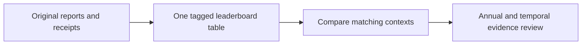

# Research leaderboard

| Algorithm / variant | Tags | Context | Period | Outcome | CAGR | Max DD | Sharpe | Calmar | Longest underwater sessions / days | Published evidence | Lesson |
| --- | --- | --- | --- | --- | --- | --- | --- | --- | --- | --- | --- |
| T11 with traffic-light cap | leveraged ETF · tactical · funded · risk gate | B | 2020–2025 | Development result | 92.03% | 36.90% | 1.64 | 2.49 | 199 /292 | [Snapshot](tasks/2026-10-28-leaderboard-source-catalog.md) · [Source hashes](tasks/evidence/2026-10-28-leaderboard-source-catalog.json) | Gate lowers depth but sacrifices growth and recovery time. |
| Ungated T11 | leveraged ETF · tactical · funded | B | 2020–2025 | Development result | 119.67% | 51.26% | 1.69 | 2.33 | 146 /214 | [Snapshot](tasks/2026-10-28-leaderboard-source-catalog.md) · [Source hashes](tasks/evidence/2026-10-28-leaderboard-source-catalog.json) | Gate lowers depth but sacrifices growth and recovery time. |
| Four-sleeve ensemble | leveraged ETF · tactical · funded | B | 2020–2025 | Development result | 93.88% | 61.04% | 1.60 | 1.54 | 157 /230 | [Snapshot](tasks/2026-10-28-leaderboard-source-catalog.md) · [Source hashes](tasks/evidence/2026-10-28-leaderboard-source-catalog.json) | Gate lowers depth but sacrifices growth and recovery time. |
| Original momentum | stocks · momentum · original sectors · replicated control | C | 2020–2025 | Historical treatment | 29.62% | 29.66% | 1.05 | 1.00 | 585 /847 | [Snapshot](tasks/2026-10-28-leaderboard-source-catalog.md) · [Source hashes](tasks/evidence/2026-10-28-leaderboard-source-catalog.json) | Original sector treatment has unknown classifications; see D repair. |
| Stock momentum | stocks/ETF · selection · base | A | 2020–2025 | Development result | 29.62% | 29.66% | 1.049 | 0.999 | 585 / 847 | [Snapshot](tasks/2026-10-28-leaderboard-source-catalog.md) · [Source hashes](tasks/evidence/2026-10-28-leaderboard-source-catalog.json) | Stock momentum beats its controls; longer underwater than SPY. |
| Original stock momentum | stocks · momentum · repaired sectors · replicated control | D | 2020–2025 | Development result | 29.62% | 29.66% | 1.0491 | 0.9986 | 585 /847 | [Snapshot](tasks/2026-10-28-leaderboard-source-catalog.md) · [Source hashes](tasks/evidence/2026-10-28-leaderboard-source-catalog.json) | Sector control improves vs matched target; trails original growth. |
| NVDA/AMD hold | NVDA/AMD · pairs/hold · fixed pair · benchmark | H | 2016–2025 | Development result | 64.66% | 65.70% | 1.27 | 0.98 | 407 / 592 | [Snapshot](tasks/2026-10-28-leaderboard-source-catalog.md) · [Source hashes](tasks/evidence/2026-10-28-leaderboard-source-catalog.json) | Pairs fails; pair-hold has hindsight selection and deep losses. |
| Sector cap | stocks · momentum · repaired sectors · sector cap | D | 2020–2025 | Development result | 24.52% | 25.48% | 1.0521 | 0.9622 | 583 /843 | [Snapshot](tasks/2026-10-28-leaderboard-source-catalog.md) · [Source hashes](tasks/evidence/2026-10-28-leaderboard-source-catalog.json) | Sector control improves vs matched target; trails original growth. |
| Momentum + sector limit | stocks · momentum · original sectors · sector cap | C | 2020–2025 | Historical treatment | 21.07% | 22.87% | 0.98 | 0.92 | 573 /828 | [Snapshot](tasks/2026-10-28-leaderboard-source-catalog.md) · [Source hashes](tasks/evidence/2026-10-28-leaderboard-source-catalog.json) | Original sector treatment has unknown classifications; see D repair. |
| Target-matched control | stocks · momentum · repaired sectors · control | D | 2020–2025 | Development result | 24.27% | 27.03% | 1.0378 | 0.8980 | 584 /846 | [Snapshot](tasks/2026-10-28-leaderboard-source-catalog.md) · [Source hashes](tasks/evidence/2026-10-28-leaderboard-source-catalog.json) | Sector control improves vs matched target; trails original growth. |
| Stock momentum · 50 bp + delay | stocks · selection · cost/delay stress | A2 | 2020–2025 | Development result | 26.25% | 30.43% | 0.957 | 0.863 | 603 / 875 | [Snapshot](tasks/2026-10-28-leaderboard-source-catalog.md) · [Source hashes](tasks/evidence/2026-10-28-leaderboard-source-catalog.json) | Stock stress drawdown exceeds30%; viewed-history stress. |
| Momentum + gate | stocks · momentum · original sectors · risk gate | C | 2020–2025 | Historical treatment | 19.65% | 26.67% | 0.86 | 0.74 | 606 /878 | [Snapshot](tasks/2026-10-28-leaderboard-source-catalog.md) · [Source hashes](tasks/evidence/2026-10-28-leaderboard-source-catalog.json) | Original sector treatment has unknown classifications; see D repair. |
| Momentum + both | stocks · momentum · original sectors · gate+sector cap | C | 2020–2025 | Historical treatment | 14.35% | 20.68% | 0.80 | 0.69 | 586 /848 | [Snapshot](tasks/2026-10-28-leaderboard-source-catalog.md) · [Source hashes](tasks/evidence/2026-10-28-leaderboard-source-catalog.json) | Original sector treatment has unknown classifications; see D repair. |
| Original SPY gate | sector ETF/SPY · daily · base · risk gate | E | 2017–2025 | Development result | 9.596% | 19.383% | 0.843 | 0.495 | 593 / 862 | [Snapshot](tasks/2026-10-28-leaderboard-source-catalog.md) · [Source hashes](tasks/evidence/2026-10-28-leaderboard-source-catalog.json) | Growth, drawdown and recovery favor different policies. |
| SPY holding (90% initial target) | stocks · momentum · original sectors · benchmark | C | 2020–2025 | Historical treatment | 13.62% | 29.79% | 0.79 | 0.46 | 488 /708 | [Snapshot](tasks/2026-10-28-leaderboard-source-catalog.md) · [Source hashes](tasks/evidence/2026-10-28-leaderboard-source-catalog.json) | Original sector treatment has unknown classifications; see D repair. |
| Sector momentum | sector ETF/SPY · daily · base | E | 2017–2025 | Development result | 13.630% | 29.682% | 0.798 | 0.459 | 195 / 287 | [Snapshot](tasks/2026-10-28-leaderboard-source-catalog.md) · [Source hashes](tasks/evidence/2026-10-28-leaderboard-source-catalog.json) | Growth, drawdown and recovery favor different policies. |
| SPY holding | stocks/ETF · selection · base · benchmark | A | 2020–2025 | Development result | 13.62% | 29.79% | 0.785 | 0.457 | 488 / 708 | [Snapshot](tasks/2026-10-28-leaderboard-source-catalog.md) · [Source hashes](tasks/evidence/2026-10-28-leaderboard-source-catalog.json) | Stock momentum beats its controls; longer underwater than SPY. |
| SPY hold | stocks/SPY · CAPM · no explicit costs · benchmark | F1 | 2016–2025 | Development result | 14.82% | 33.53% | 0.864 | 0.442 | 488 / 708 | [Snapshot](tasks/2026-10-28-leaderboard-source-catalog.md) · [Source hashes](tasks/evidence/2026-10-28-leaderboard-source-catalog.json) | CAPM fails against matched SPY even without explicit costs. |
| SPY hold | stocks/SPY · CAPM · commissions · benchmark | F2 | 2016–2025 | Development result | 14.82% | 33.53% | 0.864 | 0.442 | 488 / 708 | [Snapshot](tasks/2026-10-28-leaderboard-source-catalog.md) · [Source hashes](tasks/evidence/2026-10-28-leaderboard-source-catalog.json) | Stock stop lowers growth and prolongs recovery. |
| SPY hold | stocks/SPY · CAPM · 25bp stress · benchmark | F3 | 2016–2025 | Development result | 14.82% | 33.57% | 0.863 | 0.441 | 488 / 708 | [Snapshot](tasks/2026-10-28-leaderboard-source-catalog.md) · [Source hashes](tasks/evidence/2026-10-28-leaderboard-source-catalog.json) | Stop/re-entry and cost interaction is severe. |
| SPY hold | SPY · intraday · breakout · benchmark | G | 2016–2025 | Development result | 14.65% | 33.16% | 0.86 | 0.44 | 488 / 708 | [Snapshot](tasks/2026-10-28-leaderboard-source-catalog.md) · [Source hashes](tasks/evidence/2026-10-28-leaderboard-source-catalog.json) | Breakout improvement screen fails versus SPY. |
| SPY hold | NVDA/AMD · pairs/hold · fixed pair · benchmark | H | 2016–2025 | Development result | 13.64% | 31.26% | 0.86 | 0.44 | 488 / 708 | [Snapshot](tasks/2026-10-28-leaderboard-source-catalog.md) · [Source hashes](tasks/evidence/2026-10-28-leaderboard-source-catalog.json) | Pairs fails; pair-hold has hindsight selection and deep losses. |
| SPY hold | sector ETF/SPY · daily · base · benchmark | E | 2017–2025 | Development result | 13.950% | 31.942% | 0.846 | 0.437 | 488 / 708 | [Snapshot](tasks/2026-10-28-leaderboard-source-catalog.md) · [Source hashes](tasks/evidence/2026-10-28-leaderboard-source-catalog.json) | Growth, drawdown and recovery favor different policies. |
| Equal-weight stock universe | stocks/ETF · selection · base · control | A | 2020–2025 | Development result | 6.47% | 18.86% | 0.664 | 0.343 | 552 / 805 | [Snapshot](tasks/2026-10-28-leaderboard-source-catalog.md) · [Source hashes](tasks/evidence/2026-10-28-leaderboard-source-catalog.json) | Stock momentum beats its controls; longer underwater than SPY. |
| Equal-weight stocks · 50 bp + delay | stocks · selection · cost/delay stress · control | A2 | 2020–2025 | Development result | 6.19% | 18.12% | 0.650 | 0.342 | 553 / 806 | [Snapshot](tasks/2026-10-28-leaderboard-source-catalog.md) · [Source hashes](tasks/evidence/2026-10-28-leaderboard-source-catalog.json) | Stock stress drawdown exceeds30%; viewed-history stress. |
| Equal sectors | sector ETF/SPY · daily · base · control | E | 2017–2025 | Development result | 11.569% | 36.164% | 0.730 | 0.320 | 313 / 456 | [Snapshot](tasks/2026-10-28-leaderboard-source-catalog.md) · [Source hashes](tasks/evidence/2026-10-28-leaderboard-source-catalog.json) | Growth, drawdown and recovery favor different policies. |
| Equal-weight low-vol universe | stocks/ETF · selection · base · control | A | 2020–2025 | Development result | 5.96% | 18.87% | 0.615 | 0.316 | 573 / 835 | [Snapshot](tasks/2026-10-28-leaderboard-source-catalog.md) · [Source hashes](tasks/evidence/2026-10-28-leaderboard-source-catalog.json) | Stock momentum beats its controls; longer underwater than SPY. |
| CAPM without stop | stocks/SPY · CAPM · no explicit costs · negative baseline | F1 | 2016–2025 | Negative baseline | 10.87% | 42.10% | 0.583 | 0.258 | 716 / 1043 | [Snapshot](tasks/2026-10-28-leaderboard-source-catalog.md) · [Source hashes](tasks/evidence/2026-10-28-leaderboard-source-catalog.json) | CAPM fails against matched SPY even without explicit costs. |
| CAPM without stop | stocks/SPY · CAPM · commissions · negative baseline | F2 | 2016–2025 | Negative baseline | 10.66% | 42.13% | 0.575 | 0.253 | 716 / 1043 | [Snapshot](tasks/2026-10-28-leaderboard-source-catalog.md) · [Source hashes](tasks/evidence/2026-10-28-leaderboard-source-catalog.json) | Stock stop lowers growth and prolongs recovery. |
| ETF momentum | stocks/ETF · selection · base | A | 2020–2025 | Development result | 6.25% | 26.12% | 0.510 | 0.239 | 606 / 882 | [Snapshot](tasks/2026-10-28-leaderboard-source-catalog.md) · [Source hashes](tasks/evidence/2026-10-28-leaderboard-source-catalog.json) | Stock momentum beats its controls; longer underwater than SPY. |
| Equal-weight ETFs (5) | stocks/ETF · selection · base · control | A | 2020–2025 | Development result | 6.00% | 26.45% | 0.525 | 0.227 | 494 / 720 | [Snapshot](tasks/2026-10-28-leaderboard-source-catalog.md) · [Source hashes](tasks/evidence/2026-10-28-leaderboard-source-catalog.json) | Stock momentum beats its controls; longer underwater than SPY. |
| CAPM +1% stop | stocks/SPY · CAPM · no explicit costs · negative baseline | F1 | 2016–2025 | Negative baseline | 7.74% | 36.54% | 0.484 | 0.212 | 730 / 1063 | [Snapshot](tasks/2026-10-28-leaderboard-source-catalog.md) · [Source hashes](tasks/evidence/2026-10-28-leaderboard-source-catalog.json) | CAPM fails against matched SPY even without explicit costs. |
| CAPM +1% stop | stocks/SPY · CAPM · commissions · negative baseline | F2 | 2016–2025 | Negative baseline | 6.03% | 37.17% | 0.400 | 0.162 | 945 / 1378 | [Snapshot](tasks/2026-10-28-leaderboard-source-catalog.md) · [Source hashes](tasks/evidence/2026-10-28-leaderboard-source-catalog.json) | Stock stop lowers growth and prolongs recovery. |
| CAPM without stop | stocks/SPY · CAPM · 25bp stress · negative baseline | F3 | 2016–2025 | Negative baseline | 6.18% | 42.76% | 0.384 | 0.145 | 1121 / 1630 | [Snapshot](tasks/2026-10-28-leaderboard-source-catalog.md) · [Source hashes](tasks/evidence/2026-10-28-leaderboard-source-catalog.json) | Stop/re-entry and cost interaction is severe. |
| Low-volatility stocks | stocks/ETF · selection · base | A | 2020–2025 | Development result | 2.31% | 29.86% | 0.233 | 0.077 | 593 / 862 | [Snapshot](tasks/2026-10-28-leaderboard-source-catalog.md) · [Source hashes](tasks/evidence/2026-10-28-leaderboard-source-catalog.json) | Stock momentum beats its controls; longer underwater than SPY. |
| Causal NVDA/AMD pairs | NVDA/AMD · pairs/hold · fixed pair · negative baseline | H | 2016–2025 | Negative baseline | −2.18% | 25.62% | −0.41 | −0.09 | 2,341 / 3,401 | [Snapshot](tasks/2026-10-28-leaderboard-source-catalog.md) · [Source hashes](tasks/evidence/2026-10-28-leaderboard-source-catalog.json) | Pairs fails; pair-hold has hindsight selection and deep losses. |
| Causal Dual Thrust | SPY · intraday · breakout · negative baseline | G | 2016–2025 | Negative baseline | −3.80% | 34.06% | −1.03 | −0.11 | 2,493 / 3,620 | [Snapshot](tasks/2026-10-28-leaderboard-source-catalog.md) · [Source hashes](tasks/evidence/2026-10-28-leaderboard-source-catalog.json) | Breakout improvement screen fails versus SPY. |
| SPY intraday long | SPY · intraday · breakout | G | 2016–2025 | Development result | −19.80% | 88.99% | −1.70 | −0.22 | 2,513 / 3,649 | [Snapshot](tasks/2026-10-28-leaderboard-source-catalog.md) · [Source hashes](tasks/evidence/2026-10-28-leaderboard-source-catalog.json) | Breakout improvement screen fails versus SPY. |
| CAPM +1% stop | stocks/SPY · CAPM · 25bp stress · negative baseline | F3 | 2016–2025 | Negative baseline | -51.08% | 99.92% | -3.470 | -0.511 | 2514 / 3653 | [Snapshot](tasks/2026-10-28-leaderboard-source-catalog.md) · [Source hashes](tasks/evidence/2026-10-28-leaderboard-source-catalog.json) | Stop/re-entry and cost interaction is severe. |
| G-Score | stocks · fundamentals · blocked | GS | Not evaluated | Blocked: input semantics | — | — | — | — | — | [Snapshot](tasks/2026-10-28-leaderboard-source-catalog.md) · [Source hashes](tasks/evidence/2026-10-28-leaderboard-source-catalog.json) | Failed input probe; legacy ratios do not establish causal data. |
| Market conditions prototype | synthetic · stage development · unranked | W1 | Synthetic fixtures | Engineering-only; unwired | — | — | — | — | — | [Snapshot](tasks/2026-10-28-leaderboard-source-catalog.md) · [Source hashes](tasks/evidence/2026-10-28-leaderboard-source-catalog.json) | Combined score can soften bearish breadth; no economic validation. |
| Target selection prototype | synthetic · stage development · unranked | W1 | Synthetic fixtures | Engineering-only; unwired | — | — | — | — | — | [Snapshot](tasks/2026-10-28-leaderboard-source-catalog.md) · [Source hashes](tasks/evidence/2026-10-28-leaderboard-source-catalog.json) | Ranking differences do not establish financial superiority. |
| Risk/sizing prototype | synthetic · stage development · unranked | W1 | Synthetic fixtures | Engineering-only; unwired | — | — | — | — | — | [Snapshot](tasks/2026-10-28-leaderboard-source-catalog.md) · [Source hashes](tasks/evidence/2026-10-28-leaderboard-source-catalog.json) | Immediate cuts pass; gradual re-entry may miss rebounds. |

## How to read this leaderboard

This is the canonical current leaderboard: **one table**, with tags for asset
class, strategy type, overlay, benchmark/control role and test context. It contains
39 saved financial comparison rows plus four unranked closed outcomes, including
repeated controls; these are not43 unique strategies or43 new trials. Updated2026-10-28; zero new financial runs.

Financial rows are sorted by **reported Calmar descending for browsing**, followed
by unranked outcomes. Source precision is retained. **Compare performance within the same context code**; this
cross-context display order is not a universal scientific ranking. Dates, costs,
capital, leverage, execution and eligible universes differ. No blended score or
metric recalculation is introduced. The context descriptions below identify
those differences. Equal capital or dates alone do not equalize risk.

Tags identify what each row represents. `risk gate` and `sector cap` are policy
overlays; `control` and `benchmark` are comparison roles; `negative baseline`
means the specific study failed its improvement screen. `replicated control`
identifies repeated original policies in later matched tests. These tags are
navigation aids, not readiness or promotion decisions.

Drawdown is positive loss depth. CAGR is annualized; Sharpe assumptions and
underwater definitions remain study-specific. Reported durations count observed
sessions/calendar days under their source contract; local recovery-inclusive
metrics differ. An unrecovered ending is censored. Annual-reset drawdown cannot
replace continuous full-period drawdown.

Ungated T11 has the highest CAGR among these curated rows (119.67%,51.26%DD).
Gated T11 leads Calmar in its matched test (2.49), with lower growth and longer
underwater time. Stock momentum leads its base selection cohort (29.62%CAGR,
29.66%DD), but stressed drawdown reaches30.43%. The sector treatment improves
against its target-matched control while trailing the original policy’s growth.
No operationally approved winner, independent alpha or reliable annual doubling
has been established by these development records. The approximate30% reference
is a reassessment preference, not a guaranteed loss cap.

The original later-study reports/receipts are local-only. Table evidence links
resolve to the published aggregate snapshot and original-source hashes; they are
not raw financial evidence or independent reproduction. This document owns the
current selection and presentation of rows. MLflow/browser views are drill-downs.
Every completed research cycle reconciles this same table through research
management and history review, including failed, blocked, abandoned, inconclusive
and engineering-only outcomes. Tags, outcome, evidence/receipt and a short lesson
are required; unavailable metrics are `—`, never zero. Upsert exact cycle/case/context
identities and retain prior evidence. Unchanged results require a verified closure
note, not another row; inaccessible evidence leaves reconciliation explicitly pending. Scientific acceptance
remains with [GRS](research-standard.md), score meanings with
[scoring](research-scoring.md), priorities with [roadmap](roadmap.md).

## Contexts and lessons

### A. Stock and ETF selection — base costs

2020–2025; USD10,000 whole shares; native IB fees +25bp slippage; staged MOO,90% nominal targets;6% debit ACT/360, no credit interest. Monthly selection versus entry-only SPY; realized exposure and universe differ. Latest completed selection study replaces the earlier coverage-limited comparison for this view.

[Aggregate study summary](tasks/2026-10-28-leaderboard-source-catalog.md) · [Aggregate source provenance](tasks/evidence/2026-10-28-leaderboard-source-catalog.json)

Stock momentum has the highest displayed Calmar in this cohort, but its longest underwater stretch exceeds SPY. Fixed selected universes and viewed history limit generalization. Annual and temporal detail: [selection browser](http://127.0.0.1:8765/selection-completion-v1/index.html).

### A2. Stock selection — cost and delay stress

Same2020–2025 fixture as A, but50bp slippage and one additional observed-session decision delay. These rows form their own paired stress context.

[Aggregate study summary](tasks/2026-10-28-leaderboard-source-catalog.md) · [Aggregate source provenance](tasks/evidence/2026-10-28-leaderboard-source-catalog.json)

Stock momentum crosses30% drawdown under this stress. The stress was selected after observing its earlier result; this is disclosed development evidence.

### B. T11 and ensemble — funded, matched gate test

2020–2025; USD10,000; native IB margin/default fees +25bp slippage;90% base target; staged MOO;6% debit ACT/360; no credit interest. Embedded leveraged/inverse/volatility ETFs mean nominal allocation does not describe underlying economic leverage.

[Aggregate study summary](tasks/2026-10-28-leaderboard-source-catalog.md) · [Aggregate source provenance](tasks/evidence/2026-10-28-leaderboard-source-catalog.json)

Gated T11 improves displayed Calmar and drawdown depth, but reduces CAGR and extends underwater time. None meets the approximate30% drawdown reference. All three finish below a prior peak. [Annual and temporal browser](http://127.0.0.1:8765/qc504-t11-gate-v1/index.html).

### C. Stock momentum overlays — original classification treatment

2020–2025; USD10,000;25bp slippage, native IB fees,90% base target, staged MOO and6% debit financing. Historical classification gaps were grouped as unknown. These results are historical diagnostics; the repaired sector-only comparison is D.

[Aggregate study summary](tasks/2026-10-28-leaderboard-source-catalog.md) · [Aggregate source provenance](tasks/evidence/2026-10-28-leaderboard-source-catalog.json)

Do not treat the21.07% sector-only CAGR as the repaired sector strategy. D changes the classification treatment and adds a target-matched control. [Monthly selections, contribution and annual browser](http://127.0.0.1:8765/stock-risk-v1/index.html).

### D. Stock momentum — qualified sector treatment and target control

2020–2025; USD10,000;25bp slippage, native IB fees, staged MOO,90% base allocation and6% debit ACT/360. No market gate. Historical sector mappings are repaired under the study’s availability contract. Target-matched control matches intended allocation, not exact realized exposure.

[Aggregate study summary](tasks/2026-10-28-leaderboard-source-catalog.md) · [Aggregate source provenance](tasks/evidence/2026-10-28-leaderboard-source-catalog.json)

Sector cap improves Calmar by0.0643 against its matched control, while trailing the original momentum policy in growth and Calmar. This is a scoped tradeoff, not universal dominance. [Annual/contribution browser](http://127.0.0.1:8765/sector-matched-v1/index.html).

### E. Sector ETFs and SPY gate

2017-01-03–2025-12-31; USD300,000; USD1/order +5bp slippage;98% gross targets; no financing/interest model. Matched repaired buying-power setting2; observed closing cash remains positive and gross below99%.

[Aggregate study summary](tasks/2026-10-28-leaderboard-source-catalog.md) · [Aggregate source provenance](tasks/evidence/2026-10-28-leaderboard-source-catalog.json)

Sector momentum has a much shorter worst underwater run than SPY, but lower CAGR and more total underwater closes. The gate leads Calmar with lower growth and a longer worst underwater episode. [Annual browser](http://127.0.0.1:8765/sector-momentum-v1/index.html).

### F1. CAPM — no explicit commissions or added slippage

2016–2025; USD300,000; fixed29-stock legacy pool, minute execution, unchanged source sizing and6% debit ACT/360. Native bid/ask fills remain; this is not frictionless.

[Aggregate study summary](tasks/2026-10-28-leaderboard-source-catalog.md) · [Aggregate source provenance](tasks/evidence/2026-10-28-leaderboard-source-catalog.json)

`on`/`off` means1% per-stock stop enabled/disabled; `s` is the matching SPY hold. Every CAPM variant loses to its matched SPY on CAGR, Calmar, drawdown and longest underwater period. Retain as negative baselines. [All90 annual rows and contrasts](http://127.0.0.1:8765/capm-ablation-v1/index.html).

### F2. CAPM — native IB commissions

2016–2025; USD300,000; fixed29-stock legacy pool, minute execution, unchanged source sizing and6% debit ACT/360. No added slippage.

[Aggregate study summary](tasks/2026-10-28-leaderboard-source-catalog.md) · [Aggregate source provenance](tasks/evidence/2026-10-28-leaderboard-source-catalog.json)

`on`/`off` means1% per-stock stop enabled/disabled; `s` is the matching SPY hold. Every CAPM variant loses to its matched SPY on CAGR, Calmar, drawdown and longest underwater period. Retain as negative baselines. [All90 annual rows and contrasts](http://127.0.0.1:8765/capm-ablation-v1/index.html).

### F3. CAPM — commissions plus25bp stress

2016–2025; USD300,000; fixed29-stock legacy pool, minute execution, unchanged source sizing and6% debit ACT/360. 25bp added slippage is a stress assumption, not measured execution.

[Aggregate study summary](tasks/2026-10-28-leaderboard-source-catalog.md) · [Aggregate source provenance](tasks/evidence/2026-10-28-leaderboard-source-catalog.json)

`on`/`off` means1% per-stock stop enabled/disabled; `s` is the matching SPY hold. Every CAPM variant loses to its matched SPY on CAGR, Calmar, drawdown and longest underwater period. Retain as negative baselines. [All90 annual rows and contrasts](http://127.0.0.1:8765/capm-ablation-v1/index.html).

### G. Causal Dual Thrust and intraday controls

2016–2025; USD300,000; 98% targets, native IB commissions +5bp slippage;6% debit ACT/360 and3% short borrow ACT/365; no credit interest. This minute-execution cohort is separate from CAPM and pairs, even where dates match.

[Aggregate study summary](tasks/2026-10-28-leaderboard-source-catalog.md) · [Aggregate source provenance](tasks/evidence/2026-10-28-leaderboard-source-catalog.json)

Improvement screen failed versus SPY. Beating an intraday-long losing control did not establish a useful portfolio. [Annual and temporal browser](http://127.0.0.1:8765/dual-thrust-spy-v1/index.html).

### H. NVDA/AMD pairs and controls

2016–2025; USD300,000; native IB commissions +5bp/fill,6% debit ACT/360 and3% short borrow ACT/365. RAW execution,250 strictly-prior-session fitting,9:32 next-session execution. The fixed surviving pair is selected ex post.

[Aggregate study summary](tasks/2026-10-28-leaderboard-source-catalog.md) · [Aggregate source provenance](tasks/evidence/2026-10-28-leaderboard-source-catalog.json)

Pairs improvement screen failed. The high-growth pair-hold control has65.70% drawdown and hindsight selection; it is not a discovered robust strategy. [Result/annual and temporal browser](http://127.0.0.1:8765/stock-pairs-spy-v1/index.html).

## Unranked and archived evidence

- [G-Score](tasks/2026-10-28-leaderboard-source-catalog.md): blocked by fundamental
  input semantics; failed probe, zero qualified financial cases. No invented zero return.
- Three-agent market/selection/sizing wave: standalone synthetic prototypes only;
  engineering tests supply no financial ranking.
- [Earlier selection study](tasks/2026-10-28-leaderboard-source-catalog.md): history-window
  coverage limitations; A contains the later completed comparison.
- [Original sleeve ablation](tasks/2026-10-28-leaderboard-source-catalog.md): standalone
  rejected orders; [funded study](tasks/2026-10-28-leaderboard-source-catalog.md) repaired
  execution. B is the matched gate comparison, not a merger of policy versions.
- [Initial #504 reproduction](tasks/2026-10-28-leaderboard-source-catalog.md): different samples
  and incomplete long-case custom evidence; advertised returns are not our results.
- [Local SPY](../research/README.md), [leverage model](../research/leverage-model.md)
  and [100-idea suite](../research/strategy-suite.md): separate exploratory accounting,
  exposure and cost contexts; archived rather than silently mixed into hosted ranks.
- [Recursive research review](tasks/2026-10-25-recursive-research-review.md): historical
  risk-gate/cost/temporal evidence with retained failures and closed budgets.

Coverage is curated, not an exhaustive reconstruction of every historical run.
[Construction and verification](tasks/2026-10-28-leaderboard-source-catalog.md) records the original
39-row extraction. Later presentation changes preserve those measurements.

## Closure reconciliation notes

2026-10-28: single-table closure requirement exercised on the three closed W1
engineering submissions and the blocked G-Score cycle; all four remain unranked.
The original39 financial metric tuples are preserved. Corrected Ungated T11’s
mistaken risk-gate tag. Detailed verification is recorded in the [management closure amendment](tasks/2026-10-28-leaderboard-source-catalog.md); no financial run, new experiment allowance or promotion follows.
