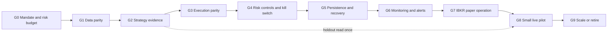
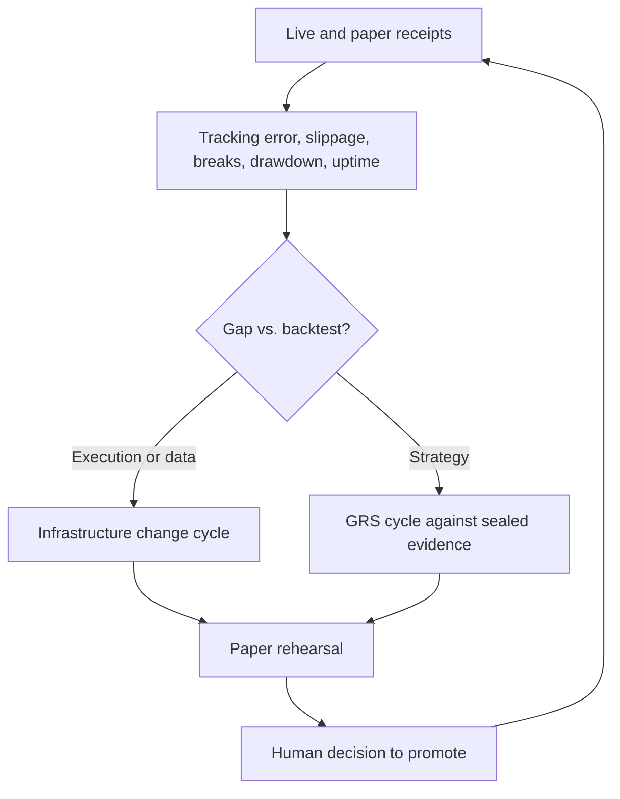

# Path to real money: gates, principles and improvement loop

This file owns the ordered readiness gates between today's research and a
real-money pilot, plus the principles for improving on live evidence. The
[mandate](goals.md) owns objectives and open risk choices, the
[roadmap](roadmap.md) owns infrastructure sequence, [GRS](research-standard.md)
owns research cycles, [scoring](research-scoring.md) owns metric meaning, and the
[incident SOP](operations/incidents.md) owns failure handling. Broker target:
[0004](decisions/0004-ibkr-target-broker.md).

**This plan authorizes nothing.** Orders, paper sessions and live access each need
their own scoped request. Passing a gate is evidence for a decision, not the
decision. Statuses below were taken from repository records on 2026-11-08;
`make check` was not rerun for this review.

## Principles

1. **Capital follows evidence.** Order of exposure: offline research, paper, small
   live pilot, scaled. Moving up needs the previous gate's receipt, never a good
   backtest alone.
2. **Protect an untouched evaluation window.** All current results use viewed
   history. Reserve forward time or a sealed holdout that no cycle reads until
   the candidate is frozen, and read it once. Failure retires the candidate; it
   is not retuned on that window.
3. **The loop optimizes the frontier, not one ratio.** Improvement means a
   candidate dominates its incumbent on net CAGR versus drawdown, with recovery,
   cost and tail guards, as in [scoring](research-scoring.md). Calmar stays a
   diagnostic.
4. **Live parameters change only through a closed GRS cycle** plus a paper
   rehearsal. No process edits its own live strategy, limits or risk gates.
5. **Safety does not depend on the strategy process.** The kill switch, loss
   limits and account checks run outside the code they constrain and fail closed.
6. **Default deny.** Paper identity checks (DU accounts, fixed loopback port) stay.
   No live port, host or mode exists in code before G8 is authorized.
7. **Unknown is not zero.** An unreconciled order, stale feed or missing fill
   halts submissions and waits for a human, per the incident SOP.
8. **Record failures with the same discipline as wins**, as GRS already requires.

## Gates

| Gate | Deliverable | Acceptance evidence | Roadmap link | Status 2026-11-08 |
| --- | --- | --- | --- | --- |
| G0 Mandate | Numeric capital at risk, leverage and concentration limits, daily and weekly loss budgets, pilot size, start date, tax treatment, rule when growth conflicts with drawdown | User-confirmed values recorded in the mandate | Mandate | Partial: objective, USD 300k and ~30% reassessment tolerance set; the rest open |
| G1 Data parity | One qualified source for research and live decisions, with known adjustment, calendar and timing rules | Audit receipt showing research and live bars agree on a sample, including corporate actions | M1 | Partial: free daily data; SIP versus IEX difference recorded; native catalog proof planned |
| G2 Strategy evidence | One frozen candidate respecting the drawdown tolerance after modeled costs | Sealed-holdout or forward result read once, trial count disclosed, leakage audit passed | GRS | Not met: all evidence is viewed history; leading candidate's recorded max drawdown (36.9%) exceeds tolerance |
| G3 Execution parity | Strategy runs on the Nautilus live node through the IB client, with the same decision and fill timing as the backtest | Fault fixtures (reject, duplicate, partial fill, disconnect after submit, restart) pass offline; replay matches backtest orders | M5 | Not met: no IB execution client in use; multi-ETF bridge absent |
| G4 Risk controls | Native limits configured plus portfolio drawdown, leverage and daily-loss stops and an independent kill switch | Fixture shows each limit halts or reduces; kill switch tested to cancel and flatten | M5 | Not met: configured behavior unexercised; no kill switch |
| G5 Persistence and recovery | Chosen state backend, order journal and restart reconciliation | Disposable crash, restart and restore drill with no blind resubmission | M3 | Not met: execution persistence unconfigured |
| G6 Monitoring | Freshness, health and alert path for dead worker, stale feed, capture failure, unreconciled state | Injected faults produce visible alerts with redacted account data | M4 | Not met |
| G7 IBKR paper operation | Paper account working and a supervised multi-week run | Receipts for orders, fills, reconciliation, uptime and tracking error against replay | M5 | Blocked: paper access never enabled; zero orders submitted |
| G8 Small live pilot | Separately authorized live session at the G0 pilot size with stop rules fixed beforehand | Daily reconciliation, measured slippage versus model, no breach of loss limits | Separate request | Not started |
| G9 Scale or retire | Decision from live evidence | Live-versus-paper-versus-backtest comparison; scale only if tracking error and drawdown are inside bounds | Separate request | Not started |

## Improvement loop on live evidence

Added metrics, in addition to those in [scoring](research-scoring.md): tracking
error of paper and live versus replay, realized versus modeled slippage and cost,
reconciliation breaks, halts and their causes, and feed uptime. They measure the
platform and are not investment returns.

## Immediate next steps

1. User resolves the G0 numbers (below) and the IBKR paper access request.
2. Reserve the G2 holdout and write the freeze rule before any further tuning.
3. Run the existing leakage-audit skill on the leading candidate's code.
4. M1 catalog proof and G3 fault fixtures can proceed offline without IBKR access.

## Decisions only the user can make

- Capital allowed at risk, and the pilot size as a share of it.
- Whether the 30% drawdown tolerance or the growth target gives way if no candidate
  meets both.
- Permitted instruments: leveraged ETFs, margin, options, shorting.
- Who monitors a live session and how fast they must respond.
- Whether tax is evaluated after personal taxes.
