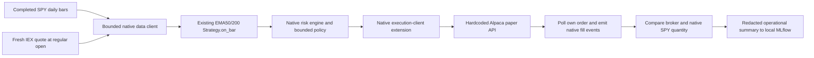
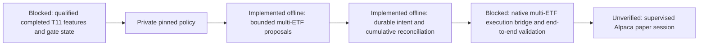

# Bounded Alpaca paper integration

This SOP owns the new Alpaca paper-only integration. The [IBKR observer](paper-connection.md)
is separate. [Architecture](../architecture.md) owns dependency boundaries;
[performance](performance.md) owns the existing local MLflow service.

## Scope and status

The pinned NautilusTrader wheel has no Alpaca adapter. We extend its public
`LiveMarketDataClient`, `LiveExecutionClient`, factories and `TradingNode` seams
for a narrow flat-start SPY session. Installed packages are unchanged. This is
**not a general Alpaca adapter or an unattended trading service**.



Verified: native EMA entry/exit and duplicate-quote suppression with a fake broker;
saved SPY signal replay; unknown-submission no-retry behavior; authenticated paper
account/asset/clock/empty-position/open-order preflight. Broker fill behavior is
**unverified**: market was closed during the current run. See the
[task receipt](../tasks/2026-10-25-alpaca-paper-integration.md).

## Fixed test policy

- Paper host is hardcoded `https://paper-api.alpaca.markets`. No host argument or
  live-trading mode; `APCA_API_BASE_URL` cannot select a different host. Only the
  listed account/clock/position/order/asset/calendar routes are available. Market
  data uses the separate fixed `https://data.alpaca.markets` host, read-only SPY.
- Keys come from ignored, owner-only `.env.alpaca` or the same named environment
  variables as the [data pilot](../data-library.md). No key values in command
  arguments, tracked files, summaries or MLflow artifacts.
- Start with an ACTIVE USD account, no blocks, at least USD1000 cash, **no existing
  positions and no open orders**. No attempt to clear unrelated account state.
- Long/cash only, one SPY share maximum, at most two orders, USD1000 maximum per
  order. No shorting, borrowing or pyramiding. Native risk remains enabled.
- Reuse original `ComparisonStrategy.on_bar` and native EMA50/200. Sizing changes
  from 99% cash to one share; execution changes from modeled market orders to
  regular-hours DAY limits up to 0.1% through a checked quote. This tests integration,
  not historical performance parity or the separate volatility risk gate.
- `session` considers one decision only within the first minute after 09:30 New
  York regular open, for up to 45 seconds of decision/order observation. It does
  not wait for a later opening, queue orders while closed, or run at boot.
- Warmup requests raw SIP daily bars over the prior 450 calendar days. Broker
  calendar dates must match all completed observed sessions with at least 200
  bars. Round signal inputs to cents, matching the saved fixture. Publication
  timestamp is unknown; feed each full bar at next New York midnight. Query fresh
  IEX quote separately: age 0–10 seconds, positive uncrossed prices, spread ≤1%.
  Historical SIP and live IEX sources are explicitly different.
- Before POST, check clock and broker quantity again; save a durable client-order
  journal first. Never resubmit after timeout. A submit timeout is **unknown**,
  not rejected. Repeated quotes cannot create another outstanding request.
- Only complete one-share fills are handled. Unexpected fractional partial fills,
  bad identity/price, missing status or disagreement halt submissions for manual
  reconciliation. After polling an acknowledged order, cancellation addresses only
  that order; unconfirmed cancellation remains unknown. No cancel-all or automatic
  liquidation. A completed buy may leave one paper share held after the test.
- Native startup/general reconciliation is disabled **only for this new bounded
  client**. Flat-start checks, exclusive lock, persisted unknown-order gate and
  end-of-session broker/native quantity comparison replace it for this test.
  Required general report/restart methods explicitly reject; no production or
  restart-safe reconciliation claim. IBKR configuration is untouched.
- One process at a time; 120 HTTP attempts maximum per run, no HTTP retries,
  10-second per-request timeout, 2 MB/response. A pending request may take time
  beyond the 45-second observation period to stop; unknown outcomes stay journaled.

## Commands

Run from the repository root, with the existing local MLflow server healthy:

```sh
.venv/bin/python scripts/alpaca_paper.py offline --log-mlflow
.venv/bin/python scripts/alpaca_paper.py replay --log-mlflow
.venv/bin/python scripts/alpaca_paper.py preflight --log-mlflow
```

`offline` uses synthetic signals and a fake broker. `replay` uses the saved Yahoo
SPY close sequence: 250 warmup observations through 2019 year-end, then 2020 Q1.
Its timestamps and USD100 fake fills are synthetic. Neither is a profitability
backtest; no return, CAGR, Sharpe or Calmar is logged. The original research files
are read-only and their source hash is recorded.

When explicitly running the bounded paper test at the next regular open:

```sh
.venv/bin/python scripts/alpaca_paper.py session --log-mlflow
```

This command can submit the bounded paper orders described above. It does not
submit a live order. Outside the first open minute it records a no-order result.
The current integration does not contain an installed scheduler or ongoing trader.

## Evidence, MLflow and recovery

Each run creates `.local/alpaca-paper/runs/<UTC-id>-<mode>/`: code snapshots/hashes,
redacted `summary.json`, optional native events, own-order journal and private HTTP
responses. Keep private HTTP/account responses out of public artifacts. The native
account ID is a local alias; native account type is CASH and does not simulate
the broker's margin capabilities. Fill commission is modeled zero, consistent
with this operational paper test; no dividend/borrow/return accounting is claimed.

Only the redacted summary enters **Alpaca paper integration — operational evidence**
in local MLflow. Tags separate `offline_fixture` from `broker_paper`; status
distinguishes closed/no-decision runs from fills. Metrics are operational counts.
The run receipt contains its browser link. Reimport of a finished identical summary
reuses the run; a failed import remains preserved for diagnosis.

If a prior real-session journal is not terminal, `session` rejects before any
submission. Inspect it and the paper account under the [incident SOP](incidents.md).
Do not delete a journal/lock or generate a new run ID to evade an unresolved state.
No automatic restart, partial-fill recovery, general external-order import or
position adoption is implemented. General risk/persistence milestones stay open.

Primary references: [Alpaca paper specification](https://docs.alpaca.markets/us/docs/paper-trading),
[client order identity](https://docs.alpaca.markets/us/docs/working-with-orders),
and installed NautilusTrader v1.231.0 adapter base classes/factories.

## T11 + traffic-light pilot preparation

The user selected **T11 + risk gate**, capped at USD10,000 for one supervised
session. This does not expand the existing SPY executable's limits. The
[implementation task](../tasks/2026-10-28-t11-paper-runner.md) owns dated acceptance
and evidence; this section owns operational status.

### Research-to-paper handoff

This handoff is assessed separately from research promotion and historical parity.
Before an order-bearing pilot, record each item as met, failed or unknown with
dated evidence. Failed or missing prerequisites block submissions; neither a green
market signal nor a higher Calmar overrides them. The checks apply to the exact
runner/account/session; the SPY slice's narrower policy remains unchanged.

- [ ] **Qualified inputs:** pinned policy/feature code, complete eligible universe,
  calendar, corporate-action/normalization and warmup semantics; source rights and
  as-of/availability timing. A caller's qualification flag is insufficient proof.
- [ ] **Fresh inputs:** completed signal session and fresh executable quotes checked
  against the frozen strategy/session policy and broker clock; stale, future,
  missing or unqualified inputs produce no new submission.
- [ ] **Capital and exposure limits:** authorized session capital, cash/buying power,
  aggregate reservations and fills, fees/reserve, concentration and leveraged-product
  exposure checks. Per-order limits do not establish an account-wide spending cap.
- [ ] **Native execution checks:** exact instruments, supported order types/timing,
  asset eligibility, risk engine, staged sells/buys and native order/fill events
  verified for the intended multi-instrument path.
- [ ] **Account/order reconciliation:** positions, open orders and cumulative fills
  reconciled with broker truth before submission and at session close; unrelated
  state is neither adopted nor cancelled implicitly.
- [ ] **No unresolved submissions:** durable intent/client IDs survive timeout;
  an unknown submission or cancellation blocks another submission until reconciled.
  New IDs, process restarts or journal deletion cannot turn unknown into rejected.
- [ ] **Restart/recovery:** test duplicate prevention, partial fills, crash before/
  after acknowledgement, lock ownership and recovery against durable evidence and
  broker observations. A restarted journal object alone is not account recovery.
- [ ] **Session owner and bounds:** named supervisor, exact start/stop windows,
  request/order/time budgets, stop/escalation action and retained redacted receipt.
  No ongoing host, recurring session or automatic liquidation is implied.

`research/workflow_readiness.py` can summarize these reviewer observations offline;
it cannot arm a runner, authenticate evidence or connect to the account. Existing
execution checks and the [incident SOP](incidents.md) retain operational authority.

**Saved T11 assessment (2026-10-30, read-only):** the
[export audit](../tasks/evidence/2026-10-29-t11-export-validation.json) reports
aggregate compatibility, with no original daily decision trace or reconciled cash/
position ledger. The [rehearsal receipt](../tasks/evidence/2026-10-29-t11-paper-rehearsal.json)
reports `order_bearing_ready: false` and zero submissions. Qualified operational
features, the native multi-ETF/aggregate-budget bridge and account/restart proof
remain missing. The saved green signal does not qualify those gaps or establish
current freshness. T11 remains **unqualified for orders**; this review performs
no new data acquisition, financial run, broker connection or session.



`paper_trading/t11_pilot.py` implements **offline preparation only**, without
credentials or network calls. It accepts base weights, applies the traffic-light
cap once, uses at most90% of a pilot capital allocation no larger than USD10,000,
reserves USD2 per target and sizes whole-share purchases at explicit auction
limits. At most three of24 source decision symbols may be proposed. It rejects
future/unavailable or more-than-four-day-old inputs, unpinned/unqualified policy
claims, stale/wide/crossed quotes and proposals outside the ten-to-two-minute
window before the broker-supplied regular open. A qualification field is an
upstream assertion, **not proof**: no qualified live feature producer exists yet.
The caller must independently validate calendar, flat account, buying power,
all asset eligibility and all signal provenance; proposal generation does not
perform those broker checks.

Auction-limit proposals differ from source T11's market-on-open execution and
can remain unfilled. This is an explicit proposed operational safeguard, not
historical execution parity. Alpaca rejects OPG submissions after09:28 and
before19:00 Eastern. No command queues these proposals overnight. Limit
consideration bounds purchases, not later portfolio market value or leveraged
ETFs' underlying exposure. The 10% reserve and USD2 allowances are not a modeled
or guaranteed broker fee schedule.

The exclusive, fsynced journal rejects duplicate reservations and tracks
cumulative partial fills across restarted objects. Unknown reservations remain
unresolved; there is no resubmission, cancellation or automatic lock removal.
Identity mismatches, regressing fills and changed terminal observations fail
closed and preserve prior records. This is a tested preparation seam, **not**
native fill-event emission, portfolio reconciliation, a general live OMS or a
complete paper runner. Aggregate spending and staged sells/buys must be enforced
by the future native bridge; individual journal reservations do not authorize
orders or enforce an account-wide cap.

**Blocked before launch:** qualified full-universe T11 features and initialized
gate state; native multi-instrument instruments/events, staged execution,
aggregate budget enforcement, account reconciliation and supervised end-to-end
checks. No T11 session command is exposed. The historical reproduction goal
remains separate; missing original daily reference results need not prevent an
operational paper test once its own signal/execution qualification passes.

References: [Alpaca auction orders](https://docs.alpaca.markets/us/docs/orders-at-alpaca)
and [historical bar adjustments](https://docs.alpaca.markets/us/reference/stockbars).


### Read-only T11 decision preview

[October29 rehearsal](../tasks/2026-10-29-t11-paper-rehearsal.md) adds a
**prototype preview**, not an order-bearing T11 session. Explicitly running
`scripts/t11_paper_preview.py` downloads a bounded snapshot using only GET on
historical bars and the calendar, then saves features privately and emits a
redacted policy preview. It requires after21:00 New York and a completed current
trading session; it is not an automatic every-day collector or a scheduler.
Each execution consumes its own declared request/data budget; do not use repeated
executions to bypass a failed or exhausted collection.

Inputs use SIP daily bars (`all` adjustments for features, RAW SPY for the gate).
A2016 seed and a shorter-seed stability diagnostic are explicit operational
prototype choices, not original2004 history or native LEAN parity. No qualification
flag is set and no live quote/order proposal is produced. Results must not be
passed directly to the order planner by changing their status string. The native
multi-ETF bridge, aggregate budget and account/restart proof remain required.
Raw responses and derived feature values stay private. Native catalog import,
corporate-action verification and redistribution rights are not inferred from
successful API access.
