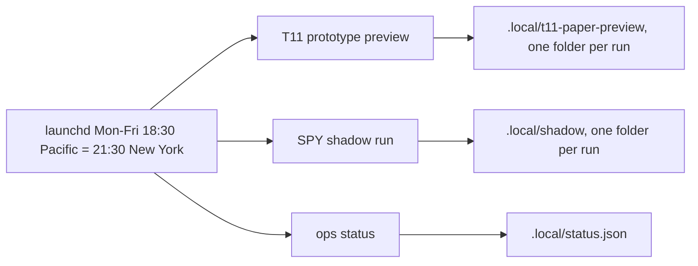

# Daily read-only schedule (macOS launchd)

Installed 2026-11-08 on the user's Mac, with their approval. It fetches market data with GET
requests only, writes local files, and cannot submit an order. It does not start a trading
session, a paper session or any broker action. See the [incident SOP](incidents.md) for
what to do when `ops_status` reports a problem.

## What runs

One job, `com.kenfuliang.qtl-daily` (`~/Library/LaunchAgents/com.kenfuliang.qtl-daily.plist`), runs
three independent steps in order, each logging to `.local/logs/` in the runner folder. A failing
step does not stop the next.

1. `scripts/t11_paper_preview.py`: the unqualified T11 prototype target. It fails on weekends and
   market holidays (the latest date must be a completed session); a failed run is preserved and
   skipped by the log view.
2. `scripts/spy_shadow_run.py --fetch`: hypothetical SPY EMA50/200 positions for the sealed forward
   cycle [FWD-SPY-EMA-1](../tasks/2026-11-09-forward-spy-ema.md). No tracking-error comparison yet, because
   the forward replay glue is not written.
3. `scripts/ops_status.py`: health table, `.local/status.json`, and alerts to stdout and the alert log.

## Where it runs and why

A separate clean clone, `~/git/quant-trading-lab-runner`, on `main`, not your working checkout. The job
must not depend on an uncommitted or switched working tree, and the frozen plan hashes the shadow code;
the runner is **never auto-pulled**, so the code stays what was frozen. Update it deliberately with
`git -C ~/git/quant-trading-lab-runner pull --ff-only` and re-check the plan's code hashes first.
Credentials are not copied: `.env.alpaca`, the pinned policy folder and the preview output folder are
symlinks to the main checkout's ignored files, so results accumulate in one place.

## Operate it

- Status: `launchctl print gui/$(id -u)/com.kenfuliang.qtl-daily`
- Run now (a weekend run will fail the preview, harmlessly): `launchctl kickstart gui/$(id -u)/com.kenfuliang.qtl-daily`
- Pause: `launchctl bootout gui/$(id -u)/com.kenfuliang.qtl-daily`
- Resume: `launchctl bootstrap gui/$(id -u) ~/Library/LaunchAgents/com.kenfuliang.qtl-daily.plist`
- Remove: bootout, then delete the plist.
- Logs: `~/git/quant-trading-lab-runner/.local/logs/` (`preview.log`, `shadow.log`, `ops.log`, `launchd.err`).

## Limits

- Runs only while the Mac is on and logged in; launchd runs a missed job on wake, but a long sleep over
  a close can skip a day's data. Check `ops_status` for freshness.
- Not yet observed firing on its own: first scheduled run is Monday 2026-11-09 at 18:30 Pacific.
- No tested remote alert path. Alerts go to local files unless `QTL_ALERT_*` variables are set for the job.
- The target-log page is not rebuilt automatically; run `scripts/t11_target_view.py` to refresh it.

## Single entry page

`scripts/dashboard.py` writes `.local/progress/index.html`, one tab bar over the progress, holdings, profile and target pages that exist in that folder, with each page's build time. Open `http://localhost:8780/` (serve only `.local/progress`). It does not build the pages; run it last, after the page scripts. `scripts/progress.py build` now writes `progress.html`.
