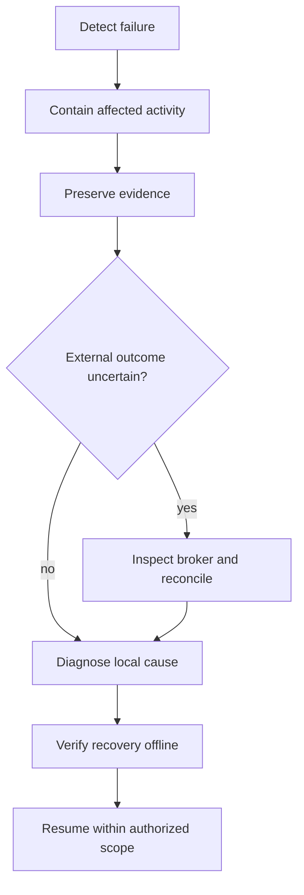

# Incident and recovery SOP

This file owns handling failed checks, stale data, worker crashes, and uncertain
broker outcomes. Use the [incident template](../templates/incident.md) for a
durable record; keep sensitive raw evidence under ignored `.local/`.

1. **Contain:** identify mode and affected process. For current observation tools,
   stop the observer. For future execution, use the verified pause-submissions
   control if available; if unavailable, report that limitation immediately.
   Stopping a process does not cancel broker orders.
2. **Preserve:** record UTC time, command, exit/error, run identity if available,
   configuration/code identity, last known healthy state, and redacted evidence.
   Keep original inputs and logs unchanged.
3. **Establish state:** distinguish failed, stale, and unknown. For broker work,
   inspect external orders/fills/positions before retrying. If access is unavailable,
   keep outcome unknown and submissions paused. Never infer rejection from timeout.
4. **Diagnose:** isolate environment, data, configuration, adapter, account-access,
   or external-connectivity failure. Account provisioning stays with IBKR/user.
   Avoid repeated reconnect loops or changing ports to discover a working account.
5. **Verify:** reproduce the failure with a fixture where practical, apply a focused
   fix, and exercise recovery. Verify matching state and adequate feed freshness
   before execution resumes. Record unresolved discrepancies explicitly.
6. **Close:** record cause, action, verification, residual uncertainty, and next
   prevention task. Update current capability status if readiness changed.

Canceling orders and closing positions are distinct external actions. Authorization
for a diagnostic check does not authorize either. Future execution controls must
record who requested an action and its observed outcome.

No automated trading/execution recovery controls exist yet. Closed research file
bundles have a separate [copy-only recovery SOP](evidence-recovery.md); this does
not resume a failed experiment or recover external execution state. This SOP specifies operator behavior and
requirements for later implementation; it does not establish recovery readiness.

## Offline controls and alert response (implemented, fake-broker tested only)

These offline controls exist now. None has been exercised against a real broker, and
none authorizes cancelling an order or closing a position.

| Signal | Meaning | Operator action |
| --- | --- | --- |
| `ops_status` check `kill_switch` engaged | The sentinel (`.local/kill-switch/HALT`) exists or is unreadable; all new orders are blocked, including exits | Read the reason with `scripts/kill_switch.py status`. Review broker state yourself. Release only with `release --actor NAME --note TEXT` after the cause is understood; a release is journaled |
| `journal` unresolved | A session journal entry is `unknown_submission`, `reconciliation_required` or `cancel_requested_unconfirmed` | Treat the order as unknown. Inspect the paper account under this SOP. Do not delete the journal or lock, start a new run id, or resubmit. `paper_trading/recovery.py` can classify entries against a broker but is not yet called by `session` |
| `journal` stuck | A `reserved` entry is older than 15 minutes | Same as unresolved: the POST may or may not have reached the broker |
| `shadow` missing, stale or failed | No recent read-only shadow run completed | Re-run `scripts/spy_shadow_run.py`; a failed run keeps its directory for diagnosis |
| `shadow` flagged | Shadow decisions disagree with the backtest replay | Investigate before trusting either; this is a signal-parity or data-timing question, not a trade |
| `data` stale or missing | The latest bar is older than 96 hours or absent | Do not infer a position from old data |

Run `.venv/bin/python scripts/ops_status.py` to write `.local/status.json`, print the
table and deliver alerts. It exits 1 when anything is unhealthy. Remote alert sinks
turn on only through `QTL_ALERT_*` environment variables. `ops_status` reads the
kill switch under `--root`; if `QTL_KILL_SWITCH` moves the sentinel elsewhere, the
monitor will not see it.

