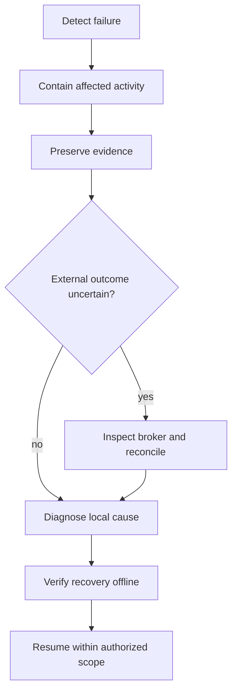

# Incident and recovery SOP

This file owns handling failed checks, stale data, worker crashes, and uncertain
broker outcomes. Use the [incident template](../templates/incident.md) for a
durable record; keep sensitive raw evidence under ignored `.local/`.

1. **Contain:** identify mode and affected process. For current observation tools,
   stop the observer. For future execution, use the verified pause-submissions
   control if available; if unavailable, report that limitation immediately.
   Stopping a process does not cancel broker orders.
2. **Preserve:** record UTC time, command, exit/error, run identity if available,
   configuration/code identity, last known healthy state, and redacted evidence.
   Keep original inputs and logs unchanged.
3. **Establish state:** distinguish failed, stale, and unknown. For broker work,
   inspect external orders/fills/positions before retrying. If access is unavailable,
   keep outcome unknown and submissions paused. Never infer rejection from timeout.
4. **Diagnose:** isolate environment, data, configuration, adapter, account-access,
   or external-connectivity failure. Account provisioning stays with IBKR/user.
   Avoid repeated reconnect loops or changing ports to discover a working account.
5. **Verify:** reproduce the failure with a fixture where practical, apply a focused
   fix, and exercise recovery. Verify matching state and adequate feed freshness
   before execution resumes. Record unresolved discrepancies explicitly.
6. **Close:** record cause, action, verification, residual uncertainty, and next
   prevention task. Update current capability status if readiness changed.

Canceling orders and closing positions are distinct external actions. Authorization
for a diagnostic check does not authorize either. Future execution controls must
record who requested an action and its observed outcome.

No automated trading/execution recovery controls exist yet. Closed research file
bundles have a separate [copy-only recovery SOP](evidence-recovery.md); this does
not resume a failed experiment or recover external execution state. This SOP specifies operator behavior and
requirements for later implementation; it does not establish recovery readiness.
