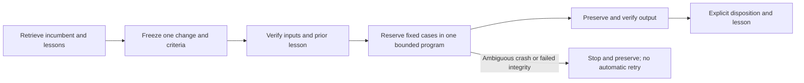
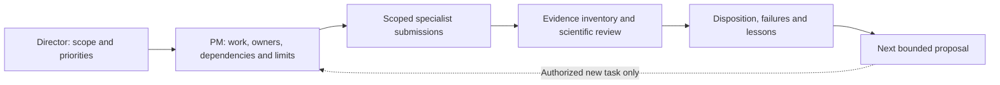

# Recursive research operating procedure

This file owns offline RSI handoffs; [GRS](../research-standard.md) owns research,
evidence and adoption rules. [Catalog](../skills.md) owns callable skills.
[Integration receipt](../tasks/2026-10-27-rsi-integration.md) owns actual proof and
limits. No financial execution adapter or unattended optimizer is available.



| Step | Existing skill route | Required handoff |
| --- | --- | --- |
| Manage | ask-pm → trade-research-management when a program needs coordination | Declared work IDs/owners, original bounds, evidence status, dependencies and next proposed handoff |
| Retrieve | trade-project → trade-research-history | Exact parent, prior failures, access history and open question |
| Freeze | trade-stage-development for a component change; trade-candidate-evolution → trade-research-design | One changed stage, falsifier, controls, timing and finite bounds |
| Preflight | trade-data-audit; feature workflow when relevant | Input hashes and known-lesson check; missing/failed evidence stops dependent work |
| Execute | trade-experiment, only through a supported adapter | Frozen cases and shared program limits; actual reservation, exit and outputs |
| Verify | trade-performance-diagnosis → trade-robust-evaluation | Accounts, comparability, uncertainty, adverse and failed evidence |
| Disposition | trade-promotion-review | Exact incumbent/candidate identities and scoped retain/provisional/adopt decision |
| Close | trade-research-history → trade-research-management; ask-pm checks completion | All attempts, evidence, lesson and next question; canonical leaderboard reconciliation per the closure contract below |

These are handoffs, not an automatic dispatcher. Infrastructure repairs use
trade-infra-change. Existing financial runners are not eligible through the new
coordinator; synthetic registry adoption does not promote a financial strategy.

## Current commands

```sh
.venv/bin/python scripts/current/rsi_foundation.py preflight
.venv/bin/python scripts/current/rsi_foundation.py preflight --evidence-root /path/to/qualified-local-history
.venv/bin/python scripts/current/rsi_foundation.py demo --evidence-root /path/to/qualified-local-history --output .local/new-rsi-demo
```

Default preflight is read-only. Historical evidence absent from a fresh checkout
returns JSON `unavailable` with exit 2. Bad integrity/unsafe paths return `failed`
with exit 1. Successful real preflight recognizes only the pinned C001 diagnostic
transition, preserving its failed gate, one consumed attempt and unchanged incumbent.
No code is imported from `--evidence-root`; the installed current helper is used.
This option does not download, modify or qualify arbitrary historical data.

Demo requires an exclusive output inside this checkout and a passing real preflight
before output creation. Its coordinator bounds two registered synthetic cases to
120 seconds and zero financial slots; the recorded integration invocation also uses
an enclosing 120-second process timeout for preflight/setup/adoption/report writing; a third request is rejected. Verified cache
reuse does not relaunch. Synthetic adoption is explicitly rolled back. Unit tests
use isolated fixtures, including synthetic historical closures; those fixtures do
not make the real historical check available or establish financial performance.
The old process-policy fixture result is retained as historical evidence, not rerun.

## Recovery and authority

Program identity freezes source/interpreter/input hashes, cases, criteria and shared
limits. New cycle names do not reset a program budget. ResearchController owns the
single writer/logical journal; RSIProgram owns actual fixed-command reservations,
process outputs and execution log. Failed starts/timeouts consume reservations.
Missing execution authority in an already initialized program stops even if no
launch was reserved; reopening cannot reset its deadline. An unsealed launch intent after interruption is ambiguous: stop and reconcile;
never retry automatically or erase the reservation. Completed cache reuse requires
verified artifacts. Source or input drift rejects reuse.

AdoptionRegistry requires exact plan/evaluation context, checks, numerical gates and
artifact hashes; explicit rollback records the prior identity. Hashes establish
byte identities, not evaluator independence, data rights, causal truth or alpha.
Financial passing evaluations remain provisional. These local lock/fsync journals
are not an OS sandbox, broker state authority or signed tamper-proof archive.
MLflow/browser views do not replace receipts or authorize execution.


## Adoption registry authority and reconciliation

New registries persist `initialized.json` before their first journal record. It
binds configuration and the local lock file's device/inode identity. Journal,
head, marker and lock must remain regular non-symlink files. Active writers seal
authority bytes and verify the lock identity before new decisions; loss, replacement
or an older valid state stops progress rather than resetting the incumbent.
Missing locks in initialized directories cannot be silently recreated. A partially
initialized registry also requires reconciliation.

Unmarked prior registry evidence, including earlier demos, is preserved. This
revision does not automatically migrate or reopen it. Keep the original files and
receipts; a restored/copied registry or lock whose identity changed requires a
separate reviewed reconciliation, not a routine constructor retry. This is local
fail-closed engineering, not offsite recovery or cryptographic authenticity.
[PR #7 final review](../tasks/2026-10-27-pr7-final-review.md) records the fixes and
actual regression checks; historical integration receipts retain their old identities.


## Developing one stage

Use trade-stage-development when a cycle specifies or changes a component boundary;
[the stage procedure](../research-development.md#individual-stage-development) owns
its worksheet, timing and verification details. It hands a frozen proposal to input
preflight, implementation and scoped evaluation. Direct synthetic component checks
are engineering verification, not financial execution through the RSI coordinator.
The existing adapter restriction remains: only fixed synthetic and saved-read-only
adapters are supported; adding a skill does not register a financial runner.

## Research management

This section owns management handoffs. The [catalog](../skills.md) owns skills
and role readiness, [roadmap](../roadmap.md) owns priority, GRS owns scientific
acceptance, and original plans/journals/receipts retain execution authority.
Management records are dated derived reviews; they do not replace those owners.



1. Freeze the named review program, expected submissions, evidence root and hash
   manifest, owner, finite verification bounds and zero/new financial allowance.
   Retrieve historical failures before deriving status. Existing programs keep their
   consumed attempts and deadlines; management review does not reopen them.
2. Maintain a [scoped work register](../templates/research-management.md), linking
   each owner/contract to reservations, results, partial outputs, lesson, blocker
   and dependency. Use original records, including unsuccessful starts. Mark absent
   evidence unknown and failed evidence failed. Duplicate or overlapping proposals
   return to the existing owner before scheduling additional work.
3. For fixed wave1-style JSONL reservation/JSON-result records, the read-only helper
   `scripts/current/research_management.py --evidence-root ROOT --manifest FILE`
   verifies declared hashes, check identities, consumed command count and zero
   financial launch declarations. It prints JSON: exit0 verified declared evidence,
   exit2 missing artifacts, exit1 failed/invalid evidence. It performs no commands
   from submissions, writes or automatic discovery. Other receipt formats require
   explicit manual reconciliation, not an inferred pass.
4. The helper accepts schema_version1, program and1..16 items. Each item declares
   id, owner, max_commands, artifacts(relative path:SHA256), reservations(JSONL path)
   and checks(distinct JSON-result paths). Every check/reservation must be in
   artifacts. Files are regular nonsymlinks beneath the supplied root, <=10MB each,
   <=128 per item; CLI manifest <=1MB. The manifest is a caller-supplied projection,
   not authenticated authority. Limits must be checked against original contracts;
   omitted trials, forged mutually consistent records, data rights, actual resource
   use and scientific truth cannot be established by hash matching.
5. Reconcile interpretation with specialists. Administrative completion cannot
   promote a strategy. Preserve adverse evidence and incomparable contexts; run
   trade-promotion-review only for its scoped decision. Use trade-research-history
   to record closure and refresh existing cycle/evidence navigation.
6. Propose one next task with dependency, accountable role, finite limits and
   acceptance/failure cases. Describe whether it is proposed, authorized or launched;
   consultation alone ends at a proposal. Dispatch and execution need their own
   user-authorized scope. This is a request-driven workflow, not an unattended PM
   service, new result database, dashboard or financial runner.

The [three-agent exercise](../tasks/2026-10-28-research-management-pr.md) records
actual evidence, mutation controls and usefulness limits. Format validation and
one saved-wave exercise do not establish general project-management effectiveness.

## Leaderboard closure contract

Every completed research cycle reconciles the **existing** `docs/leaderboard.md`
in the owning research checkout, including negative, failed, blocked, abandoned,
inconclusive and engineering-only closures. An isolated review checkout must resolve
that original owner; it must not create a second leaderboard or copy source history
merely to satisfy a missing local link. This branch publishes the owning file alongside its management skills; original
local-only financial records remain outside the published aggregate snapshot.

The [scoring contract](../research-scoring.md#calmar-headline-display-score) owns
Calmar as the headline display score. Each closure keeps evidence status, CAGR,
drawdown and time underwater beside it, preserving undefined reasons and context.
This changes no machine research priority or GRS acceptance gate.

The leaderboard owns its table presentation. It begins with one table; explanation,
context definitions and archive links follow. Its closure procedure is:

1. Identify the cycle/plan, exact candidate/control case and context (dates, capital,
   universe, costs, financing, execution, leverage and evaluation exposure). Use that
   identity to upsert, not duplicate, its current entry. A replication links prior
   evidence; cached results and retries are not new strategies or independent trials.
2. Reconcile all attempts, integrity status and scientific disposition first. Add
   meaningful tags for asset class, mechanism, overlay, test context and evidence
   state. Infer tags from the actual rule, not substring matches (`ungated` is not
   a risk gate). Keep distinct cost/input treatments identifiable in the same table.
3. Attach the source study, receipt and lesson, including contradictory results,
   warnings and failures. Show the result status and a short lesson in the table;
   use source links for full attempt history and annual/temporal detail. Metric
   eligibility follows GRS. A failed improvement screen can remain a valid measured
   negative baseline; an invalid run cannot be ranked as qualified evidence.
4. For missing, failed-integrity, blocked, inconclusive or engineering-only outcomes,
   use an unranked status row; unavailable financial metrics are `—` with the reason
   in status/lesson, never zero or invented values. Preserve valid prior rows and
   identify which version/treatment was superseded, rather than erase history.
5. Verify table uniqueness, source/metric identity, tags and evidence/lesson links;
   preserve all original reports, receipts and raw failures. Record the leaderboard
   path, before/after hashes, stable row identities, outcome and verification in
   the cycle's closure receipt (corrections use linked amendments).
6. Completion requires reconciled leaderboard evidence. If evidence is unchanged,
   append a verification note and receipt reference under the existing explanation;
   do not add a duplicate row. If the owning file or evidence is inaccessible, record
   `research closed; leaderboard reconciliation pending` with the blocker. Do not
   fabricate readiness or keep executing a scientifically closed program.

For review-only questions `/ask-pm` reports reconciliation status and the missing
handoff; it writes only when the user requests an update or as part of authorized
cycle closure. This instruction-level requirement does not add an automatic runner,
CI financial gate, scheduler or additional experiment allowance. GRS remains the
scientific acceptance owner; a leaderboard update grants no operational promotion.
