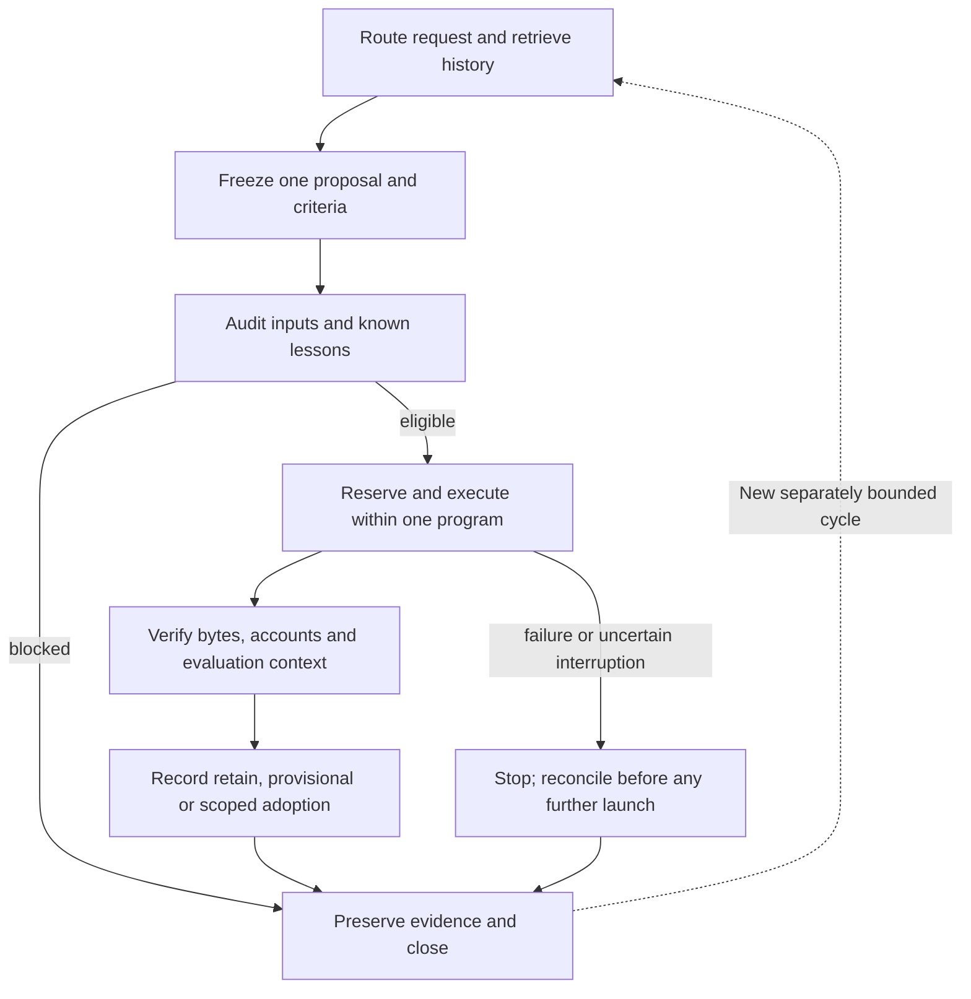

# Recursive research operating procedure

This SOP owns the operational handoffs for the bounded RSI foundation.
[GRS-1.1](../research-standard.md) owns the research/adoption/report rules;
[research development](../research-development.md) owns scientific lifecycle
contracts; [the catalog](../skills.md) owns skill discovery and readiness.
Implementation and validation status belongs to the
[foundation checklist](../tasks/2026-10-27-rsi-foundation-implementation.md).
Following this sequence does not start a scheduler or make a financial runner
eligible. Research improvement and financial improvement require separate evidence.



## Handoff checklist

Invoke existing skills through their entries in the catalog. The following is a
calling sequence, not another roster or permission system. One person or agent can
perform several steps, but the proposer cannot redefine the frozen evaluator.

| Step | Skill selection | Required input → handoff output | Stop condition |
| --- | --- | --- | --- |
| 1. Scope and retrieve | `trade-project`, then `trade-research-history` | Request and current context → exact incumbent, prior attempts/failures, data-exposure history and one open question | Missing incumbent/parent identity or closed budget |
| 2. Propose and freeze | `trade-candidate-evolution`, `trade-research-design`; `trade-stage-development` for a stage implementation | Prior evidence → one changed stage, mechanism, falsifier, simpler controls, interface/timing and immutable criteria/bounds | Unbounded search, changed success definition or duplicated dead end without new evidence |
| 3. Input and lesson preflight | `trade-data-audit`; `trade-feature-engineering` only when relevant | Frozen plan and source bytes → provenance/availability/artifact checks and saved-failure regression receipt | Missing qualified inputs, failed known lesson or contradictory evaluation exposure |
| 4. Execute | `trade-experiment` through a supported coordinator adapter | Eligible frozen case → actual reservation/command/exit, output and artifact manifest | Unsupported adapter, exhausted program budget, changed bytes or ambiguous execution state |
| 5. Diagnose and verify | `trade-performance-diagnosis`, `trade-robust-evaluation`; portfolio workflow when relevant | Preserved output and controls → scoped evaluation, adverse evidence and unresolved uncertainty | Invalid accounts, incomplete evidence or incomparable context |
| 6. Disposition | `trade-promotion-review` | Frozen criteria and verified evaluation → explicit prior/new version and retain/provisional/adopt decision | Missing required check; no inferred adoption from a high score |
| 7. Close and learn | `trade-research-management`, then `trade-research-history` | All attempts and disposition → validated receipt, lesson, leaderboard disposition, regression/check change, next eligible question | Missing failed/partial attempt, invalid new-format receipt or overstated claim |

Use `trade-infra-change` to implement or repair this infrastructure and
`trade-local-ops` for operational failures. Advisory perspectives can challenge
the plan through the catalog; adding a team name does not implement a workflow.
Add a new skill only when repeated use exposes a workflow not covered here.

## Research management

Use the catalog to invoke `/ask-pm` for advisory coordination or
`trade-research-management` for an authorized durable closure. The manager checks
cycle ownership, completed attempts, failed/partial evidence, remaining budget and
next prerequisites; it cannot replenish a closed program or declare readiness from
a high score. A missing input is a named blocker, not permission to launch another
cycle. Consultation does not launch agents.

Before closing a new cycle, validate its receipt using the
[GRS receipt contract](../research-standard.md#experiment-receipt-contract).
Retain the actual validation exit and findings. Validation checks structure and
referenced bytes, not scientific truth. Historical cycles retain their originals;
compatibility findings must identify unavailable fields without inventing them.
Capture case names, exact run/build identities and exports when results arrive,
not after the browser session or source version has been lost.

## Leaderboard closure contract

Every completed research cycle records a disposition in the
[single leaderboard](../leaderboard.md), whose table remains first and unique.
Update the existing matching study/case row with evidence status, tags, failures
and lessons, or add a new measured case in its comparison context. Keep Calmar,
CAGR, drawdown and time underwater visible using the
[scoring definitions](../research-scoring.md). Do not treat another period, exposure
or accounting convention as a comparable rank.

For a workflow-only, blocked or invalid cycle with no new performance measurement,
record an explicit **no metric-row change** disposition in its task/receipt and
link that closure from the explanation below the existing leaderboard table.
Do not manufacture a zero-return row, duplicate an incumbent, or overwrite saved
metrics. Research-version decisions remain subject to GRS; broker readiness is a
separate review under the applicable paper SOP.

## Artifact and authority boundaries

- The cycle contract carries version, parent/incumbent, one changed stage,
  field meaning/units, decision/execution timing, proposal, evaluation exposure,
  criteria, controls, bounds and artifact identities.
- The program spec freezes the supported cases, executable/interpreter/source
  identities and aggregate launch/time limits across its cycles. A new cycle
  cannot reset the same program's budget. A new program is a separately scoped
  authorization boundary, not an automatic way to replenish a closed budget.
- The coordinator owns actual allowed process launches. The existing controller
  journal owns logical reservations; a logical reservation is not proof of a
  simulation. Financial adapters are disabled in this foundation.
- Evaluator records bind exact plan, data/code/score/evaluator context and output
  hashes. Digests authenticate bytes relative to frozen trusted inputs; they do
  not certify dataset rights, economic truth, statistical independence or alpha.
- The version registry records synthetic engineering adoption/rollback. Financial
  findings remain provisional here, subject to GRS and their own qualified study.
- MLflow and browser reports can display evidence later. Neither can replace the
  frozen source receipts or quietly alter the incumbent.

## Run and recover

Ordinary verification remains offline. The foundation entrypoint defaults to
saved-evidence preflight; its explicit demonstration uses only synthetic and
read-only adapters. Consult the checklist for the observed commands and results.

```sh
.venv/bin/python scripts/rsi_foundation.py
.venv/bin/python scripts/rsi_foundation.py demo --output .local/rsi-foundation-example
```

The first command reads saved C001 evidence and writes no research artifacts. The explicit demo
requires a new output directory; it reserves at most two subprocess launches with
zero financial slots and a 120-second aggregate limit. It also runs the existing
three known logical policy fixtures in both arms with two actions/two fixture units
per arm/scenario. It records synthetic adoption and rollback, leaving financial
versions unchanged. Reuse the saved demo receipt for review; do not overwrite a
previous demonstration or interpret fixture output as financial performance.

Before launch, confirm program identity, remaining aggregate bounds, exact inputs
and known-lesson receipt. Preserve standard output, standard error, nonzero exits,
timeouts and partial artifacts before higher-level audits. On restart, verify the
journal/spec/output hashes. Reuse a completed result only after artifact verification.
An interrupted unsealed launch is ambiguous: stop and reconcile it; do not
automatically relaunch or delete its reservation. An exhausted or expired program
stays closed.

For a missing saved C001 bundle, report unavailable evidence and stop its check.
For a changed monetary field, trade, source byte or manifest, report failed
integrity. The narrow diagnostic compatibility check preserves C001's original
failed strict gate, one consumed financial attempt and unevaluated challenger.
Recognition of a known reporting difference does not reopen that experiment.

Close with the actual disposition, supported lesson and next uncertainty. The
paper-style template is used only when the GRS readiness criteria are met; a
synthetic infrastructure demonstration is an engineering receipt, not a trading paper.


## Read-only execution-record audit

The [execution-record hardening task](../tasks/2026-10-28-execution-record-hardening.md) records an implemented and synthetically verified audit in the isolated research checkout. It reuses the existing coordinator's durable UTC/epoch lifecycle, fixed source/interpreter/case identities, consumed reservations and interrupted-launch reconciliation. A quiescent reader can validate ordering and expose unresolved/ambiguous attempts without writing or launching anything. It is not a replacement for logical outcome, artifact or financial-account audits, and its next-request summary is not execution authorization.

This code remains in the isolated checkout named by that task; availability in the primary checkout or a merged release is not established. The frozen direct Calmar runner still lacks per-attempt UTC fields, and future direct financial-runner capture integration remains unimplemented. Do not backfill historical timestamps or enable financial coordinator adapters on the basis of synthetic audit success. A new financial runner must prospectively freeze and verify its capture integration before any new financial cycle.


## Subsequent fixed financial capture integration

The [C02 captured study](../../.local/rsi-calmar-20261028/docs/tasks/2026-10-28-ceiling-capture-study.md) supersedes the earlier future-runner integration gap for one explicitly registered local SPY comparison. It uses narrow internal spec/observation hooks and the existing durable lifecycle to capture six real financial cases with exact source/plan/case/interpreter bindings, UTC reservation/start/capture/result and sealed audits. Its completed restart was verified to launch no child. Default RSIProgram remains synthetic/read-only; the separate CapturedCeilingProgram is limited to that frozen six-case contract. This is not a generic adapter or broker execution feature.

All six financial slots are consumed and the candidate was rejected on Calmar/growth. Original direct-runner timestamps remain missing; none were invented. Source is in the isolated uncommitted checkout and no primary/merged runtime availability is claimed. Further cases require a new finite design; synthetic or cached restarts never replenish the closed budget.
