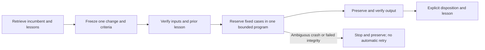

# Recursive research operating procedure

This file owns offline RSI handoffs; [GRS](../research-standard.md) owns research,
evidence and adoption rules. [Catalog](../skills.md) owns callable skills.
[Integration receipt](../tasks/2026-10-27-rsi-integration.md) owns actual proof and
limits. No financial execution adapter or unattended optimizer is available.



| Step | Existing skill route | Required handoff |
| --- | --- | --- |
| Retrieve | trade-project → trade-research-history | Exact parent, prior failures, access history and open question |
| Freeze | trade-candidate-evolution → trade-research-design | One changed stage, falsifier, controls, timing and finite bounds |
| Preflight | trade-data-audit; feature workflow when relevant | Input hashes and known-lesson check; missing/failed evidence stops dependent work |
| Execute | trade-experiment, only through a supported adapter | Frozen cases and shared program limits; actual reservation, exit and outputs |
| Verify | trade-performance-diagnosis → trade-robust-evaluation | Accounts, comparability, uncertainty, adverse and failed evidence |
| Disposition | trade-promotion-review | Exact incumbent/candidate identities and scoped retain/provisional/adopt decision |
| Close | trade-research-history | All attempts, actual evidence, lesson and next eligible question |

These are handoffs, not an automatic dispatcher. Infrastructure repairs use
trade-infra-change. Existing financial runners are not eligible through the new
coordinator; synthetic registry adoption does not promote a financial strategy.

## Current commands

```sh
.venv/bin/python scripts/current/rsi_foundation.py preflight
.venv/bin/python scripts/current/rsi_foundation.py preflight --evidence-root /path/to/qualified-local-history
.venv/bin/python scripts/current/rsi_foundation.py demo --evidence-root /path/to/qualified-local-history --output .local/new-rsi-demo
```

Default preflight is read-only. Historical evidence absent from a fresh checkout
returns JSON `unavailable` with exit 2. Bad integrity/unsafe paths return `failed`
with exit 1. Successful real preflight recognizes only the pinned C001 diagnostic
transition, preserving its failed gate, one consumed attempt and unchanged incumbent.
No code is imported from `--evidence-root`; the installed current helper is used.
This option does not download, modify or qualify arbitrary historical data.

Demo requires an exclusive output inside this checkout and a passing real preflight
before output creation. Its coordinator bounds two registered synthetic cases to
120 seconds and zero financial slots; the recorded integration invocation also uses
an enclosing 120-second process timeout for preflight/setup/adoption/report writing; a third request is rejected. Verified cache
reuse does not relaunch. Synthetic adoption is explicitly rolled back. Unit tests
use isolated fixtures, including synthetic historical closures; those fixtures do
not make the real historical check available or establish financial performance.
The old process-policy fixture result is retained as historical evidence, not rerun.

## Recovery and authority

Program identity freezes source/interpreter/input hashes, cases, criteria and shared
limits. New cycle names do not reset a program budget. ResearchController owns the
single writer/logical journal; RSIProgram owns actual fixed-command reservations,
process outputs and execution log. Failed starts/timeouts consume reservations.
Missing execution authority in an already initialized program stops even if no
launch was reserved; reopening cannot reset its deadline. An unsealed launch intent after interruption is ambiguous: stop and reconcile;
never retry automatically or erase the reservation. Completed cache reuse requires
verified artifacts. Source or input drift rejects reuse.

AdoptionRegistry requires exact plan/evaluation context, checks, numerical gates and
artifact hashes; explicit rollback records the prior identity. Hashes establish
byte identities, not evaluator independence, data rights, causal truth or alpha.
Financial passing evaluations remain provisional. These local lock/fsync journals
are not an OS sandbox, broker state authority or signed tamper-proof archive.
MLflow/browser views do not replace receipts or authorize execution.
