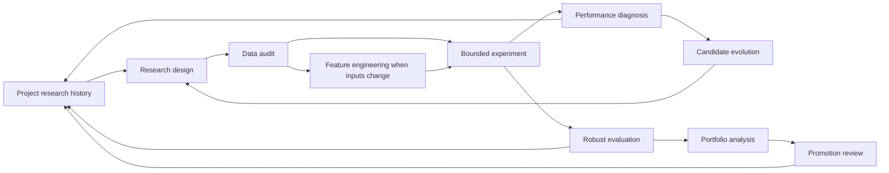
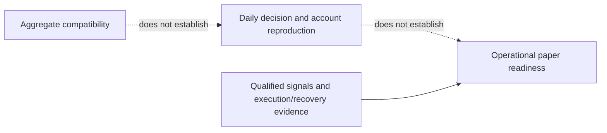
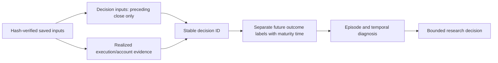

# Bounded research development

For new implementation work, follow the [current package layout](architecture.md#research-package-layout-and-frozen-compatibility). Flat research modules and original commands are frozen compatibility copies; do not edit them to implement a new candidate.

This document owns research-development tool procedures and scientific handoffs;
[GRS](research-standard.md) owns cycle evidence and adoption requirements. The
[mandate](goals.md) owns objectives/open risk decisions; [intake](research-intake.md)
owns external claims/rights; [workflow](workflow.md) owns implementation; the
[skill map](skills.md) owns discovery/readiness. This is an offline research
procedure, not an autonomous scheduler, strategy optimizer or execution engine.
An implemented, agent-coordinated offline control slice now supports this procedure:
[scoring contract](research-scoring.md), `research/control/research_controller.py` and
`research/studies/spy/bounded_study.py`. It records decisions and reserves bounded work; it does
not independently verify caller evidence or run itself against a broker. See the
[scoped pilot review](tasks/2026-10-25-recursive-research-review.md) for actual proof
and remaining aggregate-budget/orchestration boundaries.

Each requested task can use just one stage. Route only to relevant evidence;
completing a stage does not automatically launch the next. Numerical risk limits,
experiment budgets and deployment authority come from the request or an explicit
plan; missing values are recorded as open, not invented. Scope already authorized
by the user remains valid; no redundant approval step is added to ordinary offline work.

## Research design

Blocked source/accounting follow-up:
[qualification and comparison checkpoint](tasks/2026-10-25-multi-asset-qualification-v2-checkpoint.md).
It retains a source-permission input gate and has not launched the historical
comparison. Its protocol owns this fresh budget; prior epoch limits stay closed.

Latest multi-asset enablement:
[trend and relative-strength review](tasks/2026-10-25-multi-asset-unlock-review.md).
It implements synthetic-tested signal/allocation seams; its source qualification
and historical comparison remain blocked. The
[protocol](tasks/2026-10-25-multi-asset-unlock.md) defines five rules at two costs.

Latest completed frozen-candidate challenge:
[execution robustness review](tasks/2026-10-25-rsi-gate-robustness-review.md).
It used a new nine-path budget and retained the EMA/volatility-only candidate for
independent validation; the budget is exhausted. Its fixed
[protocol](tasks/2026-10-25-rsi-gate-robustness.md) remains unchanged after freeze.

Latest completed readiness audit: [bounded ETF diversification readiness](tasks/2026-10-25-rsi-etf-readiness.md).
Source qualification and native shared-cash proof precede a prospective six-case
portfolio comparison. Its not-ready decision preserves zero historical financial attempts; the
completed risk-gate study and its failures remain frozen.

Fixed study specification: [bounded SPY risk-gate test](tasks/2026-10-25-risk-gate-bounded-test.md)
defines the combined gate, unchanged controls and temporal comparisons. It is a
development-only design. The [bounded improvement epoch](tasks/2026-10-25-rsi-risk-gate-epoch.md)
owns its newer implementation, recovery and completed bounded execution evidence; the original planning
receipt remains historical.

Before a new search, record the economic hypothesis, falsifiable prediction,
eligible universe, signal/holding semantics, decision/fill timing, capital,
benchmark, costs/financing and one primary estimand. Specify which additional
metrics are diagnostics or constraints, trial budget, selection rule, chronology,
training/validation/test roles, and rejection conditions. The mandate's growth
aspiration is not a predicted return or a tuning target that overrides risk.

A protocol can be useful while inputs or risk decisions are missing; mark dependent
execution blocked rather than fabricate them. Already-viewed SPY and public-paper
samples remain development evidence. New asset symbols alone do not establish an
untouched holdout. Future chronological observation can be proposed with fixed
rules; historical test access must be logged and its independence reassessed when
results influence later choices. Model fitting, setting selection and evaluation
are separate decisions. Purge/embargo lengths, when relevant, follow overlapping
labels/holding periods rather than an arbitrary universal number of days.

### Selection and stopping review

Before choosing the next experiment, retrieve the incumbent, related trials and
negative lessons. Name the economic mechanism and explain what new evidence or
different mechanism makes this proposal informative. A different threshold,
renamed rule or new stage label does not by itself escape a failed direction.
When a mechanism has repeatedly failed, prefer a genuinely different question;
revisit only with a documented new input, diagnosis or falsifiable explanation.
Record the decision even when the best choice is to stop or retain the incumbent.

Review source reuse rights and actual free/local input availability before reserving
financial attempts. Public visibility, API access and an observed timestamp do not
establish reuse rights, point-in-time universe membership or feature publication
time. Missing dependencies yield a readiness task with no financial claims.
Freeze one change, controls, thresholds, aggregate attempts, deadline, worker count
and retry policy under [GRS](research-standard.md#the-bounded-loop). Consumed or
expired budgets stay closed; a new file, agent or child cycle does not reset them.

## Individual stage development

Use this procedure for one existing-stage improvement or one optional-stage
addition under [GRS](research-standard.md#minimal-pipeline). Freeze the stage's
input/output meanings, units, instrument identifiers, availability/as-of times,
decision horizon, warmup/missing-data behavior and fallback/no-go output. Name
which upstream and downstream contracts stay fixed and pin the incumbent and
unchanged controls. Do not combine a new selector, new sizing and new execution
model under one claimed stage improvement.

First test synthetic conformance: normal inputs, missing/future/stale inputs,
boundary values, deterministic outputs and the next stage's accepted interface.
Preserve failed checks. Synthetic passage establishes only the exercised interface;
it does not establish financial benefit, native execution parity or qualified data.
A subsequent financial test needs its separately frozen scope, ready inputs and
remaining budget. It must use the incumbent's matched accounting and the declared
effect and guardrails before changing any research version.

## Incremental-stage experiments

[GRS-1.1](research-standard.md) is the canonical owner for the minimal pipeline,
one-change cycles, evidence records, incremental adoption and paper-style reports.
Use its [bounded loop](research-standard.md#the-bounded-loop),
[cycle register](research-cycles.md) and [cycle template](templates/research-cycle.md).
The tool procedures below implement that contract within each runner's actual
capability and budget; this link does not enable an unattended optimizer.

The [RSI operating SOP](operations/recursive-research.md) connects these scientific
handoffs to the scoped coordinator, contract, artifact and version-record tools.
Its [foundation checklist](tasks/2026-10-27-rsi-foundation-implementation.md) tracks
implementation and observed acceptance separately from financial readiness.

## Data audit

Identify raw source hashes, instrument/contract, field meaning, timestamp/timezone,
calendar, observation versus availability time, adjustments/dividend treatment,
coverage and rights evidence. Check actual bytes for ordering, duplicates, missing
values, OHLC consistency, volume and relevant corporate-action/session issues.
Distinguish schema/price quality from point-in-time validity and usage rights.
A verified checksum does not validate economic meaning, and a public download
link does not establish redistribution permission. Retain original data; describe
normalization separately. Local raw/saved-data checks are available now; native
catalog round-trip behavior and absent provider contracts remain separate prerequisites.

## Experiment execution

Select the narrowest existing entrypoint matching a requested frozen plan; inspect
its actual side effects before running. [Performance operations](operations/performance.md)
owns existing report/cache/import behavior. `make strategy-suite` can start services,
run a full suite and import MLflow; it is not a generic read-only verification command.
A verification-only task should read and check saved manifests, inputs/artifact
hashes, completion/audit status and compatibility without starting a new study.

For explicitly frozen supported saved-SPY plans, `scripts/current/bounded_study.py PLAN.json`
defaults to preflight only; `--execute` invokes the bounded runner. Its exact schema
and supported cases are in `research/studies/spy/bounded_study.py`. Before execution the
coordinator reserves the aggregate financial attempts and checks the program's
deadline; `max_cases` enforces only that plan's ceiling. Standalone CLI execution
does not independently enforce a multi-study budget. The
[pilot](tasks/2026-10-25-recursive-research-pilot.md) and its machine plans demonstrate
the verified contract without replacing it with a full unattended optimizer.

A requested new experiment needs its concrete bounded input/rule/configuration,
expected outputs, run budget and termination conditions. Record revision plus dirty
input hashes, dependencies, timestamps, data identity, costs and all attempts.
Stop on missing/changed inputs, invalid artifacts, worker failure, numerical
non-finites or plan-budget exhaustion; preserve failed evidence. Mark cached reuse
versus fresh computation explicitly. A new hypothesis/parameter/split/cost policy
is a new trial; failed attempts are linked and retained. Report rendering, MLflow
import and financial simulation are distinct operations with distinct side effects.
The existing runner owns output formats; these skills do not create another ledger.

## Performance diagnosis

`reporting/temporal.py` supplies descriptive path diagnostics on explicitly anchored,
positive equity:21/63/126/252 observed-session cumulative returns,63/252-session
Sharpe, drawdown episodes, deepest versus longest underwater periods, recovery and
right-censoring, worst1/5/21/63-session returns and historical daily ES95. Sharpe uses
sample variance,252 annual sessions and zero risk-free return; daily standard
deviation≤1e-15 is numerically zero and gives an undefined ratio. Windows need full
observed coverage and are not calendar months or annualized short-window returns.
The caller verifies exchange-calendar completeness. ES95 is the mean of the worst
`ceil(.05*n)` daily simple returns, with actual tail count/fraction and small-sample
warnings; it is neither a future loss bound nor an independence assertion.
These measurements diagnose a path; computing them over later history cannot be
used as a signal at an earlier date.

Establish comparable capital, dates, cash/dividend/cost rules and effective exposure
before ranking. Read the sizing formula and state annualized volatility targets
separately from portfolio-weight or leverage caps; their percentages have different
units. Trace a saved result to its manifest/audit and metric definitions.
Distinguish CAGR from annual/total returns and daily-close from intraday drawdown.
Attribute observed outcomes using available returns, trades and account components:
market exposure, sizing, selection, timing, fees/spread, financing and concentration.
Use years/regimes, worst episodes, turnover and participation to identify a concrete
weakness or uncertainty. A summary metric cannot establish causal attribution;
request a missing series rather than manufacture it. Lower leverage/costs alone
can explain a higher ratio. State evidence, alternate explanation and a falsifiable
next test; no re-tuning during diagnosis unless the user requested it.

### Calmar comparison eligibility

[Scoring](research-scoring.md) owns Calmar's definition and the
[single leaderboard](leaderboard.md) owns its presentation. For a ranking claim,
first reconcile dates/calendar and opening anchors, capital/external cash flows,
currency/actions, costs/financing, exposure controls and metric conventions.
Different exposure can be an intentional treatment; disclose it and include an
exposure-matched control before attributing an improvement to timing or selection.
Do not compare built-in intraday drawdown with daily-close drawdown as one score.
Keep CAGR, maximum drawdown, time underwater (session/calendar units, recovery
inclusion and censoring) and evidence status beside Calmar. If conventions cannot
be reconciled, retain contextual results without an unqualified rank. Numerical
materiality and growth/recovery constraints are frozen before challenger outcomes;
no universal Calmar threshold is introduced by this procedure.

## Candidate evolution

Retrieve prior hypotheses, rejected variants and evaluation access before proposing
changes. Tie each candidate to a measured weakness, economic mechanism or data
quality finding. State the smallest rule change, expected benefit, possible harm,
control, required inputs and falsification. Prioritize a bounded set by information
value and feasibility, not by a target score. Group correlated variants and count
all attempted choices. Changing universe, sizing, execution or costs can be more
informative than another indicator. Proposals stay proposals until an experiment
is requested; an iteration cannot edit its own scoring rules/risk limits or erase
failures to improve reported performance.

## Robust evaluation

Check provenance and comparability before metrics. Identify actual tuning and test
access, total trials and correlated choices; labels such as OOS or robust are not
proof. Report selection bias, exposure/benchmark attribution, per-fold regimes,
parameter neighborhoods and cost sensitivity supported by evidence. Specify a
follow-up if these artifacts are absent; never imply a test was performed.
Confidence intervals or bootstrap estimates must name method, sample size,
dependence treatment and limitations; individual-day resampling is not a general
tail-risk bound. A stitched validation path differs from a continuous account.

Conclude supported / rejected / inconclusive / not assessed against the declared
research question and criteria. An audit validates calculations within a model;
it does not validate alpha or future returns. A scalar score is a diagnostic, not
a universal promotion rule. Keep immutable baselines and record disagreements.

## Portfolio analysis

Use account-equity returns with defined cash flows, exact return intervals,
currencies/calendars and matched cost/exposure assumptions. Compute each series'
returns with its own opening anchor; align both start and end timestamps before
correlation or joint statistics. Simply dropping missing equity dates then taking
percentage changes can compare multi-day returns with one-day returns. Preserve
and disclose exclusions, coverage and sample limitations. Summaries alone cannot
supply correlation, joint drawdown or diversification.

Analyze shared holdings, factor/beta, effective leverage, concentration, turnover,
financing and simultaneous stress losses when inputs support them. Similar rules
or identical return series are not separate diversification sources. Allocation
weights, rebalance policy and changes to exposure are new experiment assumptions,
not permission to trade. Options/futures/FX additionally require their instrument,
margin, currency, roll/expiry/assignment and liquidity model; missing fields remain
unassessed. Historical correlation is not a guarantee of stress behavior.

## Promotion review

Name the target stage: retain as reference, enter a bounded experiment, operational
paper verification, or separately scoped live readiness review. Match evidence to
that stage; a research metric cannot satisfy broker/recovery/risk acceptance.
Use the mandate's confirmed criteria and show unresolved decisions without turning
its approximately30% reassessment tolerance into an approved hard loss cap.
Record decision, supporting exact artifacts, discrepancies, failed/missing gates,
remaining uncertainty and the smallest next evidence step. Review produces a
recommendation/record, not deployment, broker configuration or orders. Operational
procedures retain authority in [paper operations](operations/paper-connection.md),
[incidents](operations/incidents.md) and the [roadmap](roadmap.md).

### Evidence transitions are separate

Report aggregate compatibility, daily decision/account reproduction and operational
readiness independently, each as supported, failed, unknown or not applicable with
evidence. Matching summary statistics cannot reconstruct the original decisions
or cash ledger. Research reproduction cannot prove order reconciliation or recovery;
an operationally qualified paper pilot can proceed under its own SOP without a
missing original historical trace, while historical-parity claims remain unknown.
For Alpaca use the [paper handoff](operations/alpaca-paper.md#research-to-paper-handoff).

`research/workflow_readiness.py` provides an implemented **descriptive offline
review helper**, `summarize_review(review, checks)`, for research selection,
Calmar comparability, daily reproduction and paper handoff. Each `ReviewCheck`
records `met` with an evidence reference, or `failed`/`unknown` with a reason.
Omitted observations remain unknown; unexpected check names fail explicitly.
The result distinguishes failed from missing checks and always states
`authorizes_execution: false` and `independently_verified: false`. Callers still
inspect artifact bytes, times, rights and accounts using the canonical procedures.
This helper neither measures freshness/budgets nor replaces receipt validation,
RSI contracts, native risk, execution checks or any broker state machine.

## Research history

The [stock-momentum gate/sector ablation](tasks/2026-10-26-stock-risk-ablation.md)
adds five fixed fresh cases, monthly chosen-security/sector/target logs and complete
full-period security PnL. It is a separate closed development study; its sector
treatment includes unknown-classification cash exclusions and does not prove a
hard continuous sector cap or independent timing alpha.

Completed bounded research goal: [first-three selection reviews](tasks/2026-10-26-selection-research-goal.md).
It owns this epoch's limits and deliverables; the [final review](tasks/2026-10-26-selection-completion.md) owns results and lessons, without reopening prior budgets.

Dated synthesis: [consolidated research lessons](tasks/2026-10-26-research-lessons.md)
links observed tradeoffs, failed claims and next discriminating questions to their
original receipts. It does not replace those records or reset data exposure.

Project history belongs in versioned task/protocol records and evidence receipts,
with bulky/private raw artifacts in ignored reports or `.local/` according to the
existing owners. A record connects hypothesis and parent, dataset/code/config
identities, all trials/failures, observed result, evaluation access, decision/reason,
and next uncertainty. Link existing canonical records instead of copying their
contents. Supersede records with replacement links; retain historical bytes and
negative results. Distinguish planned, run, audited, evaluated and paper-observed.
Project-history work does not authorize writing personal Codex memory files or
publishing/committing results. Retrieval should improve the next decision rather
than claim the system learned solely because a note was written.

## Planned decision-layer integration

The [decision-layer plan](tasks/2026-10-25-rsi-decision-layer-plan.md) specifies how
industry/target selection, market-state estimates, sizing, strategy allocation
and execution eligibility enter this lifecycle. It selects one continuous sizing
proposal with fixed controls. This is documented design, not an implemented
selector, forecast model, new runtime score version or allocated financial budget.
[Scoring meanings](research-scoring.md#planned-decision-layer-records) retain one
canonical owner; each prospective study binds its own metrics and stopping rules.
No new platform milestone or unattended goal is created by this plan.

The [parallel research checklist](tasks/2026-10-25-parallel-research-checklist.md)
organizes proposed independent lanes and ownership/budget boundaries. Its initial
wave is research/design only; it does not launch agents or allocate financial,
market-data acquisition or native-probe attempts.

## Decision logs and outcome labels

Implemented saved-result reconstruction in
[`reporting/decision_labels.py`](../reporting/decision_labels.py), method
`saved-gate-decision-outcomes-v1`. The [SPY diagnosis task](tasks/2026-10-25-gate-decision-labels.md)
owns this version's frozen diagnostic scope and observed results. This extends
research evidence capture, not the trading rule, native execution journal or
`research-score-v0.2` policy.

Keep three linked artifacts separate:

| Artifact | Required meaning | Existing implementation |
| --- | --- | --- |
| `decisions.csv` | ID, origin/version, parent source identity, input/as-of boundary, intended execution session, causal features, base/capped targets, state and trigger flags, prior holdings/cash, actionable/cash/exit indicators | Reconstructed from frozen SPY signals/timelines; modeled prior-close availability, not real-time capture or certified publication time |
| `execution.csv` | ID/session, observed raw prices, positions, account equity and modeled fees/slippage | Linked saved account evidence; no fresh simulation or broker acknowledgment inferred |
| `outcomes.csv` | ID, observed-session horizon, label maturity, separate own-account returns, relative percentage-point gap, label and censoring |5/21/63session continuation-policy paths, anchored at previous account close including overnight gap |

No outcome field can become an earlier decision input. Prospective experiments
should emit the decision record before execution and append outcomes only after
the horizon matures; this prospective emission/enforcement and live logging are
**planned**, not established by reconstructing old files. Do not overwrite old
records when adding a new label method or changing horizon/definition. Freeze
method/source/code hashes and store any revision in a new directory.

A warning is not an action. Distinguish base targetzero from prior base shareszero:
only both together count as already cash; a warning on an exit day is separate.
A lower intended gate target is actionable relative to its own base, but does not
prove an actual sale or realized protection. Execution evidence remains separate.
Prior21-session raw-SPY decline can define a rebound context because it is already
observed; future troughs or crash labels cannot be causal features.

Labels describe outcome regions, not decision correctness. Helped-during-loss
requires negative base return and higher gate return; missed-positive-move requires
positive base return and lower gate return; missed-rebound adds a prior decline.
Warnings already cash receive no immediate avoided-loss credit. Their subsequent
policy returns can diverge for other reasons. Same-horizon opposite signs and
near-ties retain distinct labels instead of being forced into win/loss.

Primary financial summaries use reduction-episode starts, excluding evaluation-
boundary anchors; warning starts and red entry/exit are secondary views. Retain
all daily rows and right-censored horizons with null outcomes/maturity. Declare
units, costs and horizons; count overlapping windows and never sum their returns
into attributed profit or independent evidence. Each saved account keeps its own
wealth and subsequent decisions, so return gaps are not single-decision treatment
estimates or matched-capital avoided USD losses.

## Feature engineering in RSI

[Feature engineering](feature-engineering.md) owns causal transforms, registry, LLM proposal limits and saved-label diagnostic interpretation. Use [trade-feature-engineering](../.agents/skills/trade-feature-engineering/SKILL.md) between data audit and experiment design when changing inputs, or after diagnosis to test a bounded feature hypothesis. A feature association is evidence for a next question, not permission to alter a policy or execute another financial trial. The [first skill test](tasks/2026-10-25-feature-engineering-skill.md) records three fixed candidates on existing SPY/outcome artifacts.

## ML modeling and infrastructure consultation

[ML team contracts](advisory-team.md#ml-team-handoff-in-rsi) define the statistical and reproducibility handoff after feature engineering. Select the appropriate adviser using the [canonical catalog](skills.md#available-advisory-skills). They use the existing bounded workflows; no new training pipeline, model fit, scheduler or deployment is implied.

## Individual stage development

This section owns the component-development procedure within an existing RSI cycle;
[GRS](research-standard.md) retains research/adoption rules and the
[RSI SOP](operations/recursive-research.md) retains operational handoffs. The
[catalog](skills.md) owns the callable trade-stage-development skill and specialist
routes. A stage is a boundary with a contract, not a mandatory extra decision layer.

Use the [stage worksheet](templates/stage-development.md) within the existing task
or cycle rather than starting another results database. Identify the source function,
exact parent/code/input identities and producer/consumer boundary. A stage's inputs
and outputs must state meaning, units, availability time and missing/unknown behavior.
Separate decision fields from later fill/accounting/outcome fields in mixed frames.
State initialization, history/warmup, replay/state scope and reset/restart behavior;
mark unsupported behavior explicitly. Execution-ready targets are not shifted twice.

Freeze one change and unchanged controls before verification. Design-only requests
end at the design handoff; implementation uses the existing development workflow.
Engineering characterization may leave policy source unchanged and use synthetic
fixtures, causal-prefix checks, invalid inputs and deliberately wrong adapters.
These are component checks with zero financial runs; they do not establish portfolio
returns or general skill usefulness. Record the actual tested context and failures.

Reuse existing specialist skills instead of making one skill per named pipeline box.
The worksheet complements RSI-CYCLE-1/GRS: it is not a second executable schema,
promotion rule or financial execution adapter. Any financial comparison still needs
qualified data, a frozen study and supported runner. Current RSI financial execution
remains unsupported; a blocked handoff preserves evidence and the incumbent.
