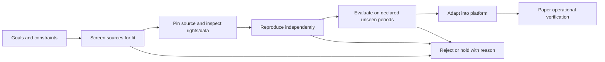

# External research intake

This file owns how online repositories and published findings become candidates
for this project. [Goals](goals.md) owns investment constraints. The existing
[SPY methodology](../research/README.md) remains the owner of that fixture alone.

## What we reuse

Reuse economic hypotheses, public code where licensed, dataset specifications,
experimental design, diagnostics, and failure lessons. Published metrics remain
source claims until independently reproduced. Repository popularity and attractive
equity curves are discovery signals, not investment evidence.

Separate libraries/frameworks from strategy findings. A model zoo or analysis
library is useful infrastructure reference but does not itself establish a
deployable strategy or transferable performance.

## Source acquisition and reuse gates

Use licensed sources first for the QuantConnect catalog, per the user's current
choice. The [details/rights receipt](tasks/2026-10-26-quantconnect-source-rights.md)
records the current access review. Do not treat a website Clone control, a matching
title, an embedded backtest or a framework license as permission to redistribute
another author's algorithm. Use documented official interfaces only within their
verified permitted scope; do not work around website extraction restrictions.

Record acquisition permission, code inspection/modification/redistribution,
external dependencies, data cloud/download/redistribution rights and result-artifact
rights separately. A blocked or unknown field remains a blocker for the affected
export. A licensed method snippet is useful research evidence but is not a complete
source package, dataset entitlement or current-engine compatibility receipt. A code-only
source bundle can be exported under an applicable verified grant while runtime or
data readiness remains blocked, provided those limits are explicit and no restricted
data or result artifacts are included. Preserve file-level grants even where a
repository has no general license; do not extend them to neighboring files.

## Intake procedure

1. **Screen:** record the source, original paper if applicable, claimed mechanism,
   instruments, frequency, holding period, capital/liquidity assumptions, and fit
   with the mandate. Reject inaccessible requirements early.
2. **Pin and inspect:** record exact commit/tag, relevant paths and hashes,
   dependency versions, license/attribution, source data rights, dataset cost and
   availability, and the reported evaluation window. Code and data can have
   different licenses. Inspect downloaded scripts before execution; keep new
   research environments separate from the operational environment.
3. **Record the claim:** capture the metric definition, units, universe, benchmark,
   sample dates, cost/dividend/financing assumptions and number of tried variants
   if disclosed. Mark missing details as unknown. Store only permitted excerpts
   and artifacts; do not copy a whole repository into maintained project source.
4. **Reproduce:** in a separately scoped task, run a pinned example with identified
   inputs and compare outputs to the claim. Record differences and explain data
   substitutions. An unavailable dataset means blocked reproduction, not success.
5. **Evaluate relevance:** predeclare splits, decisions and acceptance before seeing
   evaluation outcomes. Check point-in-time availability, survivorship, leakage,
   multiple trials, costs/turnover, liquidity, exposure and stress behavior. Widely
   circulated historical samples are not automatically untouched holdouts. Log
   negative results and all tested variants.
6. **Adopt selectively:** integrate useful code only after rights and compatibility
   review, with attribution and tests across the intended module interface. Keep
   a trace from original claim to reproduction to local adaptation. Paper tests
   establish operational behavior, not future profitability.

Reproduction and strategy evaluation are later tasks; this intake does not start
them or interrupt the infrastructure roadmap.

## Initial source registry

Reviewed repository descriptions on 2026-10-25. Status for every entry below is
**candidate reference only**: no commit pin, license compatibility review,
data access verification, installation, performance reproduction, or adoption yet.

| Source | Evidence in upstream description | Potential reuse here | Next inspection |
| --- | --- | --- | --- |
| [Machine Learning for Trading](https://github.com/stefan-jansen/machine-learning-for-trading) | Third-edition material describes data-to-deployment workflows and ETF/factor case studies | Research process, data provenance, cost/risk evaluation, case-study hypotheses | Select a goal-compatible case; inspect exact code, license and accessible data |
| [Microsoft Qlib](https://github.com/microsoft/qlib) | Research platform with model examples and data/training/evaluation workflows | Experiment design and published-model baselines | Inspect a specific example and its original paper; assess market/data fit before considering dependencies |
| [Alphalens](https://github.com/quantopian/alphalens) | Factor returns, information coefficient, turnover and grouped diagnostics | Diagnostic definitions for future cross-sectional factor research | Inspect implementation and compatibility; upstream README includes historical hosted-platform references, so setup instructions need fresh verification |

These are complementary references, not a proposal to replace NautilusTrader or
install three frameworks. Candidate-specific findings belong in
`docs/tasks/<date>-research-<topic>.md` using the
[intake template](templates/research-intake.md). Keep bulky licensed material in an
appropriate ignored dataset/vendor location, and private evidence in `.local/`.

## Free-data constraint and remaining prerequisites

Confirmed user constraint on 2026-10-25: free/local data only. No subscription,
purchase, account creation or credentials were used by the strategy suite.

The other 78 entries need instruments/data beyond the frozen SPY daily snapshot.
This is a local-availability blocker, not a claim that no free source exists.
Public source checks identify possible follow-up paths:

| Source | Available context | Unresolved prerequisite |
| --- | --- | --- |
| [French data library](https://mba.tuck.dartmouth.edu/pages/faculty/ken.french/data_library.html) | Published research factor/portfolio return series | Return series do not reconstruct tradable point-in-time stock holdings, costs or raw fundamentals; separate study/input rights review needed |
| [Alpaca Basic documentation](https://docs.alpaca.markets/us/docs/about-market-data-api) | Free tier describes IEX equities and indicative options coverage | Eligible account/access, actual coverage/history and licensing unverified; no credentials or complete historical option chain present locally |
| [Cboe historical option quotes](https://datashop.cboe.com/option-quote-intervals) | Historical quote products have defined fields and purchase terms | No paid purchase permitted; no matching complete local dataset. Public product description is not a dataset |

Option payoff formulas alone cannot establish historical fills, assignment or
volatility returns. Factor return indexes cannot be relabeled as our implemented
stock selection. Market-making needs timestamped quotes/book events and execution
assumptions. Multi-asset allocation needs a frozen common universe/calendar and
prices; event-driven systems additionally need point-in-time event records. These
requirements remain attached to each catalogue entry rather than fabricated results.

## Completed source screenings

- [QuantConnect shared-strategy screening](tasks/2026-10-25-quantconnect-strategy-intake.md)
  (2026-10-25): five ideas screened; two displayed code files inspected. Description/code
  discrepancies and concentration risk recorded; no cloning or reproduction performed.
- [Independent data providers and collectors](tasks/2026-10-25-independent-data-review.md)
  (2026-10-25): recurring-free versus trial/paid coverage compared across equities,
  ETFs, forex and exchange futures; six collector source revisions and licenses
  inspected. Source/runtime adoption unverified; [library plan](data-library.md)
  proposes qualification before acquisition or financial reuse.
- [Strategy Survival Funnel review](tasks/2026-10-25-research-strategy-survival-funnel.md)
  (2026-10-25): pinned source and published CSV consistency reviewed; 47 families,
  318 configurations and 9222 cases. Screened for process/definition reuse; direct
  code adoption held for license clarification, returns not independently reproduced.
  This screening supersedes discovery-only descriptions for this candidate.

- [Ten QuantConnect research candidates](tasks/2026-10-26-quantconnect-shortlist.md)
  (2026-10-26): ten official article methods screened across ETF allocation, stock
  factors, earnings, pairs, intraday and options. Exact code/access/performance
  unverified; first-wave inspection order recorded, no new backtests launched.

- [First-three QuantConnect selection comparison](tasks/2026-10-26-qc-selection-comparison.md)
  (2026-10-26): pinned legacy examples inspected; free hosted equity/fundamental
  sample access verified; five source-informed/baseline cases completed after two
  preserved technical issues. Readiness gaps make results provisional; no exact
  published-strategy reproduction, independent alpha or promotion established.

## Comprehensive QuantConnect review plan

The [O00–O15 objective checklist](tasks/2026-10-26-quantconnect-research-master-plan.md)
tracks the requested broad catalog/export/evaluation initiative. It applies this
intake contract to a dated accessible snapshot, preserving all blocked and rejected
records. The earlier shortlist remains historical input, not the entire catalog.
This link adds a supporting work plan; the [O00–O03 inventory receipt](tasks/2026-10-26-quantconnect-inventory.md) now
records 540 community IDs and 82 tutorial-index entries, their provisional family
map and prior-research crosswalk. Bulk source export and new simulations remain
unstarted; one tutorial target is a soft404 and detailed source contracts remain open.

The [CAPM alternative follow-up](tasks/2026-10-26-capm-spy-comparison.md) now
qualifies one of the licensed framework alternatives for a scoped free hosted
comparison. It is not exact tutorial-source reproduction. Its unfavorable fixed
cost result, actual dependencies, native-accounting limits and all technical
failures remain linked in that receipt; no broader catalog readiness is implied.
The subsequent [cost/stock-stop ablation](tasks/2026-10-26-capm-cost-stop-ablation.md)
completed nine qualified cases with matching controls. Separating commissions,
slippage stress and the stock stop leaves all six variants below matching SPY on
CAGR, Sharpe and Calmar. Preserve the negative implementation and its cost-dependent
tradeoffs; this does not clear other packages or justify repeated threshold tuning.

The [next licensed-candidate receipt](tasks/2026-10-26-dual-thrust-spy-comparison.md)
keeps that negative baseline unchanged. The first choice, G-Score, stopped before
financial testing because its quarterly API retired and legacy ratio timestamps
are known to look ahead. The licensed Dual Thrust fallback required a causal
prior-session range repair and a clearly named SPY adaptation. Its three-case
free-data comparison passes the scoped accounting/data audit but fails the frozen
improvement screen. This closes five aggregate attempts; it neither clears the
other tutorial packages nor rejects an entire strategy family.

The [stock-pairs follow-up](tasks/2026-10-26-stock-pairs-spy-comparison.md) qualifies
free hosted price/action inputs and explicitly repairs future-aware sizing,
statistical calibration, state and information timing in a named mechanism
adaptation. Its negative financial result and high-growth/high-DD hindsight-selected
hold control are preserved with the closed five-attempt ledger. Source permission,
input readiness and candidate quality remain separate dispositions.
