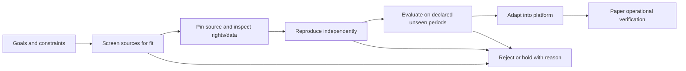

# External research intake

This file owns how online repositories and published findings become candidates
for this project. [Goals](goals.md) owns investment constraints. The existing
[SPY methodology](../research/README.md) remains the owner of that fixture alone.

## What we reuse

Reuse economic hypotheses, public code where licensed, dataset specifications,
experimental design, diagnostics, and failure lessons. Published metrics remain
source claims until independently reproduced. Repository popularity and attractive
equity curves are discovery signals, not investment evidence.

Separate libraries/frameworks from strategy findings. A model zoo or analysis
library is useful infrastructure reference but does not itself establish a
deployable strategy or transferable performance.

## Intake procedure

1. **Screen:** record the source, original paper if applicable, claimed mechanism,
   instruments, frequency, holding period, capital/liquidity assumptions, and fit
   with the mandate. Reject inaccessible requirements early.
2. **Pin and inspect:** record exact commit/tag, relevant paths and hashes,
   dependency versions, license/attribution, source data rights, dataset cost and
   availability, and the reported evaluation window. Code and data can have
   different licenses. Inspect downloaded scripts before execution; keep new
   research environments separate from the operational environment.
3. **Record the claim:** capture the metric definition, units, universe, benchmark,
   sample dates, cost/dividend/financing assumptions and number of tried variants
   if disclosed. Mark missing details as unknown. Store only permitted excerpts
   and artifacts; do not copy a whole repository into maintained project source.
4. **Reproduce:** in a separately scoped task, run a pinned example with identified
   inputs and compare outputs to the claim. Record differences and explain data
   substitutions. An unavailable dataset means blocked reproduction, not success.
5. **Evaluate relevance:** predeclare splits, decisions and acceptance before seeing
   evaluation outcomes. Check point-in-time availability, survivorship, leakage,
   multiple trials, costs/turnover, liquidity, exposure and stress behavior. Widely
   circulated historical samples are not automatically untouched holdouts. Log
   negative results and all tested variants.
6. **Adopt selectively:** integrate useful code only after rights and compatibility
   review, with attribution and tests across the intended module interface. Keep
   a trace from original claim to reproduction to local adaptation. Paper tests
   establish operational behavior, not future profitability.

Reproduction and strategy evaluation are later tasks; this intake does not start
them or interrupt the infrastructure roadmap.

## Initial source registry

Reviewed repository descriptions on 2026-10-25. Status for every entry below is
**candidate reference only**: no commit pin, license compatibility review,
data access verification, installation, performance reproduction, or adoption yet.

| Source | Evidence in upstream description | Potential reuse here | Next inspection |
| --- | --- | --- | --- |
| [Machine Learning for Trading](https://github.com/stefan-jansen/machine-learning-for-trading) | Third-edition material describes data-to-deployment workflows and ETF/factor case studies | Research process, data provenance, cost/risk evaluation, case-study hypotheses | Select a goal-compatible case; inspect exact code, license and accessible data |
| [Microsoft Qlib](https://github.com/microsoft/qlib) | Research platform with model examples and data/training/evaluation workflows | Experiment design and published-model baselines | Inspect a specific example and its original paper; assess market/data fit before considering dependencies |
| [Alphalens](https://github.com/quantopian/alphalens) | Factor returns, information coefficient, turnover and grouped diagnostics | Diagnostic definitions for future cross-sectional factor research | Inspect implementation and compatibility; upstream README includes historical hosted-platform references, so setup instructions need fresh verification |

These are complementary references, not a proposal to replace NautilusTrader or
install three frameworks. Candidate-specific findings belong in
`docs/tasks/<date>-research-<topic>.md` using the
[intake template](templates/research-intake.md). Keep bulky licensed material in an
appropriate ignored dataset/vendor location, and private evidence in `.local/`.
