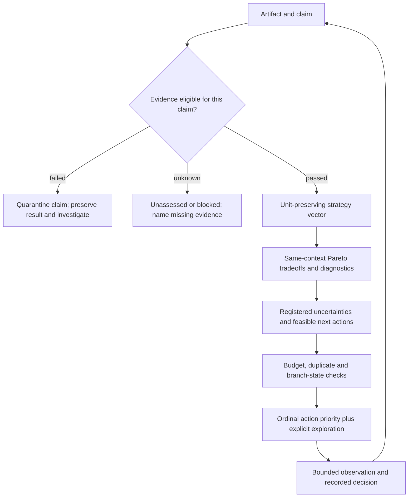

# Research scoring and direction decisions

Skills-only integration note: executable research implementations and saved results
are delivered in the dependent [research PR](https://github.com/kenfuliang/quant-trading-lab/pull/1).
Implementation descriptions and linked historical evidence below refer to that
reviewed snapshot; they do not establish runtime availability on this branch.

This document owns scoring meanings and research-selection interpretation.
[Research development](research-development.md) owns lifecycle/handoffs;
[goals](goals.md) owns the mandate and open investment choices; [roadmap](roadmap.md)
owns platform readiness. The versioned machine contract is implemented in
[research/scoring.py](https://github.com/kenfuliang/quant-trading-lab/blob/4586095846c63abf2e0b90dc547654256c3fc45e/research/scoring.py); availability/test evidence is recorded
in the [ten-hour program](https://github.com/kenfuliang/quant-trading-lab/blob/4586095846c63abf2e0b90dc547654256c3fc45e/docs/tasks/2026-10-25-recursive-research-program.md).
This contract is initially a deterministic research heuristic, not trained RL/GAE,
a calibrated expected-value model, investment advice or a promotion authority.
Current machine policy is `research-score-v0.2`; the [fresh policy evaluation](https://github.com/kenfuliang/quant-trading-lab/blob/4586095846c63abf2e0b90dc547654256c3fc45e/docs/tasks/2026-10-25-recursive-research-policy-evaluation.md)
preserves the original defects and old/new identities. Scores reconstruct eligibility
and normalized values before comparison. Consistency validation cannot authenticate
source truth, evidence pointers or the caller's required-check contract: verify
those against the frozen plan and actual receipts separately.

## Evidence eligibility is claim-specific

Each check has a status, applicability and evidence pointer. Required failure makes
the claim invalid; required unknown blocks assessment. These are not averaged.
Optional missing diagnostics remain visible without invalidating unrelated facts.
A check can be not-applicable only when its applicability was declared, not because
it failed. A higher return never rescues invalid timing/accounting or absent inputs.

The claim determines required evidence. Recomputing arithmetic on an existing local
ledger is different from claiming untouched investment validation, redistributing
provider data or executing a paper order. Preserve source-rights unknowns even when
not required for a narrowly scoped arithmetic check. Existing viewed SPY history
can support development comparisons; it cannot satisfy untouched-test confirmation.
No scoring outcome enables a broker operation or establishes a hard loss guarantee.

## Strategy outcomes retain actual units

The initial Pareto objectives are net CAGR (maximize) and drawdown magnitude
(minimize). Internally these are fractions; percent inputs must declare units and
be normalized before comparison. Sharpe and Calmar remain diagnostics; undefined
values remain null with reasons. Exposure, turnover, financing, worst episodes,
recovery and sample coverage are additional perspectives where artifacts support
them. Missing inputs cannot be fabricated from headline ratios.

Candidate A dominates B only within the same declared comparison context and if A
is no worse on both required objectives and strictly better on at least one.
Equality is a tie. Different account periods, cash/dividend rules, costs, nominal
exposure assumptions or metric definitions require separate contexts or an explicit
controlled-study comparison. Changes that are the intended treatment (such as
sizing) are recorded rather than hidden as stronger predictive information.

No scalar sum of CAGR, Sharpe and Calmar is used: their units and repeated return
information make an arbitrary sum misleading. A nondominated alternative is not
a selected investment. The approximately30% reassessment reference and +100% growth
aspiration remain mandate context, not automatic score bonuses or passing gates.
Descriptive frontier membership does not establish statistical superiority.

## Research actions use an auditable priority tuple

Action identity includes context, parent evidence, exact decision question and
observation—not its display title. A feasible action states possible observations
and how they change a research decision. Unknown outcome probabilities stay unknown;
EVSI/expected alpha and a learned critic remain unassessed.

Within a bounded pilot, order feasible actions by:

1. Documented eligibility/integrity investigation (class3), active falsification
   (class2), then distinct-mechanism exploration (class1). An audit must resolve an
   actual registered blocker; repeated generic checking cannot earn progress.
2. Decision value:2 can change a retain/retire or branch decision;1 narrows a named
   uncertainty;0 is replay/reformat or irrelevant. Unsubstantiated value is unknown.
3. Distinct shared registered questions resolvable, capped at2 to prevent splitting
   or renaming one uncertainty into many reward points.
4. Lower bounded resource cost, then stable action ID. Resource units are declared
   by the controller; they are not automatically dollars or investment utility.

Budget and feasibility checks precede priority. A zero-cost irrelevant action is
not valuable. Exact observation/question duplicates earn no new progress. A fresh
failed observation can resolve a question; a repeated failure with no new evidence
cannot. Credit shared evidence once across parent branches. Reserve a different
mechanism among the first two feasible decisions when no common integrity blocker
requires repair first. Root plan/state records the actual finite action/financial
budgets and exploration choice; priorities do not authorize unlimited search.

## Continue, explore, pause, retire and reopen

| State | Meaning and next condition |
| --- | --- |
| Active | A feasible discriminating question remains within its budget |
| Explore | A distinct question/mechanism deserves a bounded observation |
| Blocked | A required input/model/permission is missing; specify the dependency |
| Paused | Current marginal information is insufficient; require a new question or input before more attempts |
| Retired claim | Its predefined falsifier was met or its specified comparison is dominated; retain evidence, not a declaration that the entire economic family is impossible |
| Reopened | A recorded new reason/evidence changes the prior context; preserve old state and outcomes |

A program stops on time/trial exhaustion, failed integrity/accounting, unavailable
informative actions or user stop. Stopping does not mean the investment objective
was achieved. Keep score/definition/context versions immutable; score amendments
apply prospectively, and retrospective rescoring is a separately labeled view.

## How we evaluate the research policy

Reuse the primary reviews' strongest design: compare fixed and adaptive decisions
from the same history/frontier, with equal resource limits. Baselines retain the
same eligibility and budget protections. A simpler breadth-first or fixed-order
allocator is a legitimate competitor; the new controller must earn its complexity.

Primary process measures are critical-error count, distinct questions resolved,
redundant attempts and actual resource use. Financial measures are reported
separately from process measures; informative rejection is not investment profit.
One or two cycles establish feasibility only, not statistical effectiveness or
monotonic self-improvement. No model weights are trained by updating this registry.

Primary-source grounding and limitations: [method/design review](https://github.com/kenfuliang/quant-trading-lab/blob/4586095846c63abf2e0b90dc547654256c3fc45e/docs/tasks/2026-10-25-recursive-research-scoring-design.md)
and [prior results/reuse review](https://github.com/kenfuliang/quant-trading-lab/blob/4586095846c63abf2e0b90dc547654256c3fc45e/docs/tasks/2026-10-25-recursive-research-priors.md).

## Planned decision-layer records

Design extension,2026-10-25; **not implemented** in `research-score-v0.2`. Existing
scores and immutable results retain their versions. The
[integration task and bounded proposal](https://github.com/kenfuliang/quant-trading-lab/blob/4586095846c63abf2e0b90dc547654256c3fc45e/docs/tasks/2026-10-25-rsi-decision-layer-plan.md)
sequence this work; they do not change the current machine policy or promotion
rules. A future implementation needs a separate schema/version and tests.

A proposed decision record carries layer ID/version, policy/config hash, parent
question, source/input hashes, observation and availability timestamps, decision
and intended execution times, eligible universe, output value/units/horizon,
reason, uncertainty/null reason, comparison context and required-check pointers.
Actual fills/outcomes link later; they must not rewrite the historical inputs.

| Perspective | Meaning and proposed fields | Boundary |
| --- | --- | --- |
| Eligibility | Required source, timing, cash/model checks; pass/fail/unknown | Failed/unknown required evidence blocks its claim; never average into a quality score |
| Expected profit | Forecast net return/P&L, horizon, costs, uncertainty and calibration | Unassessed without a fitted/validated forecast; historical CAGR is not a forecast |
| Outcome | Net CAGR, wealth, annual/rolling returns, Sharpe/Calmar | Descriptive, same-context comparison; undefined ratios null |
| Risk | Observed or forecast volatility/ES with method, drawdown depth/duration, concentration and scenario loss | Always label observed versus forecast, horizon and units; no probability or guarantee inferred from colors |
| Evidence strength | Trial history, exposure to evaluation data, sensitivity, calibration and uncertainty method | No numerical confidence without justified estimation; viewed data cannot become untouched |
| Portfolio contribution | Incremental return/risk, correlations and joint stress | Requires comparable synchronized account paths; not available from headline ratios |
| Tradability | Costs, turnover, liquidity/capacity, borrow/cash/data availability | Missing fields remain unknown; no broker permission implied |
| Research progress | Distinct question resolved, decision change, resource cost, duplication | Existing action-priority tuple; information gained is not financial profit |

Market-state labels (estimated risk conditions), allocation outputs (intended
weights) and operational eligibility (hard no-go reasons) use separate fields.
A forecast cannot override an integrity failure. Colors summarize declared rules;
they are not calibrated probabilities. No arbitrary0–100weighted composite or
new profit-maximizing reward is introduced. Per-study temporal criteria can extend
the current CAGR/drawdown view only when predeclared; historical scoring policy
is not silently changed to include a third objective.

Saved gate input/outcome reconstruction is now available under the [lifecycle contract](research-development.md#decision-logs-and-outcome-labels). This implements a scoped evidence artifact, not the complete proposed generic schema, a profit forecast, confidence estimator or a runtime scoring-policy change. Outcome labels never award investment correctness or research reward automatically.
