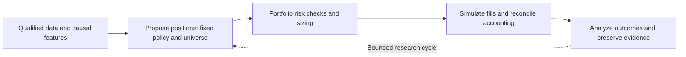
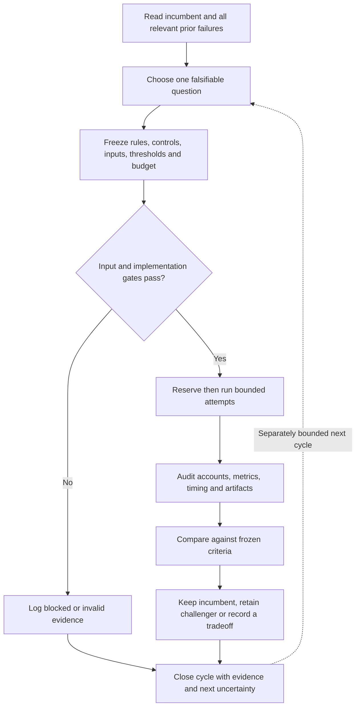

# Golden research pipeline standard

Standard ID: **GRS-1.0**. This is the single normative owner for the minimal
algorithm pipeline, incremental stage adoption, per-cycle evidence requirements
and research-report readiness. Other documents link here instead of redefining
these rules. The [mandate](goals.md) owns investment preferences, [architecture](architecture.md#algorithm-decision-hierarchy)
owns component wiring, [research development](research-development.md) owns tool
procedures, [scoring](research-scoring.md) owns metric/score definitions, and
[roadmap](roadmap.md) owns infrastructure priority. This standard does not make
an unimplemented integration operational or change the machine scoring policy.

## Minimal pipeline

Only position proposal and portfolio risk/sizing are initial decision stages.
Data qualification, baseline protections, accounting and evaluation are always
present. Mandatory protections are not removed to improve backtest returns.
Each study freezes an exact incumbent; there is no universal cross-context winner.
Start from an existing version, not a fresh unqualified rebuild of every strategy.

A research cycle changes **one existing stage** or **adds one optional stage**.
Optional examples are market-condition identification, target selection and
strategy selection. Add them only if the actual question and evidence support
it; neither this order nor a stage label requires adopting a failed predecessor.
A failed challenger leaves its incumbent unchanged. Separate simpler exposure,
eligible-universe and fixed-strategy/allocation controls isolate each claim.

## The bounded loop

No endless search for a passing score. Every cycle has finite attempts and a
wall-clock limit, counts failures, preserves partial output, and stops on failed
integrity/accounting or exhausted bounds. Consultation alone does not launch
experiments. An explicitly requested research loop can begin a finite logged
cycle; it is not an unattended scheduler, broker authorization or permanent goal.

## Required cycle record

Create a unique dated task record and compact JSON evidence receipt under
`docs/tasks/` and `docs/tasks/evidence/`; add their pointers to the
[cycle register](research-cycles.md). The register is an index, not another results
store. Existing historical records need not be renamed or silently migrated.
Use the [cycle template](templates/research-cycle.md). Before execution record:

- Exact incumbent, parent receipts and relevant failed/duplicate attempts; total
  prior trial count or an explicit unknown. Name stage and economic mechanism.
- One change, target/horizon, decision/fill timing, eligible instruments, expected
  benefit, displaced opportunities and rejection condition.
- Frozen source/data/code/config/dependency identities, model assumptions,
  capital, dates, actions, costs, financing, benchmark and intended controls.
- Primary objective, meaningful-effect threshold, guardrails and numerical
  tolerances. Sharpe/Calmar are not substitutes for loss depth or recovery.
- Chronological fitting/selection/evaluation boundaries, label maturity, availability
  times, prior data exposure, protected/forward evidence state and selection bias.
- Aggregate attempt/time/resource limits, one owner/writer, reservation before each
  launch, failure/retry policy and stop conditions. No paid data/services by default.

After execution append all attempted cases, statuses, UTC times, commands/exits,
raw artifact and manifest references/hashes, audit outcomes, results, contradictory
evidence, decision and unresolved next question. Failed, abandoned and inconclusive
trials receive the same record discipline. Unknown/missing evidence remains named.
No execution is logged as no execution, not a zero financial return.

Keep private/raw or restricted market data in existing ignored locations; public
receipts contain aggregate findings and safe references. Market data and full
third-party strategy source require separate redistribution rights. MLflow and
browser pages are views; frozen source artifacts and receipts remain evidence.
Correct records with linked versions and preserve originals. Never edit personal
Codex memory as part of this project-history requirement.

## Incremental improvement and disposition

Define what better means **before** viewing challenger results. For a claim of
improved growth and downside, use the existing same-context CAGR/drawdown Pareto
meaning: one improves and the other does not worsen. Freeze materiality and
secondary constraints; tiny numerical improvements are not automatic evidence.
An explicit risk/return tradeoff can instead be tested with predefined growth
retention and recovery constraints. It retains a scoped alternative rather than
silently replacing an incumbent with different objectives.

| Evidence state | Permitted conclusion |
| --- | --- |
| Planned | No result; prerequisite/rule definition only. |
| Blocked / invalid | Financial claim unassessed; retain partial evidence and incumbent. |
| Audited development result fails | Reject this fixed change; record negative lesson and keep incumbent. |
| Audited development result passes | Provisional challenger, eligible for independent challenge; no unseen-alpha claim. |
| Declared independent criteria pass | Eligible for the specified research-version decision; operational promotion remains separate. |

Match economic contexts; different periods, capital, costs or actions cannot form
an unqualified leaderboard. Record simpler controls, turnover, financing, exposure,
concentration, full/annual metrics, underwater duration and censoring. A better
forecast alone does not establish a better portfolio. Existing viewed2005–2025
or2020–2025history cannot become untouched by renaming a split. No score or green
signal guarantees future profits or a drawdown ceiling.

## Lessons and paper-style experience reports

**Every closed cycle gets a short evidence-backed lesson**, including failures.
A substantial report is warranted when an informative finding is audited and its
scope is clear; a favorable finding additionally needs its declared performance
and robustness gates, simpler controls, and a meaningful effect to support a
positive claim. Negative results can justify a clearly titled negative-results
report. Do not suppress them because a positive claim failed.

Use the [research-paper template](templates/research-paper.md) for substantial
experience-sharing reports. Required sections: abstract; question and contribution;
related work/source rights; data and information timing; methods and controls;
trial history and preregistered criteria; results with annual/temporal measures;
robustness and counterevidence; interpretation; limitations; reproducibility;
lessons and next question; references. Include plain-language findings and
traceable table/figure sources. Explain both gains and costs of complexity.

Use explicit labels: **development technical report**, **independently validated
research report**, or **negative-results technical report**. Paper-style formatting
is not peer review, proof of alpha or permission to publish. A development report
may share scoped modeled experience but must not claim proven future superiority.
A result passing only a primary screen while missing growth/robustness criteria
cannot be styled as an unconditional successful algorithm. Numerical claims must
resolve to immutable artifacts and disclose failed controls or missing evidence.

No report is externally posted, committed, submitted or published automatically.
Paper/live qualification, credentials, account operations and orders remain under
their separate procedures and authorizations.

## Readiness and maintenance

Implemented: this standard and templates, project instructions, existing scoped
runners/audits/journals, cycle-specific plans/manifests and saved reporting tools.
Planned: generic automatic enforcement across every runner, a unified strategy
router/combiner, and unattended recursive optimization. Validation checks confirm
exercised behavior, not the truth of every scientific claim or historical trial.

Changes to this standard require a version/date and rationale; changes to frozen
plans are new revisions retaining old evidence. The initial new cycle is indexed
in the [register](research-cycles.md); legacy studies retain their dated owners.
