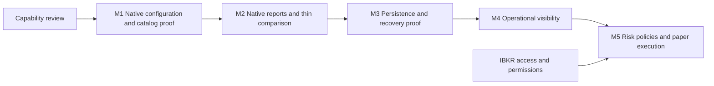

# Infrastructure roadmap

This file owns priority, sequence, dependencies and acceptance. Root README owns
current capability status. The [capability matrix](capabilities.md) supplies the
reuse evidence; [architecture](architecture.md) owns module responsibilities.

## Sequence

All milestones are owned by project-maintainers; the user owns account access and
investment-policy choices. Milestones specify order rather than committed calendar
dates. No new platform implementation starts as part of this documentation review.

| Milestone | Deliverable and native reuse | Acceptance evidence | Status / dependencies |
| --- | --- | --- | --- |
| M0 Working foundation | Workflow, documentation ownership, SOPs, skills, local checks | [Original completion receipt](tasks/2026-10-25-working-foundation.md) | Complete; later design revisions do not invalidate that historical receipt |
| M0a Capability review | Source-backed matrix; distinguish installed interfaces, configuration and runtime proof | [Review receipt](tasks/2026-10-25-capability-review.md) and offline interface probe | Complete for the scoped review, not operational validation |
| M1 Native configuration and catalog baseline | Existing TradingNodeConfig, native logging/status and ParquetDataCatalog; explicit mode validation and input receipts | Fixture catalog write/read preserves values/timestamps/instrument identity; duplicate/invalid-input behavior documented and verified; config serialization round-trip; invalid/mismatched modes fail before connection | Planned; next work packet; C01–C04, C21 |
| M2 Native reports and thin comparison | PortfolioAnalyzer, ReportProvider, tearsheets and native result/run IDs; small saved-run index | Locked visualization dependencies verified separately; saved fixture native report reconciled against its account/return policy; two saved runs compare with matched periods/capital/costs; mismatches visibly flagged | Partial: [saved-SPY reporting slice](tasks/2026-10-25-local-performance-browser.md) explicitly requested before M1; general importer/compatibility and native metric recalculation remain planned; C04, C16–C18 |
| M3 Persistence, capture and recovery | Prove current-node cache/streaming/state facilities; select backend from behavior evidence; reuse reconciliation | Written backend decision; disposable write/restart/restore exercise; captured message coverage and crash-loss window measured; restore to separate location; no blind resubmission under unknown outcomes | Planned after M2; C09–C15; Mac/backend compatibility is an open technical risk |
| M4 Operational visibility | Native logs/status and selected persistence outputs; read-only freshness/health and incident views where missing | Dead worker, stale/missing feed, capture failure and unresolved state visible; private account data redacted; source timestamps and mode shown | Planned after M3; C21; no custom chart suite assumed |
| M5 Mandate-specific risk and paper operation | Native risk states/limits and IB execution/reconciliation; missing portfolio policies | Offline fixtures cover risk rejection, duplicates, partial fills, disconnect after submit, restart, mode/account errors; supervised IBKR paper evidence verifies bounded operation | Planned after M3/M4; C06–C08, C14, C19–C20; external verification blocked pending IBKR access and selected data permissions |

M1–M4 and offline M5 fixtures do not require IBKR access. Integration milestones
stay incomplete while required external evidence is missing. Live deployment
needs a separately scoped readiness decision; paper success is not profitability proof.

## What changed and why

The [initial roadmap](history/2026-10-25-initial-roadmap.md) assumed PostgreSQL
startup/migrations first, followed by a general catalog and event registry. Source
review found native catalog, run/results, risk, persistence, streaming, reports and
reconciliation facilities. The replacement [decision](decisions/0002-native-capabilities-first.md)
removes an unconditional database choice and puts proof of native behavior first.

- M1 now proves native configuration/catalog behavior, rather than a new SQL store.
- M2 brings native reporting and a minimal cross-run comparison forward. The user
  subsequently requested local MLflow plus native reports using saved SPY results;
  this delivered slice does not complete all M2 acceptance or execution persistence.
- M3 scopes durability around actual capture/recovery gaps. It does not preselect
  PostgreSQL, a custom journal, or a runtime migration.
- M4 focuses on operational health. Custom charts wait for a demonstrated native gap.
- M5 reuses execution/risk/reconciliation without building another OMS.
- DuckDB, QuantStats, additional frameworks and an always-on SQL run registry are
  deferred until a requirement justifies their maintenance cost.

## Next work packet: M1

The user-requested [Alpaca integration slice](tasks/2026-10-25-alpaca-paper-integration.md)
also adds partial M5 evidence: native/fake-broker order lifecycle, saved-SPY signal
replay and authenticated closed-market preflight with operational MLflow logging.
It does not complete M3/M4, general risk acceptance or M5: actual paper fills,
partial-fill/restart recovery and general reconciliation remain open.

The [Alpaca price-data pilot](tasks/2026-10-25-alpaca-us-stock-pilot.md) now proves
four-instrument raw-bar catalog round-trip, identical import and separate synthetic
restore. This is **partial M1 evidence**: general configuration/mode serialization,
interrupted-import recovery and broader ingestion validation remain open. The
price pilot does not complete action accounting or universe/source qualification.

The requested [independent-data screening](tasks/2026-10-25-independent-data-review.md)
now informs the [proposed data-library phases](data-library.md). Start with its
D0 source contracts and the M1 synthetic catalog proof, then a bounded D1 provider
qualification. The user has narrowed initial library work to free daily US stocks
with SPY as benchmark; broader ETF/FX/futures acquisition is deferred in that plan.
Broad backfill, new services and historical strategy experiments
do not start merely because provider documentation lists coverage. The existing
blocked multi-asset comparison retains its period, source gates, budgets and deadline.

Create a scoped offline baseline task using the current pinned legacy interfaces.
Validate explicit modes before connection. Round-trip a small synthetic market-data
fixture through a temporary native catalog and record actual duplicate/invalid-input
semantics. Keep raw source bytes separate from normalized catalog data and attach
provenance/quality receipts. Verify config serialization and preserve observer commands.

This is a framework behavior task, not a strategy experiment. Do not install a
database or migrate runtimes to complete it. Record implementation/data identity,
commands and exits; update matrix verification only for behavior actually exercised.

## Goal and research planning lane

The user-requested [RSI foundation checklist](tasks/2026-10-27-rsi-foundation-implementation.md)
is a bounded offline engineering initiative under GRS-1.0: contracts, known-lesson
preflight, durable execution bounds and explicit evidence/version decisions.
Synthetic/saved evidence verifies this slice; it does not complete M1–M5 or
authorize another financial study. The [operating SOP](operations/recursive-research.md)
connects existing skills and handoffs without introducing another team roster.

[Goals](goals.md) owns investment constraints and unresolved decisions;
[research intake](research-intake.md) owns screening external findings. Existing
public-repository entries remain unverified candidates. These inform later data,
risk and instrument requirements without replacing infrastructure priority.

Before leveraged/options execution, resolve portfolio risk budgets, instrument
permissions, margin/assignment behavior and feed policy. Validate native models
against the intended broker behavior.

## Later scope

The explicitly requested [recursive research pilot](tasks/2026-10-25-recursive-research-review.md)
delivered a separate bounded offline journal/scoring/report slice. It does not
complete native M1–M5. Follow-up research candidates include causal traffic-light
gates with temporal diagnostics and selection-aware process evaluation; freeze
their hypotheses/budgets separately. The expansion review recommends synthetic
multi-instrument identity/calendar/corporate-action contracts within M1 before
claiming broader empirical strategy coverage. Native infrastructure sequence above
remains the portfolio priority.

Hosted deployment, multi-user access, broad parameter search, machine-learning
platform adoption and live-money operation remain future scope. Expand after an
observed need and verified foundations establish the case.

## QuantConnect research coverage initiative

The user-requested [objective checklist](tasks/2026-10-26-quantconnect-research-master-plan.md)
owns the supporting research initiative's O00–O15 deliverables, dependencies and
completion criteria. It plans full coverage of a dated accessible catalog,
permitted source preservation, data qualification, bounded reproduction/comparison,
robustness, diagnosis and research decisions. It does not replace M1–M5, claim a
maximum achievable strategy, allocate unlimited trials or launch execution.

Its [O00–O03 receipt](tasks/2026-10-26-quantconnect-inventory.md) now completes
scoped evidence reconciliation and observed catalog enumeration. Initial family
triage is available; the subsequent licensed-source review below advances rights
triage while detailed contracts remain open before new financial batches. This broadens the earlier
shortlist-only proposal without retiring existing negative results. Generic catalog
UI/importer work remains planned. No platform milestone or hosted/broker readiness
is advanced by preparing this plan; no ongoing owned implementation is displaced.

The [licensed-source review](tasks/2026-10-26-quantconnect-source-rights.md) advances
the supporting initiative's O03/O04: 82 static tutorial method inspections and 622
rights dispositions. Complete contracts, code packages and data entitlements remain
open. This source review does not change platform priorities or authorize exports.

The [tutorial-source follow-up](tasks/2026-10-26-quantconnect-tutorial-packages.md)
exports four permitted source/example bundles from the frozen 82-tutorial search.
It advances O05 source preservation only; 78 tutorial package dispositions and all
exact runtime/data reproduction gates remain open. Platform sequencing is unchanged.
