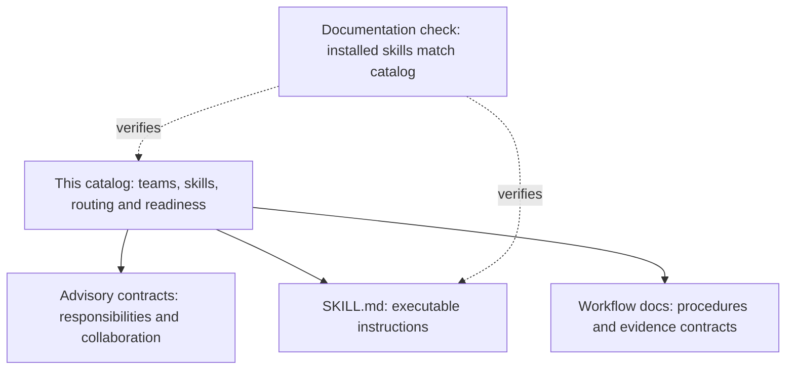
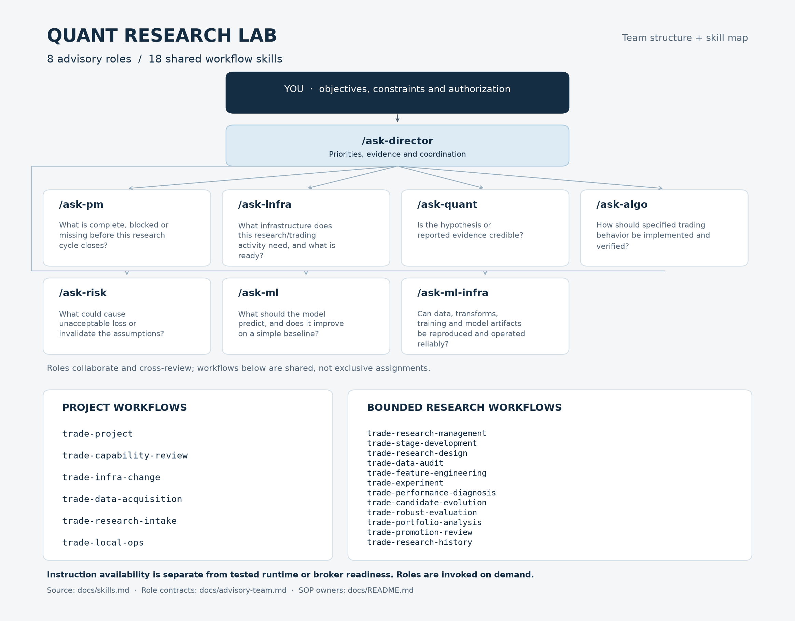
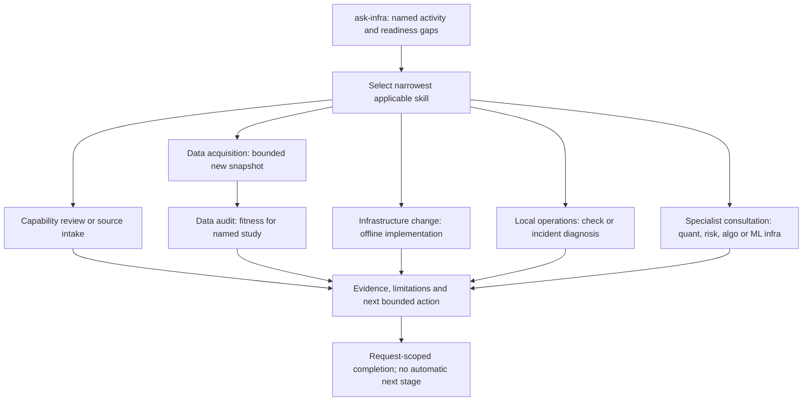

# Teams and skills catalog

This file is the single source of truth for the team roster, skill inventory,
task routing, invocation and readiness. Detailed role contracts remain in
[advisory team](advisory-team.md), executable instructions in each linked SKILL.md,
and procedures in their canonical workflow documents. [Roadmap](roadmap.md) owns
delivery priorities; [capability matrix](capabilities.md) owns native-tool evidence.
Skills describe repeatable work and route to canonical procedures. They are not
new trading infrastructure or evidence that the underlying workflow has shipped.

Research execution requires each workflow's documented inputs and tools. Check
root README for current runtime readiness; the [research review](tasks/2026-10-25-pr-review.md)
records the implementation and evaluation limits.

## Ownership and maintenance



Update this catalog when adding, renaming, retiring or changing the readiness of a
role or skill. Other maintained documents link here for discovery rather than
keeping their own rosters or counts. Historical task receipts retain the inventory
observed when they were written. `make docs-check` verifies one catalog entry per
installed skill, matching its folder and frontmatter name; it does not evaluate
behavioral usefulness or automatically update session discovery.

## Team map export



Regenerate this presentation from the available-entry tables below with
`.venv/bin/python scripts/current/render_team_skills.py`.
The [renderer](../scripts/current/render_team_skills.py) reads this catalog; the PNG is a
convenience export, not another roster owner. Update it when the catalog changes.

## Hierarchy

```text
Level 1: Advisory perspectives — available for consultation
ask-director                         priorities and synthesis
├── ask-pm                           research coordination and evidence closure
├── ask-infra                        platform/data/operational design
├── ask-quant                        hypotheses and research evidence
├── ask-ml                           predictive modeling and calibration
├── ask-ml-infra                     reproducible ML data, jobs and artifacts
├── ask-algo                         strategy logic and execution mechanics
└── ask-risk                         cross-review of downside assumptions

Level 2: Task workflows — trade-project selects the applicable procedure
├── trade-capability-review          AVAILABLE
├── trade-infra-change               AVAILABLE
├── trade-data-acquisition           AVAILABLE instructions; fixed collectors only
├── trade-research-intake            AVAILABLE
├── trade-local-ops                  AVAILABLE
├── Research development — AVAILABLE instructions; evaluation receipt below
│   ├── trade-research-management     cycle closure and leaderboard disposition
│   ├── trade-stage-development       one-stage implementation and conformance
│   ├── trade-research-design         study specification and trial budget
│   ├── trade-data-audit              frozen-input fitness and provenance
│   ├── trade-feature-engineering     causal features, redundancy and label diagnostics
│   ├── trade-experiment              bounded offline execution/cache verification
│   ├── trade-performance-diagnosis   explain observed gains/losses
│   ├── trade-candidate-evolution     evidence-driven next hypotheses
│   ├── trade-robust-evaluation       assess improvement and uncertainty
│   ├── trade-portfolio-analysis      marginal contribution and joint risk
│   ├── trade-promotion-review        stage-specific evidence decision
│   └── trade-research-history        preserve trials, decisions and data exposure
├── trade-reproduce-research         PLANNED
├── trade-compare-strategies          PLANNED
├── trade-risk-review                PLANNED numerical/operational workflow
├── trade-recovery-verification      PLANNED
├── trade-paper-execution            PLANNED
└── trade-live-readiness             LATER

Level 3: Shared tools and canonical knowledge
Nautilus native interfaces + project scripts + SOPs + evidence/templates
```

Detailed role remits, outputs, question examples and public sources
are owned by [advisory team](advisory-team.md). These roles are original project
advisers, not Jane Street representatives. An adviser can discuss a planned
workflow without making its execution tools ready.

The hierarchy is conceptual, not inheritance or automatic delegation. Actual skill
folders stay flat under `.agents/skills/<name>/SKILL.md` for discovery. The entrypoint
selects the narrowest applicable workflow; a specialist can be invoked directly.
Selection does not authorize external actions or launch other agents.

## Available project skills

Available means instructions exist and format/reference checks pass. It does not
mean an end-to-end operational evaluation has passed. These are project-local skills;
new skills can be read by path if the current session has not refreshed discovery.

| Skill and entrypoint | Trigger | Output / done condition | Canonical procedure and tools |
| --- | --- | --- | --- |
| [trade-project](../.agents/skills/trade-project/SKILL.md) | Which workflow/skill should handle this project request? | Selected workflow, relevant owners, scope and next concrete action; route only or continue according to the request | This map, root README and roadmap |
| [trade-capability-review](../.agents/skills/trade-capability-review/SKILL.md) | Does the pinned engine already provide this feature? Upgrade/runtime compatibility review | Evidence-backed reuse/configure/extend/defer finding; verification level and impact recorded | Capability matrix and offline audit script |
| [trade-infra-change](../.agents/skills/trade-infra-change/SKILL.md) | Implement a data/run/monitoring/recovery infrastructure slice | Scoped acceptance met, behavior checks and canonical docs updated, limitations explicit | Development workflow, architecture and matrix; native interfaces first |
| [trade-data-acquisition](../.agents/skills/trade-data-acquisition/SKILL.md) | Requested bounded historical-data download using existing supported collectors | Immutable source/normalized/catalog paths, resource receipt, coverage and limitations; no automatic financial eligibility | [Acquisition procedure](data-library.md#bounded-acquisition-procedure), fixed pilot/current-holdings collectors |
| [trade-research-intake](../.agents/skills/trade-research-intake/SKILL.md) | Find/screen an online repo, paper or reported strategy result | Source/goal-fit/rights/data/claim record and justified next action; unknowns explicit | Research intake SOP, mandate and intake template |
| [trade-local-ops](../.agents/skills/trade-local-ops/SKILL.md) | Environment check, failed-run diagnosis, requested paper observation | Actual command outcomes, redacted evidence, unresolved uncertainty and next action | Local/paper/incident SOPs, make checks and paper CLI |

## Available research workflows

[Bounded research development](research-development.md) owns the lifecycle, handoff
and evidence contracts. These instructions support the current saved-data/offline
path; they do not establish a generic optimizer, native catalog validation,
automatic research-history database or broker execution. A caller can request one
stage without launching a full cycle. Use the
[construction/evaluation receipt](tasks/2026-10-25-research-skills.md) for actual
behavioral evidence and limitations; the later [feature-engineering receipt](https://github.com/kenfuliang/quant-trading-lab/blob/4586095846c63abf2e0b90dc547654256c3fc45e/docs/tasks/2026-10-25-feature-engineering-skill.md) covers its added workflow. Format validation alone is not usefulness proof. The [skills/SOP repair](tasks/2026-10-30-skills-sop-repair.md) records recovered management/stage instructions and their offline evaluation.

| Skill | Trigger and observable output |
| --- | --- |
| [trade-research-management](../.agents/skills/trade-research-management/SKILL.md) | Close a requested cycle → attempt/evidence reconciliation, lesson, single-leaderboard disposition and next prerequisite; [procedure](operations/recursive-research.md#research-management) |
| [trade-stage-development](../.agents/skills/trade-stage-development/SKILL.md) | Implement one frozen stage → input/output/timing contract, offline conformance and evidence; financial execution separately scoped; [procedure](research-development.md#individual-stage-development) |
| [trade-research-design](../.agents/skills/trade-research-design/SKILL.md) | New/amended study → falsifiable control/treatment, metric/split/trial specification and open decisions |
| [trade-data-audit](../.agents/skills/trade-data-audit/SKILL.md) | Saved input fitness → actual hashes/quality/availability checks and named-experiment eligibility |
| [trade-feature-engineering](../.agents/skills/trade-feature-engineering/SKILL.md) | Define/test causal features or bounded LLM proposals → registry, leakage/quality/redundancy evidence and target-specific saved-data diagnosis; [contract](feature-engineering.md) |
| [trade-experiment](../.agents/skills/trade-experiment/SKILL.md) | Requested bounded offline run or cache preflight → actual execution/reuse/audit receipt or precise blocker |
| [trade-performance-diagnosis](../.agents/skills/trade-performance-diagnosis/SKILL.md) | Explain saved performance → supported attribution, adverse episodes and testable uncertainties |
| [trade-candidate-evolution](../.agents/skills/trade-candidate-evolution/SKILL.md) | Next iteration after diagnosis → bounded rule deltas, controls, falsifiers and expected harms |
| [trade-robust-evaluation](../.agents/skills/trade-robust-evaluation/SKILL.md) | Assess claimed improvement → comparability/selection/uncertainty findings and scoped research verdict |
| [trade-portfolio-analysis](../.agents/skills/trade-portfolio-analysis/SKILL.md) | Assess combination → interval-aligned dependence, exposures, joint-risk evidence and missing mechanics |
| [trade-promotion-review](../.agents/skills/trade-promotion-review/SKILL.md) | Decide next stage → evidence-linked recommendation; operational readiness stated separately |
| [trade-research-history](../.agents/skills/trade-research-history/SKILL.md) | Retrieve/record research learning → linked project history retaining failures and evaluation exposure |

The [RSI SOP](operations/recursive-research.md) connects these existing workflows to
the offline foundation. Only synthetic and fixed read-only saved-preflight adapters
are implemented; financial execution remains unsupported. No new skill is installed.

## Available advisory skills

For a complete bounded RSI cycle, use the
[calling sequence and handoff checklist](operations/recursive-research.md).
It connects the existing research workflows above to frozen plans, preflight,
bounded execution, verification, disposition and lessons. No additional skill
folder or automatic team dispatcher is required. Runtime availability and remaining
limits are recorded in the [foundation checklist](tasks/2026-10-27-rsi-foundation-implementation.md).

| Chat prefix / local skill | Primary question | Detailed contract |
| --- | --- | --- |
| [/ask-director](../.agents/skills/ask-director/SKILL.md) | What should we prioritize, and what evidence supports the decision? | [Role contract](advisory-team.md#ask-director) |
| [/ask-pm](../.agents/skills/ask-pm/SKILL.md) | What is complete, blocked or missing before this research cycle closes? | [Role contract](advisory-team.md#ask-pm) |
| [/ask-infra](../.agents/skills/ask-infra/SKILL.md) | What infrastructure does this research/trading activity need, and what is ready? | [Role contract](advisory-team.md#ask-infra) |
| [/ask-quant](../.agents/skills/ask-quant/SKILL.md) | Is the hypothesis or reported evidence credible? | [Role contract](advisory-team.md#ask-quant) |
| [/ask-algo](../.agents/skills/ask-algo/SKILL.md) | How should specified trading behavior be implemented and verified? | [Role contract](advisory-team.md#ask-algo) |
| [/ask-risk](../.agents/skills/ask-risk/SKILL.md) | What could cause unacceptable loss or invalidate the assumptions? | [Role contract](advisory-team.md#ask-risk) |
| [/ask-ml](../.agents/skills/ask-ml/SKILL.md) | What should the model predict, and does it improve on a simple baseline? | [Role contract](advisory-team.md#ask-ml) |
| [/ask-ml-infra](../.agents/skills/ask-ml-infra/SKILL.md) | Can data, transforms, training and model artifacts be reproduced and operated reliably? | [Role contract](advisory-team.md#ask-ml-infra) |

## Invocation

Use the exact advisory chat prefix listed above followed by a question. Match the
whole prefix: `/ask-ml-infra` selects its own role, not `/ask-ml`. This is a chat
routing convention; native slash-menu registration is not implemented. Read the
linked skill and its role contract. Consultation does not launch agents, training,
financial trials or broker actions; requested implementation uses the applicable
workflow within its authorized scope.

Skills are invoked by name (for example,
`$trade-performance-diagnosis`) or read by path if session discovery has not refreshed.
The `/ask-*` chat-prefix convention remains specific to advisory roles. Numerical
tools and operational workflows retain their own capability/readiness status.

## Infrastructure calling map

`ask-infra` assesses business coverage using its [role contract](advisory-team.md#ask-infra)
and selects the smallest applicable workflow below. These are skill handoffs in the
current conversation, not spawned teams, a scheduler or automatic orchestration.
Read a called SKILL.md before acting. Advice may finish with a plan; an authorized
implementation request continues through its selected workflow's acceptance.



| Need / callable skill | Handoff inputs | Required return / readiness limit |
| --- | --- | --- |
| Native support → `trade-capability-review` | Requirement, pinned runtime/interface, existing evidence | Reuse/configure/extend/defer finding; installed versus verified evidence |
| Provider/collector discovery → `trade-research-intake` | Coverage, free/local constraint, intended use, external source | Source/rights/compatibility record; no implicit download |
| Historical download → `trade-data-acquisition` | Supported collector, frozen universe/window/feed, credentials path only, aggregate budget/output ID | Raw/normalized/catalog manifest, resource use, coverage and failures; instructions available, fixed collector evidence only |
| Dataset eligibility → `trade-data-audit` | Frozen paths/hashes, named study/window/timing/actions requirements | Eligible/conditional/blocked receipt; no implicit refresh or repair |
| Data/runtime/accounting/CI/monitoring implementation → `trade-infra-change` | Gap, native seam, scope, acceptance and failure case | Changed interface, actual offline checks, docs and unresolved operational evidence |
| Local health or incident → `trade-local-ops` | Mode, observed symptom, relevant run/service paths and requested check | Redacted observed outcome, uncertainty and next step; follows provider-specific SOP |
| Research timing/accounting validity → `ask-quant` | Study and data/ledger assumptions, unresolved issue | Evidence requirements; actual research execution uses its scoped research workflow |
| Limits and failure policy → `ask-risk` | Activity, exposure assumptions and failure/unknown state | Challenge of limits and failure actions; no trading authorization |
| Strategy-to-order semantics → `ask-algo` | Specified rule, timing, sizing and native interface | State/invariants and verification cases; no financial retuning by default |
| ML pipelines/tracking → `ask-ml-infra` | Dataset/feature/model lineage, run/artifact contract and resource bound | ML-specific reproducibility/gap assessment; implementation via infra-change |
| Priority conflict → `ask-director` | Competing gaps, dependency evidence and effort/benefit | Bounded recommendation; portfolio priority changes remain owned by roadmap |

The [environment helpers](#reuse-skills-already-available-in-codex) cover requested
code review, interface design and roadmap edits. Planned recovery-verification,
paper-execution and live-readiness skills below remain unavailable: read the
applicable existing SOP directly and disclose its tested scope. For example,
Alpaca's bounded integration uses [its own SOP](operations/alpaca-paper.md);
IBKR observation uses [paper observation](operations/paper-connection.md).
Neither path establishes generic broker recovery or live readiness.

Pass the selected workflow only the relevant input contract, evidence and scope.
An unsuccessful receipt returns to assessment; it does not authorize repeated
requests, a new budget, a new provider, strategy tuning or a broker action.
The [scope-expansion receipt](tasks/2026-10-25-infrastructure-skills.md) records
instruction validation separately from end-to-end execution evidence.

## Candidate skills and readiness gates

Names below reserve a possible workflow, not an installed skill or commitment to
build every entry. Add only when a real repeated task and verified procedure justify
it. The milestone references are prerequisites, not independent roadmap priorities.

| Candidate | Concrete task / expected artifact | Must exist before the skill is ready |
| --- | --- | --- |
| Native catalog/provider audit extensions | Extend available trade-data-audit with catalog round-trip and provider-specific validation | M1 catalog behavior verified and provider-specific data contract available |
| trade-reproduce-research | Reproduce a pinned upstream claim with licensed inputs; discrepancy report | Scoped research request, accepted intake and reproducible isolated environment/data |
| trade-compare-strategies | Compare saved runs; flag mismatched capital/dates/costs/leverage and show risk/return tradeoffs | M2 result definitions, native report checks and comparison entrypoint |
| trade-risk-review | Assess exposures, drawdown scenarios, leverage, margin buffers, Greeks and assignment risks | Explicit mandate budgets and verified account/instrument calculations; link to M5 policies |
| trade-recovery-verification | Exercise capture loss, restart, backup/restore and reconciliation; recovery receipt | M3 backend/capture decision, disposable environment and fault/restore procedure |
| trade-paper-execution | Run an explicitly scoped paper order/reconciliation exercise; operational receipt | M5 native risk setup, account/feed permissions, bounded order plan and execution SOP |
| trade-live-readiness | Review recovery, risk, operational and paper evidence; readiness assessment | Separately scoped live-operation request and explicit acceptance criteria; assessment alone never enables trading |

Potential advisory specializations remain **planned, not installed**: ask-data
(provider contracts/quality), ask-execution (broker/microstructure), ask-ops
(incidents), ask-review (independent evidence challenge), ask-portfolio
(allocation/correlation) and ask-options (volatility/Greeks). Keep these concerns
inside current roles until repeated work justifies a distinct skill. A role alone
does not establish independent review or operational capability.

Avoid separate skills for every indicator, metric, order type or Nautilus class.
Those belong to tool/reference documentation unless a distinctive repeatable
workflow warrants its own instructions.

## Reuse skills already available in Codex

| Work | Existing skill to use when applicable | Project context to supply |
| --- | --- | --- |
| Clarify an objective | define-goal | goals.md; use quantitative evidence, do not invent a return guarantee |
| Revise roadmap after evidence | roadmap-update | roadmap.md, capability matrix and current acceptance evidence |
| Design module interfaces | codebase-design | architecture.md; extend native interfaces before replacements |
| Review a code change | code-review | Exact local diff/revision and workflow acceptance |
| Validate structured data | analyze-data-quality or validate-data | Dataset contract, source rights and provenance receipts |
| Statistical investigation | data:statistical-analysis | Predeclared question, trial history, chronological splits and costs |
| Build charts/reports | visualize-data or build-report | Native reports first; preserved run evidence and metric definitions |
| Maintain skill instructions | skill-creator and writing-for-agents | This hierarchy and canonical SOPs; avoid duplicated policy |

These are environment-provided helpers, not repository dependencies. If absent in
another session, use the project's canonical procedures directly and disclose the
missing helper when it materially limits the task. Do not install new dependencies
merely because a helper is named here.

## Rules for adding a skill

1. Identify an actual trigger, observable output, canonical owner and stop condition.
2. Check existing skill scope; add a branch there if it shares the same workflow.
3. Keep policy in canonical docs and execution in supported scripts/native tools.
4. Validate frontmatter and references; exercise new executable helpers separately.
5. Update this map with honest readiness and evidence. More skill files do not
   establish more platform capability.
