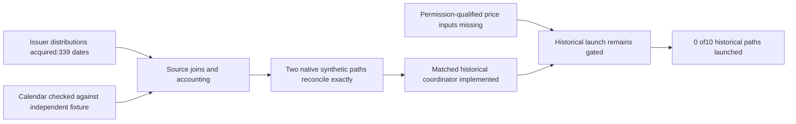

# Multi-asset qualification: blocked goal checkpoint

**Current goal status: blocked; the historical comparison is not completed.** The
[bounded protocol](2026-10-25-multi-asset-qualification-v2.md) preserves the fixed
five-rule/two-cost design. Substantial source/accounting gaps are now narrowed;
permission-qualified price input is still required. A concise question requesting
an existing authorized local export/path is pending with the user. This is missing
input evidence, not a request for broker credentials or permission to place orders.

## New evidence

| Previous blocker | Current observation and limit |
| --- | --- |
| SPY/IEF payment dates | State Street historical XLSX and iShares embedded table acquired with anonymous ordinary HTTPS.85SPY and254IEF actions in the warmup/evaluation span have issuer ex/pay dates. Their date sets match the provider lists exactly |
| Amount precision | All differences preserved in a source-join receipt. One SPY2021-12-17 discrepancy exceeds simple rounding: issuer1.636431 versus saved provider1.633USD/share. Cause unverified; new action-source policy is explicitly issuer-primary, never an overwrite of the old fixture |
| Calendar | All5,305saved rows per asset match independent rule-derived sessions.4,792sessions/open/close clocks match exchange_calendars' saved maintainer fixture,2004–2023-01-13. Extension to2025 uses separately inspected holiday/exception rules, including Carter mourning. Research qualification, not exchange certification or original-vintage availability |
| Native account path | `research/native_multi_asset.py` now uses a native SIM CASH account and actual simulated fills, with project-side receivables via supported cash adjustment. Exact independently replayed cash, shares, fees, entitlement/payment lifecycle and raw-close-plus-receivable NAV |
| Terminal unpaid dividends | Separate native synthetic case keeps1.111104USD receivable at final date, rather than crediting future cash. Payment fixture verifies selling on ex-date does not erase prior eligibility |
| Whole shares/costs | Shared existing planner, fixed sell-before-buy execution with fill acknowledgment and native cash checks; no cash borrowing, zero cash yield, USD1/order, modeled adverse fills |
| Historical orchestration | New `research/multi_asset_comparison.py` supports reviewed input bundles, exact source/code hashes, freeze-before-run, ten reservations, one worker,900seconds aggregate, failure preservation and no retries. No financial run, historical parity or completed dashboard claimed |

The initial two native accounting cases used invented prices only, six sessions total and
seven fills; independent cash/NAV differences were0USD. These are distinct from
the closed earlier probe quota. Two of this epoch's four allowed native launches
were consumed at that initial checkpoint. The follow-up below closes the quota.
No partial-fill, crash/restore or live execution readiness inferred.
Splits are deliberately rejected before simulation: no artificial fills are used
to repair native positions. This runner needs a qualified no-split input universe,
or a separately tested action handler before an input containing splits can run.

## Source scope and remaining input

Twelve artifact requests have been preserved across six domains. No price endpoint
was queried; original datasets remain unchanged. All received bytes are hash-verified
and retained in ignored local storage, including unsuitable source leads.

- The usable [State Street distribution download](https://www.ssga.com/us/en/institutional/resources/documents/etf-dividend-distributions)
  was found by inspecting its normal HTML link. Its XLSX contains ex/pay dates and
  amounts; data-use/redistribution scope still needs recording in the eventual bundle.
- The normal [IEF product page](https://www.ishares.com/us/products/239456/ishares-7-10-year-treasury-bond-etf)
  embeds the full distribution table, not merely the recent rows shown by the web
  text reader. The advertised workbook was also saved.
- The downloaded [Yahoo general terms](https://legal.yahoo.com/us/en/yahoo/terms/otos/index.html)
  restrict automated access/collection without prior permission. Authorization for
  acquisition of the existing anonymous price snapshots has not been established;
  this checkpoint does not infer a price-data license from possession of the files.
- A purported Finance-specific URL resolves to Finance Community terms; it is
  excluded as evidence of historical-price permission.
- Stooq returned a JavaScript browser-verification challenge. It is retained as
  an access failure, not mistaken for price data. No challenge or bypass executed.
- The exchange_calendars rules and fixture were retained with their Apache-2.0
  license; content hashes freeze retrieved bytes, while an upstream commit SHA
  was not resolved. No external calendar package or new dependency installed.

The required bundle declares price-use scope/evidence, raw-price semantics,
issuer action authority, calendar, restated-data limitations, no unhandled splits
and native-accounting evidence. It must contain actual hashed price, action,
calendar, permission-evidence and qualification-receipt files. Missing/unknown
gates block launch. `qualified-input-bundle.json` has **not** been fabricated;
the expected current preflight rejects its absence before launching an engine.

If the user has no authorized export, a later source change must stay within this
epoch's source/domain/deadline bounds or receive a fresh bounded scope. No proxy
NAV prices, artificial payment delays, new symbols or waived input rights will be
silently substituted. An authorized user assertion must identify the actual source
and permitted scope; it does not authorize scraping contrary to a source's restrictions.

## Validation and state

`make check` passed248tests, documentation and dependency checks (exit0). Ten new
behavior checks exercise issuer parsing/identity, duplicate and invalid actions,
calendar exceptions, payment rounding, same-day entitlement/payments, terminal
receivables, independent audit corruption rejection, matched annual score anchors,
split rejection and missing-bundle refusal. Native engineering proofs are separate
reserved runs; normal CI tests do not launch historical simulations or connect.

Artifacts and original source identities: `.local/multi-asset-qualification-v2/`.
The [checkpoint receipt](evidence/2026-10-25-multi-asset-qualification-v2.json)
records exact request/probe counts, source/calendar joins, validation and preserved
prior uncommitted files. The previous financial epochs stay closed. All new work
is local/uncommitted; no PR, service, MLflow import or deployment occurred.

Remaining work: obtain/qualify the permitted price input, assemble the normalized
bundle under the issuer-primary/cent-cash conventions, freeze the executable plan,
then reserve and run all ten paths within the remaining deadline. Annual/full-period
and temporal outputs and both-baseline joint comparisons are implemented but unrun.
The annual-doubling aspiration and independent-alpha claims remain unsupported.

## Continuation: synthetic accounting checks complete

Two additional cases were fixed before execution in
`.local/multi-asset-qualification-v2/accounting-stress-plan.json`, using the
remaining two authorized native slots. They introduce no historical strategy trial:

- **25bp rotation:** six native fills, final GLD38 and cash38.78USD; the independent
  descending-affordability replay matches every cash, position and NAV observation.
- **25bp same-ex/pay-date rounding:** two native fills; prior eligible holdings
  accrue1.111104USD, receive1.11USD cash with explicit-0.001104USD rounding P&L,
  then sell. Final cash993.53USD, zero shares/receivable; independent replay matches.

Both maximum reconciliation differences are0USD. All four native probes completed;
the quota is now exhausted at4/4. A subsequent guard-only invocation rejects before
another engine launch. Source requests remain12/32, historical financial paths0/10.
The financial preflight was independently rechecked and still rejects the absent
permission-qualified input bundle. The human export/path question remains pending.

The [stress receipt](evidence/2026-10-25-multi-asset-accounting-stress.json) links
the frozen plan, original checkpoint, exact proof/manifests and rejection logs.
Old source snapshots, native results and the original checkpoint JSON remain
unchanged. This is concrete progress in accounting verification, not a verified
wait on a running job or completion of the historical comparison.

## Blocked audit after three consecutive goal turns

The original source/accounting turn made concrete progress; the first continuation
completed the remaining native stress proofs. Both retained the same missing
permission-qualified price input. A third goal turn revalidated the absence of
the qualified bundle and executable plan, all four completed native manifests,
and the expected preflight rejection before any financial launch. No new user
source evidence has arrived. There is no live process to wait on or eligible
financial path to launch. The native quota is exhausted; all six source domains
are consumed, and no permission-qualified price source is established within them.

The [blocked-audit receipt](evidence/2026-10-25-multi-asset-blocked-audit.json)
records the three-turn threshold and required external change. The goal is marked
blocked rather than complete or voluntarily paused. All10historical paths remain
unrun. Inputs, source failures, local code, prior evidence and negative results
are preserved. Resume requires the actual authorized price-export source/scope/path,
or a separately authorized source-scope revision; recheck the original deadline
and limits before execution. No budget/deadline reset is implied.
