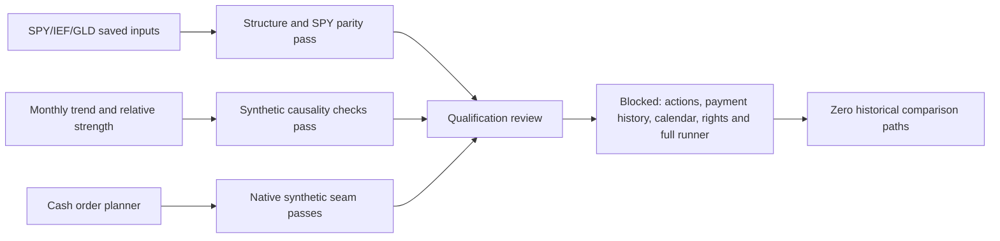

# Multi-asset goal: implementation and readiness review

Outcome: **reusable signal/allocation components implemented; historical comparison
NOT READY and unrun**. The [predeclared protocol](2026-10-25-multi-asset-unlock.md)
owns rules, limits and the conditional comparison. This new goal preserved the
closed ETF/SPY epochs and earlier uncommitted work; no old financial slot reopened.

## Delivered and behavior-verified

| Component | Evidence and boundary |
| --- | --- |
| Monthly trend | Completed10-month-end SMA; active sleeves retain1/3, inactive sleeves stay cash. No redistribution or tuning |
| Relative strength | Trailing10-month total return,11 completed month ends; positive top-one, fixed alphabetical ties, otherwise cash |
| Timing | Next-session execution labels, complete calendar transition, warmup checks, future perturbation/truncation invariance; no incomplete final-month decision |
| Forward total-return signal | Explicit unadjusted-price/action convention with split-before-distribution ordering; separate from raw fill prices and payment-date cash. Synthetic distribution/split/concurrent-action identity checks only |
| Shared-cash planner | Finite complete marks, long whole shares, fixed reserve, sells before buys, modeled adverse fills and fees, affordable quantities, reject missing marks/invalid leverage; project planning seam, no duplicate OMS |
| Receivables helper | Duplicate action consistency, payment-date check and observed-credit acknowledgment. Receivables cannot fund planned purchases. In-memory research helper; not crash-safe native persistence |
| Native seam | Pinned NautilusTrader SIM CASH venue with three synthetic quotes. Confirm sell fills before buys and check observed native cash. Six fills,6USD fees, final cash30.07USD, GLD39/IEF0/SPY0. Independent Decimal replay matches |

Two bounded native synthetic launches completed; both outcomes are preserved.
The second captures complete source/dependency snapshots to close the first probe's
incomplete transitive source identity. It is a provenance confirmation, not another
strategy trial. Neither uses historical prices or a broker. Native quota is closed
at2/2. A subsequent stricter invalid payment-date guard was unit-tested, with no
third native run. The planner AST still matches the preserved native-tested source.
Full native corporate-action readiness is not claimed; old split-handler negative
evidence remains unchanged. Immediate complete fixture fills do not prove partial
fills, changed quotes, restart, settlement or broker behavior.

## What the data audit established

All three existing Yahoo snapshots still match their acquired hashes. Each has
5,305 observed rows, with5,031 in the proposed2006–2025 evaluation interval.
Their dates align, but an observed intersection is not an independent exchange
calendar. All5,305 overlapping SPY OHLC rows match the original fixture after
cent rounding, with zero mismatching cells; distribution dates/amounts also match.
No price snapshot was downloaded or provider dataset replaced.

Recorded official-source investigation:

- [State Street distribution page](https://www.ssga.com/us/en/institutional/resources/documents/etf-dividend-distributions)
  links a historical XLSX, but the tool could not retrieve it in this bounded review.
  A surfaced historical PDF contained DIA rather than SPY and was rejected for SPY qualification.
- [IEF issuer page](https://www.ishares.com/us/products/239456/ishares-7-10-year-treasury-bond-etf)
  exposes ex-date/payable-date columns and recent distributions. It does not supply
  a qualified complete2004–2025 payment-date table in the evidence collected here.
- Yahoo help adjustment/download pages returned429; legal/API pages returned999.
  Indexed descriptions are source leads, not a qualified raw-price/action or
  intended-use contract for the saved anonymous chart snapshots. No bypass attempted.
- [GLD issuer page](https://www.ssga.com/us/en/individual/etfs/spdr-gold-shares-gld)
  confirms instrument/inception identity; it is not a blanket historical action-completeness certificate.
- [NYSE calendar page](https://www.nyse.com/markets/hours-calendars)
  currently lists2026–2028 holidays. That page alone does not qualify the full
  proposed2004–2025 warmup/evaluation calendar or exceptional closures.

Eleven official document-read attempts, within the12-read cap, are recorded in
the receipt. Six retrievals failed, including the inaccessible XLSX and an
incorrect GLD FAQ URL; these do not count as established input evidence. No accounts,
paid access, extra dependencies, market-data downloads or restricted-access bypass.
Issuer2026 quote snippets were not used for parameter selection or protected evaluation.

## Why comparison did not run

The explicit readiness guard rejected historical launch because the following
requirements remain unverified, not because an unfavorable return was hidden:

1. Intended-use rights, precise raw/adjusted semantics and complete actions.
2. Verified SPY/IEF historical dividend payment dates/ordering; no ex-date cash
   substitution or fabricated fixed payment delay.
3. Independent historical exchange calendar and input availability evidence.
4. Configured native corporate-action/receivable handling or a separately reviewed
   scope that does not pretend to trade actual raw ETF shares without those actions.
5. Full historical shared-account runner, costs, continuous NAV/receivable reporting
   and independent audits. The new pure planner/native toy is a prerequisite,
   not a full historical engine or dashboard importer.

The fixed five-rule/two-cost design remains non-executable:
`research/plans/multi-asset-unlock-v1.design.json`. Actual financial paths0/10;
the conditional allocation is closed without carry-over. No relative-strength,
trend-portfolio or benchmark performance numbers were manufactured. No independent
alpha, annual doubling, paper or live readiness is established.

## Validation and reproducibility

Implementation: `research/multi_asset.py`, `research/multi_asset_plan.py`,
`research/multi_asset_native_probe.py`, `research/multi_asset_audit.py`;
11 new behavior tests in `tests/test_multi_asset.py`. Run normal `make check` for
offline synthetic regression checks. The native probe quota is exhausted; do not
rerun its CLI. The audit CLI only reads saved inputs/proofs, checks identities and
refuses an existing output directory; no strategy simulation or download.

Recorded artifacts live under `.local/multi-asset-unlock-v1/`, including original
source-read observations, old dirty-file snapshots/hashes, native logs/source
snapshots/fills, versioned audits, plan identity and validation logs. Compact
[completion receipt](evidence/2026-10-25-multi-asset-unlock.json) records exact hashes,
checks and the expected launch rejection. The initial audit remains preserved;
the final schema explicitly includes the missing full-runner requirement.
`make check` passed238 tests, documentation and dependency checks (exit0);
whitespace validation also passed. The first final-check attempt stopped at a
missing new receipt link before tests; its log is retained, and the complete
subsequent check passed. Hosted CI was not run for these uncommitted changes.

No commit, PR update, publication, service start, MLflow import, broker operation
or framework source change. Prior uncommitted research is preserved, with only
additive capability/goal/procedure updates to shared canonical documents.

## Next bounded action

Acquire and qualify a complete free/local action-and-calendar data package before
finishing the historical native runner. Validate ex/pay-date joins and distribution
ordering against issuer records, then prove full NAV/account behavior on synthetic
actions. Source access failures are not proof that no free source exists; they
are a limit of this bounded evidence. Do not waive missing cash accounting to
produce a leaderboard. A subsequent explicit epoch can expand source investigation
or adopt a clearly labeled research proxy with different claims, never silently.
