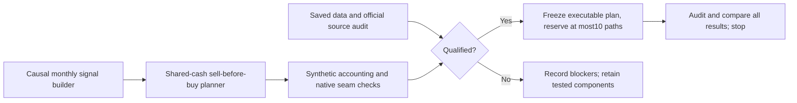

# Bounded goal: unlock multi-asset trend and relative strength

The user authorized this new goal after reviewing our SPY-only coverage. The
[mandate](../goals.md), [research procedure](../research-development.md) and
[dependency boundaries](../architecture.md#project-and-dependency-boundaries)
remain authoritative. Earlier ETF readiness and SPY robustness epochs stay closed.
Prior uncommitted work is snapshotted by hash in
`.local/multi-asset-unlock-v1/state.json`; preserve its files and evidence.

## Scope and predeclared rules

Fixed universe: SPY/IEF/GLD. USD300,000, nominal1x maximum, no shorts/borrowing,
99% investment budget, whole shares, zero cash yield, USD1/instrument order,
5bp and25bp adverse fills. Five rules across two cost contexts, at most10 paths:

1. Entry-only SPY with cash distributions; no discretionary reinvestment.
2. Unchanged daily EMA50/200 plus volatility-only gate from the previous epoch.
3. Monthly equal thirds, with no selection.
4. Monthly equal thirds; each sleeve invests only when its completed month-end
   total-return index is strictly above its10-month-end mean, including that close.
   Inactive sleeves stay cash without redistribution.
5. Monthly top-one relative strength: rank trailing10-month total returns using
   11 completed month-end marks; select the highest only if its return is strictly
   positive. Ties use fixed alphabetical symbol order (GLD, IEF, SPY). Otherwise
   all cash. No simultaneous trend-filter addition or lookback sweep.

Ten-month SMA and10-month returns are different fixed hypotheses, not alternative
parameter settings selected after results. Price peaks play no role in rule2.
Monthly signals use only completed closes and execute at the next session open.
Calendar-qualified month boundaries, not a future last-observed-row heuristic,
must identify month-end. Signal histories include warmup; no asset/date substitution.
Evaluation is2006-01-03–2025-12-31 subject to full input qualification; SPY/gate are
recomputed over exactly those dates with their own frozen warmup, not compared to
the earlier2005-start account as if it were matched.

Before any historical path, qualification must establish raw execution-price
semantics, action completeness, dividend entitlement and verified payment dates,
calendar coverage, historical availability and intended-use rights for all inputs.
If SPY source snapshots disagree, preserve and reconcile the difference before
using one common price/action stream for all rules. No adjusted-close execution
prices, invented payment dates or return-index proxy substitutes for this study.
No new price downloads in this epoch; inspect saved files and at most12 official
document reads (four initial reads recorded). No paid API, credentials, access
bypass, new dependencies, agents, broker operation or publication.

## Implementation and evidence gates

Build missing components at project seams. Use native orders/account validation
where supported; do not patch NautilusTrader or claim generic corporate-action
readiness from a project fixture. Test signal causality, warmup, deterministic
ties, nonpositive returns, missing-mark rejection, fee-aware integer allocation,
sell-before-buy ordering, no spending receivables and share/value conservation.
Two new native synthetic probe launches maximum, single worker, no dependency
changes; old exhausted probes supply reference evidence only.

Financial launch requires a separate frozen executable identity after readiness
passes, input/code hashes, all eligibility booleans true and exact case reservation.
Single worker,900seconds aggregate financial runtime, failed paths consume slots,
no automatic retry. This design alone is not executable or financial evidence.
Goal ceiling:60minutes from creation. Stop on integrity failure or resource bound.

Primary question: does either multi-asset rule improve the growth/downside tradeoff
against both SPY and the frozen gate? Use raw-unit comparisons: no worse CAGR,
absolute close drawdown and longest observed recovery/censor interval, strictly
better on at least one (1e-9 percentage-point tolerance, zero duration tolerance).
If neither dominates, report tradeoffs rather than force a winner. Rule4 versus3
isolates the filter; rule5 versus3 changes selection and concentration together.
Report annual/full-period return, DD, Sharpe, Calmar, rolling21/63/126/252 returns,
worst1/5/21/63 windows, ES95, recovery/censoring, exposure, turnover and costs.
No acceptable growth sacrifice or deployment risk budget is inferred.

All saved historical outcomes are development evidence, with a fixed retrospective
three-asset universe. New symbols do not establish an untouched test. No statistical
independence, annual-doubling, predictive-alpha or deployment claim.

Completion means tested reusable components, source/assumption receipts, a precise
ready/not-ready verdict and, only if eligible, the bounded matched comparison.
Source blockage completes the readiness decision but leaves historical performance
explicitly unrun. No fabricated table or automatic reopening of the old six-case
proposal. The completion receipt will be linked separately so this protocol can
remain unchanged after executable freezing.
