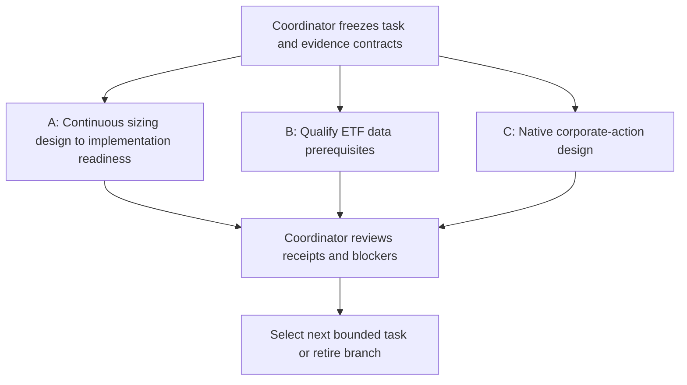

# Parallel RSI research checklist

Prepared2026-10-25 for the user's checklist request. This is a scoped research
backlog and dispatch proposal, not a launched team, new execution budget, scheduler
or replacement infrastructure roadmap. [Decision-layer integration](2026-10-25-rsi-decision-layer-plan.md),
[lifecycle](../research-development.md), [scores](../research-scoring.md) and
[mandate](../goals.md) retain authority. All work uses free/local evidence.
Unchecked means not completed in this work packet; prior evidence remains linked.

## Recommended initial parallel wave

One coordinator plus up to three workers. Start with A/B/C because they answer
different questions and B/C unblock the same portfolio study without duplicate
ownership. A is a ready design, not yet a ready executable study. D/H can replace
blocked lanes rather than stacking more variants on the same history.

| Check | Lane / decision question | First bounded deliverable | Current entry condition |
| --- | --- | --- | --- |
| [ ] | **A. Aggressiveness:** Does adaptive sizing earn its complexity? | Implementable specification and causality/accounting test plan for the [one20%continuous cap](../../research/plans/spy-continuous-cap-development-v1.design.json); preserve plain/discrete/half EMA controls | Design available. Proposed8financial cases total, not allocated or executed |
| [ ] | **B. Free-data qualification:** Can SPY/IEF/GLD support the intended claims? | One source matrix resolving payment dates, adjustments, calendar/availability and rights, or exact unresolved fields | [Readiness blockers](2026-10-25-rsi-etf-readiness.md) known. First pass official-document/source screening only; no new snapshots without a fresh acquisition bound |
| [ ] | **C. Native corporate actions:** Can splits and dividend receivables preserve account identities? | Native-first extension design plus synthetic cases for ex/pay dates,2:1split, coincident actions, fractional entitlements and missing marks | Known configured native gap. First pass design/source inspection only; prior2-probe quota closed; any new probe count must be declared separately |
| [ ] | **D. Evidence and uncertainty:** How much of an apparent gain survives selection scrutiny? | Evaluation protocol defining dependence-aware uncertainty, trial family, viewed-history limitations and prospective observation | Saved runs/trial receipts available. No new financial cases or invented confidence score |
| [ ] | **E. Temporal risk/go-no-go:** Do warnings correspond to actionable risk changes? | Read-only diagnosis separating warnings while already cash, actual exposure reductions, recovery delay and rebound participation | Existing gate paths available; no extra threshold or confirmation search. Define any new event query before inspecting its results |
| [ ] | **F. Industry/target selection:** Is sector rotation or stock ranking feasible with free inputs? | Screen at most3original papers and2repos; document point-in-time universe, delistings, features, data rights and comparator | Research screening feasible; financial execution blocked until universe/data qualification |
| [ ] | **G. Strategy allocation:** Can a selector outperform fixed allocation after switching costs? | One prospective selector design versus fixed/equal policy allocations, with causal training/decision boundaries | No independent selector evidence; no fitting on full-sample strategy rankings or retrospective best-policy oracle |
| [ ] | **H. Cost and implementation drag:** Where do existing policies lose gross gains? | Saved-ledger attribution of fees, modeled slippage, turnover and exposure; distinguish modeled from omitted impact/funding | Read-only analysis feasible; no changed-cost financial reruns or broker operations |
| [ ] | **I. Profit forecasting:** Can we estimate expected net return with honest uncertainty? | One target/horizon/feature/cost-label specification and calibration benchmark; assess whether local data can support it | Expected-profit model absent. Design only; historical CAGR/win rate is not a forecast |
| [ ] | **J. Portfolio diversification:** Do different exposures improve joint loss depth and duration? | Resolve B/C dependencies, then review the unchanged [six-case fixed ETF design](../../research/plans/etf-diversification-readiness-v1.frozen.json) | Historical study not ready and unbudgeted; do not replace unavailable inputs with examples/proxies |
| [ ] | **K. RSI research-controller quality:** Does adaptive research allocation resolve more useful questions? | Fixed-order/breadth-first versus current priority-policy evaluation design with equal information/resource budgets | Existing deterministic controller available; process improvement separate from financial return or trained RL |
| [ ] | **L. Scorecard and browser:** Can a reviewer see why a candidate passed or failed? | Read-only mockup mapping saved artifacts to outcome/risk/evidence/tradability/research-value panels, explicit nulls and reasons | Planned score extension, not runtime implementation; no new database/service/import in design pass |

Feature-engineering addition: [trade-feature-engineering and first SPY diagnostic](2026-10-25-feature-engineering-skill.md) are complete for a three-feature saved-data pilot. Further feature/model/policy work remains a separate bounded lane; the existing A/B/C budgets and prerequisites are unchanged.

## First-pass completion rules

Each lane's initial research/design packet is capped at45minutes, with no automatic
continuation; cap applies when that packet is actually launched. Finish earlier
when the decision question is answered or a required dependency is established.
Each packet is owned by one worker and contains:

- [ ] Named question, parent evidence identities and one intended decision change.
- [ ] Existing capability versus proposed behavior; required free/local inputs.
- [ ] Original-source evidence and transfer limits for externally motivated claims.
- [ ] Fixed controls, metrics, falsifier and exact proposed financial/probe/request
  counts for any subsequent execution; no budget allocated merely by naming it.
- [ ] Readiness result: ready-for-scoped-execution, blocked or design-only; exact
  missing evidence and next condition. A documented dead end is a valid result.
- [ ] Receipt of files read/created, actual checks, resource use, failures and
  unchanged shared artifacts. No financial alpha or annual-doubling inference.

The existing A proposal remains eight financial attempts/60minutes for its later
execution scope. Initial design passes use **zero new financial simulations,
zero market-data snapshots and zero native engine probes**. Bibliographic and
public documentation reads are permitted; no paid access, credentials, restricted
access bypass or package installation. If a later scope includes execution,
freeze that scope and its limits before dispatch, reserve attempts centrally and
count failures. Each worker does not receive an independent copy of a shared budget.

## Coordination and stop checklist

- [ ] Assign one owner and unique output folder/task receipt per lane; shared
  code, canonical docs and experiment state are coordinator-owned during design.
- [ ] Workers return proposals/patches; coordinator integrates sequentially.
- [ ] No two workers execute/mutate the same study, controller journal, report,
  source snapshot or MLflow store. Read-only shared evidence is allowed.
- [ ] Record all tested variants in one aggregate trial history; parallel lanes
  are not independent statistical confirmations.
- [ ] Review at the packet boundary: question resolved, genuinely new evidence,
  feasibility, cost and next discriminating observation. Use the existing priority
  tuple rather than rewarding attractive historical returns or report volume.
- [ ] Stop a lane on integrity failure, limit exhaustion, missing dependency or
  inability to name a new informative question. Do not repeat a closed audit with
  the same inputs; reopen only with a concrete new source/model/evaluation reason.
- [ ] Keep rejected results. No auto-merge, commits/publication, broker changes,
  orders, paid data or live/paper promotion.

Options/futures/FX, leverage expansion, intraday/market making and trained RL remain
later research families. Each needs a separate feasibility packet for contracts,
quotes/actions, financing/roll/assignment, execution and independent evaluation;
they are not extra lanes silently added to this first wave.
