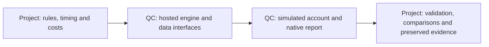

# QuantConnect free-cloud SPY comparison

Status: three cloud cases completed after user verification; EMA is conditional
because three orders were rejected for buying power. User authorized three hosted SPY backtests and a capability assessment;
no paid upgrade, brokerage connection or live/paper deployment is in scope.

Project: [Alert Asparagus Camel](https://www.quantconnect.com/project/38460130).
[Portable source](../../research/quantconnect/spy_comparison.py) contains three modes;
only `MODE` changes between cases. The default is `hold`. This is a separate hosted
adapter; local Nautilus code, datasets and historical results are preserved.

## Frozen protocol

- Three successful paths maximum: entry-only buy-and-hold, entry/exit EMA50/200,
  original combined gate over a hold base with daily target sizing. No search or
  substitute gate. Maximum five UI launch attempts including two technical repairs;
  35-minute active execution checkpoint. Existing failed research budgets unchanged.
- USD 300,000, unlevered long/cash; SPY raw daily data from QuantConnect. Explicit
  2004 history establishes first-close-seeded adjust=False EMA and expanding peak;
  evaluate 2005-01-03 through 2025-12-31. Previously viewed development period.
- Original gate: red if drawdown < -20% or volatility >=40%; yellow if EMA50<=EMA200,
  drawdown<=-10% or volatility>=25%; staged five-close recoveries unchanged. Caps
  green100%,yellow50%,red0%. Annualized 20-return sample volatility, 252 sessions.
- Native simulated MOO orders, quantity sized using prior close and99% NAV;
  whole shares, USD1/order and constant5bps slippage model. Gaps can reject orders;
  rejection count must be inspected before acceptance. No future open used to size.
- Cash dividends accumulate for entry-only controls; gate's daily resizing can
  reinvest them. This is a declared trading-policy difference. Native QC event/
  fee/fill/cash behavior still needs observation; ex-date dividend treatment need
  not match our separate pay-date ledger. Not an exact Nautilus replication.
- No borrowing, interest or tax model. Native performance report plus annual
  return/within-year drawdown logs planned. Temporal metrics and custom Calmar
  require preserved daily equity evidence; none are fabricated before execution.

## Verification so far

- Core gate/EMA synthetic episode test passed. On saved SPY inputs, after converting
  the loader's session index to a DatetimeIndex, all **5,534** comparable closes
  matched gate state, counters and cap against `research.risk_gate.timeline`.
  This is feature/state verification, not a new financial backtest.
- Browser editor saved source; full clipboard text equality checked before a
  symbol-method naming correction. Renamed `self.symbol` to `self._spy` to avoid
  QCAlgorithm method collision; final editor diagnostics reported no problems.
  A cloud build was observed on Lean2.5.0.0.18205; exact final-build identity is
  not established. Zero confirmed financial backtest IDs/results.
- Chrome embedded workspace stalled; opening its existing editor directly enabled
  editing. The in-app browser successfully opened the integrated workspace.
- Backtest request then displayed **Verify Your Account by Linking Your Credit
  Card**, stating no charge while on free tier. User chose to complete verification
  personally. No card details read, entered or submitted by this task.
- Private source/attempt ledger and screenshot under
  `.local/quantconnect-comparison-v1/`. First UI action yielded a build but no
  confirmed backtest; second reached verification gate. Preserve both attempts.

`make check` passed: documentation/dependencies and **273 offline tests**.
The standalone feature test does not import or execute the QCAlgorithm subclass.

## Infrastructure assessment

| Concern | Vendor-supported capability | Observed in this task / remaining ownership |
| --- | --- | --- |
| Hosted development | Browser Python IDE and cloud build | Observed saved editor and build; browser connection workaround needed |
| Free compute | Free tier documents one backtest and one research node | Account verification gate observed; no successful engine run yet |
| Data/catalog plumbing | Hosted equity subscriptions/history | Adapter prepared; actual dates, feed and history coverage unverified until run |
| Corporate actions/identity | Security-master splits, dividends, mappings and delistings integrated into LEAN | Documented, not independently validated by this SPY task; SPY cannot test stock split/delisting coverage |
| Execution/accounting | Native order, fee, slippage, buying-power and portfolio models | Configuration prepared; actual MOO timing, slippage, dividends and rejects need run evidence; simulator is not a live-fill guarantee |
| Reporting | Built-in backtest statistics/charts/report | Documented, no generated result yet; metric definitions/custom temporal comparisons remain project-owned |
| Research validity | User controls strategy/universe/evaluation | We retain causality, baseline comparability, costs, selection bias, trial budgets and interpretation |
| Local portability | LEAN APIs differ from Nautilus | Project adapter and provenance required; cloud data availability does not grant local download/redistribution rights |

Primary sources reviewed: [tier features](https://www.quantconnect.com/docs/v2/cloud-platform/organizations/tier-features),
[equity normalization](https://www.quantconnect.com/docs/v2/writing-algorithms/securities/asset-classes/us-equity/requesting-data),
[security master](https://www.quantconnect.com/docs/v2/writing-algorithms/datasets/quantconnect/us-equity-security-master),
[IDE](https://www.quantconnect.com/docs/v2/cloud-platform/projects/ide).
Vendor documentation is capability evidence; successful local account behavior
must be recorded separately. No upgrade is justified by this review alone.

## Executed comparison after verification

The user reported verification complete and requested the three runs. Four actual
financial paths were launched: one invalid unseeded hold, then corrected hold,
EMA and gate. The initial two preverification UI/build/gate actions remain in the
attempt ledger. A recorded continuation distinguishes those prerequisites from
financial paths and caps aggregate actual financial launches at five; four were
used. No search, rule change or additional financial run followed the results.

The technical repair seeds the simulated security from the final explicit 2004
history bar, fixing the initial order's unavailable-price error. Original source
and zero-trade run remain preserved. Reduced custom cap plotting to every fifth
session after observing the Free tier's chart quota; signals still update daily.
All three final mode texts were checked through editor clipboard equality.

| Case | Backtest ID | CAGR | Full-period native max drawdown | Ending USD | Rejected orders |
| --- | --- | --- | --- | --- | --- |
| Buy and hold | `82cd58e69dced78daeface1fade8c47e` | 9.174% | 51.800% | 1,896,262.31 | 0 |
| EMA50/200 | `3efdaac032eea7d234f8a3e21eba47c8` | 7.776% | 28.600% | 1,446,569.28 | 3 |
| Original gate | `6421cb33f5a1113c23b79cad36d39fe5` | 6.917% | 19.600% | 1,222,634.68 | 0 |

EMA's actual result includes buying-power rejection effects. Preserved order-error
logs show both open-price affordability and constrained free margin; cash settlement
is a candidate mechanism, not independently reconciled here. Do not present this
as exact intended EMA fill parity or use this run to silently change the rules.
The other two runs had zero logged rejected orders, which alone does not prove
full fill/accounting correctness.

Every final run logged 5,283 sessions and 84 dividend events, zero split events.
Captured 21 annual return/within-year drawdown rows per mode from DOM-backed log table
cells. These annual returns compound to native displayed ending NAV within USD0.01
for each case. Annual drawdown resets at the previous year-end baseline and uses
closing NAV; full-period/native drawdown can differ across year boundaries and
valuation conventions. No independent daily ledger/fill audit was performed.

The gate missed the entire 2009–2010 rebound (0% both years), and lost 17.22% in 2022
versus hold's 16.00% loss. Smaller overall drawdown did not imply universally better
downside behavior or faster recovery. Native recovery values were 1800 hold,
805 EMA, 2109 gate; vendor definitions/units are not substituted for our local temporal
contract. Approximate Calmar is derived only from rounded native CAGR/drawdown.

[Browser comparison](http://127.0.0.1:8765/quantconnect-spy-v1/index.html) contains all
21 years, a return/drawdown chart selector, CSV and evidence JSON. Builder:
`scripts/build_quantconnect_comparison.py`; no new services or MLflow imports.
The existing loopback report server returned HTTP 200. Browser checks found 21 annual
rows and 63 bars; exercised drawdown selector and saved screenshot. Structured local
outputs are under `.local/performance/quantconnect-spy-v1/`; raw UI evidence, source
snapshots, failed source and attempt ledger under `.local/quantconnect-comparison-v1/`.
A UI result-export attempt did not yield a verified download; preserve this limit.
Evidence capture used rendered overview text and DOM table log cells, without
hidden application state or authenticated API extraction.

The scoped result shows hosted subscriptions/history, 84 dividend events, simulated
MOO/account validation, fee configuration, native statistics/charts and rolling
statistics operating in this account. General stock split/delisting handling,
independent account reconciliation, economic validity and portability remain
separate. The custom annual report and evidence checks are still project-owned.

[Updated evidence receipt](evidence/2026-10-25-quantconnect-spy-comparison.json).

Final validation: `make check` exit 0, **273 tests passed**; final docs check
passed 99 files and `git diff --check` passed. The new report builder executed
successfully on the preserved evidence; browser drawdown selector value verified.
