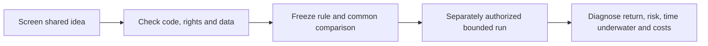

# QuantConnect shared-strategy screening

Dated research intake, governed by [the intake SOP](../research-intake.md).
**Screened, not reproduced or adopted.** No clone, financial run, package install,
broker action or publication was performed. The priority below is research value,
not a forecast of return. Preserve our [SPY comparison](2026-10-25-quantconnect-spy-comparison.md)
as a separate experiment.

## Scope and evidence

Reviewed the logged-in [Strategy Explorer](https://www.quantconnect.com/strategies/),
four detail pages, two displayed `main.py` files, and the sector-momentum tutorial.
The leaderboard distinguishes OOS three-month return, OOS one-year Sharpe and
OOS three-month Sharpe. Detail headers use different labels; do not silently treat
all header or five-year metrics as post-submission performance.

| Research priority / source | Mechanism and fit | Source-reported 5Y CAGR / maximum drawdown | Disposition |
| --- | --- | --- | --- |
| 1. [Sector Momentum](https://www.quantconnect.com/research/15308/sector-momentum/) | Rank ten sector ETFs by twelve-month momentum; hold three equally and rotate monthly. Simple industry-selection baseline. | Not extracted | Screened hypothesis; attached code revision and performance unverified |
| 2. [Multi-Horizon ETF Momentum Rotation](https://www.quantconnect.com/strategies/676/) — Jon Thibodeaux, V1.1.0, submitted 2026-10-01 | Monthly relative-strength allocation across asset classes. | 14.19% / 14.10% | Inspect discrepancies before reproduction |
| 3. [Large Cap Pullback Mean Reversion](https://www.quantconnect.com/strategies/659/) — Harini Mantripragada, V1.0.0, submitted 2026-07-14 | Buy oversold pullbacks among large QQQ constituents in uptrends. Adds stock selection and a different entry mechanism. | 27.75% / 26.00% | Concentration and constituent-data audit first |
| 4. [Risk-Regime Sector Rotation With Hedge](https://www.quantconnect.com/strategies/485/) — D Erhan, V1.0.0, submitted 2026-05-03 | Market regime → sector ranking → stock ranking; SGOV and UVXY allocations plus several exits. | 10.02% / 21.20% | Reuse hierarchy concept; defer full system complexity |
| 5. [Multi-Asset Trend With Mean-Reversion Entries](https://www.quantconnect.com/strategies/286/) — Jing Wu, V1.0.0, submitted 2018-01-15 | Regression-trend ETF entries, including shorts. | 0.74% / 51.80% | Low priority in this displayed evaluation; useful negative comparator |

These are the website's five-year summary labels, not independently reconciled
common-window results. Exact displayed evaluation boundaries, current engine/source
mapping and trial counts remain unknown. Our 2005–2025 results are not directly
comparable. A favorable recent quarter does not establish durability; the fifth
candidate appeared high on the recent leaderboard despite its weak five-year summary.

## Code inspection findings

For candidate 676, the description and displayed code disagree: twenty ETFs versus
fifteen; a claimed 21-day skip is absent; the volatility indicator consumes price
levels rather than daily returns. Top-five selection, monthly trading and an
all-selected-scores-negative cash condition are visible. Treat the published curve
as evidence for an unidentified executed revision until source/run mapping is known.
Correcting the description or formula would define a distinct variant.

For candidate 659, the displayed target weight is `1 / len(desired_symbols)`.
A single qualifying holding can therefore receive nearly the entire allocation,
subject to engine buffers; ten positions is a maximum, not a ten-percent position
cap. The code uses adjusted daily history and dynamic QQQ constituent weights.
Its source dates are 2021-01-01 through 2026-07-13; these do not establish the
exact boundaries of the separate five-year summary. Benchmark is QQQ. Daily
history access, execution timing and missing-history exits need audit.

For candidate 485, the UVXY leg introduces a materially different risk source;
its hedging effectiveness and financing cannot be inferred from the word hedge.
Candidate 286 requires borrow/shorting review. Neither code file was inspected.

## Reuse blockers and next bounded proposal

- Public visibility and a Clone button do not establish permission for repository
  redistribution. Code license/attribution and separate data rights remain unverified.
  No external source code was added to maintained project source.
- Free-account access to the exact histories, ETF constituents and required periods
  remains unverified. Current-constituent local stock data is not an equivalent
  point-in-time substitute. Prices-only ETF ideas have fewer input dependencies.
- Costs, slippage, corporate actions, cash yield, short borrow, warm-up, failures,
  and all attempted variants require independent accounting before ranking results.

Recommended next task, **planned and not executed**: freeze a ten-sector ETF
universe with inception rules; compare the single published sector-momentum rule
against SPY, equal-weight sector allocation and our existing gate on a common
available window. Use identical capital, costs and fill timing. Report annual and
rolling returns, Sharpe, Calmar, maximum drawdown, underwater duration, recovery,
turnover, concentration and rejected orders. Predeclare one baseline and at most
one separately labelled gate overlay before running. Do not tune on the inspected
leaderboard window; it is already observed evidence. Candidate 676 can follow as
a separately specified mechanism after resolving its source discrepancies.

## Validation and retained evidence

Read-only source snapshots and code-text hashes are indexed by the
[receipt](evidence/2026-10-25-quantconnect-strategy-intake.json). Full snapshots stay
in ignored `.local/quantconnect-strategy-intake-v1/`; the repository contains only
this screening and provenance hashes. A snapshot hash pins the inspected text,
not the engine revision that generated a published backtest. Documentation checks
and whitespace validation were run; no new financial result was generated.
