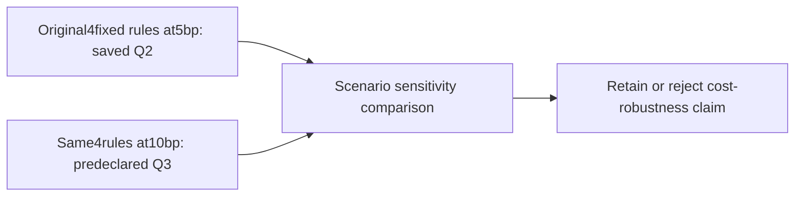

# Q3: fixed-rule execution-cost sensitivity

Design frozen after inspecting Q2 and before launching Q3. This is the conditional
follow-up allowed by the [pilot](2026-10-25-recursive-research-pilot.md), not an
untouched test. [Scoring](../research-scoring.md) owns interpretation.

Q2 found no mixture dominated either control. Equal mixture Calmar0.2814 versus
EMA0.2757 was a small ratio difference, accompanied by lower growth and substantially
more trading costs. The named uncertainty is whether the apparent risk-adjusted
ordering survives a doubled adverse execution cost. This motivates falsification,
not tuning the fixed weights.

Freeze all four original Q2 cases at10bp adverse cost per side, changing only
`cost_bps` from5 to10. Keep USD300000,99% sizing reserve,6% ACT/360 borrowing,
USD1 commission, whole shares, dividends, margin checks,2004 warmup and2005–2025
evaluation unchanged. The machine plan is
[recursive-cost-stress-v1.json](../../research/plans/recursive-cost-stress-v1.json).
Reserve four new attempts before execution; original5bp outputs are reused as
context, not rerun or counted as fresh trials. All outcomes are retained.

Compare every candidate's CAGR, drawdown, Sharpe, Calmar, cost and annual outcomes
between scenarios. Calculate Pareto membership independently within each cost
context; do not pool5bp and10bp candidates in one frontier. Any reversal, preserved
tradeoff or worse result is reported. A scenario is not a confidence interval,
broker-cost estimate, independently selected winner or investment promotion.

The user's subsequent traffic-light and temporal-metrics direction is a separate
read-only review of existing allocation rules. It does not alter these frozen rules.
