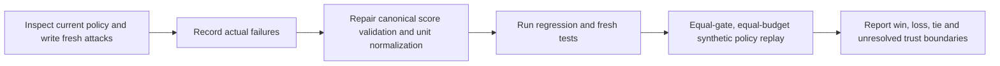

# Recursive research policy: fresh adversarial and replay evaluation

This is a scoped test receipt for the [ten-hour program](2026-10-25-recursive-research-program.md),
not investment validation. The [research development procedure](../research-development.md)
owns stage/evidence contracts. This review inspected `research/scoring.py` and
constructed new synthetic cases after the initial design and implementation.
No financial simulation, broker operation, downloaded framework or paid service
was used. All journals in this evaluation were disposable synthetic test fixtures.

**Result:** the review found and fixed two critical record-consistency bypasses
and one metric-unit bug. After correction, 14 fresh tests passed; the combined
scoring/controller/adversarial suite passed 61 tests, exit0. Matched synthetic
policy replay produced one priority win, one loss and one tie: **no demonstrated
aggregate benefit over breadth-first selection**.



## Findings and repair

| Finding | Actual behavior before repair | Correction and regression evidence |
| --- | --- | --- |
| Blocked score promoted through edited display fields | A score with unknown timing checks entered the Pareto front after only changing `eligibility` to eligible and `rankable` to true | Preserve a canonical eligibility record; reconstruct the full score from it and reject contradictory fields before comparison |
| Finite normalized metrics changed independently of raw values/units | A 10% raw CAGR record accepted normalized CAGR10, without recomputing from percent units | Reconstruct normalized metrics from raw values/units and reject inconsistent records, including finite changes |
| Equivalent units changed exact Pareto membership | Fraction0.137 and percent13.7 divided through binary floating-point produced slightly different values; the first alone entered the front | Normalize declared percentages through decimal text before float conversion; equivalent supplied values now tie without introducing a post-result tolerance |

The two bypasses were reproduced and recorded **before** repair in the evidence
receipt. The unit defect was exposed by a fresh failing test during validation;
it was not hidden by changing the expected result or adding a favorable tolerance.
Old policy and source hashes remain in that receipt.

The version changed from `research-score-v0.1` to `research-score-v0.2`.

- Old policy hash: `2c228092aeaaeeb3e78087d053cedba31382b9b94b82262fd45abea34b96a4ae`.
- Corrected policy hash: `d8e25acc7785d76fb43b863c84f7453b176edac5c5e35376ef393f2b7a1c55da`.

The controller automatically freezes the actual scoring policy hash in its
journal configuration. A journal made under an earlier policy cannot silently
resume under the new one. A new journal/context or explicitly labeled migration
is required; previous outcomes must remain preserved. The correction does not
alter existing financial backtests or make their historical sample independent.

## What the fresh tests covered

The new test module is `tests/test_research_policy_adversarial.py`. Cases cover:

- A blocked/unknown gate relabeled as eligible, and a fabricated minimal score
  without canonical inputs.
- Finite normalized-metric edits, raw/unit edits, gate-projection edits, zero-sample
  rankability edits and incompatible policy/stage/context labels.
- Equivalent percent/fraction values, including a drawdown magnitude above1.
- Missing evidence pointers and the explicit limit that a nonempty pointer is
  not authenticated by a pure scoring function.
- The explicit limit that an arbitrary context string does not authenticate the
  caller's required-check contract.
- Three matched policy replays and deterministic reconstruction from fresh journals.

The tests that characterize a trust limit intentionally demonstrate accepted
caller assertions. They are **not** proof that the system verifies source truth.
They prevent documentation or callers from silently treating structural validation
as independent evidence authentication.

Validation command actually run:

```text
.venv/bin/python -m unittest tests.test_research_policy_adversarial tests.test_research_scoring tests.test_research_controller
```

Observed: 61 tests, exit0. Earlier fresh-only run had 13 passes and one unit-invariance
failure; the corrected run includes that same test passing. No financial result
was created by running these tests.

## Equal-budget policy replay

Both policies receive the same raw candidate definitions and frozen fictional
outcomes, same two-action limit, same two fixture-resource-unit limit and the same
eligibility, unknown-cost, witness, duplicate and journal gates. Breadth-first
differs only in ordering feasible actions by branch depth and stable ID. It is
not stripped of safety/evidence checks. Each pair's candidate-set hashes agree.

| Fresh synthetic scenario | Priority resolved questions | Breadth-first resolved questions | Resource units, each arm | Interpretation |
| --- | ---: | ---: | ---: | --- |
| Shared integrity check settles two distinct questions | 3 | 2 | 2 | Priority can exploit a genuinely useful shared observation |
| Integrity check returns inconclusive | 1 | 2 | 2 | A declared high-priority check can consume effort without resolving a decision |
| Equal feasible actions | 2 | 2 | 2 | Same decisions and progress; preserve the tie |
| **Total** | **6** | **6** | **6** | **No aggregate advantage in these fixtures** |

No blocked unknown-cost action was selected in either arm. No execution-verified
or financial-performance claim was emitted. These are the explicitly scoped
critical-error invariants assessed in replay; artifact correctness is not supplied
by the fictional outcome table.

The scenarios deliberately include a win, a loss and a tie to exercise behavior.
They are not randomly sampled research tasks, not a blinded external benchmark,
and not statistically powered evidence of research efficiency. Summing them does
not estimate an expected policy reward. A priority benefit on the first fixture
does not cancel the loss on the second or demonstrate future alpha.

The replay also shows why the controller should permit negative/inconclusive
outcomes. All assertions refer to synthetic decision resolution; neither new
tree nodes nor favorable returns are used as a reward. Research credit remains
distinct from independent market information and investment value.

## Remaining prerequisites and limits

1. **Authenticate inputs outside scoring.** The module validates record consistency;
   it cannot establish that `fixture:timing` or another evidence pointer exists,
   that an artifact is correct, or that the intended use has rights. The coordinator
   must inspect receipts, source bytes and applicable contracts before passing gates.
2. **Bind required checks into the frozen plan.** A caller can coherently invent an
   inadequate required-check set. A context label or ordinary hash is not a signed
   attestation or an external policy registry. Compare actual check names and
   applicability with the approved study specification.
3. **Review action semantics.** Witness strings and action classes are declared
   judgments. Distinct strings do not prove that observations are feasible or
   decision-changing. Controller exact canonical deduplication does not infer
   equivalence of arbitrary paraphrases.
4. **Measure real resource use separately.** Reservations enforce declared bounds;
   actual process/financial-trial metering and external execution verification
   remain the coordinator's responsibility. An outcome record is not an execution.
5. **Test useful generalization later.** Use recoverable matched states, several
   task contexts and independently reviewed decisions. Preserve future nulls,
   losses and ties. The existing SPY sample remains development evidence.

No learned critic, GAE training, calibrated information value, policy optimality or
investment improvement is established. The useful demonstrated improvement is
specific: inconsistent score records and the discovered unit conversion failure
are rejected/corrected under the new policy.

Machine-readable results, pre-repair observations, pins and complete replay traces:
[evaluation receipt](evidence/2026-10-25-recursive-research-policy-evaluation.json).
