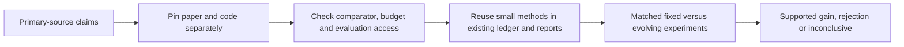

# Recursive research: primary-source intake

This scoped review supports the user's ten-hour research initiative. It applies
the [intake procedure](../research-intake.md), [mandate](../goals.md), and existing
[research development procedure](../research-development.md). It does not replace
those owners. Review date: 2026-10-25, America/Los_Angeles.

**Outcome: reuse evaluation and search-control concepts selectively; do not install
another trading stack.** Nine sources were screened. No published investment
result was independently reproduced; downloaded text was inspected, never executed.
No packages, API services, paid data, account changes or orders were used.

## Screened sources and actual findings

### 1. R&D-Agent-Quant: adaptive research direction

[Paper v2, 2025-09-25](https://arxiv.org/html/2505.15155v2), NeurIPS 2025;
[MIT code pin](https://github.com/microsoft/RD-Agent/tree/484776c211e4fbbeef03e0ec00d6bbee7362a4f4).
The paper alternates factor and model development using contextual Thompson
sampling. Its CSI300 split is training 2008–2014, validation 2015–2016 and testing
2017–2020-08-01. In the o3-mini scheduling ablation, equal 12-hour limits produced
reported ARR 14.21% for bandit versus 8.97% random and 10.09% LLM scheduling;
completed loops differed, so this is equal time, not equal trial count. The
under-USD10 claim concerns model-token cost, not all-in research expense.

Reuse: explicit branches, bounded allocation and runtime/valid-trial accounting.
Do not transfer reported ARR to SPY. Current README requires Linux and Docker for
most scenarios plus model/embedding configuration; direct macOS reproduction is
unverified. Test-feedback visibility and exact data rights still require a pinned
reproduction review. **Status: concept reuse; full reproduction blocked locally.**

### 2. Qlib: separate prediction and investment evaluation

[MIT code pin](https://github.com/microsoft/qlib/tree/54355232463878d2eebb91fe0ee5fa7fa1f5976c),
[benchmark table](https://github.com/microsoft/qlib/blob/54355232463878d2eebb91fe0ee5fa7fa1f5976c/examples/benchmarks/README.md)
and [LightGBM workflow](https://github.com/microsoft/qlib/blob/54355232463878d2eebb91fe0ee5fa7fa1f5976c/examples/benchmarks/LightGBM/workflow_config_lightgbm_Alpha158.yaml).
Benchmarks report means and standard deviations across 20 seeds and distinguish
IC/rank IC from portfolio results. The inspected workflow ranks CSI300 stocks,
holds 50 and drops five, with explicit train/validation/test segments, benchmark,
fees and dealing price. These are cross-sectional stock-selection experiments,
not single-SPY timing. Reported results depend on workflow/data version; upstream
warns that backtest changes affect comparability.

Reuse: declarative experiment manifests, multiple seeds when stochastic, separate
signal and account metrics, baseline tables. Existing audited SPY ledgers remain
the execution/accounting owner. MIT covers code, not automatic permission to use
or redistribute vendor data. **Status: reference workflow; no installation needed.**

### 3. AlphaAgent: regularize search, not just returns

[KDD 2025 paper v2](https://arxiv.org/html/2502.16789v2) checks expression
similarity, complexity and hypothesis alignment. It reports annualized **excess**
return 8.74%, IR 1.0545 and MDD −9.10% for S&P500 stock selection, versus 2.45%
excess return for AlphaForge. Training is 2015–2019, validation 2020 and testing
2021–2024; five evolution rounds and 20 trials are described. Fees are simplified;
this is not our financing/execution model.

The [paper-linked current code](https://github.com/RndmVariableQ/AlphaAgent/tree/b42cb397025510da44355db9dcf278304321f589)
now documents CSI1000/Tushare data through 2026, differing from the paper's
CSI500/S&P500 experiment. No explicit code license was found at that revision.
Reuse economic rationales, duplicate detection and complexity budgets independently.
AST novelty is not proof of independent economic exposure. Test-feedback routing
and paper-era artifact correspondence remain unverified. **Status: concepts
screened; code adoption held for rights/artifact clarification.**

### 4. AlphaAgentEvo: learning an evolution policy

[Primary OpenReview record/PDF](https://openreview.net/pdf?id=lNmZrawUMu)
identifies an ICLR 2026 paper. Its indexed primary text describes multi-turn
agentic RL with hierarchical tool-validity, consistency, exploration, performance
and streak rewards; it reports a 4B policy outperforming several search baselines.
Direct record/PDF retrieval encountered browser verification. Consequently the
numeric tables, training costs, code/checkpoint license and exact data access were
**not verified** here; third-party summaries were excluded from numeric evidence.

Reuse the distinction between a generated strategy and a trained research policy,
and make reward components inspectable. Do not claim local skills are trained RL,
or reward consecutive backtest wins. **Status: limited primary-source screening;
full intake/reproduction blocked pending accessible artifact.**

### 5. AlphaMemo: retain edit context and failures

[Preprint v1, 2026-05-26](https://arxiv.org/html/2606.20625v1) stores
parent-context/edit outcomes with confidence gates and asymmetric failure vetoes.
Its fixed-budget diagnostic reports 76.0 effective factors versus 52.4 for a
ledger-only search, five seeds each. That measures admitted discovery yield,
not investment return. Main S&P500 residual/balanced variants report Sharpe
1.0672/0.7743; CSI500 ordering reverses. Selecting a variant after inspecting
test tables would itself be another selection decision. Claimed test reporting
is 2022–2025 with memory updated only on training/validation.

[Code pin](https://github.com/jarrettyu/alphamemo/tree/412fee13d905bf5a25f0958aa572b7c668ccb925)
has no explicit license. Main script defaults to external model access, budget
500 and Qlib datasets; the heuristic smoke path defaults to **synthetic** data.
A successful smoke test would not reproduce market performance. Reuse a modest
parent/edit/outcome ledger, uncertain-memory fallback and reversible failure
lessons. **Status: concepts feasible locally; direct adoption held.**

### 6. EverMine: test whether accumulated capabilities help

[Preprint v1, 2026-09-27](https://arxiv.org/html/2609.33524v1) separates
history, current portfolio and reusable capabilities. Eighteen matched complete
trajectories and 48 shared-state continuation branches find no consistent gain
from evolving capabilities. Both model groups' OOS mean differences favor fixed
capabilities, with intervals including zero. Its endpoint is portfolio **IC**,
not financed trading P&L. Data are point-in-time 60-pair Binance spot universes
at ten-minute frequency; per-trajectory limits include USD10 equivalent model
cost, 1,000 submissions, 16 CPU core-hours and 48 active hours. No dedicated
code/data release was located in the inspected paper; reproduction is unverified.

Reuse matched fixed/evolving budgets, checkpoint capability replacement and
portfolio-state-conditioned value. This directly challenges assuming that more
skills or notes improve later research. **Status: strongest evaluation-design
inspiration; no market-performance transfer.**

### 7. GAE: credit assignment is not the reward definition

[Original paper, v6](https://arxiv.org/abs/1506.02438v6), first submitted
2015-06-08 and revised 2018-10-20, proposes exponentially weighted advantage
estimates to trade variance against bias in policy gradients. Demonstrations are
simulated robot control, not quant research or investment returns. The verified
identifier is **1506.02438**.

Reuse delayed-credit intuition and comparison against expected improvement.
Actual GAE requires trajectories, rewards, a value estimate and policy updates.
There is no evidence here that adding its formula to a research log improves
strategies. No code/checkpoint license was assessed because no implementation
adoption is proposed. **Status: conceptual reference; RL training deferred.**

### 8. Deflated Sharpe Ratio: account for searched winners

[Author paper, 2014-07-31](https://www.davidhbailey.com/dhbpapers/deflated-sharpe.pdf)
addresses inflated Sharpe from multiple selection and non-normal returns. Its
inputs include sample length, return moments and the search distribution/effective
trial count. Those assumptions must be recorded; counting only final winners or
pretending correlated variants are known independent trials gives false precision.
This is a statistical diagnostic, not an investable-return result. No external
code was selected, and paper availability is not a code license.

Reuse full attempt accounting and a selection-aware evaluation field. Any local
implementation needs independent numerical examples and sensitivity to dependence
and trial assumptions; it does not manufacture an untouched test set.
**Status: feasible small independent implementation after specification.**

### 9. Probability of Backtest Overfitting: compare selection degradation

[Author manuscript, 2015-02-27](https://www.davidhbailey.com/dhbpapers/backtest-prob.pdf),
[2017 journal record](https://escholarship.org/uc/item/4w1110bb), introduces
CSCV/PBO to study how in-sample selection ranks degrade out of sample. It requires
a comparable matrix of candidate returns and declared partitions. It does not
estimate all risks of a future deployment, and recombining historical segments
does not erase earlier research access or reproduce a chronological account.

Reuse selection-degradation diagnostics on saved, aligned research returns,
explicitly labeled retrospective. Preserve all candidate columns, including
failures where interpretable; disclose missing trials. No third-party code or
license dependency is required for an independently specified implementation.
**Status: feasible retrospective diagnostic; not promotion proof.**

## Prioritized inspiration for our existing project

| Priority | Reuse | Local acceptance evidence |
| --- | --- | --- |
| 1 | EverMine-style fixed/evolving comparison | Identical starting history/frontier, trial and runtime limits; record zero/inconclusive gains honestly |
| 1 | Immutable attempt and parent/edit ledger | Every generated, invalid, failed and completed trial retained with hashes, cost and decision |
| 1 | Eligibility before scores | Invalid chronology/accounting cannot be offset by better return; unknown evidence remains unknown |
| 2 | RD-Agent-inspired direction allocation | Compare transparent scheduler with fixed/random allocation at matched budgets; allow pause and revisit |
| 2 | AlphaMemo-style conservative experience | Show whether retrieval reduces repeats or execution cost without worsening independent endpoints |
| 2 | Qlib-style metric separation | Prediction, strategy account performance, portfolio contribution and research efficiency reported separately |
| 3 | DSR/PBO diagnostics | Numerical verification, trial/dependence sensitivity and clear retrospective labeling |
| Defer | Full RL policy/value training | First collect sufficient varied, reproducible trajectories and establish a useful non-RL baseline |

These priorities are this review's recommendations, not a replacement portfolio
roadmap or permission to deploy. Our saved SPY history is already-viewed development
evidence. It can test reproducibility, scoring behavior and scheduler mechanics;
it cannot establish a fresh investment edge or annual doubling. Multi-stock
cross-sectional IC and ten-minute crypto IC cannot be substituted for SPY account
Sharpe. New symbols alone also do not create an untouched holdout.

## Review limits and next evidence

Evidence receipt: [pins and claim status](evidence/2026-10-25-recursive-research-priors.json).
Rights checks concern only inspected files/revisions; data access, provider rights,
hardware feasibility and published returns were not independently validated.
The AlphaAgentEvo access failure is explicit rather than bypassed or replaced by
secondary numerical claims. The next useful experiment is a bounded matched
comparison of research policies on recoverable starting states, with rejected and
inconclusive outcomes retained. No guarantee of monotonic strategy improvement is
supported by these sources.
