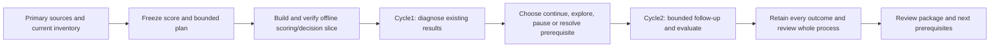

# Ten-hour recursive research program

Status: complete; bounded review package delivered early at2026-10-25 10:05 UTC.
User requested a refreshed list
of what exists, the goal and prerequisites, web research before reuse, evaluation
of prior results and a recursive self-improvement goal, with review in ten hours.
Parallel agents are authorized. This packet sequences this research initiative;
[roadmap](../roadmap.md) retains portfolio implementation priorities and readiness.
[Goals](../goals.md) owns the investment mandate; [research development](../research-development.md)
owns stage contracts. A research goal is not a prediction of investment success.

## Goal and review time

Review target:2026-10-25 19:14 UTC /12:14 PM America/Los_Angeles. Start09:14 UTC.
The substantive app goal completed early. A thread heartbeat named `Recursive quant
research — 10-hour review` stays quiet before the review target, then performs a
read-only handoff/check and disables itself. It launches no further research.
Automation ID:`recursive-quant-research-10-hour-review`. Local host/app availability
is required for local scheduled work. Keep the state file current for resumption.

By review time deliver:

1. An evidence-backed implemented/verified/unverified/blocked/planned inventory,
   existing investment aspirations and a measurable research-system objective.
2. Primary-source papers/repositories evaluated for method, result/comparator,
   resource cost, data/rights, evaluation weaknesses and reusable concepts.
3. A versioned scorecard separating evidence eligibility, strategy tradeoffs and
   research-action priority, including anti-gaming and branch-stop/explore policies.
4. A tested bounded offline prototype using existing data/ledger/report facilities,
   exercised through at least two recorded research decisions/cycles. Preserve
   negative results and distinguish replay, fresh simulation and unused evaluation.
5. A readable/browser review package with actual results, null findings, limitations,
   prototype comparison and the prerequisites for the next research directions.

Success does not require increased historical Sharpe, Calmar or returns. It requires
traceable decisions, reliable calculations, bounded allocation of research effort,
credible evidence or useful rejection, and an honest comparison against a baseline.
No GAE/RL training claim follows from updating scores, skills or project notes.

## Resource and scope bounds

These are temporary research-execution limits selected for this program, not
investment-risk limits or data-driven performance gates:

- Free/local data only; no purchases, paid API calls, new credentials/accounts or
  upstream framework installation. Public web/source inspection is allowed.
- At most12 new financial simulation attempts for the program, failures included;
  record each before launch. At most3 worker processes and one coordinated financial
  study/import operation at a time. Cache verification is recorded as reuse, not a
  new result. Existing88 cases remain immutable development evidence.
  These are market-data research cases; small synthetic correctness fixtures are
  separately counted as validation tests and never presented as trading results.
- At most3 active research branches initially. Each needs a falsifiable question,
  inputs, next discriminating action, bounded attempts and a checkpoint. This is a
  ceiling, not an instruction to fill the budget or invent improvements.
- Freeze concrete rule, cost, sizing, selection and evaluation specifications before
  each study. A descriptive exploration cannot become an untouched confirmation
  by relabeling it. Cost sensitivity is a separate scenario, not free selection of
  whichever cost makes a candidate pass.
- Stop starting new financial trials after18:44 UTC; reserve the final30 minutes for
  checks and synthesis. Earlier completion is acceptable; stop wasteful repeated
  searches and use remaining time for genuinely useful validation/source evaluation.
- Preserve all existing dirty work, datasets, run directories, failures and receipts.
  No broker/account/Gateway action, orders, deployment, commit or remote publication.
- New datasets/instruments need rights/coverage/provenance and model verification.
  Inaccessible prerequisites yield a blocked branch, not synthetic performance.

## Initial lanes and canonical artifacts

| Lane | Output | Current status |
| --- | --- | --- |
| Prior research | `2026-10-25-recursive-research-priors.md` plus receipt | Complete:9 primary sources, four repository pins; no upstream financial reproduction |
| Current capability/evidence audit | `2026-10-25-recursive-research-inventory.md` plus receipt | Complete:465 saved artifact hashes,15 financial inputs;88 curves finite |
| Scoring/selection design critique | `2026-10-25-recursive-research-scoring-design.md` plus receipt | Complete: versioned v0.2 scoring and fresh adversarial/policy replay |
| Coordinator | Plan/state, integration, prototype, tests, cycle records and final review | Complete:Q1–Q3, eight audits,177 passing offline tests, verified browser and receipt |
| User-directed follow-up | Temporal diagnostics and traffic-light gate research | Temporal-v1.1 implemented/reviewed; combined gate proposed only; existing gates reviewed |

Prior studies and [skill evaluation](2026-10-25-research-skills.md) remain authoritative
historical records. Their paired54/54 tie is zero demonstrated incremental quality
gain, not a reason to regrade the same examples until the skills win.

## State, resumability and evaluation

Current state is ignored `.local/recursive-research/state.json`; compact durable
receipts belong in `docs/tasks/evidence/`. Read state and actual process/artifact
status before resuming; never infer a completed operation from a stale status field.
Record source/data/code/config/score-policy identity and selection history. Link
research decisions to their parent and retain contrary evidence.

The first controller evaluation must compare decisions from the same available
history and candidate set with a simple baseline under the same budget. Declare
which outcomes are fixture/replay evidence versus fresh empirical results. Test
unknown versus failed evidence, duplicate observations, budget exhaustion, resumed
execution, score-version changes, invalid-account data and unavailable instruments.
Do not promise a learned policy or useful investment improvement from passing tests.

## Next action

Use the [review package](2026-10-25-recursive-research-review.md) and current local
state for the scheduled read-only review reminder. The [completion receipt](evidence/2026-10-25-recursive-research-completion.json)
records35 verified browser artifacts, UI interactions, unchanged financial core and
the final `make check` exit0. No additional financial cases are justified
by the completed questions; four of12 slots remain unused. Fixed mixtures did not
dominate controls, and their small Calmar advantage failed the cost stress. Preserve
that rejection and the unchanged investment-risk questions. A combined traffic-light
experiment needs its own fixed plan and comparators; no search is silently widened.
The native configuration/catalog baseline remains the next infrastructure milestone.
