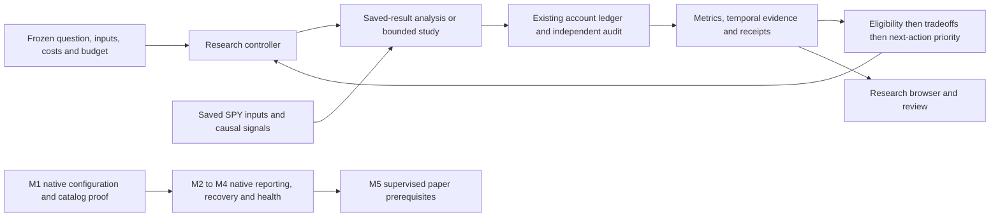

# Recursive research: review package

Review snapshot for the [ten-hour program](2026-10-25-recursive-research-program.md).
Review target: **2026-10-25,12:14PM America/Los_Angeles**. An earlier package is
available. Q1–Q3, source reviews and temporal diagnostics are reconciled below.
These are bounded development findings; the investment aspiration is unachieved.

## What we have

| Capability | Actual status | Evidence / remaining boundary |
| --- | --- | --- |
| Local runtime and project workflow | Implemented: pinned NautilusTrader, offline checks, documentation/SOPs | [Inventory](2026-10-25-recursive-research-inventory.md); native execution configuration/catalog behavior remains M1 |
| Inputs and accounting | Saved SPY history; long/cash ledger with dividends, fees, spread, financing, margin checks and separate Decimal replay | [Finance contract](../../research/leverage-model.md); simplified execution, retail-source rights/provenance limitations |
| Strategy references | 100 catalogued ideas;22 SPY adaptations and88 saved leverage cases | [Suite protocol](../../research/strategy-suite.md);78 entries need absent/unverified data or instrument models |
| Results browser | Annual/full-period returns, drawdown, Sharpe, Calmar, daily paths and MLflow | [Performance SOP](../operations/performance.md); viewed development data, not confirmed alpha |
| Skills | 19 project entrypoints, including nine research workflows | [Skill map](../skills.md); instructions do not constitute trained policies or automatic execution |
| New research-control slice | Versioned eligibility/outcome/action scores; bounded preview/reserve/record controller; durable attempt history and stop/reopen conditions | [Policy evaluation](2026-10-25-recursive-research-policy-evaluation.md); records do not independently authenticate source truth or actual execution |
| Bounded financial experiments | Eight new cases: four fixed rules at two cost settings; all audited; two original5bp controls reproduce exactly | [Control parity](evidence/2026-10-25-recursive-control-parity.json);4/12 additional program slots deliberately unused |
| Temporal diagnostics | Implemented and independently reviewed: rolling returns/Sharpe, deepest/longest episodes, recovery/censoring and empirical daily ES95 | `temporal-v1.1`; descriptive history, not a current market signal or loss bound |
| Native persistence, health and paper execution | Planned/unverified; successful project broker connection not established | [Roadmap M1–M5](../roadmap.md); research-journal durability is not trading-node recovery proof |

## What our goals mean

1. **Investment aspiration:** USD300,000 scenario, one-year horizon, annual doubling,
   leverage permitted for research, approximately30% drawdown as a reassessment
   tolerance, free/local inputs. [Goals](../goals.md) owns details and open choices.
   Neither doubling nor a maximum possible loss has been established.
2. **Research-system goal:** produce reproducible, evidence-backed next decisions;
   improve candidates when warranted, reject weak claims, and change direction
   when further work has little decision value. Success can be a useful rejection.
3. **Operational goal:** reliable data, recovery, visibility, risk and reconciliation
   before separately scoped paper/live readiness. Backtest rankings cannot satisfy it.

This initiative tests a bounded offline prototype. It does not train a value
function, apply GAE updates, prove monotonic improvement or authorize deployment.

## How the pieces relate

The research journal records decisions and resources. It neither replaces native
catalog/persistence facilities nor connects this loop to broker orders.

## What prior research contributed

- **RD-Agent/Qlib:** separate research and development, retain reproducible workflow
  identities, and allocate limited effort across directions instead of endlessly
  tuning one rule. Current frameworks are not drop-in SPY strategies.
- **AlphaAgent/AlphaMemo:** inspect complexity, repeated ideas and parent/edit
  context; retain failures and reduce confidence in sparse memory. Code licenses
  and paper/current-artifact correspondence limit direct reuse.
- **EverMine:** under matched resources, evolving capabilities did not consistently
  outperform fixed ones. Test the research process itself; more notes are not proof.
- **GAE/DSR/PBO:** distinguish credit assignment from reward definition and account
  for selection. Full historical trial count remains unknown; do not set it to zero.

See the [nine-source primary review](2026-10-25-recursive-research-priors.md) and
[scoring design critique](2026-10-25-recursive-research-scoring-design.md) for actual
comparators, resource requirements, access/rights gaps and source limitations.
Published performance remains an upstream claim unless independently reproduced.

## Actual pilot findings so far

**Q1: a better ratio is a tradeoff, not proof of prediction.** Saved1x EMA versus
EMA plus volatility targeting changes CAGR8.01%→6.47% and drawdown−29.06%→−15.10%.
Mean close exposure falls0.799→0.654; modeled trading costs rise. The deepest
drawdown episodes take291 versus507 sessions from their respective peaks to
recovery; these are different episodes, not matched event counterfactuals.
Lower drawdown does not automatically mean faster recovery. The analysis question
was predeclared, but its controller entry was recorded after reading the saved
result: this is not a blind allocator test. [Q1 receipt](evidence/2026-10-25-recursive-cycle1.json).

**Q2: fixed timing mixtures produce tradeoffs, not a dominating strategy.** Four
new cases use one net SPY account, fixed weights and the same5bp modeled side cost:

| Case | CAGR | Daily-close max drawdown | Sharpe | Calmar |
| --- | ---: | ---: | ---: | ---: |
| EMA control | 8.01% | −29.06% | .643 | .276 |
| RSI2 control | 3.83% | −21.52% | .434 | .178 |
| 50% EMA /50% RSI2 | 6.08% | −21.59% | .651 | .281 |
| 75% EMA /25% RSI2 | 7.08% | −25.38% | .662 | .279 |

All four are nondominated on the declared CAGR/drawdown pair. Neither mixture
dominates either control on both dimensions. Both controls match saved ledgers
exactly and exact trade records agree; all four Decimal audits passed. The mixtures
trade more often and incur greater costs. [Q2 metrics](evidence/2026-10-25-recursive-cycle2.json),
[scores and blocked confirmation](evidence/2026-10-25-recursive-cycle2-scores.json).

**Q3: small ratio gains did not survive execution-cost stress.** All four fixed
rules were audited again at10bp adverse side cost, with704 independently checked
full-period/annual metric values across Q2/Q3. No weights were changed.

| Case | 10bp CAGR | 10bp max drawdown | Calmar5bp →10bp |
| --- | ---: | ---: | ---: |
| EMA | 7.95% | −29.10% | .276 → .273 |
| RSI2 | 2.61% | −23.55% | .178 → .111 |
| Equal mix | 5.41% | −21.73% | .281 → .249 |
| Trend-heavy mix | 6.71% | −25.46% | .279 → .263 |

Both mixtures lose their Calmar advantage over EMA. Their return/drawdown tradeoffs
remain; RSI is dominated by the equal mix in the10bp context. Reject the specified
cost-robust ranking claim and pause further local weight/cost tuning. Its motivation
followed Q2 observations: this is falsification sensitivity, not untouched confirmation.
[Frozen plan](../../research/plans/recursive-cost-stress-v1.json),
[Q3 metrics](evidence/2026-10-25-recursive-cycle3.json),
[separate-context scores](evidence/2026-10-25-recursive-cycle3-scores.json).

**Temporal results answer the new risk-gate direction.** EMA's longest underwater
episode is531 sessions/769 calendar days; EMA plus volatility targeting is656/949,
despite the latter's much shallower maximum drawdown. Existing three-state SPY
drawdown control has28.33% portfolio drawdown and1630 underwater sessions; its20%
SPY-price threshold is not a20% portfolio-loss guarantee. Rolling observed-session
returns, Sharpe, worst loss windows and historical daily ES95 are now available
for13 saved/reference cases, alongside273 annual observations. Independent review
found and fixed numerical Sharpe inflation on constant-return paths.
[Temporal review](evidence/2026-10-25-temporal-review.json).

**Process evaluations:** the nine-skill matched evaluation tied54/54 versus54/54.
Fresh synthetic priority-versus-breadth-first replay tied6 versus6 total resolved
questions, with one win, one loss and one tie. No efficiency gain is established.
Adversarial tests did identify concrete score-consistency/unit bugs that were fixed;
that is a demonstrated engineering improvement, not investment improvement.
[Policy evidence](2026-10-25-recursive-research-policy-evaluation.md).

## What to build or resolve next

| Priority within the existing roadmap/lane | Next concrete prerequisite | Evidence that would justify advancing |
| --- | --- | --- |
| Infrastructure M1 | Native config/catalog round-trip, invalid-mode and duplicate-input proof | Actual pinned-runtime behavior, separate from this journal's tests |
| Accounting reliability | Harden legacy audit direct callers in a separately versioned change | New bounded runner has finite/coverage guards; the legacy replay alone still needs them. All88 saved curves were checked finite |
| Temporal analysis | Extend verified path diagnostics to gate event attribution | False alarms, warning lead/lag, missed rebounds and matched-risk/cash comparators remain future work |
| Optional risk-gate study | Review existing31–34 before a separately frozen green/yellow/red experiment | Causal next-open states, clear re-entry/hysteresis, false alarms and missed recovery; no future-painted colors |
| Research validity | Complete attempt/access history and define independent future evidence | Search uncertainty disclosed; no relabeling viewed history as untouched |
| Broader universe | Audit a hypothesis-driven free ETF/stock dataset before expanding | Rights, point-in-time identity, corporate actions, aligned calendars and executable instrument model |
| Paper prerequisites M3–M5 | Resolve native recovery/health, risk budgets and actual account/data access | Offline fault fixtures plus separately supervised broker evidence |

The [risk-gate proposal](2026-10-25-risk-gate-research.md) treats green as the normal
frozen research budget, yellow as reduced exposure and red as a next-opportunity
cash target. It is unimplemented/unbacktested and cannot promise avoidance of gaps
or deep losses. Operational data/account failures remain separate blocked states.

Open mandate decisions include numerical leverage/concentration/loss budgets,
liquidity needs, benchmark, eligible instruments and return/downside precedence.
They need resolution before investment selection, while bounded offline work can
continue under explicit research assumptions. [Roadmap](../roadmap.md) retains
portfolio sequence; this task record does not complete native milestones.

Browser: [research review](http://127.0.0.1:8765/recursive-research/20261025-review-v3/index.html)
and [interactive temporal paths](http://127.0.0.1:8765/recursive-research/20261025-review-v3/temporal.html).
Frozen data end2025-12-31: neither page assigns today's market color. Local files
and code remain uncommitted; no broker action or paid input was used.

Validation: `make check` passed177 offline tests, dependency consistency and document
checks, exit0. All eight Decimal audits passed;704 full/annual metric values were
independently recomputed; cached reuse executed zero extra research cases. Original
financial core files and preexisting paths were preserved. The
[completion receipt](evidence/2026-10-25-recursive-research-completion.json) records
identities, audit details, branch history and actual checks. Browser inspection is
recorded there separately from arithmetic validation.
