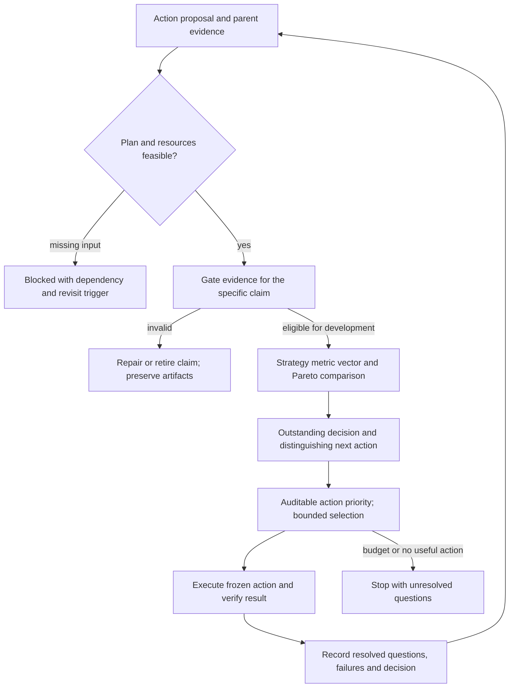

# Recursive research scoring: independent design review

Design review only. Primary papers were read on 2026-10-25; no new strategy study,
upstream code, dependency installation or broker operation was performed. This
record proposes a testable contract for the requested bounded research program;
[research development](../research-development.md) and [goals](../goals.md) retain
policy authority. It does not amend investment risk limits or establish a learned critic.

## Finding

Use three separate decisions: **is evidence eligible for this claim; what does the
strategy achieve under its model; which next research action can resolve a useful
uncertainty?** A high return cannot compensate for leakage. A failed strategy can
produce valuable research. A renamed or rerun strategy contributes no additional
information merely because it is a new tree node.

The earlier [nine-skill evaluation](2026-10-25-research-skills.md) scored 54/54 in
both arms. That ceiling cannot demonstrate incremental benefit. This contract
requires discriminating adversarial cases and behavior/cost comparisons rather
than accepting another saturated answer-quality score as proof of self-improvement.

## Primary literature and scope of transfer

| Source verified | What transfers | What does not follow |
| --- | --- | --- |
| Schulman et al., ICLR2016, [Generalized Advantage Estimation](https://arxiv.org/pdf/1506.02438), §3 eqs11,16–19 | Advantage estimates sum discounted TD residuals and trade variance against approximation bias | A heuristic score assigned to research proposals is not a trained value function or policy-gradient advantage |
| Auer, Cesa-Bianchi & Fischer2002, [Finite-time Analysis](https://homes.di.unimi.it/~cesabian/Pubblicazioni/ml-02.pdf), §1–2 | Exploration must be evaluated against an explicit reward/feedback model | UCB1 guarantees assume a stationary independent-reward model; reusing one historical SPY sample is not repeated independent reward sampling |
| Frazier, Powell & Dayanik2009, [Correlated Knowledge Gradient](https://people.orie.cornell.edu/pfrazier/pub/CorrelatedKG.pdf), §2–3 | A measurement is valuable through its expected effect on a later decision; correlated alternatives can share information | Numerical expected information value requires a declared belief/observation model; invented probabilities do not become Bayesian evidence |
| Zitzler & Thiele1999, [Strength Pareto Approach](https://cs.ijs.si/papa/courses/06_ZitzlerMultiObjective.pdf), §I–III | Preserve nondominated alternatives and expose conflicting objectives | A Pareto frontier is neither a unique investment choice nor statistical proof; monotone display rescaling cannot supply missing preferences |
| Garivier & Moulines, [nonstationary-bandit preprint2008](https://arxiv.org/pdf/0805.3415), §1–2; [published switching-bandit paper2011](https://doi.org/10.1007/978-3-642-24412-4_16) | History may need context-specific updating when reward conditions change | Discounting does not validate an arbitrary research reward or erase earlier failed trials; their switching assumptions do not automatically fit markets |
| Bailey et al., [Probability of Backtest Overfitting](https://www.davidhbailey.com/dhbpapers/backtest-prob.pdf), §2–3, working version2015 | Track configuration selection and repeated evaluation exposure; inspect joint trial performance | CSCV is not a universal independent chronological holdout or a probability applicable without its required trial matrix/design |
| Bailey & López de Prado2014, [Deflated Sharpe Ratio](https://www.davidhbailey.com/dhbpapers/deflated-sharpe.pdf), §2–3 and appendix3 | Sharpe interpretation depends on sampling, nonnormality and search multiplicity/dependence | Unknown historical trial count cannot be set to zero or replaced with an unjustified effective independent count |
| Howard et al., [confidence sequences](https://arxiv.org/pdf/1810.08240), §1, author version2022 of published2021 work | Repeated statistical looks need inference designed for that monitoring | Time-uniform coverage still needs the stated probabilistic assumptions; unrestricted dependent strategy returns do not inherit it |

These are method sources, not evidence that the proposed research controller will
improve trading returns. Source summaries are paraphrases; no external code was adopted.

### GAE boundary

The original estimator uses `delta_t = r_t + gamma V(s_(t+1)) - V(s_t)` and
`A_t = sum_l (gamma lambda)^l delta_(t+l)`. A research adaptation first needs
well-defined states, actions, outcomes, terminal versus time-limit handling,
policy identity, fitted value data, out-of-sample calibration and a stable reward
contract. Shared evidence in a DAG cannot be credited repeatedly along every
parent path. Terminal states use their declared terminal value; a budget-truncated
state is not automatically terminal with zero value. Until those exist, any
backward discounted attribution is explicitly a heuristic diagnostic, not a learned
critic, GAE policy learning or proof that ancestors caused a successful descendant.

## Proposed scoring contract v0.1

All bounded defaults below are research scheduling choices. They are not approved
portfolio risk limits. A score record includes `contract_version`, contract hash,
plan/input/artifact hashes, timestamp, scope, missingness reasons and evaluator identity.

### Layer1: claim-specific evidence eligibility

For each required check record `pass`, `fail`, `unknown` or `not_applicable` with
an exact evidence pointer. Applicability is specified before scoring. Required
checks: authorization/scope; identity/integrity; data semantics and timing; accounting
reconciliation; comparability; evaluation-access/trial history; instrument/cost
coverage; and rights for the intended use. An immutable local exploratory replay
and redistribution have different rights questions; do not silently turn uncertainty
into permission for a new use.

- `fail` on a required check makes the claim **invalid**; do not rank it against
  eligible candidates. Retain diagnostic metrics visibly quarantined if useful.
- `unknown` makes the affected claim **blocked/unassessed**, with missing evidence.
  Unknown is not zero, failure, an average score or optimistic success.
- All applicable checks passed means **eligible for the named stage only**.
  Already-viewed SPY can support development comparisons while being ineligible
  for a claim of untouched-test confirmation. Operational readiness remains separate.
- Do not create a weighted gate average: nine passes cannot outvote one causal leak.
  A repair action may be eligible to investigate invalid evidence; that does not
  make the strategy claim itself eligible.

### Layer2: strategy outcome vector

For eligible comparable development results retain actual units and uncertainty:
`net_CAGR`, `max_drawdown_magnitude`, `Sharpe`, `Calmar`, turnover, financing,
exposure/beta, worst-year/stress outcomes, sample coverage and return-series identity.
Metrics keep current project definitions, initial-equity anchor and costs. Undefined
Sharpe/Calmar, insolvent paths, absent stress fields or intervals remain null with
reasons; they are not positive infinity, zero, or omitted losses. A null diagnostic
need not block unrelated valid metrics, but a missing required objective blocks
that comparison.

For an initial development front use two objectives only: maximize net CAGR and
minimize drawdown magnitude, with Sharpe/Calmar diagnostic. Candidate A dominates B
iff both have the same comparison contract, A is no worse in both and strictly
better in at least one. Exact equality means a tie. Comparison tolerances, if used,
must be versioned rather than adjusted after seeing near-ties. Do not sum CAGR,
Sharpe and Calmar: they share return information and have different units.

Treat different leverage/cost/time policies as different contracts or explicit
controlled branches. A 2x outcome does not establish signal improvement over a1x
control. No historical drawdown frontier member is promoted because it lies below
30%: that mandate value is a reassessment tolerance, not a numerical approval gate.
The +100% aspiration is reported as a scenario distance, never a reward bonus.
A frontier is descriptive and can change under estimation uncertainty; it does not
select the live portfolio. Lower-risk/return alternatives remain visible.

### Layer3: next-action value without fictitious expectations

Define action identity by parent evidence, exact question/estimand, data/split,
rule/config difference and planned observation, not its title. Keep dependencies
as a DAG and link shared observations once. A cache rerender and a renamed variant
are not fresh observations. New evidence can be a refutation or narrower identified
uncertainty; novelty of wording, node count and search breadth earn no credit.

Each feasible action needs a **decision witness**: at least two specified possible
observation regions and the different research decisions they would cause. Example:
a cost-stress action can retain the low-turnover candidate if its predefined net
advantage survives, or retire its cost-robustness claim if it reverses. Unknown
outcome probabilities remain unknown. Completing a deterministic check resolves a
question even when it reports failure.

Use this auditable priority tuple for the pilot, descending except resource cost:

1. `class`: integrity/eligibility investigation3; falsification of an active
   candidate2; distinct-mechanism exploration1. A class3 action must actually
   investigate a documented blocker affecting a named active decision; repeated
   generic audits cannot crowd out the program.
2. `decision_value`:2 for an executable witness that can change retain/retire or
   branch selection;1 for an executable check that can only narrow a named
   uncertainty;0 for exact replay/reformat or an irrelevant question. Unsupported
   witness or unknown capability gives null and blocks scheduling until clarified.
3. `shared_questions_resolvable`: number of distinct registered decision questions
   that this one observation can adjudicate, capped at2 for pilot scheduling.
   Renaming or splitting one question does not increase this value.
4. Lower predeclared upper resource bound; then stable action ID as a tie-breaker.

This is an ordinal scheduling rubric, not a cardinal reward, probability, learned
value or expected return. Reserve one of the first two feasible research decisions
for a distinct mechanism/question class unless a documented eligibility defect
blocks both; at most one measurement of the same unresolved question runs at once.
Budget caps are checked before score priority. Do not reward cheap low-value checks
merely because their cost approaches zero. If cost cannot be bounded, first propose
a bounded feasibility probe. The pilot should explicitly compare this rubric to
simple breadth-first selection rather than claiming it is optimal.

If a calibrated future probabilistic model exists, one possible acquisition
quantity is `EVSI(a)=E_y[max_d E(U(d,theta)|D,y,a)]-max_d E(U(d,theta)|D)`.
A net/time score further requires utility units, costs, distributional assumptions,
correlation, model calibration and a nonzero time basis. Those inputs do not exist
here; store EVSI as null, not a plausible-looking number. Information entropy
reduction alone can target irrelevant parameters and is not decision value.

## State, budget and anti-gaming rules

| State/action | Observable policy |
| --- | --- |
| Explore | Feasible novel decision question with bounded plan, executable witness and remaining allowance; record its dependency/family |
| Continue | Evidence still meets the active contract and the next action resolves a registered uncertainty; no automatic deeper branch |
| Retire claim | Frozen falsifier met or comparison dominated for its declared purpose; preserve the strategy/reference and negative evidence, permit reopening only with new reason/evidence |
| Blocked | Missing required data, rights, semantics, implementation or authority; record exact dependency and change needed, not a fictitious low-return score |
| Stop iteration | Invalid input/hash, failed reconciliation, nonfinite required output, unexpected side effect, resource bound hit or all proposed actions duplicates/infeasible |
| Stop program | Ten-hour or other explicit authorization budget exhausted, no eligible informative action, or user stop; preserve partial evidence, do not mark financial objective achieved |

Batch size2 decisions and a maximum of2 candidate children per question are proposed
pilot bounds, not an instruction to fill a tree or exhaust all time. Root coordinator
must freeze its actual resource/trial bounds before execution. Reusing the same
historical paths changes research knowledge, not the amount of independent market data.
Version context after data/model/metric changes; do not pool action-success rewards
across incompatible contexts or erase older failures through a decay parameter.
Parameter siblings and overlapping returns are dependent; branch counts are not
independent trial counts. Prevent concurrent selection from rewarding the same
shared evidence twice.

Anti-gaming acceptance: preserve input/output bytes and failed trials; reject
post-result scoring edits; monotone unit conversion cannot change Pareto membership;
renaming/duplicating actions cannot improve their priority or trial accounting;
zero drawdown/variance cannot yield infinite desirable ratios; omitted hard periods
and transaction costs cannot silently raise a score; mismatched exposure cannot
claim alpha improvement; negative informative results receive the same decision
resolution credit as favorable ones. Score-version changes apply prospectively;
any retrospective rescoring is a separately labeled sensitivity comparison with
old scores retained. The proposing agent does not silently grade its own success.

## Synthetic edge cases and evaluation protocol

The linked [machine-readable design](evidence/2026-10-25-recursive-research-scoring-design.json)
contains20 adversarial case specifications with expected decisions. They are design
expectations, **not executed test results**. Cases cover invalid high returns,
unknowns, Pareto tradeoffs, duplicates, cost/scale manipulation, repeated test access,
shared branches, informative negatives, truncated GAE, accounting failure and drift.

Compare this policy against three frozen baselines: (A) rank by Calmar alone with
its undefined values exposed; (B) breadth-first deterministic feasible-action order;
(C) the existing nine-skill workflow without the new recursive controller. Give
paired evaluators identical raw inputs and equal wall/token/trial budgets. Mask
candidate names, randomize display order with recorded seeds, and withhold a fresh
case subset from rubric tuning. Each arm's outputs must include eligibility,
metric vector, selected/declined action and reason, state, artifact trace and
resource usage. A baseline must not be deliberately stripped of project policy.

Score per invariant binary observed pass/fail or unassessed, with a separate list
of critical errors: accepting leaked evidence, fabricating missing metrics, altering
history, unauthorized actions, or false OOS/live-readiness claims. No aggregate
accuracy rescues a critical error. Primary process outcome is decisions free from
critical errors; secondary outcomes are distinct decision questions correctly
resolved, redundant actions, missed useful actions and cost per resolved question.
Cost is reported beside quality, not blended into a subjective score. External
blind review checks actual artifact arithmetic, not eloquence. Preserve all ties.
A two-decision pilot is only a feasibility demonstration, not a statistically
powered test of improved research efficiency or investment returns.

## Two concrete next decisions for the coordinator to freeze

1. **Attribution:** using saved1x EMA and EMA+volatility-target ledgers, determine
   whether existing accounting/exposure evidence establishes predictive improvement
   or only a different risk-sizing outcome. Read/reconcile saved evidence first;
   no new return data or independent-test claim. Possible decisions: reject an
   alpha-improvement claim; or specify the exact matched-risk experiment still
   required. Missing beta/matched-risk evidence yields inconclusive, not assumed alpha.
2. **Cost robustness:** after attribution, predeclare a maximum four-case development
   comparison of those same two fixed rules under existing costs versus a specified
   cost stress (e.g. double modeled spread/slippage, other assumptions unchanged).
   Determine whether an observed net ranking survives. The doubled cost is an
   illustrative research stress, not an IBKR quote or approved limit. Keep original
   results immutable; classify all cases as development and do not tune to the stress
   result. Missing generic runner support requires scoped implementation, not
   silently rerunning an unrelated88-case suite.

They answer different registered questions, use only local/free data and can yield
useful negative outcomes. They do not force two profitable discoveries or satisfy
the annual-doubling aspiration. The coordinator may choose better evidence-linked
questions before freezing its pilot; this review has launched neither decision.
