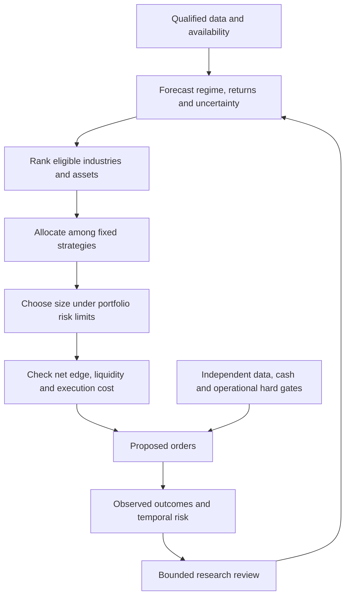

# Research screening: algorithmic trading decision layers

Screened on 2026-10-25 in response to the user's industry, aggressiveness,
traffic-light, target, strategy and risk/profit scoring question. This is a
mechanism map, not reproduction, an execution plan or a new scoring-policy owner.
[Research intake](../research-intake.md), [scoring](../research-scoring.md),
[mandate](../goals.md) and [architecture](../architecture.md) retain authority.

## Findings and source identities

Every row is **screened as a conceptual reference; financial results unverified
locally**. No downloaded code was executed or adopted. Authors' PDFs and publication
identities below were read through web research; source version dates are noted
where available. Dataset rights, full cost assumptions and tried-variant counts
have not been comprehensively audited. No exact repository revision or code license
has been qualified for adoption by this screening.

| Decision | Published mechanism and original source | Possible reuse; missing evidence |
| --- | --- | --- |
| Select industry | Moskowitz and Grinblatt, *Do Industries Explain Momentum?*, Journal of Finance54(4),1999,1249–1290. [Author-hosted paper](https://spinup-000d1a-wp-offload-media.s3.amazonaws.com/faculty/wp-content/uploads/sites/3/2019/09/DoIndustriesExplainMomentum.pdf) | Rank industry portfolios using momentum. The paper uses20value-weighted industries, CRSP/Compustat, July1963–July1995. This is not a ready sector-ETF rotation result. Point-in-time classifications, delisted stocks and tradable costs are absent locally |
| Choose aggressiveness | Moreira and Muir, *Volatility-Managed Portfolios*, NBER22208,2016; later Journal of Finance2017. [Original working paper](https://www.nber.org/system/files/working_papers/w22208/w22208.pdf) | Adjust exposure with estimated variance. Forecast risk and forecast return are separate inputs. A volatility cap is feasible to research, but does not itself prove higher return |
| Estimate regime / conditional risk-off | Ang and Bekaert, *International Asset Allocation with Regime Shifts*, RFS15,2002,1137–1187. [Institutional abstract](https://business.columbia.edu/faculty/research/international-asset-allocation-regime-shifts) | Regime probabilities influence allocation under changing volatility/correlation. Our green/yellow/red thresholds would be a new adaptation, not the paper's validated output; probability estimation and delayed detection need evaluation |
| Select individual targets / estimate expected return | Gu, Kelly and Xiu, *Empirical Asset Pricing via Machine Learning*, RFS2020; [author PDF, September13,2019 version](https://dachxiu.chicagobooth.edu/download/ML_BKP.pdf) | Nonlinear cross-sectional forecasts can rank stocks; trees/neural networks are studied. Their stock universe, features and evaluation differ from our three ETFs. Historical constituents, fundamentals/availability and rights remain reproduction prerequisites |
| Select/weight competing policies | Cover and Ordentlich, *Universal Portfolios with Side Information*, IEEE Information Theory1996; [author manuscript](https://isl.stanford.edu/~cover/papers/portfolios_side_info.pdf) | Sequential allocation compared with a defined hindsight portfolio class. Useful theoretical prior for a future expert/strategy allocator, not proof of a cost-aware selector among arbitrary strategies. Asymptotic benchmark results do not guarantee finite-horizon profit |
| Balance growth and drawdown risk | Busseti, Ryu and Boyd, *Risk-Constrained Kelly Gambling*, March19,2016 manuscript. [Author PDF](https://web.stanford.edu/~boyd/papers/pdf/kelly.pdf) | Maximize long-run growth subject to a drawdown-probability bound under the specified outcome model. Its wealth-floor probability is not automatically our rolling peak drawdown tolerance. Estimated distributions and changing markets can invalidate guarantees outside the model |
| Jointly score return, risk and trading cost | Boyd etal, *Multi-Period Trading via Convex Optimization*,2017. [Original paper](https://arxiv.org/abs/1705.00109) | Optimize trades using expected return, risk, transaction and holding costs. Authors explicitly leave forecasts to another component. Useful interfaces/formulations, not a forecast engine or alpha finding |
| Evaluate evidence strength | Bailey and López de Prado, *The Deflated Sharpe Ratio*, July31,2014 version. [Author paper](https://www.davidhbailey.com/dhbpapers/deflated-sharpe.pdf) | Account for selection/multiple trials and non-normality when evaluating Sharpe. Requires defensible trial/dependence assumptions; cannot certify a repeatedly viewed sample as independent |

Counterevidence matters: Cederburg, O'Doherty, Wang and Yan, *On the Performance
of Volatility-Managed Portfolios*, JFE138,2020,95–117, studies103equity strategies
and reports that volatility management does not systematically improve direct
comparisons, with poor implementable out-of-sample combination results linked to
instability. [Publisher abstract](https://www.sciencedirect.com/science/article/pii/S0304405X2030132X).
The abstract was search-index accessible; direct publisher read returned403 and
author-PDF retrieval timed out. This is an abstract-level counterpoint, not a new
full-paper replication. NBER's Gu/Kelly/Xiu landing page also returned403; the
accessible author-hosted manuscript supplied the mechanism evidence instead.

## Proposed separation of responsibilities

This diagram is a design interpretation from these sources, **planned**, not a
claim that these trained models or production components exist here.

A predictive red signal means estimated conditions are unfavorable; it can be
wrong and late. A hard no-go means a requirement failed, such as invalid data,
unknown action treatment or insufficient available cash. A profit forecast must
not override that failure. Thresholds, caps and resumption rules need explicit
scope; none are silently invented here.

Maintain distinct, horizon-labeled quantities rather than one opaque score:

- **Profit:** expected net return or expected USD P&L, subtracting execution,
  financing and holding costs; report estimation uncertainty and calibration.
  Win probability alone ignores payoff asymmetry. Historical CAGR is an outcome,
  not the probability of future profit.
- **Risk:** forecast volatility, expected shortfall/tail loss, drawdown scenarios,
  underwater duration, liquidity and concentration. Different risks cannot be
  reduced to one comparable number without an explicit preference model.
- **Confidence:** forecast calibration, uncertainty, effective observations,
  stability across windows and evidence after multiple trials.
- **Portfolio contribution:** incremental risk/return, correlations and joint
  stress; a high standalone Sharpe can still duplicate existing exposures.
- **Tradability:** spread, turnover, impact, capacity, borrow/funding constraints,
  available cash and data age/availability.
- **Research value:** information gained, novelty, reproducibility and cost of
  resolving a decision. Failed candidates can be valuable research outcomes.

Strategy selection is itself a new strategy with its own switching costs,
chronology and overfitting opportunities. Test any selector against fixed/equal
allocations and a no-selector control using only past available information. Do
not train on strategies' eventual full-sample rankings. An RL or bandit label does
not supply a valid reward, independent evidence or safety constraint by itself.

## Decision and bounded next action

Retain these sources as hypotheses and interface ideas. Do not add an optimizer,
industry search or trained selector to the current readiness goal. First resolve
[the ETF data/accounting gaps](2026-10-25-rsi-etf-readiness.md); then choose at most
one extra decision layer in a separately bounded study, with its own controls and
trial record. [Stanford's2024 optimization examples](https://web.stanford.edu/~boyd/papers/cvx-finance.html)
offer documented code references for later inspection; no installation, license
qualification or performance adoption was performed here. None of these sources
establishes a reliable annual-doubling strategy for our project.
