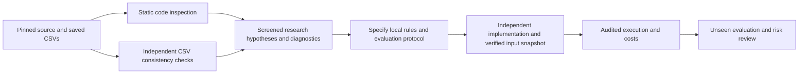

# Strategy Survival Funnel intake review

## Decision and evidence boundary

**Screened as a research-process and strategy-definition reference. Direct code
adoption is blocked pending license clarification; published performance is not
reproduced or approved for investment selection.** No strategy or framework was
installed, no upstream Python was executed, no new market data was downloaded,
and no broker connection or order was made. Existing research results are unchanged.

Reviewed 2026-10-25. Source: [crollila/strategy-survival-funnel](https://github.com/crollila/strategy-survival-funnel),
revision `e349fd25d0b03f58a1864ad918afab04b412bd89`. Static checkout retained in
ignored `vendor/strategy-survival-funnel-review/`. File hashes, CSV checks and
reported statistics are in the [review receipt](evidence/2026-10-25-strategy-survival-funnel-review.json).
The [47-family inventory CSV](evidence/2026-10-25-strategy-survival-funnel-families.csv)
contains configuration counts, reported mean scores and survivor counts, not local
strategy performance. [Research intake](../research-intake.md) owns adoption policy;
[goals](../goals.md) owns the mandate. This review does not change roadmap priority.

Only the source inspection and CSV-consistency stages above are complete.

## What the repository implements

The main sweep has 47 families, 318 parameter configurations and 29 chosen assets:
318 ×29 =9222 asset/configuration cases. These are correlated variants, not 9222
independent strategies. Daily adjusted OHLCV comes from yfinance. `config.py` requests
2010-01-01 through exclusive end2025-01-01, effectively the 2010–2024 period where
available, despite broader 2010–2025 wording in the README. IPO/crypto history varies
by instrument; exact downloaded bars and their versions are not committed.

| Group | Families | Mechanism and examples |
| --- | ---: | --- |
| Trend | 19 | Direction from moving averages, momentum, MACD, Donchian/Turtle, ADX, Supertrend, SAR, Ichimoku, regression slope, Aroon, Vortex, TRIX, Hull MA, KAMA and Elder Ray |
| Mean reversion | 12 | Oppose oscillator extremes or deviations: RSI, Bollinger, z-score, stochastic, CCI, Williams %R, Keltner, rolling VWAP, %B, Connors RSI, ultimate oscillator, lagged gap fade |
| Volume | 6 | OBV, Chaikin money flow, MFI, volume surge, force index and Chaikin oscillator |
| Volatility | 3 | ATR breakout, large-return persistence and Bollinger/Keltner squeeze release |
| Pattern | 4 | Engulfing, three-bar reversal, higher highs/lows and pivot proximity |
| Composite | 3 | MACD/RSI confirmation, trend plus stochastic pullback, and Chandelier switching |

Most rules output short/flat/long positions, shifted once. They are not generally
our long/cash variants: RSI reversion, for example, is long below the low threshold,
short above the high threshold and flat otherwise; it does not hold a long until
our existing RSI exit threshold. Names alone do not identify equivalent strategies.
`dual_momentum` is explicitly a single-asset positive-return long/cash filter,
not relative momentum rotation. `vwap_revert` uses multi-day volume-weighted typical
prices, not session VWAP. `gap_fade` shifts the gap signal and can hold for several
days; it is not same-opening-gap intraday execution. `_hold(...,days)` includes the
entry observation plus up to `days` forward-filled observations; recurring entries
can extend the holding interval. These semantics need explicit local definitions.

Sources: pinned [strategies.py](https://github.com/crollila/strategy-survival-funnel/blob/e349fd25d0b03f58a1864ad918afab04b412bd89/strategies.py),
[indicators.py](https://github.com/crollila/strategy-survival-funnel/blob/e349fd25d0b03f58a1864ad918afab04b412bd89/indicators.py),
[config.py](https://github.com/crollila/strategy-survival-funnel/blob/e349fd25d0b03f58a1864ad918afab04b412bd89/config.py).

## Published performance and checks performed

The return model multiplies daily close-to-close asset return by a shifted position,
then subtracts 1 basis point per unit of position change (5bp crypto). Each fixed
configuration is divided into five consecutive windows; the last 30% of every window
is labeled OOS. Their OOS score uses the concatenated five tails. No parameter is
retrained or chosen on the preceding window in this implementation.

The six conditions are: OOS drawdown better than−35%; OOS Sharpe above0.5 and below2.5;
OOS Sharpe at most1.3×IS Sharpe; at least30 position changes; and positive IS Sharpe.
I independently recalculated the conditions from every saved metric row. All 9222
booleans, table dimensions/unique keys, funnel stages, category/family counts and
the top 20 survivor ordering agree with the committed CSVs. This establishes internal
report consistency, not correctness or replication of prices, signals or returns.

| Filter stage | Cases remaining |
| --- | ---: |
| All configurations ×assets | 9222 |
| Positive reported OOS Sharpe | 4629 |
| Reported OOS Sharpe >0.5 | 1422 |
| Also drawdown better than−35% | 1080 |
| Also at least30 position changes | 724 |
| All six conditions | 67 (0.73%) |

Survivors by group: mean reversion49, trend13, volume3, pattern1, volatility1,
composite0. Survivor reported OOS Sharpe ranges from0.5005 to1.0437. These are
post-selection descriptive statistics, not a success probability or evidence of
mean reversion's general superiority.

| Selected source case | Reported OOS Sharpe | Reported stitched OOS drawdown | Position changes |
| --- | ---: | ---: | ---: |
| Stochastic(7),20/80, MSFT; highest surviving score | 1.044 | −14.97% | 248 |
| CMF(10),0.1 threshold, BTC | 0.954 | −34.99% | 265 |
| RSI(2),10/90, META | 0.921 | −14.82% | 263 |
| Absolute momentum63, SPY; passes filters | 0.605 | −19.17% | 55 |
| RSI(3),20/80, SPY; passes filters | 0.523 | −10.37% | 314 |

Only the last two SPY configurations survive the source filters. SPY's highest
unfiltered score is three-bar reversal with hold 3 (Sharpe1.605); it fails the
source funnel, so it should not be promoted simply by sorting Sharpe.

The separate cross-sectional test ranks assets every21 SPY sessions, long top third
and short bottom third. Reported OOS Sharpe/drawdown: 3m −0.053/−21.54%;
6m0.350/−32.30%; labeled12m−1m0.095/−46.07%. The construction has about200% gross
exposure (100% long plus100% short), so comparison with ±100% single-asset exposure
requires additional cost/risk controls. It fails their minimum Sharpe requirement;
the best6m case also exceeds our approximately30% reassessment tolerance.

The 200-resample bootstrap labels 12 of the top 20 survivors solid and 8 fragile
using a−50% worst simulated drawdown threshold. That threshold is not our risk budget.
The supplied sensitivity table flags 18 families robust under its own heuristic.
Neither label proves an investment advantage. Main sweep CSVs omit CAGR, annual
returns, Calmar, daily equity and financing/margin records; no annual-doubling
assessment can be made from these summaries.

Source: pinned [results directory](https://github.com/crollila/strategy-survival-funnel/tree/e349fd25d0b03f58a1864ad918afab04b412bd89/results).

## Material findings from source inspection

| Finding | Evidence and implication | Required treatment here |
| --- | --- | --- |
| Test-period selection | `funnel.py:71–82` selects candidates using all reported OOS scores; `backtest.py:62–89` has no train-only parameter-selection step. Fixed-rule chronological diagnostics are useful, but these scores become selection data. | Keep an all-trial register, distinguish validation from final evaluation, and use a separately predeclared untouched evaluation. Our already-viewed SPY history is not a fresh holdout. |
| Execution timing assumption | `strategy_returns`, `backtest.py:24–29`, credits the entire close-to-close move to a rule using the preceding completed close. This implicitly assumes trading at that same signal close without a modeled order cutoff. | Use our declared next-open ledger or an explicitly specified pre-close decision; a one-row shift alone does not establish executable fills. A100 prior close →110 next open →110 close example credits10% upstream but0% price return for next-open entry. |
| Non-contiguous account path | `backtest.py:78–86` concatenates separated OOS returns/positions. Drawdown spans an artificial path, and position changes at joins are not necessarily real trades. Costs were computed before slicing. | Report fold dates, per-fold metrics and continuous calendar account paths separately. Declare boundary cash/position/cost policy. Never describe stitched drawdown as full-history account drawdown. |
| Initial loss omitted from drawdown | `backtest.py:39–43` starts peak tracking at the first post-return equity instead of initial capital; bootstrap repeats this. For returns−10%,+5%, the formula reports0% drawdown; including initial capital gives−10%. Independently checked arithmetic in receipt. | Preserve our initial-equity anchor for each defined measurement period and bootstrap path. |
| Simplified portfolio and costs | Flat ±1 exposure, no cash/share ledger, borrow availability/fees, debt financing, margin liquidation, minimum commissions or separate spread/slippage; 252 annualization also used for seven-day crypto data. | Retain our account ledger and costs. Define shorting, calendars and financing before comparing variants. Adjusted dividends must not be credited again as cash. |
| Bootstrap is not tail-risk certification | `robustness.py:76–95` independently samples individual daily returns; loses serial dependence, volatility clusters and joint-asset behavior. Minimum across200 draws depends on seed/count;−50% is arbitrary. | Treat as a diagnostic; specify block lengths, joint resampling when appropriate, seed/count and quantile estimates, plus explicit crisis/gap/liquidity scenarios. |
| Parameter robustness is aggregated | `robustness.py:29–50` averages config Sharpe over assets before computing family spread. Smooth average behavior can hide a brittle asset/config; threshold rules are heuristic. | Add per-instrument parameter neighborhoods, calendar regimes and cost sensitivity; do not import robust labels as acceptance. |
| Indicator edge cases/formula differences | `indicators.py:45–48` maps zero RSI loss toNaN (an all-gain series should have an explicitly defined RSI100 outcome); MFI has analogous zero-negative-flow behavior. CCI deviation atlines57–61 uses historical residuals about different rolling means, not all deviations about the current window's mean. | Independently specify formulas, initialization and flat/monotone fixtures; do not silently equate library names/results. Static findings, not executed upstream regression tests. |
| Cross-sectional mechanics | `cross_sectional.py:34,51,57–65` forward-fills on SPY calendar and repeats target weights daily in the return calculation, although turnover charges only explicit21-day target changes. This implies uncharged daily rebalancing to constant weights, rather than drifted held shares. Labeled12m−1m uses252 returns ending21 days ago (t−273 to t−21), rather than the usual t−252 to t−21 interval. | Specify calendars/staleness, mark-to-market share drift, actual rebalance costs and exact endpoints. Do not port the portfolio engine. |
| Missing reproduction inputs | No committed raw price snapshot, daily OOS pickle, exact dependency lock or test suite. Downloads may revise history; summary CSVs lack observation dates. Present-day famous assets introduce survivorship/selection bias, which upstream acknowledges. | Require immutable input receipts, coverage/corporate-action checks, licensed usage and independent signal/ledger tests. A fresh download is a new dataset, not exact reproduction. |
| Code/data rights unknown | No LICENSE/COPYING or explicit license grant found in tracked files at this revision. yfinance access does not establish market-data redistribution rights. | Hold upstream-code copying/porting until rights clarified. Independently implement standard mathematical ideas from suitable references; review data rights separately. No package adoption is proposed. |

These findings limit interpretation; they do not establish that every result is
wrong. We did not execute their engine or reconstruct any of the 9222 returns.

## What we can reuse

| Item | Local overlap/gap | Decision |
| --- | --- | --- |
| All-trial funnel and rejection reasons | Our suite records all88 variants and audits but has no formal research-gate view | Reuse the concept with our mandate, not their arbitrary0.5/2.5/1.3/−35%/−50% filters. Show diagnostic warnings separately from acceptance. Planned. |
| Parameter surfaces and per-regime stability | Current defaults are fixed; no approved tuning or untouched validation exists | Useful future diagnostics under a predeclared limited experiment budget. Do not start an automatic318-config search. Planned. |
| Bootstrap and dependence diagnostics | No bootstrap research module | Implement independently only in a scoped task; block resampling and crisis tests, not solid/fragile certification. Planned. |
| Existing trend/reversion rules | SMA, MACD, Donchian/Turtle, absolute momentum, RSI/Bollinger/z-score/Connors and ATR overlap our current definitions | First create exact-rule comparison records; no duplicate implementation by name. Short/flat/long and holding rules differ. Screened. |
| New daily-price hypotheses | Stochastic, Williams %R, Keltner, ultimate oscillator, regression slope, Aroon/Vortex/TRIX, etc. | Saved SPY OHLC is enough for input feasibility; volume rules need validated volume. New independent implementations and tests remain required. Not adopted. |
| Two SPY survivors | Absolute momentum63 resembles local ID21 with a different lookback; RSI3/20/80 differs from local ID11's long/cash state machine | Suitable small replication candidates, not selected investments. Freeze exact signed-position or separately labeled long/cash rule and keep published/local results separate. |
| Daily rolling VWAP and lagged gap reversal | Existing catalogue's intraday VWAP/gap entries mean different strategies | Can inspire new daily variants; cannot mark intraday entries completed by substituting them. |
| Multi-asset rotation | Relevant to future allocation research, but no frozen multi-asset dataset or signed-weight account engine here | Defer until free input rights/coverage and a drift-aware portfolio model are verified. |
| Their backtest engine and performance labels | We already have an independently reconciled local portfolio model | Do not replace our engine, import their scores into our leaderboard, or treat published survivors as paper/live-ready. |

No code-adoption permission is inferred from a public GitHub URL. No upstream source
was copied into project implementation modules. The ignored checkout is a static
review reference; concise factual summaries and our own review receipts are maintained.

## Bounded next action

Before another strategy run, prepare a research-evaluation specification that defines
fold calendars, initial equity, boundary costs, long/cash versus signed positions,
full trial accounting, cost/financing stresses, benchmark and untouched-evaluation
policy. Keep implementation evidence separate from return evidence.

Then, if reproduction is requested, scope the two SPY definitions above against a
pinned licensed input snapshot. Their original data are unavailable, so our saved
2005–2025 SPY study would be an adaptation with a date/execution mismatch, not an
exact replication. Use original2010–2024 dates for a matched-period secondary view
only after exact calendar coverage is identified. Predeclare numerical comparisons
and discrepancy reporting before execution. No return/risk threshold is selected
by this review, and no claim supports100% next-year return.
