# Bounded SPY risk-gate test: development specification

Scope: review saved research and specify the next experiment. **No new financial
simulation or gate implementation was requested or performed in this task.**
This document owns this study's design; the
[machine-readable design](../../research/plans/spy-risk-gate-development-v1.design.json)
owns exact parameters. It is deliberately **not** an executable bounded-runner plan.
[Research development](../research-development.md) owns the lifecycle;
[goals](../goals.md) retains the investment mandate. The
[earlier gate proposal](2026-10-25-risk-gate-research.md) remains source/research history;
this packet selects a concrete combined configuration for prospective implementation.

## Review findings that motivate the test

The saved browser's manifest and all35 artifacts were rechecked in this task.
These are already-viewed2005–2025 development results, at5bp modeled side cost:

| Saved rule | CAGR | Max portfolio drawdown | Longest underwater, sessions |
| --- | ---: | ---: | ---: |
| Always-long, daily99% sizing | 10.47% | −54.81% | 1224 |
| EMA50/200 | 8.01% | −29.06% | 531 |
| EMA + volatility target | 6.47% | −15.10% | 656 |
| SPY-price drawdown tiers, ID33 | 6.69% | −28.33% | 1630 |

Lower drawdown did not imply greater growth or faster recovery. The drawdown-tier
rule's20% SPY-price boundary did not cap portfolio loss at20%. The fixed EMA/RSI
mixtures did not dominate controls; their small Calmar advantage reversed when
modeled side cost doubled. These observations motivate explicit path, cash and
cost comparisons—not another local threshold sweep.

External results also warrant caution: Cederburg et al.'s
[published author-hosted study](https://www.lehigh.edu/~xuy219/research/COWY.pdf)
finds no systematic direct-comparison advantage for volatility management and
distinguishes ex-post combinations from real-time strategies. This does not
establish that this proposed gate works or fails. The NBER source returned403 on
refresh; no access restriction was bypassed. Earlier primary-source findings and
limits remain in the linked proposal, not newly reproduced investment evidence.

## Question and comparisons

Does one fixed combined gate reduce **observed drawdown depth and underwater
duration**, after costs, relative to its unchanged base? What growth, exposure
and rebound participation does that protection sacrifice?

| Case | Holding rule | Purpose |
| --- | --- | --- |
| Entry-only buy and hold | Buy once at the first evaluation open; hold shares; dividends accumulate in cash | Literal buy-and-hold benchmark; new results not yet available |
| Always-long daily | Daily target1× before99% reserve | Unchanged sizing control for standalone gate; matches saved reference |
| EMA | Existing EMA50/200 long/cash; daily sizing | Strategy benchmark and unchanged base for gated EMA |
| Gate on always-long | Cap daily target using the fixed color | Primary standalone treatment |
| Gate on EMA | Cap the existing EMA target using the same color | Overlay treatment; stays cash when EMA is off |
| Half-target always-long | Fixed0.5× daily target, remainder cash | Simple lower-exposure alternative, not an exact matched-risk control |

Each case runs at5bp and10bp adverse side cost: **12 cases maximum**, including
controls and failures. The primary paired comparisons are gate/always-long daily
and gated-EMA/EMA. Entry-only buy/hold is a separate headline benchmark: differences
from it combine gating with daily sizing and must not be attributed solely to the
gate. No half-EMA or precisely matched-risk claim is made.

Analytical all-cash reference: zero return/cost under the common zero-interest
assumption; Sharpe and Calmar undefined. It consumes no trading-study attempt.
IDs31–34 remain saved context, not extra tested/tuned variants.

## Fixed state machine and execution

Features reuse the existing formulas: recursive EMA50/200,20-return sample
volatility annualized with252 sessions, and raw SPY close relative to its expanding
peak from the saved2004 start. Require full warm-up; dividends remain a separate
account cash flow. This is not a dividend-inclusive signal or all-time price peak.

| Provisional condition at completed close | State | Cap before99% sizing reserve |
| --- | --- | ---: |
| SPY price drawdown below−20% **or** volatility≥40% | Red, with precedence | 0 |
| Otherwise trend is off, drawdown≤−10%, **or** volatility≥25% | Yellow | 0.5× |
| Otherwise | Green candidate, subject to recovery confirmation | 1× |

```mermaid
stateDiagram-v2
    [*] --> Yellow: full warm-up; evaluate deterioration immediately
    Green --> Yellow: yellow condition
    Green --> Red: red condition
    Yellow --> Red: red condition
    Red --> Yellow: five consecutive recovery-band closes
    Yellow --> Green: five subsequent green-band closes
```

Worsening is immediate at the observed close. Red-to-yellow requires five closes
with drawdown>−18%, volatility<35% and no red condition. Yellow-to-green requires
five subsequent closes with positive trend, drawdown>−8% and volatility<20%.
Reset the relevant counter on failed confirmation/worsening. A red exit never
simultaneously counts toward green; otherwise hold state. Before warm-up is ready,
state is unassessed and target zero, not a fabricated market color.

At close `t`, schedule `min(base_target, color_cap × nominal_budget)` for the next
saved session's open. Shift once. No multiplication of two de-risking factors.
Carry warm-up signal/state into2005, but start every account with cash. Preserve
observation time, scheduled fill time, provisional/final state, counters, base
target, cap, actual target and holdings. A next-open exit cannot undo an earlier gap.
Green means the normal specified research budget, not a profitable forecast.

## Shared accounting, chronology and data

Use the same frozen snapshot/hash as the prior pilot; source identity is in the
design JSON. Warm-up2004; evaluation2005-01-03–2025-12-31,5283 saved sessions.
USD300000, whole shares,99% sizing reserve, USD1 per actual net trade, zero cash
interest, illustrative6% ACT/360 borrowing, original cash-dividend and margin
contract. Nominal exposure is1×; no shorts, options or leverage expansion.
Retain final marked holdings without artificial closing sales. Entry-only buy/hold
has no discretionary rebalance or dividend reinvestment; mandatory modeled risk
handling remains common. [Finance contract](../../research/leverage-model.md).

No fitting, calibration or threshold selection. Report three predeclared blocks:
2005–2011,2012–2018,2019–2025. Extract them from continuous ledgers with prior-close
equity anchors; do not reset capital, features, state or positions at block edges.
Within-block drawdown and full-path drawdown are different measurements. All three
blocks have been inspected previously and are **not** protected validation/test sets.
Provider rights and independent exchange-calendar completeness remain limitations;
exact saved-row alignment alone does not settle them. No new data are downloaded.

## Temporal metrics, events and decisions

- Primary paired path test: minimize maximum drawdown magnitude and longest
  observed underwater sessions. Gate must be no worse on both and better on at
  least one; otherwise reject this joint protective-path claim for that base/cost
  context. Drawdown numerical tolerance is1e-10 fraction; duration is integer
  sessions with no tolerance. This is separate from existing CAGR/drawdown Pareto
  rankings, whose historical meanings remain unchanged.
- Report CAGR differences in percentage points, ending equity, annual return/DD,
  Sharpe/Calmar and exposure/costs. No acceptable growth sacrifice has been chosen;
  passing the path test is not investment selection. Cost robustness requires the
  specified paired result at both5bp and10bp; keep contexts separate.
- Reuse temporal-v1.1:21/63/126/252-session cumulative returns,63/252 rolling
  Sharpe, worst1/5/21/63-session returns, deepest episode/recovery, longest
  underwater sessions/calendar days and historical daily ES95. Preserve nulls,
  full-window coverage, tail counts and censoring. Censored recovery remains
  unresolved, never a claim of faster eventual recovery.
- Warning episode: first executed green-to-yellow/red transition until green
  returns. A diagnostic price event occurs if any SPY raw close in that execution
  session plus the next20 sessions is≤95% of its opening price. Count incomplete
  horizons as censored, outside precision/false-alarm denominators. This price
  label excludes dividends and is not portfolio P&L. Separately mark the first
  actionable reduction below the unchanged base within each episode; an EMA-off
  warning receives no avoided-loss credit merely for showing yellow/red.
  A reduced state carried into the evaluation window is left-censored; preserve
  it but do not manufacture a new transition/warning at the first evaluation day.
- For red entries and exits, show5/21/63-session net-account returns for gate,
  own base and always-long benchmark, from previous close through horizon close.
  This includes transition overnight gaps. Report signed return gaps, costs and
  actual exposure; do not clip away inconvenient results. Future observations
  evaluate earlier warnings and never determine their historical color.
- Report color dwell/transition counts, warning counts, repeated/overlapping
  horizons and block consistency. These are descriptive observations; do not
  treat overlapping windows or a few crises as independent statistical evidence.

Fixed half exposure helps falsify an added-value claim but is not exact risk
matching. Protective alpha and general market-timing superiority remain unassessed.
If the gate's gains vanish after costs, extend underwater time, or simply mirror
cash reduction, retain that outcome and pause this configuration. Do not tune it
until a fresh, specifically bounded hypothesis is written. A historical pass
would justify prospective evaluation design, not paper/live promotion or a30% cap.

## Readiness, budget and implementation prerequisites

**Design ready for implementation review; execution blocked by missing support.**
The current bounded runner does not implement this combined state machine, literal
entry-only buy/hold, the complete case matrix or event attribution. Implement/test
those capabilities first, keep finite/coverage guards ahead of legacy replay, then
freeze executable code/dependency hashes before reserving any financial attempt.

Required fixtures: exact boundary/precedence checks; staged recovery/reset and
warm-up continuity; future-price perturbation cannot change a prior scheduled
target; single lag/cap; entry-only holding; exact EMA and daily always-long5bp
control parity (ledger tolerance1e-7USD, exact trades); separate Decimal audits;
temporal/event horizon/censoring checks; failed attempt and immutable cache behavior.

Proposed limits for a separately scoped execution:12 attempts, one worker/study,
15-minute wall-clock cap, no automatic retries or sweeps. Reserve cases before
launch; preserve/terminate a timed-out case as failed and stop new cases. Synthetic
correctness fixtures are separate validation, not investment evidence. The earlier
program's8 attempts and4 unused slots remain historical; this design spends none.

Outputs: immutable design/executable plans, source/code hashes, state timeline,
daily ledger/fills, per-case guarded Decimal audit, annual/temporal/event tables,
paired verdicts, all failures and a browser view with colors aligned to execution
time. [Planning receipt](evidence/2026-10-25-risk-gate-bounded-test.json).
