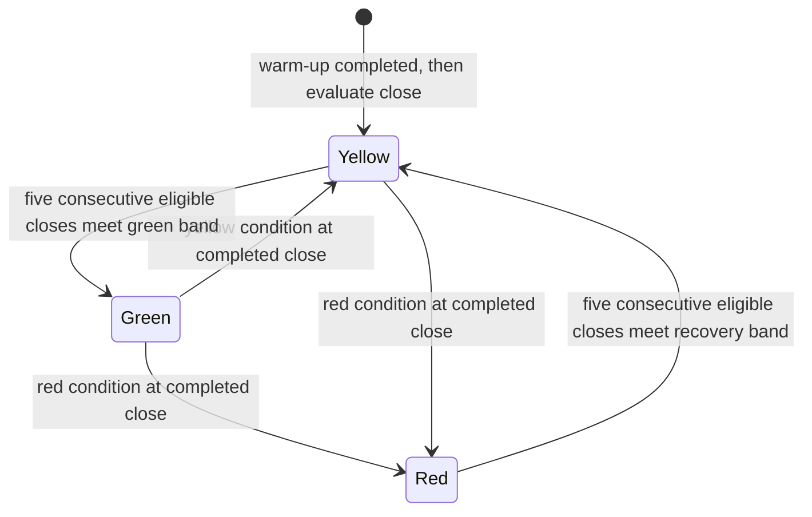

# Risk-state gates and temporal evaluation: research proposal

This primary-source review addresses the user's green/yellow/red exposure idea
and concern that CAGR hides the path. It supports the
[recursive research program](2026-10-25-recursive-research-program.md), while
[goals](../goals.md) retains investment constraints and
[allocation methods](../../research/allocation-strategies.md) owns existing rules.
**No gate was implemented, optimized or backtested in this task.** The already-frozen
four-case cost experiment remains unchanged. Every number below describing a new
gate is an illustrative research specification, not a portfolio limit or approval.

## What prior research supports and challenges

| Primary source and status | Reported result or method | Local implication and limit |
| --- | --- | --- |
| Moreira & Muir, *Volatility-Managed Portfolios*, Journal of Finance2017; [publisher](https://onlinelibrary.wiley.com/doi/abs/10.1111/jofi.12513), [2016 author manuscript](https://law.yale.edu/sites/default/files/area/workshop/leo/leo17_moreira.pdf) | Scales monthly factor exposure by inverse previous-month realized variance. The inspected manuscript reports market alpha4.9% and a25% buy-and-hold Sharpe increase. | Lagged risk estimates motivate sizing research. These are factor-study claims, not our reproduced SPY results. Our capped10% volatility targeting is inverse volatility, not this inverse-variance specification. Full-sample scaling and portfolio-combination choices require care. The requested [NBER page](https://www.nber.org/papers/w22208) returned403; accessible primary alternatives were used. |
| Cederburg, O'Doherty, Wang & Yan, *On the Performance of Volatility-Managed Portfolios*, JFE2020; [published author-hosted PDF](https://www.lehigh.edu/~xuy219/research/COWY.pdf) | Of103 equity strategies, scaled versions had higher Sharpe in53 and originals in50; only8 positive differences were statistically significant. Real-time combination strategies had lower certainty-equivalent return in72/103 base-case comparisons. | Positive spanning-regression alpha can rely on ex-post optimal combinations that are unknown in real time. A protective overlay must be evaluated as an executable rule against simple risk/cash alternatives. This critique does not establish that every volatility-control rule fails. |
| Goulding, Harvey & Mazzoleni, *Momentum Turning Points*, JFE2023; [published author-hosted PDF](https://people.duke.edu/~charvey/Research/Published_Papers/P158_Momentum_turning_points.pdf) | Examines slow/fast momentum disagreement and four market states. Slow signals miss turning points; fast signals create false alarms. Their model and stock-market analysis support intermediate-speed combinations. | Faster warnings and slower confirmation have a measurable tradeoff. Their long/short momentum analysis does not prove our proposed long/cash SPY gate. Report missed recoveries and turnover as well as avoided losses; do not name historical states with future peaks/troughs. |
| Babu et al., *You Can't Always Trend When You Want*, AQR2020; [author publication page](https://www.aqr.com/Insights/Research/Journal-Article/You-Cant-Always-Trend-When-You-Want) | Attributes weaker hypothetical trend performance mainly to smaller market moves rather than inability to translate trends into profits. | A prolonged sideways/whipsaw period is a substantive risk. This is an author/institutional research claim from hypothetical multi-market results; peer-review status and full underlying replication were not established here. |
| Adams & MacKay, *Bayesian Online Changepoint Detection*, preprint2007; [primary PDF](https://arxiv.org/pdf/0710.3742) | Updates a posterior over run length using already observed data, a likelihood and a hazard assumption. Demonstrations cover three real-world sequences. | Causal change detection is distinct from retrospectively labeling regimes. It detects evidence of a distributional change; it is not a forecast that the next return will be negative. Within-segment independence/likelihood assumptions and false-alarm calibration need validation. No financial-return claim transfers. |

These sources were inspected, not independently reproduced. No external source
code was adopted. Public access to papers does not supply historical data rights
or a trading implementation license. We paraphrase claims and link sources;
source PDFs are not redistributed in the project.

## Reuse the existing four allocation methods first

| Existing ID | Already specified locally | What it can answer | What it cannot establish |
| --- | --- | --- | --- |
| 31 | Capped10% annualized target using lagged20-return sample volatility | Does simple continuous de-risking change the account path? | Crash prediction or a guaranteed realized volatility |
| 32 | ID31 plus EMA50/200 long/cash filter | Does a trend condition change participation and adverse episodes? | Incremental predictive alpha without matched-risk analysis |
| 33 | Raw SPY-price drawdown tiers: full above−10%, half from−10% through−20%, cash below−20% | How does a simple observed drawdown response behave? | Prevention of the initial decline or control of portfolio drawdown |
| 34 | CPPI with fixed80% initial-capital floor and multiplier3 | How does prior-close portfolio cushion affect exposure? | A loss floor under gaps/costs, or automatic recovery after cash lockout |

IDs31–34 already use the viewed SPY history. Their parameters cannot be presented
as independently chosen confirmation settings. ID33 uses raw underlying prices,
not dividend-inclusive portfolio wealth. ID34 uses portfolio equity, not SPY's
running price peak. Preserve those distinctions in attribution and displays.

## A bounded illustrative gate, if separately scheduled

**Meaning of the colors:** green permits the normal frozen research exposure
budget, yellow limits it, and red requests zero risky target exposure at the next
modeled execution opportunity. Green does not mean a profitable forecast, cheap
valuation, guaranteed safety or permission to add leverage. None of these states
overrides operational checks or actual margin requirements.

Use only saved SPY close inputs and existing formulas:

- `trend_t = EMA50_t > EMA200_t`, calculated recursively as in ID32.
- `vol_t = std(last20 simple close returns, ddof=1) * sqrt(252)`.
- `dd_t = close_t / max(all closes through t) - 1`, as in ID33.
- Require the full EMA/return warm-up. No future states, centered windows,
  smoothed retrospective probabilities, future-year volatility or future extrema.

At completed close `t`, compute a provisional state with red precedence:

| Condition | Provisional state |
| --- | --- |
| `dd_t < -20%` **or** `vol_t >=40%` | Red |
| Otherwise, `not trend_t` **or** `dd_t <=-10%` **or** `vol_t >=25%` | Yellow |
| Otherwise | Green candidate |

The20/25/40% quantities have different meanings: drawdown versus annualized
volatility. They must not share a vague score axis. These thresholds are
illustrative and partly derived from already-viewed method definitions; they have
not been chosen through an untouched experiment.

Use immediate deterioration and slower, explicit recovery:

- On a worse provisional state, move there immediately, resetting recovery
  counters; green can move directly to red.
- Red exits to yellow only after **five consecutive completed closes** with
  `dd_t >-18%` and `vol_t <35%` and no red condition. Reset the counter on failure.
- Yellow exits to green only after **five subsequent consecutive completed
  closes** with positive trend, `dd_t >-8%` and `vol_t <20%`. Reset on failure.
  A red-to-yellow transition does not simultaneously count toward green.
- Hold the current state when neither deterioration nor its recovery condition
  completes. At initialization evaluate worsening conditions immediately; allow
  the same five-close green confirmation rather than starting optimistically green.
- The decision applies once at **the next open**, with the existing ledger's
  costs/financing, share rounding, margin checks and gap behavior. No transaction
  can undo a loss that happened before that open. The first green/red label must
  retain both its observation timestamp and scheduled execution timestamp.

For a separately frozen nominal budget `L` and base target `e_base`, use caps
`c_green=1`, `c_yellow=0.5`, `c_red=0` and
`e_target=min(e_base, c_state*L)`. This is a cap, not multiplication of two
de-risking factors. If ID32 already targets0.4L, a yellow0.5L cap makes no further
change. Retain base-signal, volatility factor, color cap, actual exposure and costs
separately. For a standalone gate test, define the base holding rule explicitly;
do not silently switch between buy-and-hold and EMA during comparison.

These choices create another strategy variant and consume trial budget if tested.
Hysteresis may reduce switching while delaying recovery; it is not a free benefit.
Current raw-price drawdown may remain depressed long after a market rebound,
especially after distributions. A total-return signal would be a separately
specified alternative, not a silent correction after viewing outcomes.

## Keep operational eligibility separate

Market color is a research signal. Missing/stale inputs, unknown instrument state,
failed reconciliation or an unverified order interface are **operationally
blocked/unassessed**, not another learned market color. A live system would need
separate frozen actions for new-risk prevention, outstanding orders and existing
positions; missing data must not be treated as green or as a made-up executable
cash liquidation. This proposal authorizes no broker changes or orders.

## Evaluate the path and the warning cost

CAGR remains one outcome, paired with the following temporal measurements. Define
all windows and event rules before measurement; report coverage and missingness.

| Perspective | Proposed measurement |
| --- | --- |
| Loss path | Equity drawdown including initial capital; deepest episode; days/sessions below prior peak; time spent below−5/−10/−20%; mean drawdown depth and total drawdown area in fraction-sessions |
| Recovery | Peak-to-recovery and trough-to-recovery durations; episodes unrecovered at sample end are right-censored and retained, never dropped |
| Shorter windows | Worst and distribution of21/63/126/252-session compounded net returns; rolling252-session Sharpe only where defined; no annualized21-day return used as a headline substitute |
| Tail and gaps | Worst1/5/21-session net losses; empirical worst5% daily mean with sample count; overnight gap losses and observed intraday-low account checks separately |
| Participation | Sessions and effective exposure in each color; transitions, average dwell time, turnover, finance/spread cost; equity from held positions and cash separately |
| Up/down opportunity | Matched-interval upside/downside participation against a defined dividend-inclusive benchmark, plus net missed-recovery return; do not divide by near-zero or ambiguous benchmark returns |
| State conditionality | Subsequent21-session return/loss distributions by the color actually available before execution, with dependence/overlap disclosed; these are evaluation labels, never input colors |

For warning evaluation, one explicit **illustrative** protocol could be frozen:

1. A warning episode starts at the first executed green-to-yellow/red transition
   after green and ends when green is re-entered. Count an episode once, not each
   day or each color downgrade.
2. A downside event is a benchmark future closing-price fall of at least5% from
   that warning's scheduled open within21 sessions. Report warning precision and
   false-alarm fraction; near-end warnings without a complete horizon are censored.
   This is an outcome label, not ground truth that the exposure change was useless.
3. Separately identify benchmark10% drawdown-crossing episodes under a frozen
   nonoverlap convention. Report the fraction already reduced before crossing,
   first-warning lead/lag, and losses accumulated before execution. Do not define
   a warning's success using the same threshold that mechanically created it.
4. For each red exit, measure benchmark and strategy compounded returns over the
   next5/21/63 sessions and the exposure gap while sidelined. Show costs and losses
   avoided alongside missed rebounds. Report negative and inconclusive episodes.

The example5/10% event thresholds and21-session horizon are diagnostic research
choices, not financial risk limits. Future outcomes may be used to evaluate a
previously fixed warning, never to paint its historical color. Overlapping labels,
few crises and repeated specification choices limit inferential strength.

## Comparators and falsification

Keep cash, fixed lower exposure, and the current methods visible:

- Unchanged base rule with the same starting equity, dates, cash/dividends,
  spread/fees, financing and execution timing.
- The existing ID31,32,33 and34 definitions, identifying their different mechanisms.
- A fixed-exposure/cash comparator calibrated only on the declared training period
  to comparable risk or exposure, then frozen; also retain simple fixed50%/100%
  references as explicit research scenarios. A full-sample matched-vol comparator
  may be descriptive but cannot be labeled implementable ex ante.
- Zero risky exposure under the same cash-interest assumption. Cash in our model
  earns zero, whereas a Treasury comparison would require its own verified input
  and execution/cost treatment.

Primary question: does the fixed gate improve declared downside/recovery outcomes
**beyond merely holding less risk**, after switching costs, without an unacceptable
missed-recovery tradeoff? No weights or acceptable losses are inferred from the
user's30% reassessment tolerance. Report the tradeoff vector; settle required
preferences before turning it into an acceptance rule.

Reject a protective-alpha claim when matched-risk evidence is absent; reject
guaranteed-loss claims outright. Retain an inconclusive result when improvements
depend on a few already-known crashes, fail under cost stress, or cannot be
distinguished from a fixed cash allocation. Gap paths can exceed any tier or CPPI
floor. Review chronological stability and parameter neighborhoods in separately
bounded trials rather than optimizing the color map until crises disappear.

## Proposed next step

After the frozen four-case experiment, review saved ID31–34 episode/exposure
evidence and identify the smallest unresolved question. Only then schedule a
separate bounded gate study with hashes, fixed state transitions, comparators,
temporal/event definitions and all attempted variants recorded. No new dataset or
framework is needed for the illustrative daily-SPY gate, but that feasibility
does not establish predictive value or safe live operation.

[Evidence receipt](evidence/2026-10-25-risk-gate-research.json) records sources,
inspection limits, local method identities and the unexecuted proposal status.
