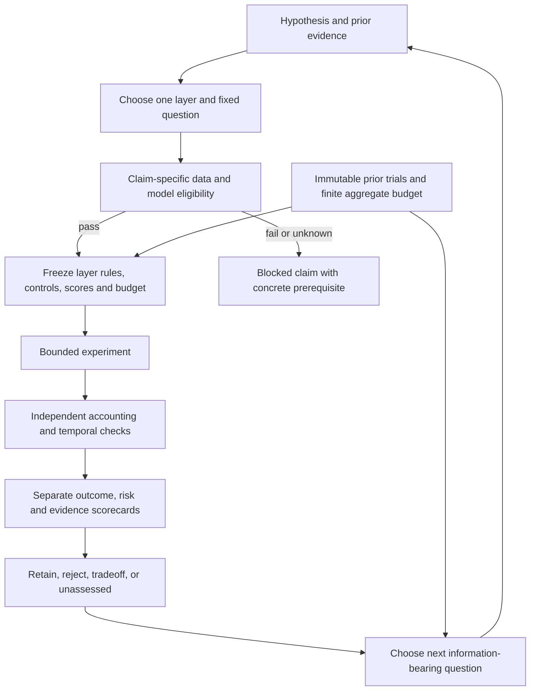

# RSI decision-layer integration and next bounded experiment

Prepared2026-10-25 for the user's planning request. RSI here means recursive
self-improvement, not the relative-strength indicator. Deliverable: workflow
integration plan and one selected experiment design. No implementation, financial
execution, new data request, service/import, broker operation or automatic next
research goal is launched. [Lifecycle](../research-development.md),
[scoring](../research-scoring.md), [mandate](../goals.md), [architecture](../architecture.md)
and [roadmap](../roadmap.md) retain their respective authority.

## Planned decision flow



Only one decision layer changes per experiment where feasible. A strategy selector
or combined policy requires its own controls and a narrower joint-policy claim.
Research iteration does not change its own reward definitions after observing
outcomes. Existing source/risk failures remain visible even when a narrower
arithmetic claim is eligible.

| Layer | Decision/output | Existing support | Planned addition and dependency |
| --- | --- | --- | --- |
| Data/model go-no-go | Eligible, blocked, invalid with reasons | Source audits, hash manifests and claim-specific evidence policy | Explicit per-layer required checks; no averaged quality score |
| Market state | Trend, volatility or stress estimate and availability time | Causal EMA/volatility traffic-light implementation | Keep predictive regime estimates separate from operational hard gates; no calibrated stress probability exists |
| Industry/target selection | Eligible universe and ranking |100idea catalogue;22local SPY adaptations | Point-in-time universe/classifications, multiple qualified inputs and survivorship controls; deferred |
| Aggressiveness | Target gross allocation,0–1 in next design | Discrete caps and audited daily-sizing ledger | One smooth cap; no leverage; selected next development experiment |
| Strategy allocation | Weights among named policies | Saved outcome comparisons; bounded research-action controller | A time-causal allocator with switching costs and fixed/equal controls; not implemented. Research-action priority is not trading-strategy selection |
| Portfolio construction | Combined weights, cash and contributions | Native synthetic shared-cash proofs | ETF action/payment/calendar/rights qualification and allocator gaps remain blocked |
| Execution permission | Proposed order may proceed or stop | Native capability review and offline fixtures; paper observer only | Real execution/recovery policies remain separate infrastructure work |
| Research direction | Next question, finite budget and reason | Versioned priority tuple, duplicate detection, branch states | Add layer identity and information witness; keep financial profit separate from research progress |

## Deliverable sequence and skill ownership

1. **Evidence/record contract first:** extend the existing lifecycle and score
   meanings with layer, inputs, availability, output, units, reason and comparison
   context. This turn documents the planned contract; no new runtime schema is
   implemented. Use `trade-research-design` and `trade-research-history`.
2. **One bounded sizing slice:** preserve the following design, implement only its
   pure target rule and required reporting fields in a separately requested
   execution scope. Use `trade-experiment`, `trade-data-audit` and existing audits;
   assess native capabilities before changing infrastructure.
3. **Diagnose and decide:** `trade-performance-diagnosis` and
   `trade-robust-evaluation` produce retained/rejected/tradeoff/unassessed evidence.
   `trade-candidate-evolution` selects a new discriminating question only if one
   exists within a new explicit budget. `trade-promotion-review` cannot infer
   investment/paper/live permission from a metric.
4. **Broaden only after qualification:** revisit ETF portfolio blockers, then
   industry/target and strategy allocation when those inputs support a credible
   controlled test. This sequencing is local research planning, not a change to
   the infrastructure roadmap. No new skills, optimizer or RL framework needed.

## Scores and browser plan

[The scoring owner](../research-scoring.md#planned-decision-layer-records)
defines the proposed extension. Preserve raw units and eligibility, uncertainty,
unknown/null reasons; avoid a combined0–100score. Outcome panels are retrospective;
inputs that controlled historical decisions must be past-available.

```text
Experiment / layer / parent / model / dataset / cost context
┌──────────────────┬─────────────────────┬────────────────────────┐
│ Eligibility      │ Outcome and risk    │ Evidence and process   │
│ pass/block/fail  │ net growth and loss │ uncertainty and trials │
│ reasons + links │ depth and duration  │ new question resolved  │
└──────────────────┴─────────────────────┴────────────────────────┘
Timeline: observed input → available time → target → fills → realized path
Comparison: annual + rolling metrics | exposure + costs | decision and reason
```

This browser layout is planned, not implemented. Use existing per-run CSV/JSON
artifacts and reporting/MLflow import paths when that work is requested; add no
second database or source of truth. A color badge alone cannot authorize orders.

## Selected experiment: one continuous sizing policy

**Selection rationale:** highest feasible information value among the new decision
layers with current saved inputs, not a predicted return ranking. The earlier
[agent proposal2](2026-10-25-rsi-risk-mechanisms.md) already specifies the20%risk
budget, avoiding a newly optimized parameter. The completed ETF readiness audit
returned not-ready; its different-mechanism appeal remains, but it cannot supply
qualified tradable portfolio results now. This proposal does not reopen it.

| Alternative | Decision value | Feasibility / opportunity cost | Decision |
| --- | --- | --- | --- |
| Continuous sizing | Compare adaptive versus discrete and simply smaller exposure; can retire a more complex policy | Existing frozen SPY and sizing ledger; substantial prior-history selection remains | Select one development-only test |
| Faster red recovery | Isolate confirmation delay | Feasible but another variation on same viewed gate thresholds | Defer rather than test two competing ideas |
| ETF diversification | Distinct mechanism | Known payment/action/source/allocator gaps | Remains blocked pending named prerequisites |
| Industry/stock selector | Broader opportunity ranking | Point-in-time constituents/features absent | Defer |
| Strategy-switching learner | Dynamic strategy allocation | No independent selector data; extra selection bias and costs | Defer |
| New hard go-no-go audit | Could resolve eligibility | Valuable only with a concrete new source/model path; repeating closed failures adds no information | Keep prerequisites visible; no generic repeat-audit loop |

Research motivates testing risk sizing but does not establish the answer:
[Moreira–Muir's2016manuscript](https://law.yale.edu/sites/default/files/area/workshop/leo/leo17_moreira.pdf)
uses monthly inverse variance, while our proposal uses daily capped inverse
volatility. [Cederburg etal2020](https://experts.arizona.edu/en/publications/on-the-performance-of-volatility-managed-portfolios/)
find no systematic direct outperformance across103equity strategies and weaker
implementable combination results. These competing findings motivate controls,
not adoption. No paper was replicated or code installed.

### Fixed question, rule and comparisons

[Machine design](../../research/plans/spy-continuous-cap-development-v1.design.json)
owns the exact proposed study. It is intentionally non-executable by the existing
runner and allocates zero attempts now.

- Same fixed EMA50/200 base. If eligible and sigma20positive, next-open target
  `min(1,0.20/sigma20)`; otherwise0. Sigma20is20raw-close simple returns' sample
  standard deviation, annualized with sqrt252, available after the preceding
  completed close. Lag once. Valid zero volatility gives0; invalid inputs after
  warmup stop the study.20%is a proposed sizing constant, not a forecast return,
  achieved portfolio volatility or approved investment risk limit.
- Four policies × two costs = **8proposed financial cases**: plain EMA, half EMA,
  frozen price-peak-ablated discrete gate on EMA, continuous cap on EMA. Half EMA
  is a new matched control; the saved half-hold portfolio is not equivalent.
  EMA versus continuous changes sizing alone. Discrete versus continuous replaces
  a policy including its confirmation memory; it does not isolate discontinuity
  alone. Both interpretations must appear in the report.
- Frozen original SPY input SHA,2004warmup,2005-01-03–2025-12-31,5,283sessions,
  USD300,000,99%reserve, daily whole-share sizing, nominal cap1, next-open fills,
 5/10bp adverse per side and USD1per actual trade. No intentional borrowing,
  shorts or cash interest. Preserve the existing **ex-date dividend cash credit**
  as a stylized model, not verified payment-date cash. New Yahoo ETF snapshots
  are not substituted. No new downloads, packages or broker access.
- All history already viewed; no trained forecast or new holdout. Labels such as
  training/test or later-year slices do not restore independence. Fixed calendar
  blocks2005–2011,2012–2018,2019–2025are continuous-path diagnostics only.
- Retain source rights/calendar/action unknowns. This narrow model comparison can
  examine sizing arithmetic under declared assumptions; it cannot establish
  tradable-cash performance, independent alpha, data redistribution rights or
  paper/live readiness. Expanding any of those claims requires the missing evidence.

### Predeclared decision and stop rules

Primary claim: versus the frozen discrete EMA gate, continuous sizing must have a
**strictly shorter longest observed recovery interval**, with **no worse maximum
drawdown**, at both cost levels. Drawdown fraction tolerance1e-10; durations exact.
A worse/equal duration or worse depth at either cost rejects this specified claim.
Invalid accounting/timing makes the claim unassessed, not financially rejected.

Separately compare net CAGR, drawdown and duration with half EMA. If half EMA is
no worse on all three and strictly better on at least one at both costs, retire
the continuous policy's added-complexity claim for this development context. Ties
provide no reason to prefer complexity. Mixed tradeoffs stay mixed. Half exposure
is not an exact realized-risk or exposure match; no ex-post leverage matching.

Report growth sacrifice, annual/rolling Sharpe/Calmar, ES95, worst intervals,
censored episodes, turnover/costs, allocation/actual exposure and rebound
participation. No acceptable growth sacrifice has been selected, so a path pass
is not an investment selection. Forecast profit and crash probabilities remain
unassessed; do not infer them from CAGR or traffic-light colors.

Proposed execution cap: **8financial attempts,1candidate,1financial worker,
60minutes total,0automatic retries**, including controls/failures in the attempt
count. Synthetic causality/rounding checks and exact baseline/accounting parity
must pass first; freeze implementation hashes and reserve each attempt before
execution. Stop on integrity failure, exhaustion or deadline. Do not add target,
lookback or confirmation variants, borrow unused old budget or spend cached-control
savings on another candidate. Preserve negative outcomes and stop after the review.

Next independent condition: freeze a retained policy/config and prospectively
observe later data with qualified availability and cash conventions. A development
pass permits planning that observation, not claiming future superiority.
