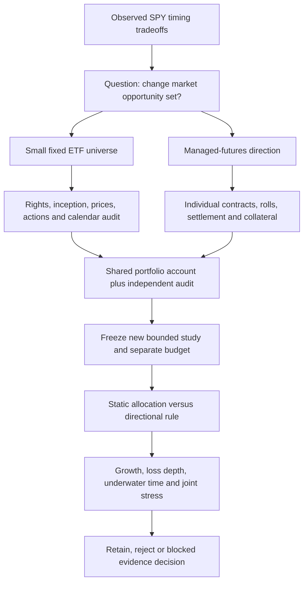

# RSI exploration: diversify the opportunity set before optimizing weights

This scoped research-intake brief supports the user's request for three parallel
recursive self-improvement (RSI) investigations. It does not reopen the exhausted
risk-gate financial budget, select investments, amend the [mandate](../goals.md),
or redefine the [roadmap](../roadmap.md). No strategy was run, data downloaded,
package installed, account accessed, or existing evidence changed in this lane.
[Research intake](../research-intake.md) and [portfolio analysis](../research-development.md#portfolio-analysis)
retain policy ownership. The companion [read-only receipt](evidence/2026-10-25-rsi-diversification-ideas.json)
records inspected paths, identities and archive observations.

**Recommendation:** the next diversification prerequisite is a small, audited ETF
universe plus one shared-cash account proof. It has fewer missing mechanics than
managed futures. Neither branch is ready for financial execution today. Changing
SPY indicators cannot create exposure to an absent bond, gold or currency market;
changing ticker count also does not establish independent economic risk sources.

## What prior research supports, and what it does not

| Primary source checked 2026-10-25 | Original evidence and reusable idea | Transfer limitation / intake decision |
| --- | --- | --- |
| [Moskowitz, Ooi and Pedersen, Time Series Momentum (2012)](https://www.aqr.com/Insights/Research/Journal-Article/Time-Series-Momentum) | Author-hosted summary studies 58 futures/forward instruments across equities, bonds, commodities and currencies; own prior twelve-month returns motivate a directional mechanism. | A diversified long/short derivatives study is not evidence for another SPY moving average. Full contract data, collateral and short exposure differ from our share ledger. **Screened mechanism; reproduction blocked.** |
| [Hurst, Ooi and Pedersen, A Century of Evidence (2017), publisher PDF hosted by authors](https://images.aqr.com/-/media/AQR/Documents/Insights/Journal-Article/AQR-JPM-Fall-2017.pdf) | Extends a diversified trend construction back to 1880; combines one-, three- and twelve-month signals, with ex ante volatility scaling and modeled trading costs/fees. Broad economic regimes are useful stress-design inspiration. | Historical reconstruction is not an executable free instrument tape. Page2 explicitly notes uncertain estimated costs and omitted futures rolling costs. Do not import a headline Sharpe or reproduce the paper by substituting four ETFs. **Screened design; no local replication.** |
| [Kim, Tse and Wald, Time series momentum and volatility scaling (2016)](https://www.sciencedirect.com/science/article/pii/S1386418116301379) | Publisher's indexed abstract reports that unscaled time-series momentum and buy-and-hold have similar cumulative returns/alphas in its comparison. | Full page returned403 during this review; only publisher-indexed abstract verified. This counterevidence motivates a matched-sizing long-only control before crediting directional skill. **Screened counterhypothesis; full methods not inspected.** |
| [Faber, original paper listing](https://mebfaber.com/white-papers/) and [author's 2013 update/FAQ](https://mebfaber.com/2013/06/14/qtaa-update-conclustions-and-faqs/) | Author describes monthly trend filtering combined with allocation across asset classes and reports historical risk-adjusted benefits. | The FAQ says its Global Financial Data agreement prevents sharing original inputs. Public claims do not establish our returns; a new ETF adaptation has different prices, distributions and costs. **Screened mechanism; original-data reproduction blocked.** |
| [Marmi, Pacati, Renò and Risso (2013), institutional paper record](https://ricerca.sns.it/handle/11384/6484) | Authors challenge an inference of market inefficiency from Faber's performance and propose bootstrap experiments. | Institutional abstract verified, full paper not available there. Retain dependence/selection cautions; no significance test was performed here. **Screened caution.** |

These sources motivate falsifiable alternatives. They do not support the annual
100% aspiration, a one-year success probability, or a maximum30% loss guarantee.
The user's capital/horizon and roughly30% reassessment reference remain as recorded
in the mandate; new numerical research assumptions below are proposals only.

## Actual local inputs: examples are not an approved universe

Only the existing SPY snapshot has the current studies' documented normalization,
corporate-action treatment and independent account reconciliation. The loader in
`research/spy_backtest.py` explicitly accepts SPY and rejects any split events.
The custom finance loop in `research/leveraged_spy.py` holds one share position;
summing separate accounts does not implement a common multi-instrument cash book.

There are **1,145 files under ignored `data/`**, including LEAN example/support
archives. Read-only inspection of the first CSV member found:

| Existing archive | First-member rows | First timestamp → last timestamp | Meaning of this check |
| --- | ---: | --- | --- |
| `data/equity/usa/daily/spy.zip` | 5,849 | 1998-01-02 →2021-03-31 | Separate LEAN example, not the frozen Yahoo SPY source used by current studies |
| `data/equity/usa/daily/qqq.zip` | 3,964 | 1999-03-10 →2021-03-31 | Presence and endpoint inspection only; no coverage/action/right validation |
| `data/equity/usa/daily/eem.zip` | 5,245 | 1998-01-06 →2021-03-31 | **Pre-inception flag:** issuer gives2003-04-07 inception |
| `data/equity/usa/daily/iwm.zip` | 5,244 | 2000-05-26 →2021-03-31 | Presence and endpoint inspection only |
| `data/equity/usa/daily/uso.zip` | 3,910 | 1998-01-02 →2021-03-31 | **Pre-inception flag:** fund filing gives2006-04-10 listing/operations |
| `data/future/cme/daily/es_trade.zip` | 61 | 2013-10-06 →2013-12-20 | First member `es_trade_201312.csv` only; other contracts exist, unvalidated |
| `data/future/comex/daily/gc_trade.zip` | 5 | 2013-10-07 →2013-10-11 | First member `gc_trade_201310.csv` only; not evidence of a complete futures panel |

Inception cross-checks use [iShares' EEM page](https://www.ishares.com/us/products/239637/ISHARES-MSCI-EMERGING-MARKETS-ETF)
and [USO's issuer-filed 2019 report](https://secure.alpsinc.com/MarketingAPI/api/v1/Content/uscfinvestments/united-states-oil-fund-10-q-20190930.pdf).
The mismatches may reflect example/support construction, mapping or other semantics;
this inspection does not diagnose their origin. Preserve bytes, flag them, and
refuse tradable pre-inception history until provenance explains it. Filename and
long date range cannot certify instrument identity or coverage.

## Capability and missing-input matrix

| Requirement | Reuse available now | Missing behavior/evidence |
| --- | --- | --- |
| Frozen input identities | SHA manifests, attempt journals, source receipts | New per-instrument sources/rights, identities, inception and closures; normalized action receipts |
| Multi-instrument replay | Native engine interfaces assessed in [capability matrix](../capabilities.md), including instrument registration, account/risk and catalog surfaces | Configure and behavior-verify the pinned1.231.0 interfaces; native availability is not our tested shared-cash allocation implementation |
| Prices/actions/calendar | SPY OHLC validation, dividends credited on ex-date to prior holdings | Split/share adjustments, multiple distributions and pay-date cash availability, changing symbols, missing/stale sessions; choose explicit execution/valuation policy |
| Allocation and cash | Existing daily/entry-only single-position sizing, fills/costs, independent Decimal replay patterns | Sell-before-buy across instruments, cost-aware whole-share sizing, common cash/reserves, event order, failed/missing fills, portfolio exposure and independent replay |
| Temporal/stress comparison | `reporting/temporal.py`: rolling21/63/126/252-session returns,63/252 Sharpe, drawdown episodes/censoring and historical ES95 | Align actual return-interval endpoints; joint loss/contribution tables and asset/block exposure. Do not forward-fill missing returns as zero |
| Optimizer | None installed/needed for fixed weights | Estimation/constraints/turnover validation if later justified; no full-history weight fitting |
| Futures | Example contracts present; native instrument concepts assessed | Verified full contract panel and calendars; multiplier/tick/expiry, causal rolls, daily settlement, collateral/funding, variation margin and joint liquidation |
| Evaluation independence | Preserved prior attempts and negative results | Already viewed2005–2025 SPY remains development. New symbols/publicly studied history do not confer untouched evidence |

Optional tools to screen later: [PyPortfolioOpt](https://github.com/PyPortfolio/PyPortfolioOpt)
provides covariance estimators, HRP and discrete allocation under MIT licensing;
[Riskfolio-Lib](https://github.com/dcajasn/Riskfolio-Lib) provides risk-parity and
CVaR/drawdown objectives under BSD-3-Clause. Repositories were inspected, not
installed, executed, revision-pinned, or adopted. An optimizer supplies weights;
it does not supply data rights, point-in-time holdings, shared-account execution,
or a predictive edge. Preserve the current compounded-equity metric definitions:
Riskfolio's documented uncompounded drawdown measures are not interchangeable.
The [official AQR monthly factor page](https://www.aqr.com/Insights/Datasets/Time-Series-Momentum-Factors-Monthly)
is useful for a separately licensed statistical reference: it describes monthly
long/short excess-return factors starting1985, not contract-level executable prices.
No dataset was fetched or entitlement verified here.

## Candidate1 — fixed ETF diversification, then one monthly trend ablation

**Status: proposed, blocked on inputs and shared-account proof.** The smallest
informative extension is a fixed USD-traded universe of SPY, IEF and GLD, chosen by
asset-class roles rather than selecting historical winners. This is an ETF
adaptation, not a replication of Faber or the futures papers.

- **Hypothesis:** a static one-third allocation to equity, intermediate Treasuries
  and gold reduces maximum daily-close drawdown magnitude or longest observed
  underwater duration, while worsening neither, versus a matched SPY reference
  after costs. A separate
  monthly filter may improve that static portfolio's path beyond diversification.
- **Rules/controls:** three fixed rules: monthly100%SPY reference; monthly1/3 each
  static basket; same basket with each sleeve invested only when its causal
  split/distribution-consistent total-return index exceeds its trailing10 month-end
  mean, otherwise that sleeve remains cash. No reassignment to winners. The current
  month-end observation enters its mean; fill at next common exchange-session open,
  using only completed observations. No leverage/shorting/weight optimization.
- **Costs/account:** new study would compare5/10bp adverse per side plus USD1 per
  actual net instrument order, USD300k,99%investable reserve, whole shares and one
  common account. Sell-before-buy; account for execution costs before buys. Zero
  cash interest for all primary cases, explicitly an opportunity-cost omission.
  Fund expenses are embedded in market paths, not deducted twice. Raw fills plus
  split position adjustments and dividend entitlements/receivables/pay-date cash
  must reconcile; no dividend-adjusted fills plus duplicate cash credits.
- **Inputs/timing:** proposed evaluation2006–2025 after full ten-month warmup;
  verify actual inception/common coverage before freezing dates. No pre-inception
  backfill or automatic proxy splice. Freeze legal-use receipts, raw/action hashes,
  total-return construction and session conventions. Fixed surviving tickers are
  an explicitly selected contemporary research universe, not survivor-free market
  selection. Boundary holdings carry continuously; no reset by year/block.
- **Evaluation/negative criteria:** six proposed cases total (three rules×two costs),
  requiring a new authorization/budget after current epoch closure. Primary
  hypothesis fails if the static basket worsens either drawdown magnitude or
  longest observed duration, or improves neither, at either cost. Assess the filter
  separately against the same static basket under that rule. Report total wealth,
  CAGR sacrifice, year/rolling returns, Sharpe/Calmar, deepest/longest episodes,
  right-censored recovery, ES95, turnover, asset contributions and simultaneous
  losses, especially2008,2020 and2022. These dates are diagnostic, not untouched
  holdouts. Path improvement alone establishes neither return superiority nor alpha.
- **Free/local feasibility:** no new market download is authorized now. Existing
  validated fixture supplies SPY only; verified complete IEF/GLD/actions are absent
  from this lane's evidence. Free-source discovery may solve acquisition later,
  but actual coverage/rights are unverified. Synthetic shared-account fixtures can
  be prepared under a separate engineering scope; they cannot produce returns.

## Candidate2 — four-market directional futures, with sizing held constant

**Status: screened hypothesis; blocked by substantially larger input/model gaps.**
Investigate equity-index, Treasury, gold and major-currency futures as distinct
risk families rather than adding four correlated equity tickers. Example contract
families ES, ZN, GC and6E are a proposed research universe, not broker permissions.

- **Hypothesis/control:** a monthly long/short sign-of-prior12-month excess-return
  rule reduces joint equity-stress losses and portfolio drawdown duration versus
  always-long positions in the same four families with the **same** fixed25%notional
  sleeve budgets. Keep gross target at most1×equity before contract rounding;
  no volatility scaling, leverage optimization or parameter grid. This intentionally
  differs from published58-market/volatility-scaled implementations and isolates
  direction from risk scaling. Monthly signal uses only observations available by
  the decision close; enter next eligible session, never at the observed close.
- **Contracts/costs:** prices must identify individual contracts; signal-return
  stitching and executable raw prices are separate. A predeclared roll schedule
  must precede first-notice/last-trade dates using known contract calendars and
  account for both legs. Proposed cost sensitivity is one/two adverse ticks per
  filled contract-side plus USD2.50commission; verify instrument ticks/multipliers
  before plan freeze. Raw settlement P&L, daily variation margin, collateral/cash
  return, fees, FX conversion and margin/liquidation events belong in shared USD
  portfolio equity. No return-on-posted-margin ranking and no multiplying isolated
  leveraged curves. Exact collateral-rate series/availability and maintenance
  schedules remain unresolved inputs, so this is not executable specification.
- **Evaluation/rejection:** a future four-case design (two rules×two costs) only
  after a separately approved budget, exact contract/model definitions and audit.
  Reject proposed protection if treatment worsens loss depth or longest observed
  underwater duration, or improves neither, at either cost;
  also report wealth/CAGR sacrifice, rolling annual losses, censored recoveries,
  joint stress, turnover, roll/collateral contributions and margin events. Poor
  capital granularity or integrity failure stops the study. No meaningful claim
  can use only a monthly published factor where daily temporal outcomes are missing.
- **Free/local feasibility:** example ES/GC archives do not establish complete four-
  market contract history, price rights, calendar or collateral data. Unlike ETF
  accounting, futures settlement and roll implementation are not in our audited
  custom ledger. Hold financial execution; prefer Candidate1 prerequisites first.
  If free valid inputs cannot be obtained, record blocked/retired rather than
  substitute adjusted continuous quotes and claim implementability.

## Next decision and validation actually performed

Prioritize **data identity/action audit plus synthetic shared-account proof** over
installing an optimizer or searching more SPY thresholds. Portfolio benefit remains
**not assessed**. Existing infrastructure is reusable, but it has not established
cross-asset diversification or one-year suitability.

This lane read project policy, saved state, finance/loader interfaces and archive
headers/endpoints; checked primary source pages/paper passages; created only this
brief and its receipt. All sixteen current-epoch financial attempts remain counted;
no new financial attempt, performance calculation, simulator execution or data
acquisition occurred here. Source/API failures are disclosed above. This brief is
an idea/input readiness result, not an empirical strategy comparison.
