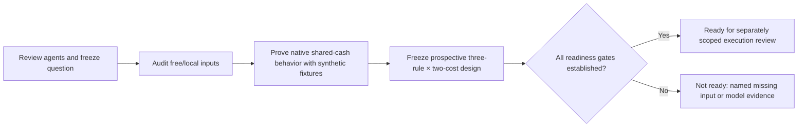

# Next bounded RSI goal: ETF diversification readiness

Selected on 2026-10-25 after the user requested review of the three agents' findings,
a research-direction decision and a new bounded goal using free/local data.
This task owns this readiness epoch, not portfolio priorities or the investment
mandate. [Research lifecycle](../research-development.md), [scoring](../research-scoring.md),
[goals](../goals.md) and [native-first architecture](../architecture.md) retain authority.
The [completed risk-gate epoch](2026-10-25-rsi-risk-gate-epoch.md) remains closed.

## Decision

Choose **a fixed SPY/IEF/GLD portfolio**, beginning with source qualification and
one shared USD cash-account proof. This is the most useful next research direction
under current constraints; it is not a prediction of the highest future return.
The universe represents US equity, intermediate Treasury and gold exposures.
Fixed roles do not imply independence in every crisis or an optimal investment mix.

| Agent lane | Finding retained | Decision and opportunity cost |
| --- | --- | --- |
| [Risk mechanisms](2026-10-25-rsi-risk-mechanisms.md) | Removing all price-peak conditions improved the saved path; entry versus recovery effects and future performance remain unresolved | Freeze the simpler EMA/volatility gate as a research reference. Defer confirmation-length/continuous-cap variations: they are feasible but continue selection on the same viewed SPY history |
| [Diversification](2026-10-25-rsi-diversification-ideas.md) | New asset roles test a different mechanism; data, corporate actions and common cash must be proved first. Some bundled LEAN examples contain pre-inception dates | Select small ETF readiness. Prefer a fixed portfolio and controls before an optimizer; managed futures require substantially more contract/roll/collateral work |
| [Frontier and selection](2026-10-25-rsi-frontier-and-selection.md) | Public SPY intraday, cross-sectional ML and automated-research results have different inputs, costs, leverage and benchmarks | Reuse research discipline. Defer intraday/stock ML/options/futures execution because verified inputs/models are missing. Qlib/RD-Agent are process priors, not ready-made SPY alpha |

This applies the existing research-action policy qualitatively, without inventing
calibrated expected returns or a weighted score. Data integrity/eligibility comes
first; a fixed different-mechanism comparison can change a research branch; resource
cost and missing prerequisites disfavor a more complex engine now. The three briefs
are advisory evidence, not independent financial replications or a vote certifying
readiness. A clean independent evaluation opportunity for the frozen SPY gate could
change priority; no such eligible untouched path has been established here.

AQR's [original time-series momentum research](https://www.aqr.com/Insights/Research/Journal-Article/Time-Series-Momentum)
motivates asking a cross-asset question. Its diversified futures/forwards and
12-month signals are not reproduced by this ETF adaptation. The chosen10-month
mean is the concrete fixed proposal from the diversification brief; the frontier
brief's different12-month-return proposal is deferred, not added as another variant.
No10-versus12-month sweep or historical winner selection is authorized.

## Concrete goal and bounds

Deliver a verified **ready/not-ready decision** for this experiment, supported by:

1. Per-instrument source, identity, coverage, action, adjustment, calendar,
   availability and rights receipts; retain actual failures and absent fields.
2. A native-first synthetic multi-instrument/common-cash proof with independent
   accounting reconciliation, or a precise blocking native gap backed by a probe.
3. A fixed prospective six-case specification and an evidence-backed list of
   conditions required before any real historical performance run.

- Universe: SPY, IEF and GLD only; no symbol substitution or expanding watchlist.
- This readiness epoch: **zero historical financial simulations** and no
  parameter/weight optimization, leverage, shorting or RL training.
- Source investigation: at most two free/public price providers and six anonymous
  snapshot requests total. No credentials, paid APIs, restricted-access bypass,
  data purchases or dependency installations. Bibliographic/issuer-page reads are
  not market-data snapshot downloads; record acquisition attempts before sending.
- Native behavior work: at most two bounded synthetic probe revisions, one worker,
  pinned dependencies unchanged. Synthetic order/fill fixtures stay entirely
  offline; there are no broker/account/external order operations.
- Deadline: **2026-10-25 13:38:24 America/Los_Angeles**
  (20:38:24 UTC),60minutes from goal creation. Stop source/probe work at its bound,
  integrity failure or required external dependency; preserve evidence and report
  not-ready rather than increasing limits or fabricating replacements.
- Preserve old reports, failures and input bytes. No commit, deployment or publication.
  The old16-attempt epoch supplies no carried-over budget.

The six-case performance study is **proposed, non-executable and unbudgeted in
this phase**. Source availability alone does not allocate those future attempts.
The readiness result does not certify an investment, paper/live operation or
annual doubling.

## Prospective comparison, fixed before performance inspection

The [machine design](../../research/plans/etf-diversification-readiness-v1.design.json)
owns exact proposed fields. It is intentionally unsupported by the financial
bounded-study runner. It specifies three rules at5/10bp adverse per side plus USD1
per actual instrument order:

| Rule | Purpose |
| --- | --- |
| Monthly full-SPY target | Matched rebalance reference for the diversification change |
| Monthly static one-third SPY/IEF/GLD | Isolate diversification with fixed weights |
| Same sleeves,10-month total-return trend/cash filter | Isolate the incremental filter; an inactive sleeve stays cash without redistribution |

Use USD300,000,99%investable reserve, whole shares, one USD cash account, no leverage
or shorts and zero cash interest in all primary cases. Zero cash interest omits
opportunity cost; it must not be presented as a realistic Treasury cash strategy.
Monthly targets use only the last completed common session and execute at the next
common session open. Proposed warmup starts2004-12-01 and evaluation2006-01-03–
2025-12-31, subject to actual inception/coverage/full10-month qualification; do not
silently shift dates or splice a proxy. These are development dates, not an untouched
holdout. New symbols do not make public historical outcomes independent.

H1 compares static thirds with monthly SPY; H2 compares filtered thirds with static
thirds. In each cost context, require no worse full-path drawdown magnitude and
longest observed peak-to-recovery/observed-end duration, strictly better on at least
one (drawdown fraction tolerance1e-10, integer duration exact). A cost-robust claim
requires both cost contexts. Report CAGR/ending-wealth sacrifice separately; an
acceptable sacrifice remains unset. No composite score is substituted for this pair.

Carry capital, features and positions continuously. Report annual return/DD/Sharpe/
Calmar, rolling21/63/126/252returns and63/252Sharpe, worst1/5/21/63returns, deepest/
longest episodes and censoring, historical daily ES95, turnover/costs, available
cash/receivables and sleeve/joint-stress contributions. Context references from
other cash/rebalance policies are labeled separately rather than used as matched
controls.

## Readiness gates and known gaps

The proof must distinguish raw execution prices from forward total-return signals;
price adjustments plus cash distributions cannot be counted twice. Dividend
entitlement/receivables enter wealth separately from verified payment-date
spendable cash. Unpaid receivables cannot finance buys. Split actions must preserve
quantity/value identities without recording a split as profit. Verify fee-aware
whole-share sizing, deterministic sell-before-buy ordering, insufficient-cash
rejection and missing-mark behavior. Prove a native capability or name its actual
gap before proposing a custom accounting component.

Use source calendars/venue conventions; do not treat row intersection or forward-
filled zeros as exchange-calendar completeness. Reject pre-inception histories,
uncertain instrument identity, missing actions or material adjustment ambiguity.
Unknown rights/availability remain visible and block the corresponding claim.
Source-byte access is not a redistribution license.

The [setup receipt](evidence/2026-10-25-rsi-etf-readiness-setup.json) records:

- Three briefing identities and the previous completed epoch's receipt hash.
- Existing SPY source:5,535rows,2004–2025,89dividend dates; its parser is SPY-only
  and does not establish payment dates or independently complete venue sessions.
- No conventionally named IEF/GLD snapshots found under `data/`, `reports/` and
  `.local/`. This is filename discovery, not proof about arbitrary embedded archives.
- Native1.231.0 is installed; actual three-instrument common-cash behavior remains
  unverified. No new infrastructure milestone has been marked complete.
- At setup: zero snapshot requests, zero native probe revisions and zero financial
  cases. Runtime reservations/deadline are in ignored `.local/etf-readiness/state.json`.

Issuer facts were refreshed through [IEF's official page](https://www.ishares.com/us/products/239456/ishares-710-year-treasury-bond-etf)
and [GLD's official site](https://www.spdrgoldshares.com/usa/). These identify roles
and source leads; neither page proves a complete usable historical dataset. Current
issuer quotes appearing on these pages were not used to optimize rules or select
historical winners; no2026protected evaluation has been claimed.

## Verification and handoff

The setup verifies JSON/schema intentional non-executability, expected three-symbol/
six-proposed-case counts, zero current financial budget, source/brief hashes and
local documentation links. This is goal setup and first inventory evidence, not
completion of the readiness epoch. Later native/source results require their own
receipts and `make check`; preserve this initial checkpoint as historical evidence.

Setup phase at creation: **input qualification and native behavior proof next**.
No historical portfolio performance is available for this design.

## Completed readiness review

**Outcome: readiness audit complete; NOT READY for historical portfolio execution.**
No financial simulations were run and no new financial budget was allocated.
The setup observations above remain historical; this section is the later result.
The [completion receipt](evidence/2026-10-25-rsi-etf-readiness-completion.json)
records exact hashes, bounds, checks and independent accounting results.

| Requirement | Actual evidence | Status and limit |
| --- | --- | --- |
| Three frozen inputs | Three Yahoo anonymous snapshots, each5,305daily rows,2004-12-01–2025-12-31; identical observed dates; identity, inception, finite prices and OHLC checks passed | Basic structure verified; calendar, historical availability and raw/adjusted semantics remain unverified |
| Corporate-action source | SPY85 and IEF254 dated distributions; GLD0 reported; all0reported splits | Pay dates absent; empty provider event lists do not certify event completeness |
| Source access/rights |3/6snapshot requests,2providers investigated | Yahoo terms/help reads returned999/429. Stooq required browser verification; no bypass or alternate download. Intended-use rights remain unverified |
| Native common cash | Probe1: five fills, fees5, final cash263 after8fixture payment; probe2: six fills, fees6, final cash19. Both three-symbol inventories match independent Decimal replays | Verified for invented quotes in one SIM USD CASH account; real cross-venue/broker parity unverified |
| Whole shares, fees, rejection | Probe2 reduced a300USD,100USD/share purchase from3shares to2 because fee1 would otherwise cost301; both oversized orders rejected/denied | Synthetic cost-aware deltas and sequenced sells-before-buys verified; production monthly allocator and missing-mark stop behavior remain unimplemented/unverified |
| Dividend wealth versus cash | Project-side receivable8 on ex-date; native cash unchanged until fixture payment; payment credited once | Separation demonstrated by fixture; no native receivable/corporate-action service configured |
| Split value continuity | Known synthetic2:1 split quote change left native IEF quantity4 instead of8; native marked wealth941 versus economically corrected1041 | Expected negative probe identifies configured split-handler gap. No fake trades or silent quantity repair |
| Signal versus fill series | Independent toy TRI100,104,104,104,104 with split/distribution; raw quotes used for fills | Fixture formula verified; no qualified historical TRI built |
| Prospective design | [Frozen six-case extension](../../research/plans/etf-diversification-readiness-v1.frozen.json), linked to unchanged original design SHA | Fixed conventions before performance; intentionally non-executable, budget0 |

Ignored local evidence is under `.local/etf-readiness/`: raw acquisition bytes,
`input-audit/`, `native-r1/`, `native-r2/`, source snapshots, logs and
`artifact-verification.json`. Hash verification covered24manifested artifacts/raw
snapshots, plus original design, previous epoch receipt and all three agent briefs.
Two separate saved-fill replays matched native positions/cash without another
engine execution. Probe quota is exhausted at2/2; no third attempt is implied.

### Exact remaining prerequisites

1. Qualify intended-use rights and document price adjustment/action semantics,
   action completeness, independent session calendars and historical availability.
2. Supply verified SPY/IEF payment dates and explicit entitlement/payment ordering;
   never use unpaid receivables to finance buys. Verify absence of relevant GLD
   actions rather than assuming it from an empty list.
3. Design a native-compatible corporate-action/receivable component or document an
   alternate scope. Prove split quantities/value, concurrent actions and fractional
   entitlements with accounting invariants; current configured path fails this.
4. Implement and prove the frozen monthly target allocator, adverse-price/cost
   model, missing-mark stop behavior and continuous NAV attribution. A fixed-order
   shared-cash fixture is narrower than this requirement.
5. Review readiness and define a new explicit financial execution budget before
   any of the six proposed cases. Do not carry old attempts forward or relabel
   public/viewed history as an independent holdout.

Final verification: `make check` exited0 (200tests, dependency consistency and70
existing documentation files before this closing update); final documentation/link
and whitespace checks are recorded separately in the completion receipt. No
framework versions changed, financial imports/services started, broker accessed,
commit made or publication performed. This does not complete a roadmap milestone
or establish alpha, trained RL advantage, annual doubling or a loss guarantee.

The user's broader decision-layer question is screened separately in
[algorithmic selection and scoring research](2026-10-25-research-decision-layers.md).
It does not expand this epoch's data, native-probe or performance limits.
