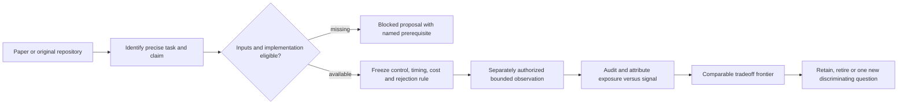

# Frontier strategies and selection of the next research direction

Screened 2026-10-25. This is a source-backed proposal from one of the three
requested parallel research lanes. It creates no financial-trial allocation and
changes no strategy, score contract or investment mandate. The current epoch's
[state](../../.local/rsi-risk-gate/state.json) records **16 financial attempts**;
its results require final review. No simulation, price-data acquisition,
installation, service, account or order operation was performed in this lane.

## Answer to the state-of-the-art question

There are strong published methods and benchmark-specific leaders. This screening
does **not** establish a universal best strategy for SPY, or an investable system
that reliably doubles capital annually. A paper's best historical ratio is a
candidate claim, not a common comparison standard. SPY exposure timing,
cross-sectional stock ranking, futures trend and option-premium harvesting solve
different problems. Their capital bases, cash returns, shorting, leverage,
execution costs and evaluation access must be aligned before ranking.

The [mandate](../goals.md), [intake procedure](../research-intake.md),
[research lifecycle](../research-development.md) and
[scoring contract](../research-scoring.md) retain authority. This task record
screens examples; it is not an exhaustive literature survey or a second roadmap.

## Primary-source candidate matrix

All performance below is **reported by its original source and not reproduced
here**. Review date is not the return-observation end date.

| Direction and primary evidence | What the source actually establishes or reports | Reuse and local feasibility |
| --- | --- | --- |
| SPY intraday momentum — Zarattini, Aziz and Barbon, [author-university PDF](https://alexandria.unisg.ch/server/api/core/bitstreams/a99aba00-f967-49b3-aceb-f544dc386e0b/content), version 2025-02-03, Tables2–3 and data FAQ | Main 2007–early2024 simulation: dynamic-sizing variant reports19.6% annualized return, Sharpe1.33 and25% max drawdown. Exposure can reach4x; its2% volatility target is **daily**. Fixed100%-notional current-band/VWAP variant reports9.7%, Sharpe1.24 and12% drawdown. Costs describe$0.0035/share commission plus$0.001/share slippage; long/short intraday exposure differs from our1x long/cash study. | Screened; not executable on daily bars. Original IQFeed history is not shared due contractual restrictions. Need timestamped intraday prices/volume, session/VWAP rules, trade/quote execution evidence, shorting/financing and source rights. Do not assume the paper's historical free-vendor claims remain current. Headline19.6% cannot be credited solely to a better signal than our gate. |
| Diversified time-series trend — Hurst, Ooi and Pedersen, [AQR original study](https://www.aqr.com/-/media/AQR/Documents/Insights/Journal-Article/AQR-JPM-Fall-2017.pdf), 2017 | Simulated1880–2016 evidence across markets and asset classes supports investigating diversified trend and crisis behavior. This is a historical research construction, not a currently audited account or a promise that every crisis is profitable. | Reuse the cross-market question and attribution. Futures replication needs contract histories, rolls, multipliers, collateral yields, currency/margin and execution models. A small ETF proxy is a different, explicitly labeled experiment; existing SPY-only inputs cannot reproduce the paper. |
| Volatility scaling — Moreira and Muir, [original NBER paper](https://www.nber.org/system/files/working_papers/w22208/w22208.pdf), working paper2016 | Investigates changing exposure with estimated variance. This is a sizing/risk-premium mechanism, not necessarily improved directional forecasts. | Relevant to attribution of our existing volatility overlay; do not call it a fresh mechanism merely by renaming its lookback. Requires distinct unanswered evidence before another trial; cash return, leverage and costs need explicit modeling. |
| Cross-sectional stock selection — Gu, Kelly and Xiu, [original NBER record](https://www.nber.org/papers/w25398), revised2019/published2020 | Compares predictive methods for equity risk premia; nonlinear interactions explain gains in trees/neural networks, with momentum, liquidity and volatility among important predictors. Some reported performance doubles regression comparators; this does not mean100% annual portfolio return. | Reuse simple-versus-complex prediction controls. This is ranking many stocks, not forecasting SPY alone. Point-in-time membership, delistings, corporate actions, features/availability and trading costs are absent from the local SPY fixture. Full fundamentals research has additional availability/rights requirements. |
| Public model/workflow benchmark — [Microsoft Qlib benchmark table](https://github.com/microsoft/qlib/blob/54355232463878d2eebb91fe0ee5fa7fa1f5976c/examples/benchmarks/README.md), inspected repository revision `54355232463878d2eebb91fe0ee5fa7fa1f5976c` | Alpha158/360 comparisons on China CSI300/500; stated20-seed means/std compare complete workflows. A framework/model leaderboard is not a US/SPY strategy leaderboard. The [LightGBM configuration](https://github.com/microsoft/qlib/blob/54355232463878d2eebb91fe0ee5fa7fa1f5976c/examples/benchmarks/LightGBM/workflow_config_lightgbm_Alpha158.yaml) uses top50/drop5,100m account,2017–2020 evaluation and asymmetric trading fees. | MIT repository license verified through GitHub metadata; dataset rights remain separate. Reuse feature/label discipline and baseline evaluation, not raw table rankings as our portfolio CAGR. A new engine installation is unnecessary to study the contract. |
| Automated factor/model R&D — [R&D-Agent-Quant v2](https://arxiv.org/html/2505.15155v2),2025-09-25, [original repository](https://github.com/microsoft/RD-Agent/tree/484776c211e4fbbeef03e0ec00d6bbee7362a4f4) | Research→development→feedback with adaptive factor/model selection; reports up-to2x annualized returns versus factor-library baselines. These are benchmark-relative research results, not guaranteed annual doubling or verified SPY alpha. | Strong process prior for our recursive improvement. Repository revision `484776c211e4fbbeef03e0ec00d6bbee7362a4f4`, MIT metadata verified. Paper license/data rights are separate. Reuse explicit hypothesis, implementation, validation and history separation; do not install/run an LLM API loop under free/local constraints. Reported sub$10 token expense is not total trading/data/compute cost. |
| RL formulaic factor mining — [AlphaGen original paper](https://arxiv.org/abs/2306.12964),2023 | Learns collections of mutually useful formulaic factors using contribution to a combination model, rather than only selecting factors individually. A forecasting/simulation result is not a live strategy guarantee. | Reuse incremental contribution and redundancy checks. Data universe, training/search trials and evaluator separation remain prerequisites. Paper screening alone supplies no code-license or dataset-rights clearance. |
| Option income/volatility exposure — [Cboe strategy benchmarks](https://www.cboe.com/us/indices/benchmark_indices/) and [official income-strategy descriptions](https://www.cboe.com/us/index_income/) | Standardized buy-write and cash-secured put-write constructions provide explicit benchmarks. Covered-call premium trades upside participation for income; it is not free additional return. | Useful benchmark definitions, not selected strategies. Need historical chains/quotes, rates/dividends, fills, expiry, exercise/assignment, margin and contract mechanics. SPX index options and SPY ETF options are not interchangeable. Local prices cannot synthesize these observations; free/local complete-chain feasibility remains unverified. |

Repository revisions were read with GitHub's API; no external repository was
cloned or executed. A surfaced independent SSRN follow-up,
[Beat the Market Revisited](https://papers.ssrn.com/sol3/papers.cfm?abstract_id=7323419),
returned403 to the reading tool. Its findings, methodology and independence remain
**unverified** and are excluded from conclusions.

## How to select research without rewarding a lucky winner

Use two separate records. **Strategy outcomes** retain net return, drawdown,
underwater time, tail losses, exposure, turnover and costs in their own units.
**Research actions** retain the decision they can change, required inputs,
mechanism novelty and finite cost. Existing eligibility gates and action-priority
tuple already own this distinction; no replacement weighted score is proposed.

First resolve a real integrity blocker, then prefer a falsification that changes
retain/retire decisions, and reserve distinct-mechanism exploration when feasible.
A high paper Sharpe with unavailable data is blocked, not a higher-priority runnable
experiment. Another gate threshold on the same viewed history should not earn
novelty credit. A negative result that closes an actual uncertainty can be useful
process progress without being a profitable strategy.

Before a comparative claim, declare the benchmark, return numerator, capital
denominator, financing/collateral yield, costs and trade timing. Information ratio,
Sharpe, CAGR and information coefficient have different meanings; published ARR
may be a benchmark-relative annualized statistic rather than geometric account
growth. Inspect each implementation before mapping its fields to our dashboard.
Compare growth and path protection separately until an acceptable growth sacrifice
has been agreed. Smaller drawdown with a much longer recovery is not automatically
an improvement.

The [original Deflated Sharpe Ratio paper](https://www.davidhbailey.com/dhbpapers/deflated-sharpe.pdf)
addresses multiple testing and non-normal returns. Its applicability needs an
honest search record and distribution assumptions. It is not a universal safety
score, and computing it cannot make repeatedly viewed history untouched. Preserve
all tried variants, failed runs, evaluator access and code/metric amendments;
keep a future protected observation unavailable to the proposer until rules freeze.

## At most two proposed future studies

Both are **blocked proposals, not executable plans**. No prices were downloaded,
no new budget exists, and no candidate is selected for investment. Dataset identity,
exact chronology, code, finite attempt count and cost model must be frozen in a
separately authorized design before execution. New symbols do not create an
independent holdout merely because our system has not traded them.

### P1 — Diversification versus another SPY timing refinement

**Question:** Does a fixed, multi-asset ETF trend/cash allocation improve depth
and duration of portfolio losses compared with equally weighted static exposure
to the same instruments, after modeled costs? This tests cross-asset participation,
not a claim to reproduce a futures paper.

**Proposed construction:** SPY, IEF and GLD, with equal one-third sleeves, no
shorting/leverage. On each month's last completed session, invest a sleeve next
session's open only if its prior12-month total return is positive; otherwise keep
that sleeve in cash. No ranking or threshold search. Static control uses the same
instruments, sleeve weights and monthly rebalance schedule. SPY entry-only hold is
an additional context reference, not the mechanism-matched control.

**Required inputs:** Audited common daily opens/closes, distributions and splits,
trading calendar, instrument inception/delist information, USD cash-rate history,
licensing and availability timestamps. Signals require a documented total-return
series; accounting needs raw prices/distributions without double counting. No
backfilling ETF pre-inception histories. Missing inputs currently block the study.

**Decision policy:** For each predeclared cost scenario, require no worse maximum
drawdown magnitude and longest observed underwater sessions than the static
control, with strict improvement in at least one; otherwise reject that specific
path-protection claim. Report CAGR/wealth sacrifice, rolling21/63/126/252 returns,
ES95, censoring, turnover and cash exposure separately. A pass cannot establish
superior investment utility or predict return doubling. Do not infer an
acceptable growth sacrifice from the pass rule.

### P2 — Stock selection with a simple model before automated factor mining

**Question:** Does one frozen nonlinear price/volume ranking model add useful
predictive and net portfolio information over a linear model on identical features?

**Proposed construction:** A point-in-time US liquid-stock universe, fixed before
outcome inspection; same modest price/volume feature set, five-session forward
total-return label, five-session holding/rebalance schedule, equal-weight top
quintile, long-only/no leverage. Compare a single predeclared gradient-boosted
configuration with a single regularized linear configuration and universe
equal-weight reference. Hyperparameter tuning is not implied; preprocessing and
any coefficient fit use only training data. Any validation choices consume the
future study's declared search budget.

**Required inputs:** Historical membership and eligibility, delisted securities,
corporate actions/distributions, prices/volume, calendars and rights; realistic
liquidity/turnover/fill costs. Point-in-time fundamentals are deliberately outside
this initial proposal. A free complete local panel is not established; present-day
constituents or French factor indexes cannot replace it.

**Decision policy:** Select/fit on chronological training/validation only, with
boundary labels purged according to the actual five-session overlap. Freeze all
choices before the protected final block. Primary estimand is the nonlinear minus
linear mean cross-sectional rank-IC on that block, with a predeclared dependence-
aware interval. If its interval includes zero, incremental predictive benefit is
inconclusive. Reject the net-return superiority claim if matched portfolio return
fails to improve at either declared cost level; report IC and financial conclusions
separately. Report drawdown, underwater duration, exposure, turnover and annual
stability; even a success does not establish a universal best strategy. Dates,
interval method and cost levels remain design prerequisites, not invented inputs.

## Recursive improvement and GAE

[GAE's original paper](https://arxiv.org/abs/1506.02438) estimates advantages for
policy-gradient learning using a tunable variance/bias tradeoff. A research
checklist, archive update or deterministic priority tuple does not train a value
function. Our current controller is not a GAE-trained policy. More backtests do
not guarantee better out-of-sample strategies.

Reuse research-process ideas first: evaluate an adaptive selector against an
equal-budget fixed/breadth-first selector, with the same evidence gates and an
independently hidden set of research tasks. Measure distinct decision-relevant
questions resolved, serious errors, duplicate work and actual resources. Such
process evaluation can use saved/synthetic task evidence without generating new
financial paths, but must not claim financial alpha or learned-RL advantage.

**Next decision:** Finish reconciliation of the exhausted epoch. If it closes
the gate question without an unresolved accounting blocker, screen the free-data
prerequisites for P1 first; retain P2 as the distinct selection mechanism. Keep
intraday SPY and options as screened, input-blocked alternatives. Do not reopen
financial execution from a literature review alone.

## Verification performed

Read the current local epoch state, mandate, scoring/lifecycle contracts and
relevant project skills. Read original papers and official repositories/benchmark
configuration through browser search tools; checked the two repository revisions
and MIT license metadata using read-only GitHub API calls. Wrote only this task
record. No source results reproduced, no private/live track record verified and
no claim of an exhaustive2026 market-wide strategy ranking.
