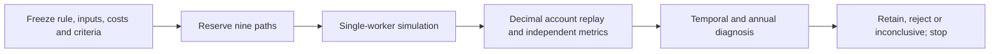

# RSI goal: frozen gate execution robustness

Authorized by the user's request to set a goal and continue developing toward the
best algorithm. This is a new bounded epoch; the previous sixteen-attempt gate
epoch and zero-financial-budget ETF audit remain closed. Canonical procedures:
[research development](../research-development.md), [mandate](../goals.md).

## Protocol fixed before outcomes

Hypothesis: the previously selected EMA/volatility-only gate's joint historical
growth/depth/duration advantage over EMA survives higher execution costs and one
additional observed session of signal delay. This tests a known uncertainty rather
than changing thresholds to improve an already viewed score.

Three rules: frozen EMA50/200 plus volatility-only gate, unchanged EMA50/200,
and entry-only buy-and-hold. Gate thresholds, staged five-close confirmations,
green/yellow/red caps and warmup match the prior price-peak ablation exactly;
no raw-price peak conditions. No fitting or parameter search.

Three execution contexts, each containing all three rules:

| Context | Adverse fill cost per side | Additional signal delay |
| --- | --- | --- |
| base | 5bp | zero |
| expensive | 25bp | zero |
| delayed | 25bp | one observed session for both dynamic rules |

Buy-and-hold's standing initial purchase remains at the first evaluation open;
there is no recurring signal to delay. Its expensive and delayed paths must match
exactly and are explicitly duplicate controls, not independent confirmations.
Dynamic targets are shifted on the complete warmup timeline before evaluation is
selected; execution prices and dividend dates never shift. The ordinary signal
already uses the preceding close; delayed uses the close two sessions earlier.
Daily sizing still uses current open/account equity. This is stale-signal stress,
not an outage simulator, delayed-fill queue, or empirical broker slippage estimate.

Use saved raw SPY rounded to cents, 2004 warmup, 2005-01-03–2025-12-31 (5283
sessions), USD300,000, whole nonnegative shares, nominal1x,99% sizing reserve,
USD1/net trade, zero cash interest, illustrative6% borrowing,50%/25% margin checks.
Keep the saved ex-date dividend-cash approximation and final marked holdings.
Payment dates, taxes, rights/calendar qualifications, native execution parity and
intraday mark completeness remain limitations. No new data or redistribution.

All history and the winning rule were previously viewed. No new holdout, training,
independent alpha claim or p-value. Full continuous accounts; annual and three
existing chronological blocks are diagnostics without reset/refit/liquidation.

Primary fixed claim: in **every** context, gate CAGR is at least EMA CAGR (1e-9
percentage-point tolerance), absolute maximum close drawdown is no worse (same
tolerance), longest observed peak-to-recovery/censor interval is no longer (zero
session tolerance), and at least one improves strictly beyond tolerance. Failure
rejects this joint robustness claim, not every possible use of the gate. Complete
and passing evidence retains it for independent validation only. Missing/invalid
cases make the verdict inconclusive. Buy-and-hold is an opportunity-cost reference,
not a requirement to dominate it. Report Sharpe (zero risk-free), Calmar, annual
metrics,21/63/126/252 rolling returns, worst1/5/21/63 windows, ES95, recovery and
censoring, cost, turnover, exposure and block differences without changing criteria.

## Bounds and acceptance

At most nine financial attempts total, single worker,900seconds aggregate child
wall time, no automatic retry/resume/refreeze. Failed paths consume slots and stop
new launches. Reserve before launch; exclusive output directory prevents replay.
Synthetic engineering tests are separate. Freeze source, executable and relevant
dependency/code hashes before any historical simulation. Preserve every artifact,
failure, log and previous study; no orders, services, imports, deployment or agents.

Completion: immutable plan, attempt accounting, all available ledger/metric/temporal
audits, artifact manifest, annual/block tables, concise retain/reject/inconclusive
decision and next evidence-acquisition step. Negative results complete the goal.
Implementation and final evidence are recorded below after execution.
