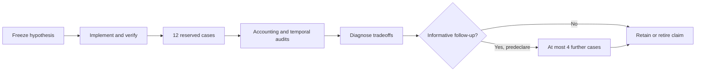
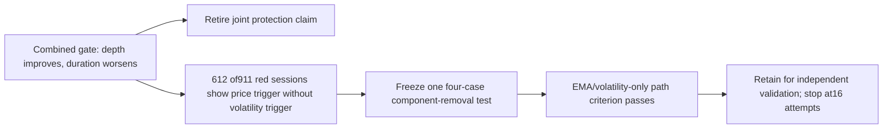

# Bounded recursive improvement epoch: causal risk gate

User authorized goal-backed execution on 2026-10-25. This is a new bounded epoch,
separate from the completed [prior research review](2026-10-25-recursive-research-review.md).
The [fixed study protocol](2026-10-25-risk-gate-bounded-test.md) owns the rules and
metrics. Its planning receipt remains historical; this record owns execution status.

Success means a reproducible decision about whether this fixed gate improves both
observed downside depth and duration versus its own base at both cost levels,
with growth sacrifice and censoring visible. Higher returns are not required for
research progress. Existing history is viewed development data, not an untouched
test. This is recursive experimental improvement, not trained reinforcement learning.

Hard limits: 16 new financial attempts across at most two studies; initial study
12 cases, optional follow-up at most four, failures counted. One financial worker,
900 seconds per study. No threshold search, automatic retry or budget transfer
from the closed prior program. A follow-up must resolve a new decision-relevant
question, be frozen before results and remain within the total bound. Stop on
integrity failure, exhausted budget or no useful follow-up.

Require gate boundary/causality/recovery tests, entry-only dividend/cash behavior,
guarded independent Decimal replay, saved control parity (trades exact; ledger
within 1e-7 USD), independent metrics and full offline checks. Preserve negatives
and failed attempts. No broker, orders, paid inputs, deployment, commit or publication.
Runtime reservations and baseline hashes: `.local/rsi-risk-gate/state.json`.

## Historical checkpoint: stopped, performance study incomplete

Implemented: fixed causal gate and state counters; target caps; entry-only holding;
guarded Decimal replay; temporal/event attribution; reserved single-worker runner.
The frozen plan is `research/plans/spy-risk-gate-development-v1.executable.json`,
SHA256 `5da2f7dccff311781ba3c60eb845706f1c8a9b1bb5f012f20ddc858bf03e94e7`.
First run exit 1: legacy daily-long ledger has 14 columns; the current ledger adds
`effective_target_leverage`. The whole-frame comparison rejected that schema.

One financial attempt failed; eleven reserved cases never started. No retry,
threshold tuning or follow-up occurred. Its Decimal replay passed 5,283 sessions
and 1,218 fills with maximum discrepancy 4.66e-10 USD; 88 independently recalculated
financial metrics and 30,933 scalar/window temporal checks passed before the stop.
All raw evidence, frozen plan, original failure and failed status remain preserved
in `reports/risk-gate/5da2f7dccff31178`.

Post-stop read-only analysis confirmed exact parsed trades and all fourteen
shared ledger fields within 1e-7 USD. The fifteenth field is explicitly checked
as constant 1x, rather than silently discarding unknown columns. Regression checks
reject arbitrary schema changes, changed account values, target values and trades.

A second read-only check of the saved EMA reference exposed rolling variance
residue: a zero-return cash window after volatile history displayed Sharpe 0.
Temporal-v1.2 recomputes variance separately for each window, making such Sharpe
undefined. A dedicated regression covers 63/252-session flat windows. Old reports
and the failed frozen plan retain their original identities; the repaired code
intentionally fails the old plan's code-identity preflight.

Validation: 188 tests, documentation metadata/links and dependency checks pass.
The [browser checkpoint](http://127.0.0.1:8765/risk-gate/20261025-checkpoint-v2/index.html)
shows verified historical controls, not gated outcomes; year filtering was checked
in the real browser. Read-only review recalculated 176 financial metrics and
61,866 scalar/window temporal comparisons across the two references. A failed
initial report build is retained beside its versioned replacement.

Decision: retain the implementation for further engineering review; do not retain
or retire the gate's trading hypothesis based on an unrun comparison. No gate
performance, literal-hold performance, cost robustness or RL advantage is established.
The research objective remains incomplete. Re-entry needs a separately frozen
repair plan that explicitly resolves this epoch's stop rule and budget accounting;
remaining slots are not automatically reused. No new financial work is scheduled.

See [checkpoint receipt](evidence/2026-10-25-rsi-risk-gate-checkpoint.json).

## Final bounded epoch review

Current outcome: **16 financial attempts across two studies, budget exhausted**.
Fourteen processes completed; the two original control processes remain failed in
process history. Their saved account evidence was qualified through fresh guarded
Decimal replay and independent metric checks before subsequent comparisons. No
failed financial case was rerun and no extra attempt was hidden as recovery.

The separately frozen recovery addenda are
`research/plans/spy-risk-gate-development-v1.recovery.json` and
`research/plans/spy-risk-gate-development-v1.recovery2.json`. They resolved
representation-only checker stops, preserved initial failure evidence and allowed
only never-started cases. Original first-study deadline19:01:50.145287UTC was not
reset; all twelve attempts finished by18:58:02.466100UTC. Trading thresholds and
accounting rules did not change. The EMA wrapper's nominal-budget diagnostic was
restored to legacy semantics; the source failed ledger remains raw. Its explicitly
derived legacy-budget comparison changes only the unitless diagnostic, not money,
positions or trades. Raw monetary fields agree within1e-7USD and parsed fills agree
exactly for both five-bp controls. No broker/native-engine parity is inferred.

The follow-up was declared in
`research/plans/spy-risk-gate-price-peak-ablation-v1.json` before its four results.
It removes all raw-price drawdown entry/recovery conditions, keeping EMA, volatility
thresholds, five-stage confirmations, costs and financial accounting fixed. It
tests an entire component, not entry versus recovery separately. Its one-worker
900-second cap was respected (6.81seconds actual execution). No threshold sweep.

| Five-bp rule | CAGR | Max drawdown | Longest observed peak-to-recovery intervals |
| --- | ---: | ---: | ---: |
| Daily full target | 10.473% | −54.815% | 1224 |
| Literal buy-once holding, dividend cash | 9.161% | −51.680% | 1243 |
| EMA | 8.013% | −29.062% | 531 |
| Combined gate on EMA | 7.140% | −18.089% | 1384 |
| EMA/volatility-only gate on EMA | 8.734% | −17.770% | 513 |
| EMA/volatility-only gate on daily full target | 9.693% | −21.826% | 567 |

At10bp, EMA/volatility-only on EMA records8.659%CAGR,−17.976%drawdown and514
intervals versus EMA7.948%,−29.099%and531. Both component-removal/base pairs pass
the predeclared joint depth/duration test at both costs. Growth sacrifice remains
explicit: the standalone daily-long treatment gains protection while returning
less than daily full exposure. Fixed half exposure is a comparison, not exact risk
matching; analytical zero-interest cash earns zero with undefined Sharpe/Calmar.

Duration includes the recovery interval;513 intervals mean512 strictly underwater
observations in that episode. Deepest and longest episodes differ. The browser
contains full rolling returns/Sharpe, worst windows, ES95, censoring, three continuous
blocks, annual metrics, executed color timelines, warnings and5/21/63-session red
entry/exit net-return gaps. Combined warnings:3of13 were followed by the specified
5%raw-price event;10were not. This is not all-drop recall or independent-sample
predictive accuracy. EMA-off warnings receive no invented avoided-loss credit.

Decision: reject the combined configuration's stated joint protective-path claim.
Retain the EMA/volatility variant as a development candidate for a separately
designed independent evaluation; no investment or paper/live promotion follows.
No untouched financial alpha, annual doubling or trained-RL advantage is established.
All sixteen paths are on already-viewed2005–2025 data. Further financial work in
this epoch stops at its exhausted bound.

[Final browser review](http://127.0.0.1:8765/risk-gate/20261025-epoch-v1/index.html)
and [final receipt](evidence/2026-10-25-rsi-risk-gate-completion.json) own the saved
outputs and acceptance audit. The old checkpoint/report failure remain historical.
Final audit replays every saved account (maximum discrepancy1.98e-9USD), checks
1,408 annual/overall financial metrics,494,928scalar/window temporal comparisons,
all drawdown episode dates/durations/censoring/tails and1,456warning/event fields.

A final supervisor review found that an injected timeout could leave a terminal
failed worker labeled running. The two affected supervisors now mark that active
attempt failed and count it before stopping. Synthetic failure-injection checks
confirm no next launch. Execution-time versions are preserved in ignored
`.local/rsi-risk-gate/code-at-execution/`; no financial result was rerun or rewritten.

## Parallel idea exploration (no new simulations)

The user's later request launched three agents. Their completed source-screening
briefs are proposals, not additional trials or competing roadmaps:

- [Risk mechanisms](2026-10-25-rsi-risk-mechanisms.md): distinguish price-peak entry
  versus recovery, and continuous capped volatility sizing.
- [Diversification](2026-10-25-rsi-diversification-ideas.md): audit a small fixed ETF
  universe/shared-cash account before allocation research; futures need more input
  and contract modeling. Bundled examples have concrete pre-inception flags.
- [Frontier and research selection](2026-10-25-rsi-frontier-and-selection.md): SPY
  intraday momentum, multi-asset trend, Qlib and RD-Agent priors; benchmark, leverage,
  data rights and costs must align. Public backtests are not a universal SOTA ranking.

Keep the existing scoring contract. A future research decision should resolve a
new uncertainty or input prerequisite; another threshold search on this history
does not establish novelty or an untouched test. No new research budget or
scheduled financial loop was created by these briefings.

## Completion audit

`make check` exit0:195tests, documentation metadata/local links and dependency
consistency passed. All187source-run artifacts and76browser artifacts match their
manifests. All four frozen execution plans now have complete declared code, method
and dependency snapshots, with17/22/24/24files respectively verified against their
recorded SHA256 identities. Earlier versions were reconstructed from retained edits
only when their bytes matched the already-frozen hash. The current supervisors add
only the separately tested terminal-timeout bookkeeping repair. This improves
reproducibility without changing or rerunning any financial outcome.

The three requested research agents completed their briefs without new financial
cases, market-data downloads, installs or broker operations. Goal acceptance covers
this bounded historical research epoch and its retain/retire decisions; independent
financial validation and operational readiness remain future work. The earlier
ten-hour review's35artifacts were also reverified; its eight-case tradeoffs and
cost-sensitive Calmar ranking remain historical. The former reminder was checked
for removal and was already absent; no replacement automation was created.
