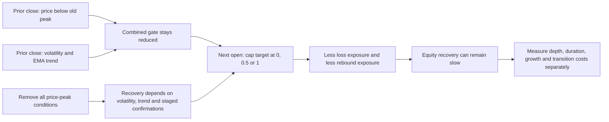

# Risk-gate mechanisms: what to retain, retire and investigate

This is a source-screening and saved-evidence diagnosis for the user-requested
parallel recursive-improvement review. It does not authorize or execute another
financial study. The [epoch record](2026-10-25-rsi-risk-gate-epoch.md) owns execution
history; the [fixed protocol](2026-10-25-risk-gate-bounded-test.md) owns the initial
rules. Current runtime state records **16 financial attempts, two failed process
exits, and no remaining epoch budget**. Root review is qualifying the saved control
evidence; the failures remain failures in the process history.

## Finding

Removing every expanding-price-peak condition produced a substantially different
recovery path on the same viewed SPY history. This supports a narrow development
finding: **the combined gate's peak dependency was costly in this implementation**.
It does not establish that volatility timing predicts profitable opportunities,
that five recovery confirmations are optimal, or that the ablated rule will beat
EMA on independent observations.

The arrows describe rule mechanics and plausible transmission. They are not a
causal estimate of market predictability.

## Local evidence inspected

Read the current state, frozen ablation plan, implementation and saved artifacts.
Verified all **113** artifact hashes in `reports/risk-gate/b6b57fe7077dff3b` and
all **46** in `reports/risk-gate/449096da9fbe1385`; no mismatches were found.
No simulator, study entrypoint, broker, import or service was run in this lane.

All rows below use viewed 2005-01-03–2025-12-31 development history, 5,283 sessions,
USD 300,000 initial equity, next-open execution, whole shares, cash dividends and
zero cash interest. Costs are adverse basis points **per side**, plus USD 1 per
actual trade. These are saved local results, not results from the public papers.

| Rule | Cost | CAGR | Max drawdown | Longest peak-to-recovery/observed-end interval |
| --- | ---: | ---: | ---: | ---: |
| EMA | 5 bp | 8.013% | −29.062% | 531 sessions |
| Combined gate on EMA | 5 bp | 7.140% | −18.089% | 1,384 sessions |
| Price-peak ablation on EMA | 5 bp | 8.734% | −17.770% | 513 sessions |
| EMA | 10 bp | 7.948% | −29.099% | 531 sessions |
| Combined gate on EMA | 10 bp | 7.073% | −18.295% | 1,384 sessions |
| Price-peak ablation on EMA | 10 bp | 8.659% | −17.976% | 514 sessions |

The 5 bp EMA reference is the saved control qualified by the coordinator at
`reports/risk-gate/97e9d442a8b83201/5_ema`; its score and temporal summaries were
also read directly. All rows were read from case `scores.json` and `temporal.json`.
The source/input identity is in the
[ablation plan](../../research/plans/spy-risk-gate-price-peak-ablation-v1.json).

**Duration terminology matters:** saved `duration_sessions` includes the recovery
interval. The combined EMA episode has 1,384 elapsed observed intervals and 1,383
strictly underwater observations; the 5 bp ablation has 513 and 512 respectively.
Do not mix these counts or call 513 days a guarantee of eventual recovery.

Saved 5 bp combined-EMA timeline: 3,207 green, 1,165 yellow and 911 red sessions.
Its longest equity recovery spans 2007-10-09 to 2013-04-10. Ablated EMA: 4,036 green,
1,036 yellow and 211 red; its longest spans 2022-01-03 to 2024-01-19. These are color
dwell counts, **not counts of invested sessions**: EMA can already be in cash.
The frozen ablation motivation records 612 red sessions with the price drawdown
trigger and without the contemporaneous volatility trigger. That count alone
does not allocate every red session to a unique cause because recovery memory
also affects color.

The ablated daily-long rule also improves on the combined daily-long rule, but
trades a different growth/protection balance: 5 bp CAGR 9.693%, drawdown −21.826%,
duration 567; 10 bp 9.631%, −21.941%, 571. This prevents interpreting the EMA result
as a universal property independent of the underlying strategy.

## What the ablation identifies—and leaves unresolved

The intervention sets the drawdown input to zero for the same recurrence; it
removes price-peak conditions in **entry and recovery together**. EMA50/200,
20-session sample volatility, 40%/25% warning thresholds, 35%/20% recovery bands,
five staged confirmation closes and next-open target caps are retained.
Consequently it identifies the path effect of removing that entire component
under this saved market path and account model. It does not separately identify
red-entry versus yellow-entry versus recovery constraints.

The source price peak begins at the first saved 2004 close, uses raw prices and
excludes dividend reinvestment. Account equity includes dividend cash. A rule
requiring raw price to recover toward an old peak can remain defensive while an
investor's total wealth recovers. The ablation changes neither data quality nor
economic truth; it removes this particular dependence. A rolling or dividend-
adjusted peak would be another hypothesis, not a retrospective repair to the
completed test.

For gate-on-EMA, the EMA base already sets exposure to zero in a negative trend.
Yellow caused solely by that same trend therefore adds no immediate protection.
Its confirmation state can still reduce exposure after the base switches on.
Count warnings, actionable reductions and actual trades separately; a correct
warning while already in cash must not receive invented avoided-loss credit.

Independent Decimal accounting audits in the inspected cases report passing
reconciliation. These receipts support arithmetic consistency with the specified
account model. This lane checked receipt contents and artifact hashes, not an
independently rewritten engine. Ledger correctness does not validate raw-price
availability, historical execution realism, cash opportunity cost, taxes, market
impact, all feasible alternative policies or statistical generalization.

## Primary-source findings and transfer limits

Reviewed 2026-10-25. Sources are author/institution-hosted papers or author research
pages; no third-party performance repository was used as evidence. No code or
market dataset was downloaded or adopted.

| Source | Public finding and what we can reuse | Transfer limit |
| --- | --- | --- |
| Moreira and Muir, *Volatility Managed Portfolios*, author manuscript dated 2016-10-25, [Yale PDF](https://law.yale.edu/sites/default/files/area/workshop/leo/leo17_moreira.pdf), pp. 1–4 | Lagged realized variance can inform exposure sizing; the paper reports improved factor Sharpe/alpha and discusses gradual restoration as volatility shocks fade. Reuse the separation of risk prediction from expected-return prediction. | Its monthly inverse-variance scaling differs from daily capped traffic lights. Full-sample normalization, factor returns and portfolio combinations are not our executable SPY result. Its reported alpha is not ours. |
| Cederburg, O'Doherty, Wang and Yan, *On the Performance of Volatility-Managed Portfolios*, JFE 2020, [author-hosted published PDF](https://www.lehigh.edu/~xuy219/research/COWY.pdf), §4.3/Table 5 | Real-time combinations can underperform despite positive in-sample spanning alpha; their market comparison reports Sharpe 0.42 versus 0.46. Reuse implementable timing, stable comparisons and explicit estimation uncertainty. | This does not disprove every fixed volatility cap. Their factor-combination estimation problem is distinct from ours. Neither set of public results substitutes for protected local evaluation. |
| Kaminski and Lo, *When Do Stop-Loss Rules Stop Losses?*, JFM 2014, [author publication entry](https://alo.mit.edu/topic/risk-management-and-systemic-risk/page/2/) and [MIT manuscript record](https://dspace.mit.edu/entities/publication/bb69ca4b-0cdc-487f-831d-63b2e84fafee) | Studies marginal value added/subtracted by stop policies; certain policies at longer sampling intervals improved expected return and reduced volatility in index-futures evidence. Reuse paired overlay-versus-base evaluation. | Not a universal stop-loss endorsement. The author-linked PDF did not expose readable content and the MIT PDF returned HTTP 429 in this review; only verified publication/abstract-level findings are used. |
| Daniel and Moskowitz, *Momentum Crashes*, [author institutional research page](https://business.columbia.edu/faculty/research/momentum-crashes) | Reports momentum losses associated with rebounds after declines in high-volatility states. Reuse the requirement to inspect rebound opportunities rather than classify every high-volatility interval as unattractive. | Its cross-sectional winners-minus-losers portfolio and short-leg economics differ from long/cash SPY. It does not establish our gate's re-entry timing or predict SPY rebounds. |
| Hurst, Ooi and Pedersen, *A Century of Evidence on Trend-Following Investing*, 2017, [author-firm paper](https://www.aqr.com/-/media/AQR/Documents/Insights/Journal-Article/AQR-JPM-Fall-2017.pdf), pp. 2–4 | Studies 67 markets, monthly 1/3/12-month signals and risk scaling over 1880–2016; delayed execution weakens especially short-horizon results. Reuse latency and broad-regime diagnostics. | This is diversified long/short futures/forwards evidence, not a SPY-only gate replication. Historical cost estimates are uncertain and the paper notes omitted roll costs. Data and publication access do not grant unrestricted code/data reuse. |

These findings conflict in useful ways: risk forecasting can help sizing, but
implementable portfolio construction and re-entry determine whether the benefit
survives. Nothing here establishes the user's annual-doubling aspiration.

## Two falsifiable next ideas—proposals only

The current epoch is exhausted. Neither idea is a new reservation, a ready-to-run
plan, or permission to bypass the original stop condition. Each needs a separately
authorized, frozen protocol, reviewed code and explicit attempt limit. Keep every
2005–2025 result labeled development; new symbols or relabeled year blocks do not
make observations independent.

**1. Is red-exit confirmation delaying useful risk restoration?** Compare the
frozen ablated gate against one change: exit red to yellow on the first qualifying
close with volatility below 35%, instead of five consecutive closes. Keep red
entry at 40%, yellow warning at 25%, yellow-to-green bands and five closes, EMA,
caps, fills and account model unchanged. This is a prospective mechanism ablation,
not a recommendation to shorten the delay. Worsening remains immediate.

Use the same frozen local OHLC/dividend data for implementation diagnostics only;
no paid inputs. Evaluate separately at 5/10 bp per side plus USD 1 per trade and
zero cash interest. Controls: original ablated rule, unchanged EMA, daily-long,
literal entry-only and fixed-half holdings. Reuse verified same-window controls
only where account/rule identities match. Primary prediction: earlier red exit
reduces the longest recovery interval without worsening maximum drawdown versus
the frozen ablation, at both cost levels. Require at least one strict improvement;
reject that prediction if either dimension worsens in either cost context.

Predeclare red-exit 5/21/63-session net account return gaps, actual exposure and
turnover, repeated red re-entry count, worst 1/5/21/63-session losses and historical
ES95 as diagnostics. Event returns begin at the prior account close so the
transition overnight gap is retained; incomplete horizons stay censored.
Overlapping episodes are not independent trials. A recovery gain purchased by a
deeper path is recorded as a tradeoff, not quietly promoted. Afterwards freeze
the surviving rule for genuinely later observation; do not choose a confirmation
length from a sweep.

**2. Does a continuous cap improve on color discontinuities?** Compare ablated
gate-on-EMA with a single prespecified cap `min(1, 0.20 / sigma20)` while the same
EMA base is positive, and zero otherwise; use zero if volatility is zero or not
finite. The 20% budget is a proposed round design constant, not an optimized or
approved investment risk limit. Use lagged sample volatility exactly as the
existing rule, apply the cap once at the next open, retain 99% sizing reserve,
whole shares and every common ledger assumption. This is inverse **volatility**,
not reproduction of Moreira–Muir's inverse **variance** strategy.

Inputs, controls and cost contexts match proposal 1; fixed half is a simple
lower-exposure reference, not an exact risk-matched or exposure-matched portfolio.
Primary prediction: continuous scaling lowers longest recovery duration without
worsening maximum drawdown versus ablated EMA at both costs, strict improvement
in at least one dimension. Reject if the joint condition fails at either cost.
Report CAGR/ending wealth, 21/63/126/252-session return distributions, 63/252-session
Sharpe with undefined flat windows preserved, ES95, turnover and cap/exposure
distributions. Do not normalize weights with the full evaluation sample or add
leverage to match realized risk after seeing results. A smooth rule may increase
small rebalances and retain exposure during a sharp crash; those are testable
costs, not reasons to modify the rule after the fact.

## Retire rather than tune

Retire the **fixed combined gate's joint depth-and-duration improvement claim**
for this history/cost model: duration is worse despite smaller drawdown. Preserve
the implementation and negative evidence as controls. Retire any interpretation
of green as a probability of gain or red as guaranteed protection. Preserve the
ablated EMA result as a candidate worth independent validation, not a selected
investment strategy. No further threshold/peak-window/cap search belongs to this
epoch. If new evaluation cannot be protected, the next useful work is evidence
quality and prospective observation design rather than more favorable historical
rankings.
