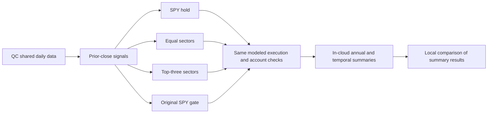

# Bounded hosted sector momentum comparison

User authorized the four fixed comparisons following the
[shared-strategy screening](2026-10-25-quantconnect-strategy-intake.md).
[Protocol](../../research/plans/sector-momentum-v1.json) was frozen before launches;
[source](../../research/quantconnect/sector_comparison.py) is a project-owned
implementation of the hypothesis, not an exact upstream code reproduction.
[Research procedure](../research-development.md) owns execution/evidence policy.

## Frozen design

- USD300,000; 2017-01-03 through 2025-12-31; ten fixed sector ETFs:
  XLB/XLE/XLF/XLI/XLK/XLP/XLRE/XLU/XLV/XLY. XLRE requires a full trailing year
  before evaluation; XLC is excluded rather than introduced later. This is a
  historically changing sector classification, not ten immutable economic baskets.
  The shorter window omits 2008; all inspected history is development evidence.
- SPY entry-only buy/hold; monthly ten-sector equal weight; monthly top-three
  sectors ranked by 252-session total-return change, equal weights; original
  combined green/yellow/red SPY gate with daily resizing and unchanged 2004 seed.
  No absolute momentum filter, skip, extra overlay or optimized variant.
- Same raw daily subscriptions and native corporate-action accounting; momentum
  alone requests normalized total-return history for its ranking. Signals use
  completed closes; whole-share MOO orders use prior closes and98% target gross.
  USD1/order plus configured5bp constant slippage. Sales are submitted first.
- Original attempt used simulated IB margin-account plumbing at leverage1.
  The matched repaired runs use leverage2 buying-power credit for pending sales.
  Every daily close must have nonnegative cash, long positions and gross<=1;
  no borrowing intent, financing, interest or tax model. This changes the earlier
  cash-account/99% SPY protocol, so all four controls are freshly evaluated here.
- Original six-attempt budget amended to eight before exhaustion after a pending-sale
  rejection, so all four cases can use identical repaired execution. Four selected
  cases maximum;45-minute execution checkpoint. Preserve every failure
  or duplicate. No paid data, upgrades, broker connection or deployment.

## Metric definitions

All custom metrics use closing account NAV including initial capital and costs.
Sharpe is arithmetic daily mean divided by sample standard deviation times
sqrt252, zero risk-free rate. Cash/zero-volatility ratios are undefined.
Full Calmar is calendar-time CAGR divided by absolute maximum drawdown;
annual Calmar is that year's simple return divided by within-year maximum
absolute drawdown. Annual peaks reset to previous year-end NAV.

Underwater fraction counts closes below the running peak, not below starting
capital. Annual summaries include both year-reset underwater measures and
`global_uw` fraction against the full-history high-water mark. Longest underwater
run counts consecutive strictly underwater closes; calendar duration runs from
its preceding peak through the last underwater close, excluding the recovery day.
These duration measures differ from `reporting.temporal`'s recovery-inclusive
`duration_sessions`. An unrecovered ending episode is right-censored, not a
predicted recovery time. Full-period underwater totals cannot be inferred by
summing year-reset values.

The pure summary helper is tested against the existing temporal contract on
synthetic NAV. Daily NAV and market data stay inside QC; only summary metrics
are captured through the rendered results/log interface. This follows the
[platform data policy](https://www.quantconnect.com/docs/v2/cloud-platform/security-and-ip)
and the free tier's log quota. Summary algebra checks do not establish an
independent daily account, price-history, fill or corporate-action audit.

## Execution repair and status

[Technical-only protocol amendment](../../research/plans/sector-momentum-v1-execution-repair.json):
the first momentum case stopped on 2017-02-01 when an XLF MOO purchase was checked
before the corresponding pending sale freed buying power. Submitting sales first
was insufficient at the original credit limit. The repair changes only the
simulated buying-power limit to2; actual98% targets, fees, signals, fill timing,
and closing cash/gross checks are unchanged. All four cases are rerun with this
same setting. Existing hold and equal-weight controls were reproduced exactly
under the repaired setting, including ending NAV and custom summaries.

The original protocol and source snapshots remain preserved. This amendment is
an execution fix within the requested comparison, not a strategy search. It was
recorded before repaired runs and before the original cap was exhausted; the
original six-attempt limit was not silently treated as eight. No further financial
attempts follow the revised cap, even on another failure.

Completed on 2026-10-26. The first SPY launch completed before the standalone editor showed
its result. A subsequent project-editor launch produced a duplicate SPY control;
both IDs count against the six-attempt budget. The duplicate is retained and
excluded from candidate selection. No parameter was changed in response to it.
The coordinator ledger is `.local/sector-momentum-v1/attempts.json`.

Offline checks before launch: six focused tests passed, including unchanged
GateCore identity, summary identity and existing gate-state parity tests.

## Final selected results

All four selected repaired cases completed on Lean2.5.0.0.18205 with2,262 common
sessions, matching calendar hash, zero rejected orders, positive minimum closing
cash and maximum closing gross below99%. Counts of397dividend and10split events
are **subscription-wide events across all eleven ETFs**, including unheld assets
and split notifications; they are not cash distributions received or independently
audited completed split events. Native full fill/corporate-action parity remains
unverified.

| Case | Hosted backtest ID | CAGR | Max DD | Sharpe | Calmar | Longest underwater sessions / calendar days |
| --- | --- | --- | --- | --- | --- | --- |
| SPY hold | `6c8508992e895c1f2d74135fc85ee4a3` | 13.950% | -31.942% | 0.846 | 0.437 | 488 / 708 |
| Equal sectors | `864ed9405e79219525ce1681ec2f18b7` | 11.569% | -36.164% | 0.730 | 0.320 | 313 / 456 |
| Momentum | `50edaf711c54af28182baf346fdbbb2c` | 13.630% | -29.682% | 0.798 | 0.459 | 195 / 287 |
| Original SPY gate | `5101f436af85b1d043661c07153305a9` | 9.596% | -19.383% | 0.843 | 0.495 | 593 / 862 |

Momentum improved CAGR by2.06percentage points versus equal weight and reduced
maximum drawdown by6.48points. Versus SPY, its CAGR was0.32points lower and
maximum drawdown2.26points smaller. Momentum had more total underwater closes
(87.71% versus84.31% for SPY), despite shorter worst runs. The gate's best Calmar
and shallowest loss came with the slowest growth and longest underwater run.
All four were below their own previous peak at evaluation end; this censoring
flag describes the final episode, not necessarily the longest one.

| Year | SPY return | Equal-sector return | Momentum return | Gate return |
| --- | --- | --- | --- | --- |
| 2017 | 20.38% | 17.17% | 13.95% | 20.34% |
| 2018 | -4.30% | -5.84% | -5.24% | -9.68% |
| 2019 | 29.51% | 27.33% | 23.65% | 23.99% |
| 2020 | 16.96% | 8.67% | 20.21% | 7.06% |
| 2021 | 26.83% | 30.41% | 18.61% | 28.10% |
| 2022 | -17.07% | -7.34% | 13.85% | -17.07% |
| 2023 | 23.77% | 13.43% | 18.35% | 9.75% |
| 2024 | 22.74% | 14.27% | 15.29% | 24.32% |
| 2025 | 16.21% | 12.05% | 6.81% | 9.10% |

The [browser report](http://127.0.0.1:8765/sector-momentum-v1/index.html) has all36
annual rows with return, drawdown, Sharpe, Calmar and underwater measures, six
interactive views, annual CSV and summary/provenance JSON. No raw source prices
or daily NAV were exported. The existing local server was reused; no MLflow
import, new service, commit or deployment was performed.

## Reconciliation and closure

Eight actual paths: duplicate initial SPY IDs `9f5bb41cff66d8726920b32053cf3adb`
and `5e49aced35a1f3426b58632fea9c996c`; superseded equal-weight
`03ce32f86470fb59567f97c1593974cd`; stopped momentum
`a24c3aa701afef2ca7073d9731dead31`; then the four selected cases above.
The final selected sources differ only in `MODE`. Both repaired control summaries
exactly match their superseded versions. Revised budget is exhausted and closed;
no further financial trials are authorized by this record.

Builder: [saved-summary comparison](../../scripts/build_sector_comparison.py).
It checks four-case/nine-year completeness, annual/end NAV compounding within
USD0.01, calendar matching, return-moment aggregation of Sharpe, calendar-time
CAGR, Calmar, carried-peak underwater totals, execution guards, source hashes and
attempt counts. It does not rerun strategies. These are internal summary
consistency checks, not independent account or external-calendar qualification.
[Receipt](evidence/2026-10-25-sector-momentum-comparison.json) records source
identities, attempts and limitations; generated artifact hashes live in
`.local/performance/sector-momentum-v1/manifest.json`.

Validation: `make check` passed282offline tests; browser checks exercised all six
selectors, each with36bars and9matrix rows, plus36detail rows. Screenshot and UI
check evidence are retained in `.local/sector-momentum-v1/`. Independent daily
ledger/fill/corporate-action/slippage audit, broader stress windows and unseen
validation remain unverified. No independent alpha, next-year performance, annual
doubling or hard drawdown bound was established.
