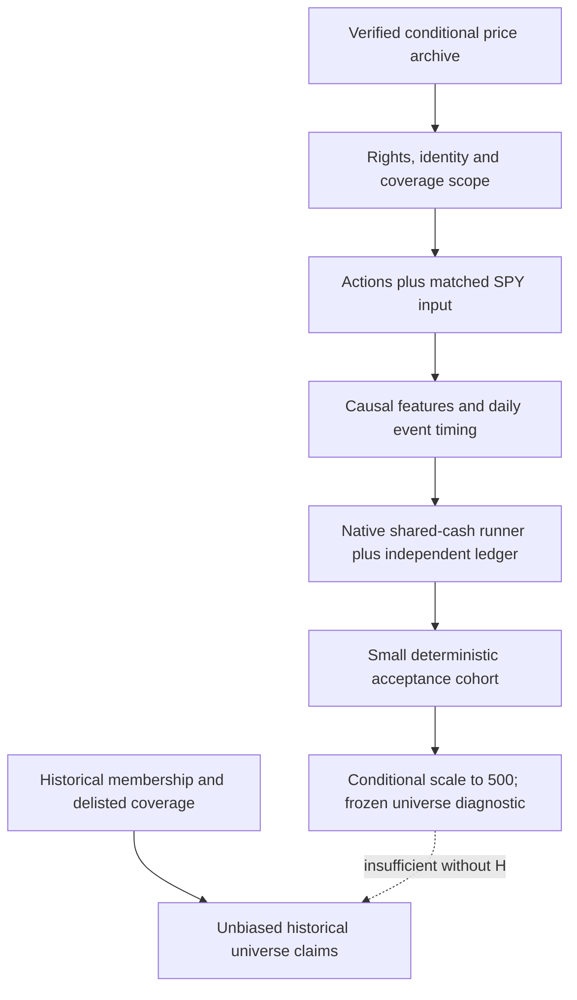

# Current-stock backtesting readiness and bounded repair plan

Review completed; repair packets below are proposed, not executed. The user asked
ask-infra to review blockers and prioritize a bounded plan. This record supports
M1/data qualification, not a replacement portfolio roadmap or research mandate.
Canonical contracts: [data library](../data-library.md), [architecture](../architecture.md),
[research workflow](../research-development.md), [roadmap](../roadmap.md).

## Verdict and observed evidence

**Blocked for financially reliable 500-stock historical comparisons.** Suitable
for conditional price inspection and infrastructure fixtures. A smaller explicitly
survivor-selected cohort can become eligible after the relevant gates pass;
historical membership is a separate prerequisite for unbiased index-universe claims.

Read-only audit of `data/manifests/spy-equities-2016-2025-v1.json` found all 1,635
artifact hashes unchanged. Manifest SHA-256:
`95602e7332a5cb9ac34e6334f1e9c624cfbd62d8f8b66d40e309034a685e6adf`.
The archive records 1,212,539 bars: 459 full-window instruments, 41 partial and
three unavailable out of 503 requested. This review rechecked file identity and
manifest coverage; the prior acquisition receipt owns the all-bar native read-back
proof. No new full engine replay or financial calculation was performed.

Other observed evidence:

- Corporate actions are `not_acquired`, financial eligibility is false, and
  source-use/redistribution scope is unqualified in the frozen manifest.
- SPY is absent from this equity-holdings catalog. Earlier SPY results use a
  different source/period and are not automatically matched benchmark evidence.
- `research/us_stock_library.py` assigns each daily bar next New York midnight;
  actual publication time is unknown. Source session labels survive separately.
- `research/native_multi_asset.py` rejects splits and imports a fixed three-ETF
  universe. `research/multi_asset_comparison.py` binds its original bundle, dates
  and gates. Reusing it unchanged for 500 stocks is unsupported; preserve its
  blocked historical experiment rather than changing its controls.
- The research calendar has scoped rules/fixture checks, not per-security venue
  certification. Structural session coverage does not validate prices/actions.

## Dependency path

## Gaps in priority order

| Priority / status | Requirement and consequence | Owner / calling workflow | Completion evidence |
| --- | --- | --- | --- |
| P0 blocked | Source-use scope: download success does not establish permitted research/storage/output uses | ask-infra / research-intake | Dated evidence for named personal/local use; unknown required permission keeps that use blocked; publication separately qualified |
| P0 blocked | Identity/actions: raw price jumps can corrupt features, positions, cash and NAV; current as-of ticker mapping does not prove historical identity continuity | ask-infra + ask-quant / infra-change, acquisition, data-audit | Effective identity map; splits/dividends and required dates reconciled; ambiguous mergers/spinoffs/rights halted or scoped out explicitly |
| P0 unverified | Timing: day-D close/high/low cannot be used at day-D open; midnight label is neither exchange close nor executable quote | ask-algo / infra-change | Separate session, feature-known-at, decision, order and fill times; next-session execution tests across DST, weekends and early closes; volume/price conventions explicit |
| P0 blocked | General stock accounting/runner: existing ETF seam rejects splits and is fixed-universe | ask-infra + ask-algo + ask-quant / infra-change | Native public-interface extension; shared cash; split quantity/cost basis/open-order behavior; dividend receivable/pay cash; independent cent-level cash/NAV reconciliation; unsupported actions fail closed |
| P1 blocked | Matched SPY control: missing from catalog; current reports differ in source/period | ask-quant / acquisition and data-audit | Same declared window, provider/feed/action/timing/cost/cash policy and frozen hashes; any provider difference explicitly qualified |
| P1 conditional | Missing histories/warm-up: 41 partial and three unavailable; full-window survivors are another selected subset | ask-quant + ask-infra / data-audit | Per-date availability mask, trailing warm-up and eligibility; missing is unknown, no pre-history fills; denominators/exclusions visible; no inferred IPO dates |
| P1 unverified | Execution realism and report comparability: daily bars cannot prove intraday fills/capacity; custom metrics are not automatically native metrics | ask-algo + ask-risk / infra-change and robust-evaluation | Conservative next-open sizing/fills, explicit costs and stress assumptions, participation policy or capacity-unknown label; reconciled annual/temporal metrics and MLflow identities |
| P2 blocked for broad claims | Historical universe: current 2026 constituents selected using future survival relative to 2016–2025 | ask-quant / source intake and data-audit | Effective/known-at memberships, ticker changes, delistings/terminal values, security types; absent evidence limits claims to retrospective fixed-cohort diagnostics |
| P2 partial | Reproducibility/recovery: source and catalog proofs exist; generic interrupted ingest/restore and scalable runner evidence incomplete | ask-infra + ask-ml-infra / infra-change, local-ops | Disposable corruption/interruption/restore checks, immutable inputs, complete code/environment/config identities, duplicate-safe reporting/import |

Storage servers, intraday feeds, GPUs, live brokers, margin/options and a new
scheduler are not prerequisites for the proposed daily offline acceptance cohort.
A missing industry/sector history blocks a sector-selection study, not this initial
accounting/timing qualification. Existing reports/MLflow should be extended only
where the comparison contract requires it.

## Proposed bounded packets

These limits are prospective ceilings, not permission to execute now or reset any
prior failed experiment/acquisition budget. Each packet returns a receipt before
progression; stop at a failed material gate. No optimization or alpha target.

### 1. Offline contract and acceptance specification — first

- One implementation packet, at most four engineering hours before checkpoint;
  zero HTTP requests and zero historical financial paths.
- Freeze a diagnostic cohort of AAPL, MSFT, JPM, BRK.B and ABNB plus SPY control.
  Selection tests engineering cases, not expected returns. Saved observations show
  ABNB starts 2020-12-10; this does not certify its listing date. Four others have
  full-window coverage. Use 2016 as initial warm-up, evaluate 2017–2025 only after
  qualification; partial histories enter only after sufficient prior observations.
- Deliver input/identity/action schema, timestamp trace, study-specific gate
  validator, eligibility masks and expected outputs. Require nonfinite, changed
  hash, missing action, unsupported identity and insufficient warm-up to reject.
- Preserve the raw archive; publish a new qualified manifest only after later gates.
  Completion of this packet is a specification/validator milestone, not data eligibility.

### 2. Free source-use/action/benchmark qualification — second

- First inspect existing local permission/action evidence and collector support.
  Then, only under an explicit execution scope, at most **20 aggregate HTTP
  attempts**, **40 MB**, **15 minutes**, **one worker**, including failures/pages;
  six named instruments only. No automatic retry, paid source or provider switch.
- This is a qualification probe, not a promise that full event histories fit the
  cap. Stop with exact missing fields if the source/entitlement/collector cannot
  answer it. Do not expand to all 500 under this packet.
- Return source-use finding, action/identity availability and coverage, complete
  candidate SPY/control inputs where feasible, original bytes/hashes and event
  cross-checks. Independently sourced event anchors should include a split and a
  dividend; actual source availability/permission must be demonstrated.
- Missing required known-at/payment fields must remain unknown, narrow the claim
  or block it; never invent event dates. Source failure is useful negative evidence.

### 3. Accounting and timing seam proof — third

- At most four engineering hours before checkpoint; **12 predeclared tiny
  synthetic scenario runs**, no historical return comparisons or network calls.
- Cover split continuity and open-order policy, dividend entitlement versus cash
  payment (including sell after ex-date), missing/unsupported actions, identity
  changes, partial history/warm-up, order affordability/rounding, fees, timestamp
  causality/DST/early close, corruption/duplicate and restore/restart boundaries.
  Group assertions into the 12 fixtures before running; no ID rotation on failure.
- Reuse public Nautilus interfaces and existing receivable/reconciliation helpers
  where compatible, with independent expected quantities/cash/NAV. Split arithmetic
  cannot be emulated by profitable trades or double-adjusted price/cash credits.
- Require cent-level cash/NAV agreement, exact expected share quantities under the
  declared fraction policy, no negative cash/unsupported state, deterministic
  same-input results and unchanged prior artifacts. Normal regression checks are
  separate from the 12 scenario runs and remain offline/order-free.

### 4. Acceptance cohort, then a scale decision — fourth

- Only after qualification and seam gates pass: a fresh preregistered research
  design, maximum **six historical paths** for this engineering acceptance epoch:
  three fixed controls (SPY buy-and-hold, equal-weight eligible cohort, cohort with
  one frozen gate) at two cost assumptions. No parameter search, ML or leverage.
- Use USD 300,000, long/cash, whole shares and no borrowing as the diagnostic
  proposal. Fix the eligible-cohort rebalance/cash policy, gate version/hash,
  fees/fill assumptions, warm-up and daily denominators before launch; if the
  saved SPY gate cannot be causally reproduced on this input, stop rather than
  substitute a new rule. The mandate's leverage permission need not be exercised.
- Report gross/net returns, turnover/costs, CAGR, annual return/drawdown,
  Sharpe/Calmar, rolling 1/3/12-month return distributions, underwater duration,
  recovery episodes, worst rolling loss and invested time. Use consistent trading
  versus calendar time, Sharpe risk-free convention and undefined-ratio handling.
  Independently reconcile account curves and metric calculations; bind code/data/
  config hashes and operational versus financial evidence labels in MLflow.
- Completion means valid comparisons and visible failures/tradeoffs, not improved
  returns. A five-stock smoke test does not qualify the other 495 instruments.
  Scaling requires a **new bounded packet**: per-symbol identity/action/rights/
  coverage gates for every included series, measured runtime/storage and a locked
  universe/claim. Historical membership work remains necessary for unbiased
  historical index-universe claims. Do not auto-expand or resume the older ETF goal.

## Review execution limits

This review rehashed saved artifacts, inspected manifest coverage and current
collector/runner/calendar source, and recorded the plan. No download, financial
simulation, service, agent or broker operation occurred. Verification is read-only
inventory/source review, not a fresh engine/accounting validation. The next concrete
work is packet 1, not another bulk price download.
