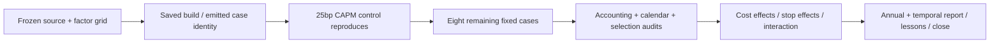

# CAPM cost × per-stock-stop ablation

This requested O10–O12 slice follows the [completed CAPM comparison](2026-10-26-capm-spy-comparison.md)
and [master checklist](2026-10-26-quantconnect-research-master-plan.md). The
[frozen protocol](../../research/plans/capm-ablation-v1.json) owns the nine-case
experiment; it does not change portfolio priorities or reopen prior budgets.

## Frozen scope and progress

- [x] Preserve and audit the previous CAPM/SPY evidence and closed budgets.
- [x] Freeze nine fresh cases: three explicit-cost levels × CAPM stop on/off,
  plus three matching entry-only SPY controls.
- [x] Keep 2016–2025, USD 300,000, minute execution, 29 fixed legacy stock
  candidates plus subscribed SPY, source ranking/alpha/portfolio/execution rules,
  1% cash-buffer setting and prior-close 6% debit ACT/360 financing unchanged.
- [x] Reserve a new 90-minute, 11-attempt maximum with two technical-only retries.
- [x] Verify saved build/start identity and repeat the prior 25bp CAPM control.
- [x] Run the remaining eight cases within the coordinator budget.
- [x] Audit native accounting/fees, calendars, monthly selection hashes and both
  prior-control reproductions; preserve every failure.
- [x] Compare full/annual return, drawdown, Sharpe, Calmar and underwater metrics,
  plus exposure, cash periods, turnover and explicit cost/stop interactions.
- [x] Verify the browser report; update the master checklist and lessons; close budget.

| Cost setting | CAPM, 1% stock stop | CAPM, no stock stop | SPY, no stock stop |
| --- | --- | --- | --- |
| No commissions or added slippage | c0_on | c0_off | s0 |
| Native IB commissions; no added slippage | cf_on | cf_off | sf |
| Native IB commissions + 25bp added slippage | c25_on | c25_off | s25 |

Native bid/ask fills remain at every level. “No explicit costs” is not a frictionless
market. No other slippage value, stop threshold, ranking, universe or allocation
rule will be searched. Native minimum-order behavior and normalization defaults
are retained. The no-stop treatment uses the documented
[Null Risk model](https://www.quantconnect.com/docs/v2/writing-algorithms/algorithm-framework/risk-management/supported-models#02-Null-Model),
and the zero-commission treatment uses the supported
[ConstantFeeModel(0)](https://github.com/QuantConnect/Lean/blob/22404ea28b8d3f3c9eb74d6ed9f0444426f8e417/Common/Orders/Fees/ConstantFeeModel.cs).

## Interpretation and evidence gates

Primary diagnostics are full-period CAGR contrasts, stop-on minus stop-off at
fixed costs, fees minus no explicit costs, added slippage minus fees-only, and
cost × stop interaction. Show annual contrasts and the same drawdown, Sharpe,
Calmar and underwater measures alongside exposure/turnover. Lower drawdown or
fewer fills alone does not establish dominance.

These are total effects of changing a closed-loop policy. Costs can change share
counts, entry cost, risk triggers and later trades, so this is not a subtraction
of fees from an identical trade tape. Monthly source selections are passively
hashed and must match across all six CAPM cases; SPY controls use the same cost
level. The high-cost CAPM and SPY cases must reproduce all 11 prior metric records.

All runs use previously viewed development history and free hosted data. Raw bars,
dense NAV/return paths and corporate-action rows stay hosted. Only own aggregate
metrics/counts/hashes are exported. Native-book reconciliation is not independent
cash/action replay or vendor-data verification. No untouched OOS, real-time trading,
source-tutorial equivalence or investment promotion follows from this study.

## Execution log

A separate project, 38512092, was created. The free organization permits one coding
session; the completed prior study's idle coding environment was stopped to release
that slot. Its saved source, completed backtests and local frozen evidence remain
preserved. No paid resource or broker operation was requested.

Attempt 1 stopped in the first scheduled universe callback before any closing
marks. Its runtime status, source and original protocol are preserved under
`.local/capm-ablation-v1/superseded/attempt1/`; it counts against the 11 attempts.
The end handler's “No closing marks” error masked the initiating error. The audit
instrumentation used custom Python attributes through a native algorithm callback
proxy. A technical-only amendment moved those passive counters/hashes to module
scope; strategy, cost factors, deadline and budget are unchanged. This is a
diagnosis pending control reproduction, not established financial evidence.
The separate proxy-boundary regression test passes locally; attempt 2 is the
first of the two allowed technical retries.

Attempt 2 passed: all 11 annual/full metric records exactly match the earlier
CAPM control; native book/fees and closing marks reconcile. The passive audit
reports 120 monthly selections, mean closing gross 0.8435603436 and 257 cash-only
closes. The initiating proxy failure remains inferred, but moving passive state
resolved the observed failure without changing performance. The remaining eight
cases are now eligible to run.

## Completed result and decision

All nine fresh cases qualified in ten attempts, including the preserved first
instrumentation failure. The separate budget is closed within its original
90-minute deadline; one retry slot was unused. Both 25bp controls reproduce all
11 prior full/annual metric records exactly. All cases have the same 2,514 closing
sessions; all six CAPM cases share the same 120-decision selection hash. Native
lifetime book, event-fee and last-mark residuals are USD 0 at the exported precision,
with no rejected/canceled or pending orders. Financing charges are USD 0 in every
case, so this experiment does not identify a financing effect.

Open the [comparison dashboard](http://127.0.0.1:8765/capm-ablation-v1/index.html).
It contains all 90 annual rows, seven annual chart metrics, full/annual factor
contrasts, matched SPY comparisons and exposure/execution diagnostics. The
[redacted receipt](evidence/2026-10-26-capm-cost-stop-ablation.json) links aggregate
provenance; the private manifest preserves source, attempts, checksummed packets,
reloaded-editor verification, browser checks and the superseded failure.

Drawdown below is a positive loss depth; the browser uses signed negative values.
Sharpe uses zero risk-free return. Full Calmar uses calendar-day CAGR; annual Calmar
uses annual total return. Underwater calendar days and terminal censoring are shown
in the dashboard; every full-period path ends in an open latest drawdown, which
need not be its longest episode.

| Case | CAGR | Max DD | Sharpe | Calmar | Underwater sessions % | Longest sessions | Calendar days | Fills |
| --- | --- | --- | --- | --- | --- | --- | --- | --- |
| c0_on | 7.74% | 36.54% | 0.484 | 0.212 | 93.20% | 730 | 1063 | 7510 |
| c0_off | 10.87% | 42.10% | 0.583 | 0.258 | 91.81% | 716 | 1043 | 3788 |
| cf_on | 6.03% | 37.17% | 0.400 | 0.162 | 94.27% | 945 | 1378 | 7541 |
| cf_off | 10.66% | 42.13% | 0.575 | 0.253 | 91.89% | 716 | 1043 | 3824 |
| c25_on | -51.08% | 99.92% | -3.470 | -0.511 | 100.00% | 2514 | 3653 | 7995 |
| c25_off | 6.18% | 42.76% | 0.384 | 0.145 | 94.43% | 1121 | 1630 | 3862 |
| s0 | 14.82% | 33.53% | 0.864 | 0.442 | 84.21% | 488 | 708 | 1 |
| sf | 14.82% | 33.53% | 0.864 | 0.442 | 84.21% | 488 | 708 | 1 |
| s25 | 14.82% | 33.57% | 0.863 | 0.441 | 84.21% | 488 | 708 | 1 |

## Cost and stop contrasts

CAGR differences are annualized percentage points, not additive dollar loss
attribution. The frozen factors change complete trading policies; quantities,
entry bases and later trades can change even with identical monthly selections.

| Contrast | CAGR difference, pp |
| --- | --- |
| Stop on minus off, zero | -3.12 |
| Stop on minus off, fees | -4.63 |
| Stop on minus off, stress | -57.26 |
| Fees minus no explicit costs, stop on | -1.71 |
| 25bp stress minus fees, stop on | -57.11 |
| Fees minus no explicit costs, stop off | -0.20 |
| 25bp stress minus fees, stop off | -4.48 |
| Total cost × stop interaction | -54.13 |

With commissions only, the stop reduces full DD from 42.13% to 37.17%, while CAGR
falls 10.66%→6.03%, Calmar falls 0.253→0.162 and longest underwater rises
716→945 sessions (1,043→1,378 calendar days). The stop has higher annual return
in only 2017 and deeper annual DD in six of ten years. In 2022, stop-on returns
−24.35% with 32.11% annual DD versus −20.27% and 26.75% without it. Thus the
full-period DD improvement does not establish consistent annual crash protection.

At no explicit costs, stop-on produces 7,510 fills and USD 763.64m notional versus
3,788 fills and USD 91.08m without it. With commissions, the corresponding fees
are USD 42,872.91 versus USD 9,357.01. These aggregates support a turnover/cost
interaction diagnosis; they do not classify every exit or independently replay
stop/re-entry events. The 25bp level is a stress assumption, not measured execution.

All six CAPM variants have lower CAGR, Sharpe and Calmar, deeper closing DD and
longer maximum underwater duration than their matching SPY control. The strongest
CAPM CAGR here is 10.87% with no explicit costs and no stop, versus SPY 14.82%.
None of the CAPM variants satisfies the approximate 30% continuous closing-DD
reassessment tolerance. SPY itself exceeds that tolerance too. Retain this fixed
CAPM alternative as a negative development baseline; no promotion, threshold search
or new financial run follows. This does not reject all CAPM ideas or other tutorial
implementations.

## Verification and remaining limits

- Implemented and verified: nine-case aggregate report, 90 annual rows, all four
  cost filters, seven chart metrics and 11 contrast periods; rendered cells/points
  match the saved aggregate evidence. Both prior controls exactly reproduce.
- Offline checks: 355 tests, documentation and dependency checks passed. Final
  manifest verification is read-only and includes the closed attempt ledger.
- Unverified: independent cash/action/vendor replay, event-level causal loss
  attribution, exposure-matched timing alpha, unseen/forward advantage, live fills
  and exact hosted tutorial equivalence. Native minimum-order warnings remain part
  of the unchanged model; a complete ignored-target count was not captured.
- Preserved: original research budgets, first failed ablation, initial source and
  protocol, technical-only amendment and every completed aggregate output. No paid
  resource, broker operation, real order, service start, commit or publication.

The [master checklist](2026-10-26-quantconnect-research-master-plan.md) and
[lessons L25–L28](2026-10-26-research-lessons.md#capm-cost-and-stock-stop-ablation-follow-up)
record this O10–O12 slice; catalog-wide objectives and portfolio priorities remain
with their canonical owners.
