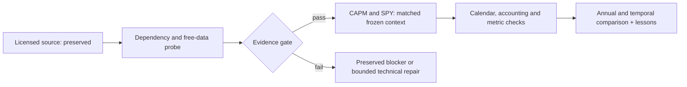

# CAPM framework alternative: dependency gate and bounded SPY comparison

This receipt implements a requested slice of O06–O10 in the
[master checklist](2026-10-26-quantconnect-research-master-plan.md), without changing
portfolio priorities. The [frozen protocol](../../research/plans/capm-spy-v1.json)
owns the test contract; the [licensed package receipt](2026-10-26-quantconnect-tutorial-packages.md)
retains original export and rights evidence.

**Current outcome:** completed. The free hosted runtime/data checkpoint passed,
and both financial cases now pass the declared aggregate/native-accounting checks.
The accounting-only CAPM retest exactly reproduced all eleven original metric
records. CAPM underperformed SPY in every calendar year under the frozen model.
See the [completed browser report](http://127.0.0.1:8765/capm-spy-v1/index.html).

## Scope and checklist

- [x] Identify the Apache-2.0 official LEAN framework alternative and preserve its source.
- [x] Inspect dependencies: LEAN AlgorithmImports/framework models, NumPy and pandas;
  minute/daily US equity prices, mapping/corporate actions; no fundamental or paid
  alternative-data calls in the source.
- [x] Freeze 2016–2025, USD 300,000, native IB fees, 25bp slippage, 1% cash buffer,
  6% debit ACT/360 financing and five-attempt/90-minute aggregate budget before runs.
- [x] Verify actual hosted dependencies and free daily/minute histories without orders.
- [x] Run the source-informed CAPM case and entry-only SPY baseline; qualification differs.
- [x] Reconcile closing calendars, costs, native accounting and aggregate metrics.
- [x] Compare annual/full return, drawdown, Sharpe, Calmar and time underwater; retest qualified both cases.
- [x] Save all failures, render the browser report, record lessons and update O06–O10.

## Interpretation boundaries

This example uses 29 fixed legacy symbols and ranks the intercept of a regression
of market returns on stock returns. It is not standard stock-on-market CAPM and
is not the exact implementation of the hosted tutorial. Its 1% drawdown rule is a
per-security stop, not a portfolio loss guarantee. No ranking or risk threshold
optimization is authorized. Already-viewed history is development evidence.

[US equity prices](https://www.quantconnect.com/data/algoseek-us-equities) and the
[security master](https://www.quantconnect.com/data/quantconnect-us-equity-security-master)
are advertised for free cloud use. This provider claim is separate from actual
account access, runtime compatibility and causal history qualification, which the
probe must establish. Raw bars and dense benchmark paths stay hosted; only own
aggregate metrics, counts and identity hashes are saved locally.

## Execution evidence

Study frozen at 2026-10-27 03:50:59 UTC, deadline 05:20:59 UTC. Dedicated project
38510582 was created in the existing free organization; engine selected by the
UI is master v18209. No old project code was replaced. Actual probe and financial
receipts will be appended after they are observed; these checks are not yet passed.

At 03:57 UTC, attempt 2 completed on the free server with NumPy 1.26.4 and pandas
2.3.3. All four source framework models constructed. All 29 original symbols had
aligned 21-bar daily histories and minute history at each of ten annual checkpoints;
no fills, invalid orders or future checkpoint bars were observed. The original
rate-of-change/rolling-window and regression executed. These are sampled access
checks, not independent reconstruction of every historical mapping or monthly
feature window. Attempt 1 completed but its result-panel controls were inaccessible;
its source and status are preserved. A technical-only debug-output amendment used
one of two repair slots, without changing rules, dates or costs.

Static framework review also found that the explicitly subscribed SPY benchmark
is eligible for ConstantAlpha insights; the strategy should not be described as
necessarily holding only two stocks. This follows the inspected framework source,
not a verified per-symbol attribution report. The common minute SPY clock can
change benchmark price/insight timing relative to the original daily subscription.
Dates, capital, costs, funding and that clock are explicit adaptations; the source
ranking and framework configuration remain fixed. See the pinned
[ConstantAlpha model](https://github.com/QuantConnect/Lean/blob/22404ea28b8d3f3c9eb74d6ed9f0444426f8e417/Algorithm.Framework/Alphas/ConstantAlphaModel.cs).

Attempt 3 (CAPM) completed with no invalid/canceled or pending orders, but the
initial active-holdings P&L check failed by USD 200,710.78. The public engine
implementation distinguishes active `Portfolio.Values` from lifetime
`Portfolio.TotalNetProfit`, which includes removed securities. A technical
amendment now uses the lifetime total plus current-mark unrealized P&L, checks
fill-event fees against lifetime native fees, and retains the failed active-only
residual. SPY and the one CAPM retest will use this same instrumented source.
No signal, cost, timing or threshold changes are permitted; the repaired CAPM
metrics must reproduce attempt3. All attempts count toward the original five.

## Historical five-attempt checkpoint: provisional comparison

SPY attempt4 passed aggregate integrity, calendar, native-book and event/native
fee checks. At USD 300,000 its 2016–2025 observed CAGR is 14.8154%, closing
maximum drawdown 33.5736%, Sharpe 0.8626, Calmar 0.4413, underwater 84.2084%
and longest underwater 488 sessions/708 calendar days.

CAPM attempt3 observed CAGR −51.0788%, drawdown99.9216%, Sharpe −3.4700,
Calmar −0.5112 and 2,514 underwater sessions, with 7,995 fills andUSD 15,015.985
in fees. **These remain provisional because its accounting cross-check failed.**
Do not promote or rank it as a qualified strategy. There was no cost/risk-rule
ablation, so exact causal attribution of the losses is not established.

Attempt5 was reserved for repaired CAPM, but actual run b187c769a7aaa7b6e48c4038e312ea02
emitted the SPY identity and reproduced the SPY output. Clipboard verification
proved the editor contained CAPM; it did not prove which saved cloud build ran.
The attempt is counted as a technical identity failure and preserved, not relabeled
as a CAPM retest or silently removed. The five-attempt budget was closed at
04:10:35 UTC. One additional, accounting-only rerun was requested explicitly; no
new financial run is authorized until that answer arrives. The desired repair
source is prepared, and server-save/build verification is being checked without
a new simulation.

[Browser comparison, subsequently completed below](http://127.0.0.1:8765/capm-spy-v1/index.html)
contains all ten annual tables, selectable charts, source identities and audit limits.
The original source exports and earlier catalog evidence remain unchanged.

## Explicitly approved accounting retest

At04:13UTC the user approved exactly one further CAPM rerun. The original
five-attempt ledger remains closed. The [separate extension protocol](../../research/plans/capm-spy-v1.accounting-retest.json)
allows one launch, no further technical retries and a 20-minute deadline. The
prepared source f69732f6… was verified after a project reload and explicit cloud
build 00abe7-ba07f2 before launch. Actual job 00949bff1a18a203083dcbc32281d9c6
launched on LEAN 2.5.0.0.18209. Its result, not editor content alone, must identify
CAPM and pass the repaired checks. No rule, date, cost or financing changes were made.

## Completed extension and results

Job 00949bff1a18a203083dcbc32281d9c6 completed in 121.31 seconds. It emitted the
CAPM identity, with 9,716,712 processed data points. The repaired lifetime native
book residual, event-versus-native fee residual and final closing-mark residual
are allUSD 0.00. All eleven full/annual metric dictionaries exactly equal the
original attempt3, so the accounting repair did not improve the investment result.
The one-attempt extension closed at04:16:15UTC; no further trials are authorized.

| Metric,2016–2025 | CAPM framework alternative | SPY buy and hold |
| --- | ---: | ---: |
| CAGR | −51.08% | 14.82% |
| Total return | −99.92% | 298.18% |
| Ending modeled NAV,USD | 235.32 | 1,194,553.75 |
| Closing maximum drawdown | 99.92% | 33.57% |
| Zero-RF daily Sharpe | −3.47 | 0.86 |
| Full-period Calmar | −0.51 | 0.44 |
| Underwater fraction | 100.00% | 84.21% |
| Longest underwater,sessions | 2,514 | 488 |
| Longest underwater,calendar days | 3,653 | 708 |
| Terminal drawdown unrecovered | Yes | Yes |
| Fills | 7,995 | 1 |
| Fees,USD | 15,015.985 | 8.81 |
| Financing,USD | 0 | 0 |

Both cases have the same 2,514 closing dates and calendar hash. CAPM's aggregate
fill notional isUSD 140,260,517.82; 2,331 fills involved SPY, confirming the explicitly
subscribed benchmark participated in the framework rather than remaining merely
a comparison series. Thirty distinct security IDs were traded; this aggregate output does not identify
every traded ID or independently reconstruct corporate-action identity chains. Closing gross exposure never exceeded 0.9949x for CAPM or 0.9981x for SPY;
no financing charges accrued under the prior-close debit model. Intraday peak
exposure was not logged. No invalid/canceled or pending
orders were observed. Full ten-year annual return,DD,Sharpe,Calmar and underwater
summaries are in the browser and its aggregate JSON; these are not native-QC
headline Sharpe values with another risk-free convention.

**Decision:** stop this fixed CAPM alternative as a default improvement in this
25bp cost scenario. Behavior under other costs remains untested.
The result is far outside the roughly 30% drawdown reassessment tolerance. Retain
it as a useful source/framework/cost fixture. Repeated exits/re-entry and turnover
are plausible mechanisms to investigate, not isolated causal explanations: no
risk-stop ablation, cost sensitivity study or same-universe passive control was
run. No extra simulation is implied by that proposal.

## Lessons and reproducibility

The [lesson registry](2026-10-26-research-lessons.md) links the source-identity,
portfolio-stop, lifetime-accounting and cloud-build lessons. The control also
reconfirms that high long-term growth can coexist with lengthy underwater periods.
The source alternative is not the exact hosted tutorial, and changing its dates,
capital, common minute SPY clock, fees/slippage/funding constitutes a declared
adaptation. Default native normalization/corporate-action treatment was retained,
not independently replayed. Vendor data vintage/hashes and complete historical
mapping chains are not exported or independently frozen. No untouched OOS,
independent alpha, source-publication performance reproduction or broker readiness
is established.

Artifacts are in`.local/capm-spy-v1/` and`.local/performance/capm-spy-v1/`.
The original five-attempt ledger, one explicitly authorized extension, failed
sources/output packets and stale-SPY identity failure all remain preserved.
`scripts/build_capm_review.py` rebuilds only from those saved aggregates;
`scripts/audit_capm_review.py` checks artifact hashes, separate budget closure,
source identity and declared metric/native-book eligibility without simulations.
The unchanged licensed upstream fixture and its license are under
`research/quantconnect/sources/`, so source-integrity tests do not depend on ignored
local export paths. The generator changes no installed NautilusTrader/MLflow code.

Workspace branch`codex/rsi-gate-robustness`, HEAD
`4999ec5767eccdd6f61863b14a05e459855f95e3`; unrelated dirty work was preserved.
This SHA does not identify uncommitted source changes; the report manifest hashes
the actual declared source/processing/evidence files. Final offline/browser checks
are recorded in the accompanying evidence receipt.

A native minimum-order warning was observed in the initial CAPM terminal: a
single-share rebalance recommendation could be ignored to limit fees. Such
ignored recommendations are not invalid order rejections; their complete count
was not instrumented. The source's native minimum-order policy was retained.
This is another execution detail to inspect before any further strategy change.

Final verification: `make check` exited0 with117 documentation files checked,
no broken requirements and350 passing offline tests. Five new evidence/temporal
regression tests cover source-rule preservation, missing/corrupt/wrong-identity
packets, failed accounting and annual versus continuous underwater behavior.
All six browser metric views showed20 annual rows and20 bars with both case audit
labels passed. The read-only manifest/budget auditor passed; neither check proves
an independent vendor-data or cash/action reconstruction. An initial pytest
invocation found no installed pytest; verification used the repository's existing
unittest runner without dependency installation. The [machine-readable receipt](evidence/2026-10-26-capm-spy-comparison.json)
records the final context and artifact paths.
