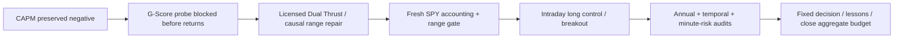

# Causal Dual Thrust SPY comparison

This is the feasible licensed fallback within the user's request to retain CAPM
as a negative baseline and test the next checklist strategy. The
[G-Score readiness attempt](2026-10-26-gscore-spy-comparison.md) closed after one
failed, order-free probe. Its current data API retired quarterly ROA, while the
[official migration notice](https://www.quantconnect.com/forum/discussion/21449)
identifies look-ahead ratio dating in the legacy feed and its October 31 retirement.
No legacy financial run was launched, no quarterly-to-annual substitution was made,
and no G-Score return was observed. CAPM's 77-file manifest still passes unchanged.

The [frozen fallback plan](../../research/plans/dual-thrust-spy-v1.json) preserves
**the same overall six-attempt ceiling and original 90-minute deadline**. One slot
was used by G-Score; this fallback has three fresh financial cases plus at most
two technical retries. No results-based candidate or parameter search is allowed.
The [master checklist](2026-10-26-quantconnect-research-master-plan.md) retains initiative authority.

## Source and causal adaptation

Selected QC-T-15258 / `dual-thrust-fx`, one of the four previously licensed bundles.
The [pinned Apache-2.0 source](https://github.com/je-suis-tm/quant-trading/blob/611b73f2c3f577ac5b28aaa19ac8c43d3236c7a5/Dual%20Thrust%20backtest.py)
and repository license are preserved unchanged in `research/quantconnect/sources/`.
The original is a GBPUSD signal/plot example, not a complete cost-aware portfolio.
Its `min2day` range includes the current session's eventual high/low/close, and
`signal_generation` uses that range at the open: an inadmissible forward dependency.
The original script and its `os.chdir('D:/')` are never imported or executed.

This test is explicitly a **causal SPY regular-session adaptation**. Retain the
example's five-session range and 0.5 multiplier, using only five fully completed
prior sessions. The opening reference is the first observed minute's open. A
completed-minute close above/below the bands targets +98%/−98%, executed on the
next minute; the interior band retains direction. Liquidate five minutes before
the actual close, including early closes. No stop/threshold optimization or claim
of original FX/tick/tutorial-four-day equivalence follows.

## Checklist and frozen context

- [x] Preserve source/license and document the current-session look-ahead repair.
- [x] Freeze one candidate and two controls before financial outcomes, under the
  original aggregate budget/deadline; CAPM and G-Score budgets stay closed.
- [x] Verify range arithmetic, prior-session boundary, next-minute decision order,
  state safety and packet checks offline.
- [x] Pass the fresh SPY native-accounting/calendar/range-readiness gate.
- [x] Run SPY hold, daily intraday long holding and the causal long/short breakout.
- [x] Audit all 30 annual rows, native book/fees/borrow, source identity and equal
  calendar/range hashes; no invalid/pending orders or overnight intraday holdings.
- [x] Verify the browser, update checklist/lessons and close the aggregate budget.

All cases use 2016–2025, USD 300,000, 98% targets, native IB fees plus fixed5bp
slippage, native spread/fill/normalization defaults and prior-close6% ACT/360 debit
financing with zero credit. Short borrow is a fixed3% ACT/365 charge on previous-
minute short notional and elapsed seconds. Historical SPY shortability/locates
are assumed, not independently verified. The model forbids overnight short
positions; no short dividend or overnight borrow exposure is silently omitted.
Costs are assumptions, not measured fills/capacity. Only the pre-2016 data seed
runs before the financial window; no pre-2016 orders or NAV are included.

Controls are one98% SPY purchase at the next minute after the first2016bar, and
98% long each session from the same opening delay until five minutes before close.
The latter diagnoses the effect of avoiding overnight exposure; actual average
exposure can differ. Existing free hosted SPY access was qualified by prior probes.
Every case additionally requires 2,514 ready five-prior-session windows.

Report full/annual closing return/DD/Sharpe/Calmar and underwater metrics under
existing definitions, with full minute-mark DD and mean/max minute gross exposure.
Closing gross is zero for the intraday cases and cannot describe their actual
intraday risk. The raw minute path stays hosted; only aggregates/counts/hashes are
exported. Native reconciliation does not establish independent action/vendor replay.

Primary estimand is breakout net CAGR excess over SPY. Retain for further validation
only if CAGR beats SPY and the intraday control, Calmar is at least SPY, and longest
underwater is no worse than SPY. Otherwise do not call it an improvement or retune
on viewed history. The30% reassessment reference remains material. No untouched OOS,
trained RL advantage, broker operation, paid resource or deployment follows.

## Preserved observation failure and technical retry

The first intraday control completed with zero book/fee/mark residuals, but its
fee-model set was empty: the inherited audit observed holdings only at the close,
when this case is flat. Preserve attempt 2 and its source/plan/aggregates under
`.local/dual-thrust-spy-v1/superseded/attempt2/`. Amendment 1 adds passive model
observation at filled/partially-filled events for the two intraday cases. SPY's
generated source stays byte-identical. The permitted technical rerun confirms
`InteractiveBrokersFeeModel` and reproduces all 11 prior metric records exactly.
No trading rule, threshold, price, cost or financial timing changes.

## Completed comparison and decision

**Completed and scoped-audit qualified; improvement screen failed.**
[Browser comparison](http://127.0.0.1:8765/dual-thrust-spy-v1/index.html) ·
[redacted evidence](evidence/2026-10-26-dual-thrust-spy-comparison.json).

| Case | CAGR | Closing max DD | Sharpe | Calmar | Time underwater | Longest sessions / calendar days |
| --- | ---: | ---: | ---: | ---: | ---: | ---: |
| Causal Dual Thrust | −3.80% | 34.06% | −1.03 | −0.11 | 99.16% | 2,493 / 3,620 |
| SPY intraday long | −19.80% | 88.99% | −1.70 | −0.22 | 99.96% | 2,513 / 3,649 |
| SPY hold | 14.65% | 33.16% | 0.86 | 0.44 | 84.21% | 488 / 708 |

USD300,000 ends at203,572.35 for Dual Thrust,33,026.79 for intraday long and
1,177,497.34 for SPY. All three end below earlier peaks. Dual Thrust beats the
intraday control by15.99CAGR points but trails SPY by18.45points. It fails the
frozen CAGR/Calmar/longest-underwater conditions against SPY and exceeds the30%
reassessment reference. Preserve it as negative evidence; no threshold retuning
or deployment follows. This does not reject every opening-breakout/FX strategy.

Dual Thrust is profitable in only2022(+7.22%) and beats SPY annual return in2018
and2022, two of ten years. Its annual reset DD is at most10.43%, yet continuous
closing DD is34.06%: a sequence of smaller losses accumulates across years.
Minute-mark DD is34.76%, mean gross8.25% and peak gross1.0168x despite98% targets.
It has27,763long and55,302short minutes,929fills,USD3,714.65commissions,
USD729.93modeled borrow and zero debit financing. Zero closing gross is an
inadequate exposure diagnostic. Short-side responsibility, cost-free expectancy
and isolated slippage effects remain untested; no causal P&L claim is inferred
from these aggregate counts.

All cases have2,514closes,2,514ready prior-five-session ranges and976,680minute
observations, with identical calendar/range hashes. Native book/fee/mark residuals
are zero to emitted precision, no rejected/pending orders, actual native IB model
confirmed and no intraday position survives a close. This supports scoped
accounting consistency, not independent cash/dividend/split replay or historical
locate validation. Original source/license, archived failure, pre-amendment plan
and all raw aggregate packets remain preserved. Dense prices/NAV stay hosted.

The aggregate budget closed at **5/6 attempts**: one blocked G-Score input probe,
three qualified financial cases and one preserved metadata-observation path.
All reservations preceded the original07:00:45UTCdeadline; the last completed
case was recorded05:52:51UTC. No budget extension, paid data, new service,
additional strategy grid, MLflow import, broker operations, commits or publication.

## Validation and limitations

- Offline `make check`:364tests pass; dependencies pass; documentation checks pass.
- Read-only report audit:43files, three qualified cases,30annual rows, five
  aggregate attempts; exact source/build/case tokens and all11intraday retry
  records verified. CAPM's original77-file audit still passes unchanged.
- Browser: all cells across four tables match saved aggregates; seven selectors
  each render30matching chart points. Final screenshot saved in the local report.
- Viewed2016–2025development data, assumed native fills/spreads/capacity and fixed
  financing/borrow. No untouched validation, trained RL advantage, independent
  alpha or guaranteed30%loss limit established.

[Lessons L29–L32](2026-10-26-research-lessons.md#licensed-candidate-readiness-and-causal-adaptation-follow-up)
record the resulting research decisions. The broader master checklist stays partial.
