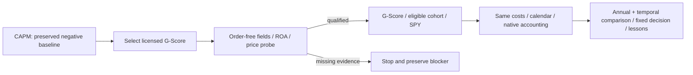

# Licensed G-Score comparison

The user requested retaining CAPM as a negative baseline and testing the next
promising licensed checklist candidate with free data. This receipt owns that
bounded slice; the [master checklist](2026-10-26-quantconnect-research-master-plan.md)
owns initiative status. The [frozen plan](../../research/plans/gscore-spy-v1.json)
owns cases, assumptions, decision rule and the six-attempt/90-minute limit.

## Selection and source boundary

Selected **QC-T-15267 / g-score-legacy**, one of the four previously exported
licensed files. It introduces fundamental profitability/quality and investment
information beyond the CAPM price-ranking mechanism. The pairs source has
future-aware sizing; Dual Thrust lacks a complete portfolio/execution contract.
G-Score has a complete single-file mechanism and a documented free-cloud
fundamental route. This is a readiness/economic-diversity choice, not a performance
ranking or assurance that it will improve returns.

The [pinned file](https://github.com/santoshlite/StrategyLibraryQC/blob/6b406477afce2a12724dbf1031a99fbc1e1fee4d/G-Score%20Investing.py)
has an explicit QuantConnect Apache-2.0 header; the grant applies to that file,
not the repository's neighbors. The unchanged original and accompanying license
are preserved under `research/quantconnect/sources/`. The
[official method](https://www.quantconnect.com/research/15267/g-score-investing/)
describes seven factors and a score threshold of five. Actual source math uses
market-cap-normalized R&D, CapEx and SG&A (an advertising proxy), the bottom
book-to-market quartile, and quarter-snapshot ROA histories. Zero/missing-field
filters and negative book values are retained; no new universe/liquidity cap is
silently introduced.

This is a **declared adaptation**, not an exact legacy framework reproduction.
It retains the source score/ranking code, builds ROA state causally during
2013–2015 and eliminates ObjectStore/pickle reads and writes. Annual target
rebalances with staged native minute execution replace the legacy constant-alpha,
equal-weight and immediate-execution framework, whose insight events may create
additional rebalances. The original source is never imported as an executable
local strategy. No NautilusTrader or MLflow dependency is modified.

## Frozen execution and checklist

- [x] Preserve CAPM's closed budgets, source/results and manifest as a negative baseline.
- [x] Inspect grant, exact source, dependencies, seven-factor math and state hazards.
- [x] Freeze one order-free probe, three financial cases and two technical-only
  retry slots, with a new 90-minute deadline. No parameter or cost grid.
- [x] Test source math preservation, a hand-built stock-selection example, state
  boundaries and packet integrity offline.
- [ ] Pass the free hosted data/dependency gate before financial execution.
- [ ] Run G-Score, the same eligible technology cohort without the score threshold,
  and entry-only SPY; 2016–2025, USD 300,000, 98% target gross, native IB fees plus
  fixed 5bp slippage, prior-close 6% ACT/360 debit financing, zero cash credit.
- [ ] Check accounting, calendars, source identity and probe/financial selection parity.
- [ ] Compare full/annual return, DD, Sharpe, Calmar, underwater fraction/duration,
  exposure, fills and costs; verify browser output and preserve failures.
- [ ] Update checklist/lessons and close this budget with no automatic next trial.

Primary estimand is full net CAGR excess over SPY. The predeclared retain-for-further-
validation screen additionally requires Calmar at least SPY, no longer maximum
underwater period and higher CAGR than the eligible-cohort control. Failure does
not justify retuning the threshold. Drawdown above the approximately 30%
reassessment reference remains material; no live promotion follows any result.

The [Morningstar documentation](https://www.quantconnect.com/data/morning-star-us-fundamentals)
describes original-reported figures, filing-date availability and an approximate
45-day delay for older records without filing dates. Native as-of delivery is not
an independent filing/publication or vendor-data audit. Twelve quarterly snapshots
are not necessarily twelve distinct filings, and the source can score a newer
stock without awarding its variance point. Raw fundamentals/bars and dense NAV
remain hosted; only own aggregates/counts/hashes leave the service. This viewed
history cannot supply untouched OOS evidence or a trained RL advantage.

## Execution log

A separate free project, 38513705, was created. The completed CAPM project's idle
coding environment was stopped to release the single free coding slot; saved
sources and completed results remain preserved. No paid resource, broker operation,
service start, dependency installation, commit or publication is authorized.

## Closed readiness outcome

Attempt 1 (`107aec083d70ba3a0ab88a8401d64c9d`) failed on current engine18209 at
`ROA.ThreeMonths`: the property was retired by Morningstar. Its status, saved build,
source and original protocol are preserved. The UI offers legacy engine18184;
this was considered in a technical amendment but **never selected or launched**.
The [provider migration notice](https://www.quantconnect.com/forum/discussion/21449)
then established that some legacy ratio dates preceded filings and that this feed
retires October31,2026. Restoring the old API would not establish causal inputs.
The study is **blocked by input semantics**, with one failed probe, zero financial
cases and a closed budget. Its prepared financial code is unverified, not a result.

The [licensed Dual Thrust fallback](2026-10-26-dual-thrust-spy-comparison.md)
proceeds under the same aggregate six-attempt ceiling and original deadline.
It does not reuse G-Score results or silently carry an unrestricted budget.

The [redacted readiness receipt](evidence/2026-10-26-gscore-spy-comparison.json) records the closed probe and zero financial cases.
